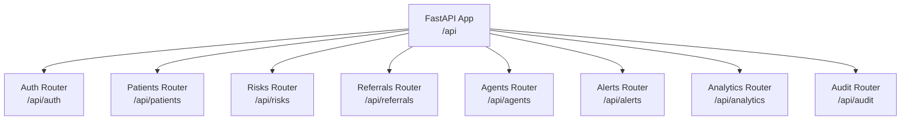
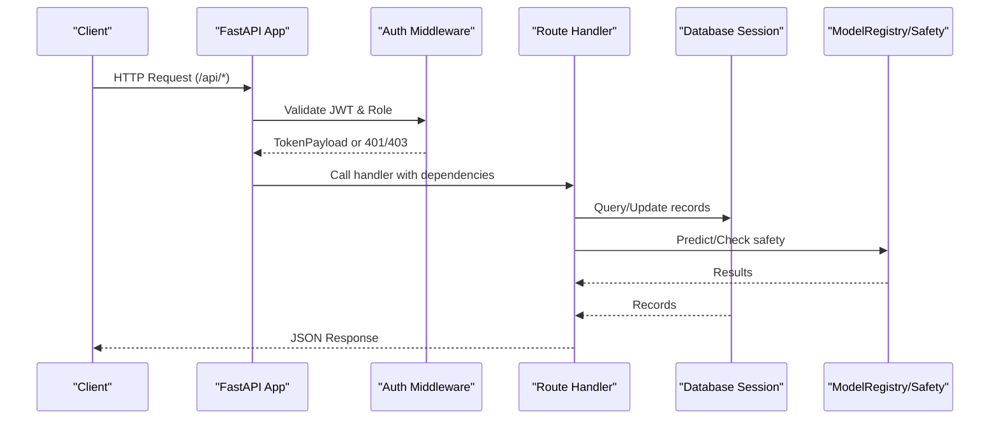
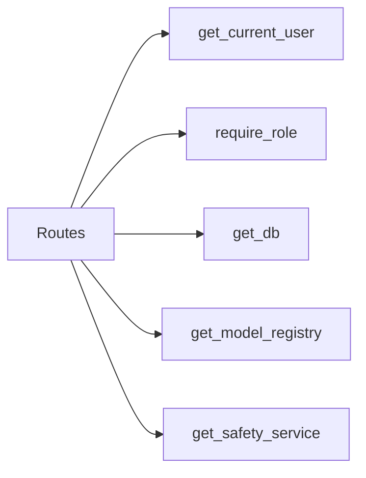

# API Reference

<cite>
**Referenced Files in This Document**
- [main.py](file://backend/api/main.py)
- [auth.py](file://backend/api/auth.py)
- [deps.py](file://backend/api/deps.py)
- [patients.py](file://backend/api/routes/patients.py)
- [risks.py](file://backend/api/routes/risks.py)
- [referrals.py](file://backend/api/routes/referrals.py)
- [agents.py](file://backend/api/routes/agents.py)
- [alerts.py](file://backend/api/routes/alerts.py)
- [analytics.py](file://backend/api/routes/analytics.py)
- [audit.py](file://backend/api/routes/audit.py)
- [auth.py](file://backend/schemas/auth.py)
- [patient.py](file://backend/schemas/patient.py)
- [referral.py](file://backend/schemas/referral.py)
- [risk.py](file://backend/schemas/risk.py)
- [config.py](file://backend/config.py)
</cite>

## Table of Contents
1. Introduction
2. Project Structure
3. Core Components
4. Architecture Overview
5. Detailed Component Analysis
6. Dependency Analysis
7. Performance Considerations
8. Troubleshooting Guide
9. Conclusion
10. Appendices

## Introduction
This document provides comprehensive API documentation for the MaaHifazat AI RESTful API. It covers authentication, patient management, risk assessment, referral system, agent orchestration, alerts, analytics, and audit endpoints. Each endpoint specifies HTTP methods, URL patterns, required headers, query parameters, request/response schemas (based on Pydantic models), status codes, error responses, and practical usage guidance. The OpenAPI specification is available at /api/openapi.json and the interactive Swagger UI at /api/docs.

## Project Structure
The FastAPI application is defined in the backend module:
- Application entry point and routers are mounted under /api.
- Authentication uses JWT with role-based access control.
- Schemas define request/response contracts using Pydantic.
- Routes implement business logic and integrate with repositories and services.

**Diagram sources**
- [main.py:52-64](file://backend/api/main.py#L52-L64)
- [main.py:122-134](file://backend/api/main.py#L122-L134)

**Section sources**
- [main.py:1-135](file://backend/api/main.py#L1-L135)

## Core Components
- Authentication: JWT-based login and protected routes with roles (patient, lhw, clinician, admin).
- Patient Management: CRUD operations for patients with validation via Pydantic schemas.
- Risk Assessment: Quick inference endpoints that call ML models and safety rules, persist results.
- Referrals: Create, list, retrieve, and update referrals with filters and pagination.
- Agent Orchestration: Run full workflow or invoke individual nodes; requires clinician/admin.
- Alerts: Send SMS/WhatsApp/emergency alerts and check delivery status.
- Analytics: Dashboard stats and model health checks.
- Audit: Admin-only logs retrieval with filtering and pagination.

**Section sources**
- [auth.py:1-156](file://backend/api/auth.py#L1-L156)
- [patients.py:1-97](file://backend/api/routes/patients.py#L1-L97)
- [risks.py:1-149](file://backend/api/routes/risks.py#L1-L149)
- [referrals.py:1-126](file://backend/api/routes/referrals.py#L1-L126)
- [agents.py:1-135](file://backend/api/routes/agents.py#L1-L135)
- [alerts.py:1-125](file://backend/api/routes/alerts.py#L1-L125)
- [analytics.py:1-102](file://backend/api/routes/analytics.py#L1-L102)
- [audit.py:1-88](file://backend/api/routes/audit.py#L1-L88)

## Architecture Overview
The API exposes a set of routers under /api. Authentication middleware validates JWT tokens and enforces roles. Routes depend on database sessions, model registry, and safety services to perform operations.

**Diagram sources**
- [main.py:52-64](file://backend/api/main.py#L52-L64)
- [auth.py:99-115](file://backend/api/auth.py#L99-L115)
- [deps.py:16-46](file://backend/api/deps.py#L16-L46)

## Detailed Component Analysis

### Authentication
- Base URL: /api/auth
- Methods:
  - POST /api/auth/login
    - Purpose: Authenticate user and return JWT.
    - Request: Form data (username, password).
    - Response: TokenResponse with access_token, token_type, expires_in.
    - Status Codes: 200 OK, 401 Unauthorized.
  - GET /api/auth/me
    - Purpose: Return current user payload.
    - Headers: Authorization: Bearer <token>.
    - Response: { user_id, role }.
    - Status Codes: 200 OK, 401 Unauthorized.

Authentication details:
- Uses OAuth2PasswordBearer with tokenUrl "/api/auth/login".
- Roles: patient, lhw, clinician, admin.
- JWT configuration from settings (secret, algorithm, expiry).

Example client flow:
- Login with credentials to obtain access_token.
- Include Authorization header for protected endpoints.

Security best practices:
- Rotate JWT secret regularly.
- Enforce HTTPS in production.
- Use minimal scopes and short-lived tokens.

**Section sources**
- [auth.py:1-156](file://backend/api/auth.py#L1-L156)
- [auth.py:125-156](file://backend/api/auth.py#L125-L156)
- [config.py:26-29](file://backend/config.py#L26-L29)

### Patient Management
- Base URL: /api/patients
- Methods:
  - POST /api/patients
    - Purpose: Create a new patient.
    - Request Body: PatientCreate schema fields (name, age, gender, phone, location, gestational_age_weeks, parity, language, channel).
    - Response: PatientProfile.
    - Status Codes: 201 Created, 401 Unauthorized, 403 Forbidden.
  - GET /api/patients
    - Purpose: List patients with pagination.
    - Query Parameters: skip (>=0), limit (1..500).
    - Response: Array of PatientProfile.
    - Status Codes: 200 OK, 401 Unauthorized.
  - GET /api/patients/{patient_id}
    - Purpose: Get patient by ID.
    - Response: PatientProfile.
    - Status Codes: 200 OK, 404 Not Found.
  - PUT /api/patients/{patient_id}
    - Purpose: Update patient.
    - Request Body: PatientCreate.
    - Response: PatientProfile.
    - Status Codes: 200 OK, 404 Not Found.

Validation and constraints:
- Age range, vital ranges, and enums enforced via Pydantic.

Example request body:
- name: string
- age: integer within bounds
- gender: enum (male, female, other)
- phone: optional string
- location: optional string
- gestational_age_weeks: optional float
- parity: optional integer
- language: default "ur"
- channel: default "app"

**Section sources**
- [patients.py:44-97](file://backend/api/routes/patients.py#L44-L97)
- [patient.py:31-47](file://backend/schemas/patient.py#L31-L47)

### Risk Assessment
- Base URL: /api/risks
- Methods:
  - POST /api/risks/assess
    - Purpose: Run quick risk assessment using ML models and safety rules.
    - Request Body: RiskAssessmentRequest (patient_id, case_id optional, vitals dict, ctg_features dict, clinical_features dict, anc_features dict).
    - Response: RiskAssessmentResponse (case_id, maternal_risk, fetal_health, preterm_risk, gestational_complication, anc_followup, safety_triage, is_emergency).
    - Status Codes: 200 OK, 401 Unauthorized.
  - GET /api/risks/{case_id}
    - Purpose: Retrieve stored risk assessment by case_id.
    - Response: Case summary with model outputs and triage info.
    - Status Codes: 200 OK, 404 Not Found.

Processing logic:
- Calls ModelRegistry for predictions based on provided features.
- SafetyService checks WHO red flags and determines emergency status.
- Persists results to clinical_records repository.

Example request body:
- patient_id: string
- case_id: optional string
- vitals: object with keys like Age, SystolicBP, DiastolicBP, BS, BodyTemp, HeartRate
- ctg_features: object with 21 CTG feature floats
- clinical_features: object for GestationInsight
- anc_features: object for CareReach ANC follow-up

**Section sources**
- [risks.py:24-54](file://backend/api/routes/risks.py#L24-L54)
- [risks.py:61-123](file://backend/api/routes/risks.py#L61-L123)
- [risk.py:14-43](file://backend/schemas/risk.py#L14-L43)

### Referrals
- Base URL: /api/referrals
- Methods:
  - POST /api/referrals
    - Purpose: Create a new referral manually.
    - Request Body: ReferralCreate (patient_id, case_id optional, facility_name/type/lat/lon optional, distance_km/travel_time_min optional, urgency_level default "routine").
    - Response: Referral record dict.
    - Status Codes: 201 Created, 401 Unauthorized.
  - GET /api/referrals
    - Purpose: List referrals with filters and pagination.
    - Query Parameters: urgency (optional), status (alias "status"), skip (>=0), limit (1..500).
    - Response: Array of referral dicts.
    - Status Codes: 200 OK, 401 Unauthorized.
  - GET /api/referrals/{referral_id}
    - Purpose: Get referral by ID.
    - Response: Referral dict.
    - Status Codes: 200 OK, 404 Not Found.
  - PUT /api/referrals/{referral_id}/status
    - Purpose: Update referral status.
    - Request Body: ReferralStatusUpdate (status enum: pending, accepted, in_transit, completed, cancelled).
    - Response: Updated referral dict.
    - Status Codes: 200 OK, 404 Not Found.

**Section sources**
- [referrals.py:21-35](file://backend/api/routes/referrals.py#L21-L35)
- [referrals.py:60-126](file://backend/api/routes/referrals.py#L60-L126)
- [referral.py:7-28](file://backend/schemas/referral.py#L7-L28)

### Agent Orchestration
- Base URL: /api/agents
- Methods:
  - POST /api/agents/run
    - Purpose: Run full multi-agent workflow.
    - Request Body: WorkflowRequest (patient_id, case_id, language default "ur", channel default "app", vitals dict, symptoms array, demographics dict, ctg_data optional).
    - Response: { status: "completed", result: serialized state }.
    - Status Codes: 200 OK, 500 Internal Server Error.
    - Access: Requires clinician or admin role.
  - GET /api/agents/status
    - Purpose: List available agent nodes and descriptions.
    - Response: Array of NodeInfo (name, description).
    - Status Codes: 200 OK.
  - POST /api/agents/{node_name}/invoke
    - Purpose: Invoke a single node by name.
    - Request Body: NodeInvokeRequest (state dict).
    - Response: { node, status: "completed", result }.
    - Status Codes: 200 OK, 400 Bad Request, 404 Not Found, 500 Internal Server Error.
    - Access: Requires clinician or admin role.

Node names include: patient_intake, data_quality, clinical_risk, fetal_monitoring, anc_followup, smart_referral, communication, clinician_review, reporting.

**Section sources**
- [agents.py:35-55](file://backend/api/routes/agents.py#L35-L55)
- [agents.py:62-114](file://backend/api/routes/agents.py#L62-L114)

### Alerts
- Base URL: /api/alerts
- Methods:
  - POST /api/alerts/send
    - Purpose: Send SMS, WhatsApp, or emergency alert.
    - Request Body: SendAlertRequest (recipient, message, channel default "sms", patient_id optional, priority default "normal").
    - Response: AlertResponse (alert_id, message_id, channel, recipient, status, sent_at, patient_id).
    - Status Codes: 201 Created, 400 Bad Request, 500 Internal Server Error.
  - GET /api/alerts/{alert_id}/status
    - Purpose: Check delivery status of an alert.
    - Response: Alert entry (includes sent_by hidden field not returned).
    - Status Codes: 200 OK, 404 Not Found.

Channels supported: sms, whatsapp, emergency.

**Section sources**
- [alerts.py:26-42](file://backend/api/routes/alerts.py#L26-L42)
- [alerts.py:49-125](file://backend/api/routes/alerts.py#L49-L125)

### Analytics
- Base URL: /api/analytics
- Methods:
  - GET /api/analytics/dashboard
    - Purpose: Return operational dashboard stats (total_patients, risk_distribution, referral_stats, recent_cases).
    - Response: Dashboard summary object.
    - Status Codes: 200 OK, 500 Internal Server Error.
  - GET /api/analytics/models/health
    - Purpose: Check loaded ML models health.
    - Response: { models, all_loaded, loaded_count, total_count }.
    - Status Codes: 200 OK, 500 Internal Server Error.

**Section sources**
- [analytics.py:21-102](file://backend/api/routes/analytics.py#L21-L102)

### Audit
- Base URL: /api/audit
- Methods:
  - GET /api/audit/logs
    - Purpose: List audit logs with filtering and pagination.
    - Query Parameters: skip (>=0), limit (1..500), agent_name (optional), patient_id (optional), date_from (ISO datetime), date_to (ISO datetime).
    - Response: Paginated logs with metadata (total, skip, limit, logs array).
    - Status Codes: 200 OK, 500 Internal Server Error.
    - Access: Requires admin role.

**Section sources**
- [audit.py:21-88](file://backend/api/routes/audit.py#L21-L88)

## Dependency Analysis
- Authentication dependency chain:
  - get_current_user extracts and verifies JWT.
  - require_role enforces role-based access.
- Database dependency:
  - get_db yields AsyncSession with commit/rollback handling.
- Services:
  - get_model_registry returns ModelRegistry instance.
  - get_safety_service returns SafetyService singleton.

**Diagram sources**
- [auth.py:99-115](file://backend/api/auth.py#L99-L115)
- [deps.py:16-46](file://backend/api/deps.py#L16-L46)

**Section sources**
- [auth.py:99-115](file://backend/api/auth.py#L99-L115)
- [deps.py:16-46](file://backend/api/deps.py#L16-L46)

## Performance Considerations
- Pagination:
  - Patients and referrals support skip/limit to avoid large payloads.
  - Set reasonable limits (e.g., up to 500) to balance performance and usability.
- Dashboard aggregation:
  - Cap patient scans (e.g., 200) to prevent N+1 query slowdowns.
- Model loading:
  - Models are loaded at startup; health checks indicate availability.
- Database sessions:
  - Auto-commit/rollback ensures transactional integrity and avoids leaks.

[No sources needed since this section provides general guidance]

## Troubleshooting Guide
Common errors and handling:
- Authentication failures:
  - 401 Unauthorized: Invalid or missing token; ensure Authorization header includes valid Bearer token.
  - 403 Forbidden: Insufficient role; verify user role matches required permissions.
- Resource not found:
  - 404 Not Found: Incorrect IDs for patients, referrals, risk assessments, or alerts.
- Validation errors:
  - 400 Bad Request: Invalid request body or unsupported channels/nodes.
- Internal server errors:
  - 500 Internal Server Error: Unexpected exceptions; check logs and service health.

Global exception handler:
- Returns structured JSON with error, detail, and path for unhandled exceptions.

**Section sources**
- [auth.py:73-91](file://backend/api/auth.py#L73-L91)
- [main.py:83-100](file://backend/api/main.py#L83-L100)
- [alerts.py:84-94](file://backend/api/routes/alerts.py#L84-L94)
- [agents.py:100-114](file://backend/api/routes/agents.py#L100-L114)

## Conclusion
The MaaHifazat AI API provides a robust set of endpoints for authentication, patient management, risk assessment, referrals, agent orchestration, alerts, analytics, and audit. Endpoints are secured with JWT and role-based access, use Pydantic schemas for validation, and integrate with ML models and safety services. Use the OpenAPI spec and Swagger UI for interactive exploration and testing. Follow security best practices and performance guidelines for production deployments.

[No sources needed since this section summarizes without analyzing specific files]

## Appendices

### OpenAPI and Swagger
- OpenAPI JSON: /api/openapi.json
- Swagger UI: /api/docs
- ReDoc: /api/redoc

These provide interactive documentation and client SDK generation capabilities.

**Section sources**
- [main.py:52-64](file://backend/api/main.py#L52-L64)

### Security Best Practices
- Use HTTPS in production.
- Rotate JWT secrets frequently.
- Enforce least privilege roles.
- Validate and sanitize inputs.
- Monitor and rate-limit endpoints if necessary.

[No sources needed since this section provides general guidance]

### Practical Examples
- Authentication:
  - POST /api/auth/login with form data to obtain access_token.
  - Include Authorization: Bearer <access_token> for protected endpoints.
- Patient creation:
  - POST /api/patients with PatientCreate fields.
- Risk assessment:
  - POST /api/risks/assess with vitals and optional features.
- Referral:
  - POST /api/referrals with urgency and facility details.
- Agent workflow:
  - POST /api/agents/run with initial state.
- Alerts:
  - POST /api/alerts/send with channel and message.

[No sources needed since this section provides general guidance]