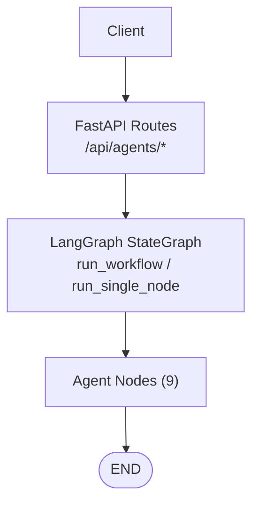
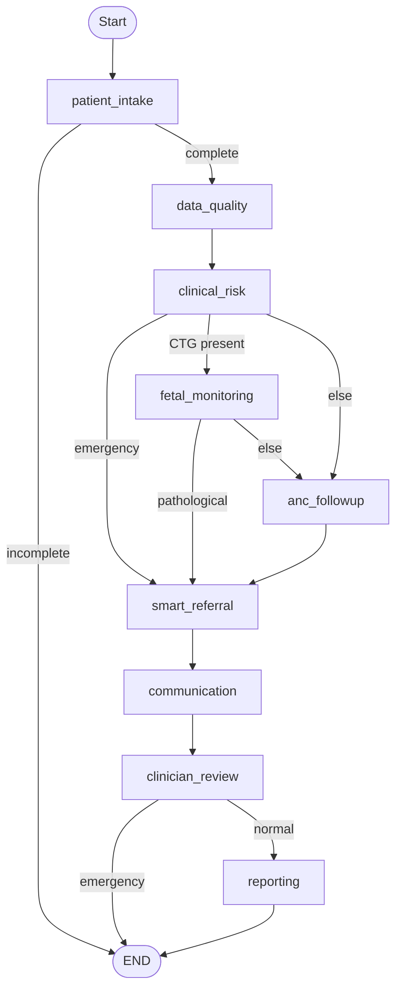
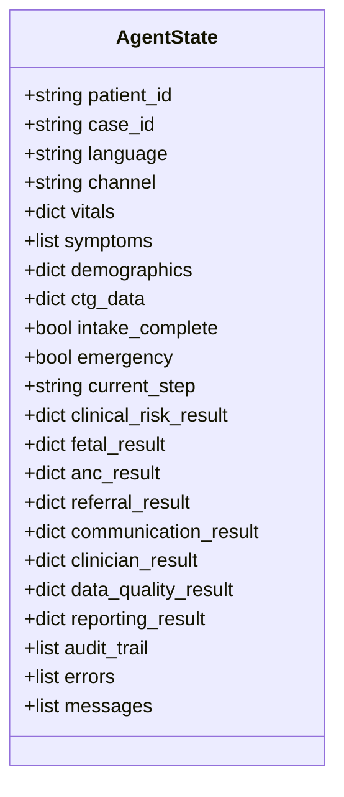
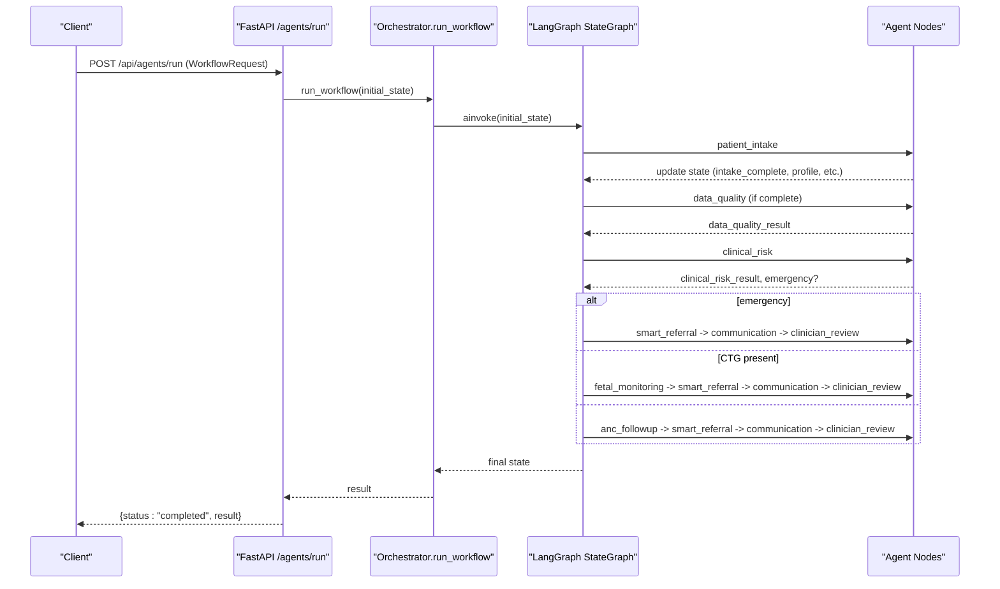
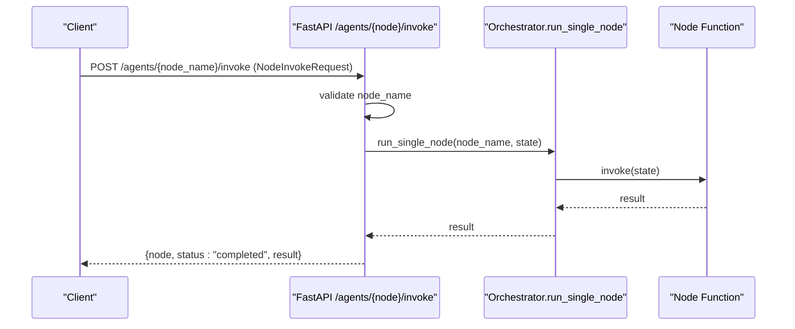
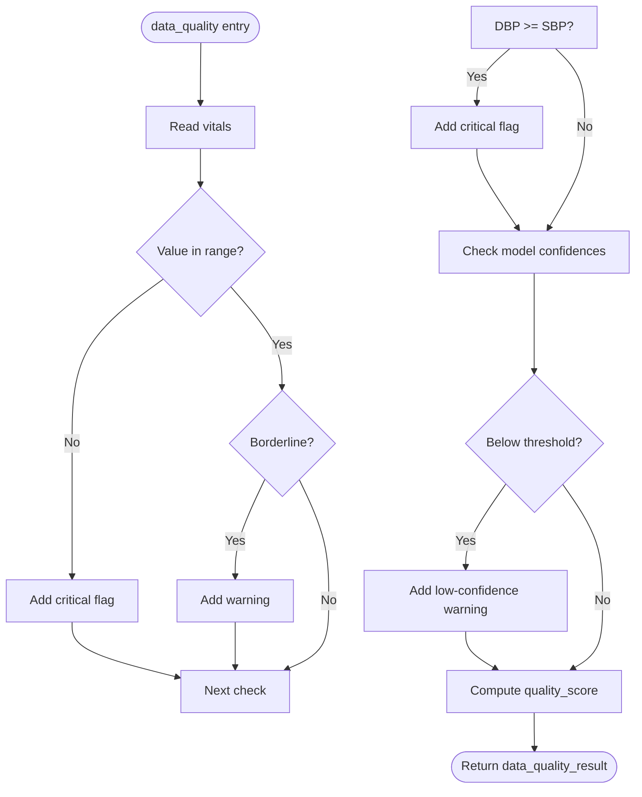
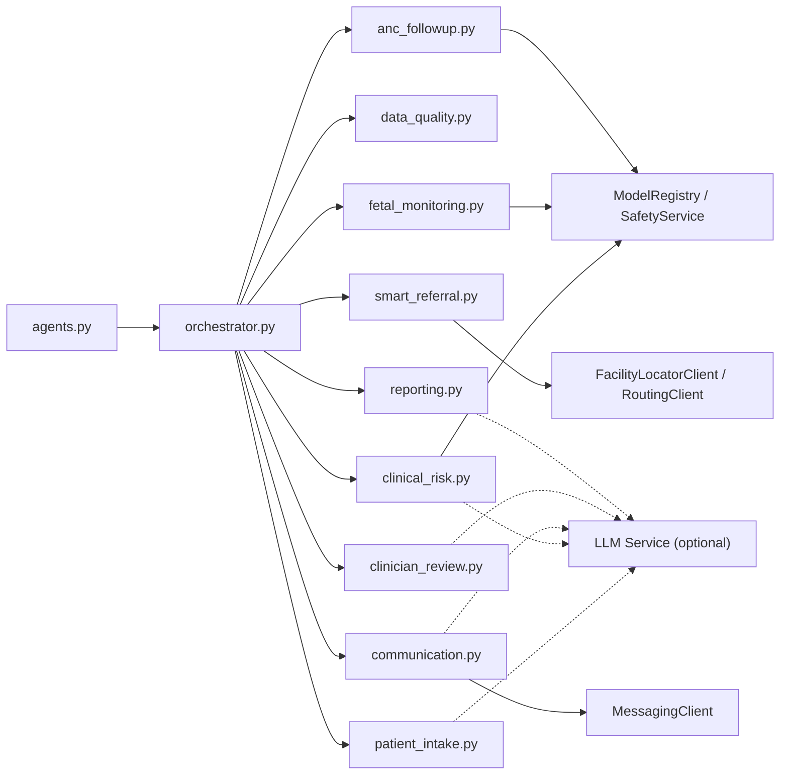

# Agent Orchestration API

<cite>
**Referenced Files in This Document**
- [agents.py](file://backend/api/routes/agents.py)
- [orchestrator.py](file://backend/agents/orchestrator.py)
- [state.py](file://backend/schemas/state.py)
- [patient_intake.py](file://backend/agents/nodes/patient_intake.py)
- [data_quality.py](file://backend/agents/nodes/data_quality.py)
- [clinical_risk.py](file://backend/agents/nodes/clinical_risk.py)
- [fetal_monitoring.py](file://backend/agents/nodes/fetal_monitoring.py)
- [anc_followup.py](file://backend/agents/nodes/anc_followup.py)
- [smart_referral.py](file://backend/agents/nodes/smart_referral.py)
- [communication.py](file://backend/agents/nodes/communication.py)
- [clinician_review.py](file://backend/agents/nodes/clinician_review.py)
- [reporting.py](file://backend/agents/nodes/reporting.py)
- [test_orchestrator.py](file://backend/tests/test_orchestrator.py)
</cite>

## Table of Contents
1. Introduction
2. Project Structure
3. Core Components
4. Architecture Overview
5. Detailed Component Analysis
6. Dependency Analysis
7. Performance Considerations
8. Troubleshooting Guide
9. Conclusion
10. Appendices

## Introduction
This document provides comprehensive API documentation for the agent orchestration endpoints that run a multi-agent clinical workflow. It covers:
- Full workflow execution via POST /api/agents/run
- Individual node invocation via POST /api/agents/{node_name}/invoke
- Workflow status and node metadata via GET /api/agents/status

It also documents the WorkflowRequest schema, available agent nodes, state management patterns, error handling strategies, and practical examples for different clinical scenarios.

## Project Structure
The orchestration layer is implemented with FastAPI routes that delegate to a LangGraph-based orchestrator. The orchestrator wires nine agent nodes into a directed graph with conditional routing based on patient data and risk signals.

**Diagram sources**
- [agents.py:62-114](file://backend/api/routes/agents.py#L62-L114)
- [orchestrator.py:62-138](file://backend/agents/orchestrator.py#L62-L138)

**Section sources**
- [agents.py:1-135](file://backend/api/routes/agents.py#L1-L135)
- [orchestrator.py:1-167](file://backend/agents/orchestrator.py#L1-L167)

## Core Components
- API routes: Define request/response models and HTTP endpoints for running workflows, invoking single nodes, and listing nodes.
- Orchestrator: Builds and compiles a LangGraph StateGraph with conditional edges and exposes run_workflow and run_single_node.
- AgentState: TypedDict defining shared state fields across all nodes (patient identifiers, vitals, symptoms, demographics, CTG data, flow control flags, per-node results, audit trail, errors, messages).
- Agent nodes: Nine specialized functions that read/write state and produce domain-specific outputs.

Key responsibilities:
- POST /api/agents/run: Accepts WorkflowRequest, runs full pipeline, returns completed result or raises 500 on failure.
- POST /api/agents/{node_name}/invoke: Runs a single node by name for testing/debugging; validates node existence and returns result or appropriate errors.
- GET /api/agents/status: Returns list of available nodes and descriptions.

**Section sources**
- [agents.py:35-114](file://backend/api/routes/agents.py#L35-L114)
- [orchestrator.py:144-167](file://backend/agents/orchestrator.py#L144-L167)
- [state.py:7-43](file://backend/schemas/state.py#L7-L43)

## Architecture Overview
The workflow starts at patient_intake and proceeds through data quality, then branches based on risk and data availability. Emergency cases fast-track to smart referral and communication, skipping reporting when necessary. Normal flows continue through anc_followup or fetal_monitoring, then proceed to smart referral, communication, clinician review, and optionally reporting.

**Diagram sources**
- [orchestrator.py:22-56](file://backend/agents/orchestrator.py#L22-L56)
- [orchestrator.py:78-132](file://backend/agents/orchestrator.py#L78-L132)

## Detailed Component Analysis

### API Endpoints

- POST /api/agents/run
  - Purpose: Execute the full multi-agent workflow from intake to reporting.
  - Authentication: Requires clinician or admin role.
  - Request body: WorkflowRequest (see Schema section).
  - Response: {status: "completed", result: ...} or 500 on exception.
  - Error handling: Catches exceptions and returns HTTP 500 with a descriptive message.

- POST /api/agents/{node_name}/invoke
  - Purpose: Run a single agent node by name for testing/debugging.
  - Authentication: Requires clinician or admin role.
  - Request body: NodeInvokeRequest with a state dict.
  - Response: {node, status: "completed", result: ...} or 400/404/500 depending on validation and runtime errors.

- GET /api/agents/status
  - Purpose: List available agent nodes and their descriptions.
  - Authentication: Requires current user.
  - Response: Array of {name, description}.

**Section sources**
- [agents.py:62-114](file://backend/api/routes/agents.py#L62-L114)

### WorkflowRequest Schema
Fields:
- patient_id: string (required)
- case_id: string (required)
- language: string (default "ur")
- channel: string (default "app")
- vitals: object (default {})
- symptoms: array (default [])
- demographics: object (default {})
- ctg_data: object | null (default None)

These fields map directly to AgentState keys used by the nodes.

**Section sources**
- [agents.py:35-45](file://backend/api/routes/agents.py#L35-L45)
- [state.py:7-43](file://backend/schemas/state.py#L7-L43)

### Available Agent Nodes and Purposes
- patient_intake: Validates and normalizes incoming patient data; collects demographics, vitals, symptoms; optional voice transcription and LLM-generated follow-up questions; sets intake_complete and missing_fields.
- data_quality: Validates vital ranges, flags anomalies, checks model confidence scores, computes an overall quality score.
- clinical_risk: Runs maternal and gestational risk predictions and mandatory WHO red-flag triage; sets emergency flag if high-risk.
- fetal_monitoring: Runs FetalWatch and PretermGuard on CTG features; sets emergency if pathological; skips gracefully if no CTG data.
- anc_followup: Predicts missed-visit risk and recommends action (home_visit/call/sms) based on priority.
- smart_referral: Finds and ranks nearby facilities by capability and distance; plans route; determines urgency; creates referral record.
- communication: Sends alerts via SMS/WhatsApp/emergency channels; generates messages via LLM with fallback templates; tracks delivery.
- clinician_review: Aggregates upstream results into a structured case summary; marks pending_review; highlights risk indicators.
- reporting: Generates comprehensive case summary payload and dashboard/trend data; optional narrative report via LLM.

**Section sources**
- [patient_intake.py:58-168](file://backend/agents/nodes/patient_intake.py#L58-L168)
- [data_quality.py:25-201](file://backend/agents/nodes/data_quality.py#L25-L201)
- [clinical_risk.py:15-127](file://backend/agents/nodes/clinical_risk.py#L15-L127)
- [fetal_monitoring.py:10-111](file://backend/agents/nodes/fetal_monitoring.py#L10-L111)
- [anc_followup.py:10-103](file://backend/agents/nodes/anc_followup.py#L10-L103)
- [smart_referral.py:11-136](file://backend/agents/nodes/smart_referral.py#L11-L136)
- [communication.py:38-231](file://backend/agents/nodes/communication.py#L38-L231)
- [clinician_review.py:13-165](file://backend/agents/nodes/clinician_review.py#L13-L165)
- [reporting.py:13-217](file://backend/agents/nodes/reporting.py#L13-L217)

### State Management Patterns
- Shared state: All nodes read/write a common state dictionary defined by AgentState.
- Append-only logs: audit_trail, errors, and messages use annotated append semantics to accumulate entries across nodes.
- Flow control: intake_complete, emergency, and current_step guide routing and termination.
- Per-node results: Each node writes its output under dedicated keys (e.g., clinical_risk_result, fetal_result, anc_result, referral_result, communication_result, clinician_result, data_quality_result, reporting_result).

**Diagram sources**
- [state.py:7-43](file://backend/schemas/state.py#L7-L43)

**Section sources**
- [state.py:7-43](file://backend/schemas/state.py#L7-L43)

### Workflow Execution Sequence

**Diagram sources**
- [agents.py:62-79](file://backend/api/routes/agents.py#L62-L79)
- [orchestrator.py:62-138](file://backend/agents/orchestrator.py#L62-L138)
- [orchestrator.py:144-147](file://backend/agents/orchestrator.py#L144-L147)

### Single Node Invocation Sequence

**Diagram sources**
- [agents.py:90-114](file://backend/api/routes/agents.py#L90-L114)
- [orchestrator.py:150-167](file://backend/agents/orchestrator.py#L150-L167)

### Data Quality Validation Flow

**Diagram sources**
- [data_quality.py:25-201](file://backend/agents/nodes/data_quality.py#L25-L201)

## Dependency Analysis
- API routes depend on orchestrator functions and authentication dependencies.
- Orchestrator depends on the set of agent nodes and defines conditional routing logic.
- Nodes depend on external services:
  - Inference service for model predictions (clinical_risk, fetal_monitoring, anc_followup).
  - Safety service for WHO red-flag triage (clinical_risk).
  - Messaging client for communications (communication).
  - Facility locator and routing clients for referrals (smart_referral).
  - Optional LLM service for generating messages, summaries, and reports (multiple nodes).

**Diagram sources**
- [agents.py:62-114](file://backend/api/routes/agents.py#L62-L114)
- [orchestrator.py:62-138](file://backend/agents/orchestrator.py#L62-L138)
- [clinical_risk.py:15-127](file://backend/agents/nodes/clinical_risk.py#L15-L127)
- [fetal_monitoring.py:10-111](file://backend/agents/nodes/fetal_monitoring.py#L10-L111)
- [anc_followup.py:10-103](file://backend/agents/nodes/anc_followup.py#L10-L103)
- [smart_referral.py:11-136](file://backend/agents/nodes/smart_referral.py#L11-L136)
- [communication.py:38-231](file://backend/agents/nodes/communication.py#L38-L231)

**Section sources**
- [agents.py:62-114](file://backend/api/routes/agents.py#L62-L114)
- [orchestrator.py:62-138](file://backend/agents/orchestrator.py#L62-L138)

## Performance Considerations
- Asynchronous execution: Endpoints and nodes are async to avoid blocking I/O operations (LLM calls, messaging, inference).
- Non-blocking LLM calls: LLM requests are executed in worker threads to prevent event loop contention.
- Conditional routing: Early exits (e.g., incomplete intake, emergency paths) reduce unnecessary processing.
- Fallbacks: LLM failures fall back to template text to keep pipelines resilient.
- Audit and error accumulation: Append-only lists allow lightweight tracking without heavy logging overhead.

[No sources needed since this section provides general guidance]

## Troubleshooting Guide
Common issues and resolutions:
- Unknown node invoked: Ensure node_name matches one of the registered nodes; otherwise, a 404 is returned.
- Missing required vitals: patient_intake will mark intake_incomplete; provide all required vital fields to proceed.
- Emergency escalation: If WHO triage or fetal monitoring indicates emergency, the workflow fast-tracks to referral and communication; verify input data and model availability.
- Communication failures: Check messaging provider connectivity; delivery logs indicate status per message.
- LLM unavailability: Nodes fall back to templates; check logs for warnings about LLM generation failures.

Error handling patterns:
- API-level: Exceptions raised in endpoints return appropriate HTTP status codes (400, 404, 500).
- Node-level: Each node catches exceptions, records errors and audit entries, and returns partial results where possible.

**Section sources**
- [agents.py:90-114](file://backend/api/routes/agents.py#L90-L114)
- [patient_intake.py:151-168](file://backend/agents/nodes/patient_intake.py#L151-L168)
- [data_quality.py:185-201](file://backend/agents/nodes/data_quality.py#L185-L201)
- [clinical_risk.py:111-127](file://backend/agents/nodes/clinical_risk.py#L111-L127)
- [fetal_monitoring.py:95-111](file://backend/agents/nodes/fetal_monitoring.py#L95-L111)
- [communication.py:215-231](file://backend/agents/nodes/communication.py#L215-L231)

## Conclusion
The Agent Orchestration API provides a robust, extensible framework for clinical decision support. It combines modular agent nodes with a flexible workflow engine to handle diverse scenarios—from routine ANC follow-ups to emergency referrals—while maintaining strong error handling, auditability, and resilience to external service failures.

[No sources needed since this section summarizes without analyzing specific files]

## Appendices

### Practical Examples

- Normal workflow (complete intake, normal vitals)
  - Expected behavior: intake_complete=True, clinical_risk_result populated, no emergency, reporting generated.
  - Reference test scenario: normal workflow assertions.

- Emergency workflow (dangerous vitals)
  - Expected behavior: emergency=True, smart_referral triggered with urgency=emergency, communication sends emergency alert.
  - Reference test scenario: emergency workflow assertions.

- Incomplete intake (missing required vitals)
  - Expected behavior: intake remains incomplete, workflow stops early, no downstream assessments.
  - Reference test scenario: incomplete intake assertions.

**Section sources**
- [test_orchestrator.py:52-136](file://backend/tests/test_orchestrator.py#L52-L136)