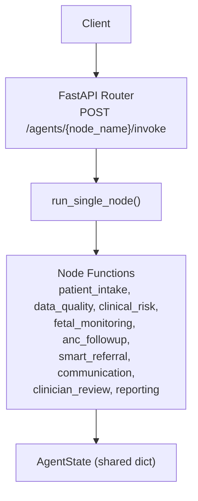
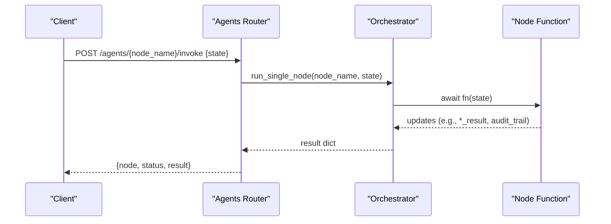
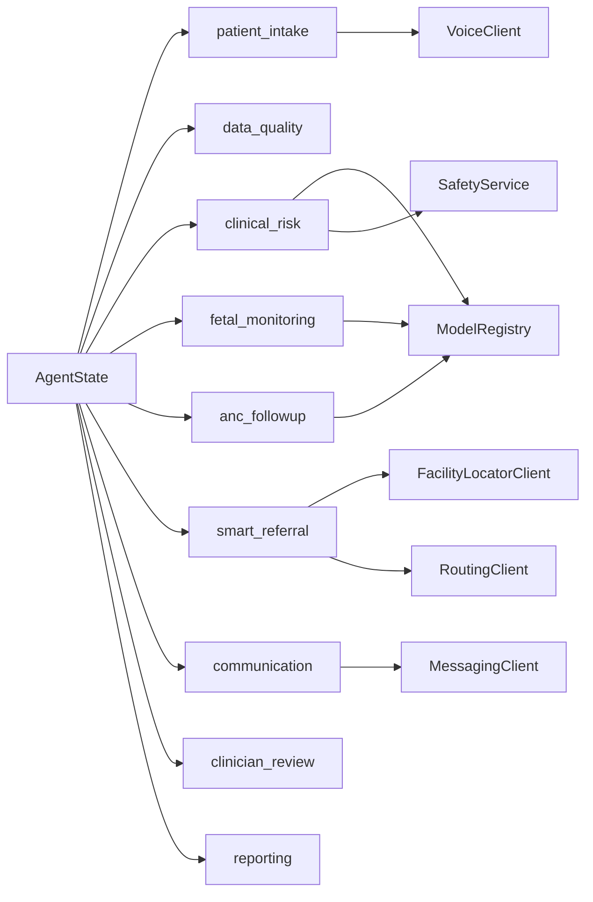

# Individual Node Invocation

<cite>
**Referenced Files in This Document**
- [agents.py](file://backend/api/routes/agents.py)
- [orchestrator.py](file://backend/agents/orchestrator.py)
- [state.py](file://backend/schemas/state.py)
- [patient_intake.py](file://backend/agents/nodes/patient_intake.py)
- [data_quality.py](file://backend/agents/nodes/data_quality.py)
- [clinical_risk.py](file://backend/agents/nodes/clinical_risk.py)
- [fetal_monitoring.py](file://backend/agents/nodes/fetal_monitoring.py)
- [anc_followup.py](file://backend/agents/nodes/anc_followup.py)
- [smart_referral.py](file://backend/agents/nodes/smart_referral.py)
- [communication.py](file://backend/agents/nodes/communication.py)
- [clinician_review.py](file://backend/agents/nodes/clinician_review.py)
- [reporting.py](file://backend/agents/nodes/reporting.py)
</cite>

## Table of Contents
1. Introduction
2. Project Structure
3. Core Components
4. Architecture Overview
5. Detailed Component Analysis
6. Dependency Analysis
7. Performance Considerations
8. Troubleshooting Guide
9. Conclusion

## Introduction
This document explains how to invoke individual agent nodes via the POST /api/agents/{node_name}/invoke endpoint, and documents the shared state dictionary used to pass context between nodes. It also details each available node’s purpose, input expectations, output fields, and typical usage scenarios for testing and debugging.

## Project Structure
The invocation endpoint lives under the API routes and delegates execution to a single-node runner that maps node names to their implementations. The shared state schema is defined centrally and consumed by all nodes.

**Diagram sources**
- [agents.py:90-114](file://backend/api/routes/agents.py#L90-L114)
- [orchestrator.py:150-166](file://backend/agents/orchestrator.py#L150-L166)
- [state.py:7-42](file://backend/schemas/state.py#L7-L42)

**Section sources**
- [agents.py:1-135](file://backend/api/routes/agents.py#L1-L135)
- [orchestrator.py:1-167](file://backend/agents/orchestrator.py#L1-L167)
- [state.py:1-43](file://backend/schemas/state.py#L1-L43)

## Core Components
- Endpoint: POST /api/agents/{node_name}/invoke
  - Request body: NodeInvokeRequest with a state field (dict).
  - Response: { "node": "<name>", "status": "completed", "result": <node result> }.
  - Errors: 404 for unknown node; 400 for validation errors; 500 for runtime exceptions.
- Shared state: AgentState TypedDict defines keys like patient_id, case_id, language, channel, vitals, symptoms, demographics, ctg_data, plus per-node result namespaces and cross-cutting lists (audit_trail, errors, messages).
- Single-node runner: run_single_node(node_name, state) dispatches to the corresponding async function.

Usage example (conceptual):
- Send JSON {"state": {...}} to POST /api/agents/{node_name}/invoke with appropriate auth headers.
- Inspect returned result and updated state fields written by the node.

**Section sources**
- [agents.py:47-49](file://backend/api/routes/agents.py#L47-L49)
- [agents.py:90-114](file://backend/api/routes/agents.py#L90-L114)
- [orchestrator.py:150-166](file://backend/agents/orchestrator.py#L150-L166)
- [state.py:7-42](file://backend/schemas/state.py#L7-L42)

## Architecture Overview
The endpoint validates the node name, then calls the orchestrator’s single-node runner, which invokes the matching node function. Each node reads from and writes to the shared state dictionary, appending audit entries and optionally setting flags like emergency or current_step.

**Diagram sources**
- [agents.py:90-114](file://backend/api/routes/agents.py#L90-L114)
- [orchestrator.py:150-166](file://backend/agents/orchestrator.py#L150-L166)

## Detailed Component Analysis

### NodeInvokeRequest Schema and Shared State
- NodeInvokeRequest.state: A Python dict conforming to the AgentState TypedDict.
- Key shared fields:
  - Identification: patient_id, case_id, language, channel
  - Patient data: vitals (dict), symptoms (list), demographics (dict), ctg_data (optional dict)
  - Intake outputs: profile, missing_fields, followup_questions, llm_generated
  - Flow control: intake_complete, emergency, current_step
  - Per-node results: clinical_risk_result, fetal_result, anc_result, referral_result, communication_result, clinician_result, data_quality_result, reporting_result
  - Cross-cutting: audit_trail (append-only), errors (append-only), messages (append-only)

Notes:
- Nodes typically return a subset of these keys; the caller can merge them into a larger state if chaining multiple invocations.
- Many nodes append an audit entry with timestamp, action, and result_summary.

**Section sources**
- [state.py:7-42](file://backend/schemas/state.py#L7-L42)
- [agents.py:47-49](file://backend/api/routes/agents.py#L47-L49)

### patient_intake
Purpose: Validate and normalize incoming patient data; optionally transcribe voice audio and extract symptoms; generate follow-up questions for missing required fields.

Input state expectations:
- patient_id, case_id, language, channel
- vitals (at least systolic_bp, diastolic_bp, heart_rate, temperature_celsius, gestational_age_weeks)
- symptoms (list)
- demographics (dict)
- Optional audio_data (for voice transcription)

Key outputs written to state:
- intake_complete (bool)
- vitals, symptoms, demographics (echoed back)
- current_step ("intake_complete" or "intake_incomplete")
- profile (structured intake summary)
- missing_fields (list of required vital keys still missing)
- followup_questions (list of strings)
- llm_generated (bool indicating whether LLM was used for follow-ups)
- audit_trail (entry with action "patient_data_collection" or error action)

Typical usage:
- Call this node first to validate and enrich intake data before other nodes.
- If intake_complete is False, request additional information based on missing_fields and followup_questions.

Debugging tips:
- If intake remains incomplete, verify presence and types of required vital fields.
- Check llm_generated to see if LLM fallback occurred due to service unavailability.

**Section sources**
- [patient_intake.py:58-168](file://backend/agents/nodes/patient_intake.py#L58-L168)

### data_quality
Purpose: Validate vital ranges, flag anomalies, check model confidence scores, and compute an overall quality score.

Input state expectations:
- vitals (dict)
- Optional upstream results: clinical_risk_result, fetal_result, anc_result (to assess model confidence)

Key outputs written to state:
- data_quality_result (dict with quality_score, flags, warnings, model_confidence_checks, vitals_checked, timestamp)
- current_step ("data_quality_complete")
- audit_trail (entry with action "data_quality_validation" or error action)

Validation highlights:
- Checks numeric types and physiological ranges for known vital keys.
- Detects impossible combinations (e.g., diastolic >= systolic).
- Flags low-confidence model predictions below a threshold.

Typical usage:
- Run after intake and risk assessments to ensure data integrity and model reliability.

Debugging tips:
- Review flags for out-of-range values and warnings for borderline values.
- Inspect model_confidence_checks to identify models with low confidence.

**Section sources**
- [data_quality.py:25-201](file://backend/agents/nodes/data_quality.py#L25-L201)

### clinical_risk
Purpose: Predict maternal risk and gestational complications, apply WHO red-flag safety rules, and determine emergency status.

Input state expectations:
- vitals (dict)
- demographics (dict)

Key outputs written to state:
- clinical_risk_result (dict containing maternal_risk, optional gestational_risk, who_red_flags, is_emergency, risk_summary, llm_generated, timestamp)
- emergency (bool set when WHO triage indicates high-risk emergency)
- current_step ("clinical_risk_complete")
- audit_trail (entry with action "clinical_risk_assessment" or error action)

Behavior notes:
- SafetyService.check_who_red_flags is always executed; HIGH_RISK_EMERGENCY sets emergency=True.
- Gestational prediction runs only when relevant features are present.
- LLM-generated risk summary is optional and falls back to a template if unavailable.

Typical usage:
- Use to drive downstream routing (emergency vs non-emergency) and to inform referral and communication decisions.

Debugging tips:
- Inspect who_red_flags.triage_level and triggered_rules to understand emergency escalation.
- Verify model availability and confidence levels in clinical_risk_result.

**Section sources**
- [clinical_risk.py:15-127](file://backend/agents/nodes/clinical_risk.py#L15-L127)

### fetal_monitoring
Purpose: Analyze CTG data using FetalWatch and PretermGuard models; set emergency if pathological CTG detected.

Input state expectations:
- ctg_data (dict) — must be present to run assessment

Key outputs written to state:
- fetal_result (dict with fetal_status, probabilities, confidence, model_available; preterm_risk, probabilities, confidence, model_available; escalate; timestamp)
- emergency (bool set when fetal status is pathological)
- current_step ("fetal_monitoring_complete" or "fetal_monitoring_skipped")
- audit_trail (entry describing skipped or assessed outcome)

Behavior notes:
- If no ctg_data is provided, the node returns not_assessed results and skips assessment gracefully.

Typical usage:
- Invoke when CTG data is available; otherwise, skip or provide placeholder data.

Debugging tips:
- Confirm ctg_data structure matches model expectations.
- Check fetal_result.fetal_status and preterm_risk for escalation signals.

**Section sources**
- [fetal_monitoring.py:10-111](file://backend/agents/nodes/fetal_monitoring.py#L10-L111)

### anc_followup
Purpose: Predict missed ANC visit risk and recommend follow-up actions (home_visit, call, sms).

Input state expectations:
- demographics (dict)
- vitals (dict) — merged into patient features if not already present

Key outputs written to state:
- anc_result (dict with missed_visit_risk, priority, priority_score, recommended_action, confidence, model_available, risk_factors, timestamp)
- current_step ("anc_followup_complete")
- audit_trail (entry with action "anc_followup_assessment" or error action)

Behavior notes:
- Action mapping: high -> home_visit, medium -> call, low/unknown -> sms.
- Risk factors include age, parity, financial support indicators, and blood pressure.

Typical usage:
- Use to prioritize outreach and resource allocation for ANC follow-up.

Debugging tips:
- Review risk_factors to understand why a particular priority was assigned.
- Ensure demographics and vitals contain expected keys for feature extraction.

**Section sources**
- [anc_followup.py:10-103](file://backend/agents/nodes/anc_followup.py#L10-L103)

### smart_referral
Purpose: Find and rank nearby facilities, plan route, and create referral record with urgency determination.

Input state expectations:
- demographics (dict) with latitude/longitude (defaults to Peshawar region if absent)
- emergency (bool)
- clinical_risk_result (dict)
- fetal_result (dict)

Key outputs written to state:
- referral_result (dict with referral_case_id, urgency_level, ranked_facilities, selected_facility, route_info, estimated_travel_time_min, capabilities_needed, timestamp)
- current_step ("referral_complete")
- audit_trail (entry with action "smart_referral_created" or error action)

Behavior notes:
- Capability needs derived from emergency flag and fetal outcomes (NICU/maternity/emergency).
- Ranking combines capability match and distance; penalizes high-load facilities.
- Route planning uses RoutingClient for top-ranked facility.

Typical usage:
- Triggered in emergency or high-risk scenarios; also useful for routine referrals.

Debugging tips:
- Inspect ranked_facilities and selected_facility to confirm capability matching.
- Check route_info for travel time and path details.

**Section sources**
- [smart_referral.py:11-136](file://backend/agents/nodes/smart_referral.py#L11-L136)

### communication
Purpose: Send alerts via SMS/WhatsApp/emergency channels based on context; track delivery status.

Input state expectations:
- emergency (bool)
- patient_id, language, channel
- demographics.phone
- Upstream results: clinical_risk_result, referral_result, anc_result

Key outputs written to state:
- communication_result (dict with messages_sent, delivery_status, all_delivered, is_emergency_alert, channel_used, language, llm_generated, timestamp)
- current_step ("communication_complete")
- audit_trail (entry with action "communication_dispatch" or error action)

Behavior notes:
- Emergency alerts sent to configured recipients with LLM-generated or template messages.
- Referral notifications sent via SMS or WhatsApp depending on channel.
- ANC reminders sent based on recommended_action; “call” triggers SMS plus note about phone call.
- Falls back to templates if LLM is unavailable.

Typical usage:
- After referral or risk assessment to notify patients or health workers.

Debugging tips:
- Review delivery_status entries for send failures.
- Check llm_generated to confirm message generation path.

**Section sources**
- [communication.py:38-231](file://backend/agents/nodes/communication.py#L38-L231)

### clinician_review
Purpose: Aggregate upstream results into a structured case summary for human review; mark pending_review.

Input state expectations:
- patient_id, case_id, emergency
- vitals, symptoms, demographics
- Upstream results: clinical_risk_result, fetal_result, anc_result, referral_result, communication_result

Key outputs written to state:
- clinician_result (dict with status "pending_review", case_summary, case_summary_text, risk_indicators, requires_immediate_attention, llm_generated, timestamp)
- current_step ("pending_clinician_review")
- audit_trail (entry with action "clinician_review_prepared" or error action)

Behavior notes:
- Builds comprehensive case_summary including risk assessments, fetal assessment, ANC follow-up, referral, and communication log.
- Generates risk_indicators for quick scanning (e.g., EMERGENCY FLAGGED, high maternal risk, fetal concern, WHO triage).
- LLM narrative summary is optional and falls back to template text.

Typical usage:
- Final step before reporting; provides a consolidated view for clinicians.

Debugging tips:
- Inspect risk_indicators to understand why immediate attention may be flagged.
- Verify case_summary contains all expected sections.

**Section sources**
- [clinician_review.py:13-165](file://backend/agents/nodes/clinician_review.py#L13-L165)

### reporting
Purpose: Generate structured report payload and dashboard/trend data suitable for analytics and export.

Input state expectations:
- patient_id, case_id, language, channel, emergency
- vitals, symptoms, demographics
- Upstream results: clinical_risk_result, fetal_result, anc_result, referral_result, communication_result, clinician_result, data_quality_result
- audit_trail, errors

Key outputs written to state:
- reporting_result (dict with case_summary, dashboard_data, narrative, llm_generated, generated_at)
- current_step ("reporting_complete")
- audit_trail (entry with action "reporting_generated" or error action)

Behavior notes:
- case_summary aggregates risk assessments, referral info, communication stats, clinician review status, and data quality metrics.
- dashboard_data includes risk_scorecard, vitals_snapshot, and pipeline_health metrics.
- Narrative report is optional and falls back to a short template if LLM unavailable.

Typical usage:
- End-to-end reporting for dashboards, trend analysis, and export.

Debugging tips:
- Check errors_count and pipeline_health to assess pipeline performance.
- Validate dashboard_data fields for numeric conversions and completeness.

**Section sources**
- [reporting.py:13-217](file://backend/agents/nodes/reporting.py#L13-L217)

## Dependency Analysis
Nodes depend on shared state and external services:
- ModelRegistry for predictive models (maternal, gestational, fetal, preterm, ANC).
- SafetyService for WHO red-flag checks.
- Integrations: FacilityLocatorClient, RoutingClient, MessagingClient, VoiceClient.
- Optional LLM service for narrative generation across nodes.

**Diagram sources**
- [clinical_risk.py:15-127](file://backend/agents/nodes/clinical_risk.py#L15-L127)
- [fetal_monitoring.py:10-111](file://backend/agents/nodes/fetal_monitoring.py#L10-L111)
- [anc_followup.py:10-103](file://backend/agents/nodes/anc_followup.py#L10-L103)
- [smart_referral.py:11-136](file://backend/agents/nodes/smart_referral.py#L11-L136)
- [communication.py:38-231](file://backend/agents/nodes/communication.py#L38-L231)
- [patient_intake.py:58-168](file://backend/agents/nodes/patient_intake.py#L58-L168)

**Section sources**
- [clinical_risk.py:15-127](file://backend/agents/nodes/clinical_risk.py#L15-L127)
- [fetal_monitoring.py:10-111](file://backend/agents/nodes/fetal_monitoring.py#L10-L111)
- [anc_followup.py:10-103](file://backend/agents/nodes/anc_followup.py#L10-L103)
- [smart_referral.py:11-136](file://backend/agents/nodes/smart_referral.py#L11-L136)
- [communication.py:38-231](file://backend/agents/nodes/communication.py#L38-L231)
- [patient_intake.py:58-168](file://backend/agents/nodes/patient_intake.py#L58-L168)

## Performance Considerations
- LLM calls are executed in worker threads to avoid blocking the event loop; failures fall back to templates.
- Data quality checks operate over fixed vital ranges and model confidence thresholds; keep inputs minimal to reduce overhead.
- Smart referral ranking sorts facilities by capability and distance; limit radius to balance accuracy and latency.
- Communication node batches message sends and tracks delivery status; prefer efficient channels (SMS vs WhatsApp) based on urgency.

[No sources needed since this section provides general guidance]

## Troubleshooting Guide
Common issues and resolutions:
- Unknown node name: Ensure node_name matches one of the registered nodes; endpoint returns 404 with available list.
- Validation errors: NodeInvokeRequest.state must conform to AgentState; missing required fields may cause nodes to skip or produce not_assessed results.
- Runtime exceptions: Each node catches exceptions and appends errors and audit entries; inspect errors and audit_trail in the response.
- Emergency escalation: If WHO triage indicates HIGH_RISK_EMERGENCY, emergency is set to True; downstream nodes will adjust behavior accordingly.
- LLM unavailability: Nodes fall back to templates; llm_generated indicates whether LLM was used.

Diagnostic steps:
- Inspect audit_trail entries for timestamps, actions, and summaries.
- Review errors list for exception messages and contexts.
- For data quality issues, examine data_quality_result.flags and warnings.
- For communication failures, check communication_result.delivery_status for send outcomes.

**Section sources**
- [agents.py:90-114](file://backend/api/routes/agents.py#L90-L114)
- [data_quality.py:25-201](file://backend/agents/nodes/data_quality.py#L25-L201)
- [communication.py:38-231](file://backend/agents/nodes/communication.py#L38-L231)
- [clinical_risk.py:15-127](file://backend/agents/nodes/clinical_risk.py#L15-L127)

## Conclusion
The POST /api/agents/{node_name}/invoke endpoint enables targeted invocation of any agent node with a shared state dictionary. Each node reads from and writes to well-defined state fields, ensuring consistent context passing and auditability. By understanding the state schema and node-specific behaviors, you can compose workflows, test individual components, and debug issues effectively.

[No sources needed since this section summarizes without analyzing specific files]