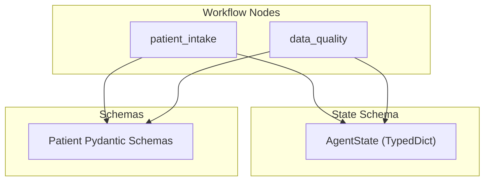
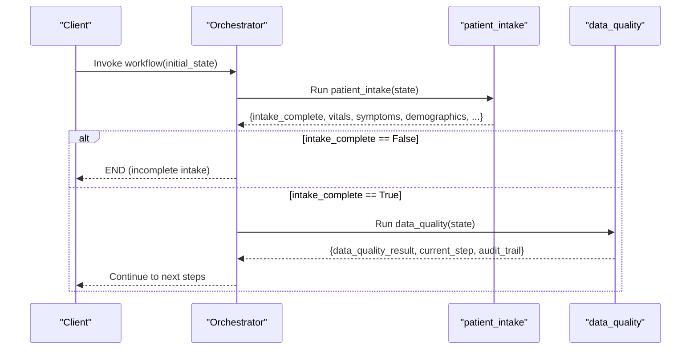
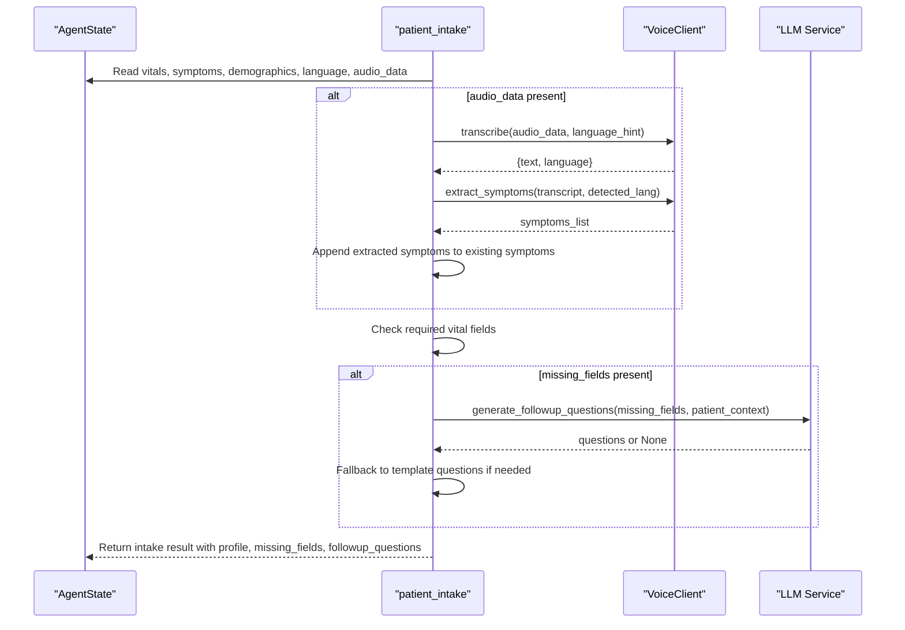
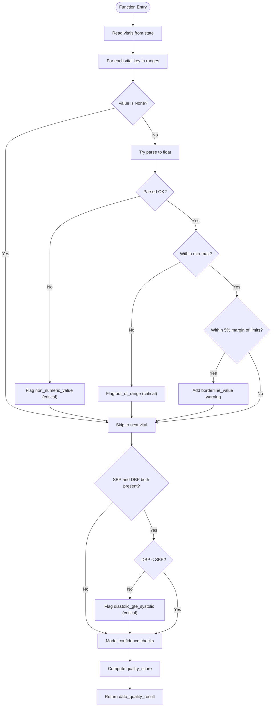
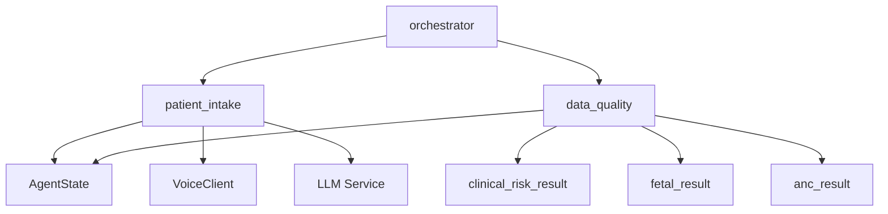

# Patient Data Processing Nodes

<cite>
**Referenced Files in This Document**
- [patient_intake.py](file://backend/agents/nodes/patient_intake.py)
- [data_quality.py](file://backend/agents/nodes/data_quality.py)
- [state.py](file://backend/schemas/state.py)
- [patient.py](file://backend/schemas/patient.py)
- [orchestrator.py](file://backend/agents/orchestrator.py)
</cite>

## Table of Contents
1. Introduction
2. Project Structure
3. Core Components
4. Architecture Overview
5. Detailed Component Analysis
6. Dependency Analysis
7. Performance Considerations
8. Troubleshooting Guide
9. Conclusion

## Introduction
This document explains the patient data processing nodes that validate and normalize incoming patient information and run quality checks on missing values and outliers. It focuses on:
- The patient_intake node for collecting, validating, and normalizing demographics, vital signs, symptoms, and medical history context.
- The data_quality node for range validation, anomaly flagging, model confidence checks, and computing an overall quality score.
It also describes state schemas, input validation rules, transformation processes, output formats, error handling, and normalization standards used by these nodes.

## Project Structure
The relevant code is organized under backend/agents/nodes for workflow nodes, backend/schemas for shared types, and backend/agents/orchestrator for wiring the workflow graph.

**Diagram sources**
- [orchestrator.py:62-138](file://backend/agents/orchestrator.py#L62-L138)
- [state.py:7-43](file://backend/schemas/state.py#L7-L43)
- [patient.py:14-57](file://backend/schemas/patient.py#L14-L57)

**Section sources**
- [orchestrator.py:62-138](file://backend/agents/orchestrator.py#L62-L138)
- [state.py:7-43](file://backend/schemas/state.py#L7-L43)
- [patient.py:14-57](file://backend/schemas/patient.py#L14-L57)

## Core Components
- patient_intake: Collects and validates required vitals, integrates optional voice-derived symptoms, builds a structured profile, and determines whether intake is complete. It can generate follow-up questions via an LLM or fallback templates when fields are missing.
- data_quality: Validates vital ranges, detects impossible combinations, checks downstream model confidence scores, and computes an overall quality score from 0 to 1.

Key responsibilities:
- Input validation and normalization for demographics, vitals, symptoms, and optional CTG features.
- Quality assurance through range checks, logical consistency checks, and confidence thresholds.
- Robust error handling with audit trails and non-fatal failures where appropriate.

**Section sources**
- [patient_intake.py:58-168](file://backend/agents/nodes/patient_intake.py#L58-L168)
- [data_quality.py:25-201](file://backend/agents/nodes/data_quality.py#L25-L201)

## Architecture Overview
The workflow begins at patient_intake. If intake is incomplete, the workflow ends; otherwise it proceeds to data_quality, then to clinical risk assessment and other nodes.

**Diagram sources**
- [orchestrator.py:22-31](file://backend/agents/orchestrator.py#L22-L31)
- [orchestrator.py:62-138](file://backend/agents/orchestrator.py#L62-L138)

## Detailed Component Analysis

### patient_intake Node
Purpose:
- Gather demographics, vitals, symptoms, and optional audio-based symptom extraction.
- Validate completeness of required vital fields.
- Build a normalized profile and determine if intake is complete.
- Generate follow-up questions for missing fields using an LLM with a safe fallback.

Input schema (from AgentState):
- patient_id, language, channel
- vitals: dict (BP, HR, temperature, gestational age, etc.)
- symptoms: list of symptom entries
- demographics: dict (age, gender, parity, etc.)
- ctg_data: optional dict
- audio_data: optional raw audio for transcription

Output format:
- intake_complete: bool
- vitals, symptoms, demographics: normalized inputs
- current_step: "intake_complete" or "intake_incomplete"
- audit_trail: list of audit entries
- profile: structured summary including patient_id, language, channel, demographics, vitals, symptoms, and optional voice_transcript
- missing_fields: list of required vital keys still absent
- followup_questions: list of strings
- llm_generated: bool indicating whether follow-ups came from LLM

Validation and normalization rules:
- Required vital fields checked: systolic_bp, diastolic_bp, heart_rate, temperature_celsius, gestational_age_weeks. Missing or null values mark intake as incomplete.
- Optional voice transcript integration: if audio_data is present, transcribe and extract symptoms, appending them to the existing symptoms list.
- Language and channel metadata preserved in the profile.

Follow-up question generation:
- Attempts to call an LLM service to generate targeted questions based on missing fields and patient context.
- Falls back to simple template questions if the LLM is unavailable or parsing fails.
- Non-blocking execution ensures the intake node remains resilient.

Error handling:
- Exceptions during intake are caught and returned with errors and audit entries; the node never crashes due to external service issues.

Typical patient data structures:
- Demographics: name, age, gender, phone, location, gestational_age_weeks, parity, language, channel.
- Vitals: systolic_bp, diastolic_bp, heart_rate, temperature_celsius, respiratory_rate, blood_sugar, gestational_age_weeks, fetal_movement_present.
- Symptoms: list of entries with name, severity, duration_hours.
- CTG features: optional dict for cardiotocography-derived features.

Quality considerations:
- Ensures critical vitals are present before proceeding.
- Captures voice-derived symptoms to enrich clinical context.

**Section sources**
- [patient_intake.py:14-56](file://backend/agents/nodes/patient_intake.py#L14-L56)
- [patient_intake.py:58-168](file://backend/agents/nodes/patient_intake.py#L58-L168)
- [state.py:7-43](file://backend/schemas/state.py#L7-L43)
- [patient.py:14-57](file://backend/schemas/patient.py#L14-L57)

#### Sequence Diagram: patient_intake Flow

**Diagram sources**
- [patient_intake.py:14-56](file://backend/agents/nodes/patient_intake.py#L14-L56)
- [patient_intake.py:58-168](file://backend/agents/nodes/patient_intake.py#L58-L168)

### data_quality Node
Purpose:
- Validate vital sign ranges and detect impossible combinations.
- Flag borderline values as warnings.
- Assess downstream model confidence scores against a minimum threshold.
- Compute an overall quality score from 0 to 1.

Input schema (from AgentState):
- vitals: dict
- clinical_risk_result: dict (contains maternal_risk and possibly gestational_risk with confidence)
- fetal_result: dict (contains fetal_confidence, preterm_confidence, fetal_status, preterm_risk)
- anc_result: dict (contains confidence)

Output format:
- data_quality_result: object containing:
  - quality_score: float between 0 and 1
  - flags: list of critical issues (out-of-range, non-numeric, impossible combinations)
  - warnings: list of soft issues (borderline values, low model confidence)
  - model_confidence_checks: per-model confidence assessments
  - vitals_checked: count of vital keys validated
  - timestamp: ISO timestamp
- current_step: "data_quality_complete"
- audit_trail: list of audit entries

Normalization and validation rules:
- Vital ranges enforced for:
  - systolic_bp, diastolic_bp, heart_rate, temperature_celsius, SpO2, fetal_hr, respiratory_rate, gestational_age_weeks.
- Non-numeric values flagged as critical.
- Impossible combination check: diastolic must be less than systolic; violation flagged as critical.
- Borderline values within 5% margin of range limits produce warnings.
- Model confidence checks:
  - MaternalGuard confidence from clinical_risk_result.maternal_risk.confidence
  - GestationInsight confidence from clinical_risk_result.gestational_risk.confidence (if present)
  - FetalWatch confidence from fetal_result.fetal_confidence (only if fetal_status != "not_assessed")
  - PretermGuard confidence from fetal_result.preterm_confidence (only if preterm_risk != "not_assessed")
  - CareReach confidence from anc_result.confidence (if anc_result exists)

Quality scoring system:
- total_checks = number of vital range checks + number of model confidence checks
- issues = number of flags + number of models below threshold
- quality_score = max(0, 1.0 - (issues / max(total_checks, 1))) rounded to 4 decimals

Error handling:
- Exceptions are caught and returned with errors and audit entries; the node remains resilient.

Example typical results:
- Flags may include out_of_range values for BP or heart rate, non_numeric_value for temperature, or diastolic_gte_systolic.
- Warnings may include borderline_value near limits or low_model_confidence below threshold.
- quality_score close to 1 indicates high-quality data; lower scores indicate multiple issues.

**Section sources**
- [data_quality.py:9-23](file://backend/agents/nodes/data_quality.py#L9-L23)
- [data_quality.py:25-201](file://backend/agents/nodes/data_quality.py#L25-L201)

#### Flowchart: data_quality Validation Logic

**Diagram sources**
- [data_quality.py:46-155](file://backend/agents/nodes/data_quality.py#L46-L155)

## Dependency Analysis
- Both nodes depend on the shared AgentState schema for reading/writing workflow state.
- patient_intake optionally depends on VoiceClient and LLM service for symptom extraction and follow-up question generation.
- data_quality reads outputs from downstream agents (clinical_risk_result, fetal_result, anc_result) to assess model confidence.
- orchestrator wires the nodes into a LangGraph StateGraph and defines routing logic after intake and data_quality.

**Diagram sources**
- [state.py:7-43](file://backend/schemas/state.py#L7-L43)
- [orchestrator.py:62-138](file://backend/agents/orchestrator.py#L62-L138)
- [patient_intake.py:58-168](file://backend/agents/nodes/patient_intake.py#L58-L168)
- [data_quality.py:25-201](file://backend/agents/nodes/data_quality.py#L25-L201)

**Section sources**
- [state.py:7-43](file://backend/schemas/state.py#L7-L43)
- [orchestrator.py:22-31](file://backend/agents/orchestrator.py#L22-L31)
- [orchestrator.py:62-138](file://backend/agents/orchestrator.py#L62-L138)

## Performance Considerations
- patient_intake performs asynchronous transcription and symptom extraction only when audio_data is present, minimizing overhead for text-only inputs.
- LLM follow-up question generation runs in a worker thread to avoid blocking the event loop; fallback templates ensure responsiveness even if the LLM is slow or unavailable.
- data_quality iterates over a fixed set of vital ranges and model confidence checks, resulting in O(n) complexity relative to the number of vitals and models; this is lightweight and suitable for real-time workflows.
- Avoid unnecessary reprocessing by ensuring upstream nodes populate only required fields.

[No sources needed since this section provides general guidance]

## Troubleshooting Guide
Common issues and resolutions:
- Missing required vitals:
  - Symptom: intake_complete is False and missing_fields lists absent keys.
  - Resolution: Prompt user or system to provide systolic_bp, diastolic_bp, heart_rate, temperature_celsius, gestational_age_weeks.
- Non-numeric vital values:
  - Symptom: data_quality flags non_numeric_value.
  - Resolution: Ensure numeric types for all vital fields.
- Out-of-range values:
  - Symptom: data_quality flags out_of_range.
  - Resolution: Re-measure or correct erroneous readings; verify units match expected ranges.
- Impossible blood pressure:
  - Symptom: data_quality flags diastolic_gte_systolic.
  - Resolution: Correct measurement so diastolic is less than systolic.
- Low model confidence:
  - Symptom: data_quality warnings for low_model_confidence.
  - Resolution: Review input data quality; consider re-running models with better features or additional data.
- Voice transcription failures:
  - Symptom: No symptoms added from audio; follow-up questions generated via templates.
  - Resolution: Verify audio format and language hint; retry transcription.

Error handling patterns:
- Both nodes wrap main logic in try/except blocks and return structured errors and audit entries without crashing the workflow.
- Audit trails capture timestamps, actions, and summaries for traceability.

**Section sources**
- [patient_intake.py:151-168](file://backend/agents/nodes/patient_intake.py#L151-L168)
- [data_quality.py:185-201](file://backend/agents/nodes/data_quality.py#L185-L201)

## Conclusion
The patient_intake and data_quality nodes form the foundation of reliable patient data processing:
- patient_intake ensures essential demographic, vital, and symptom data are collected and normalized, with robust fallbacks for voice and LLM services.
- data_quality enforces physiological ranges, detects impossible combinations, evaluates model confidence, and produces a clear quality score.
Together, they enable safe progression through the clinical workflow while maintaining transparency via audit trails and actionable feedback for missing or invalid data.

[No sources needed since this section summarizes without analyzing specific files]