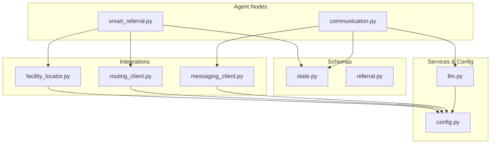
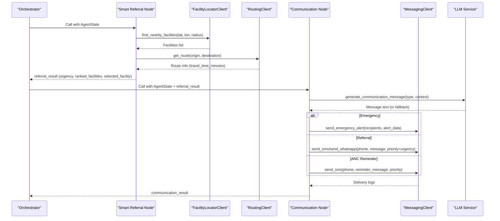
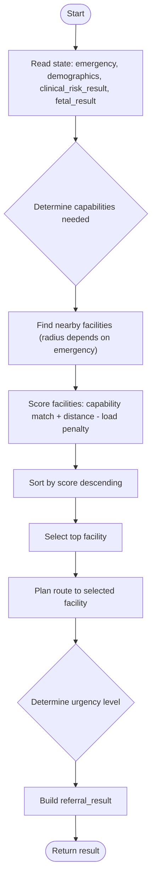
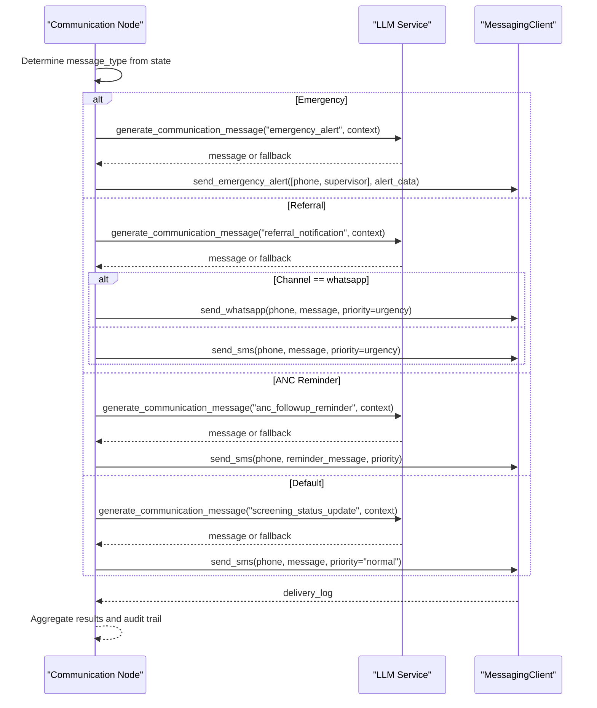
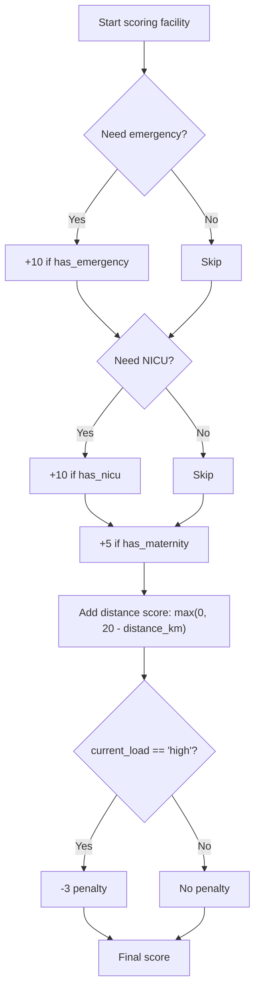
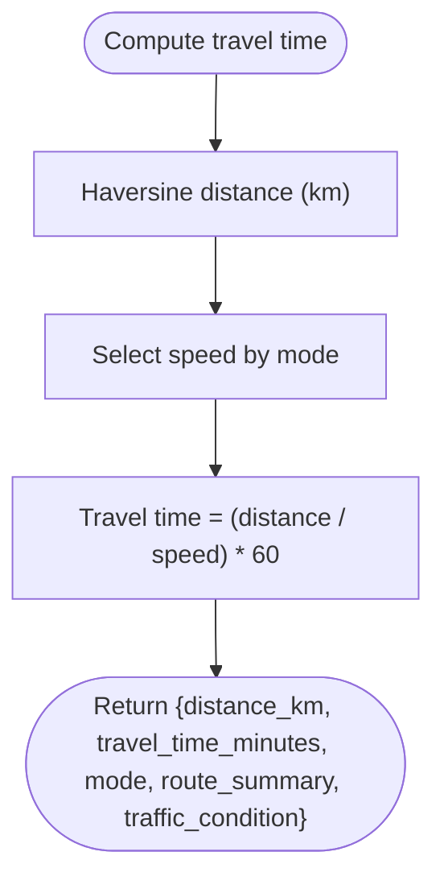
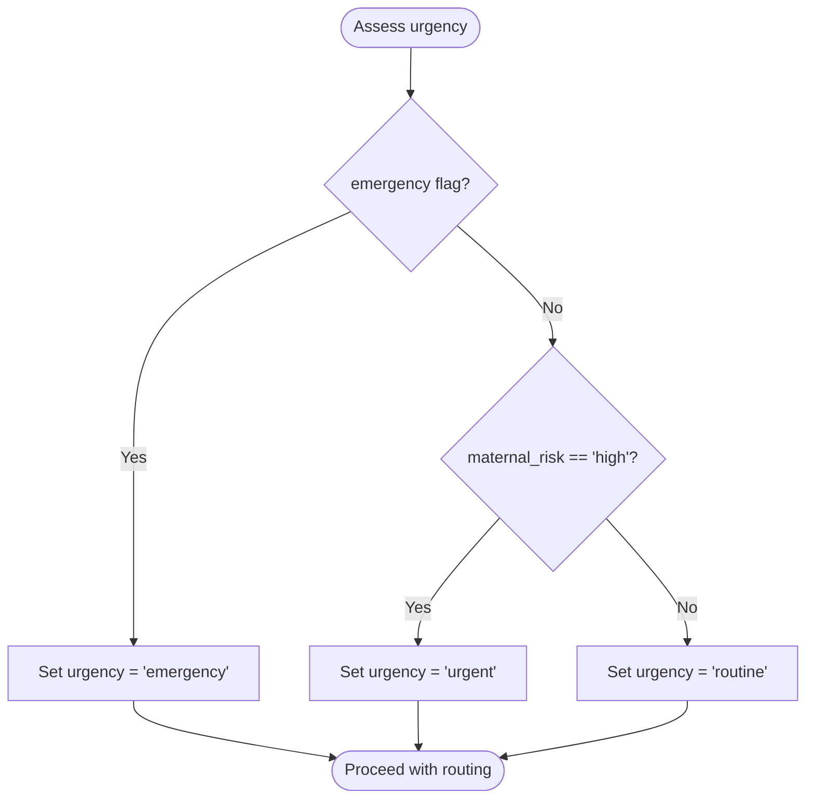
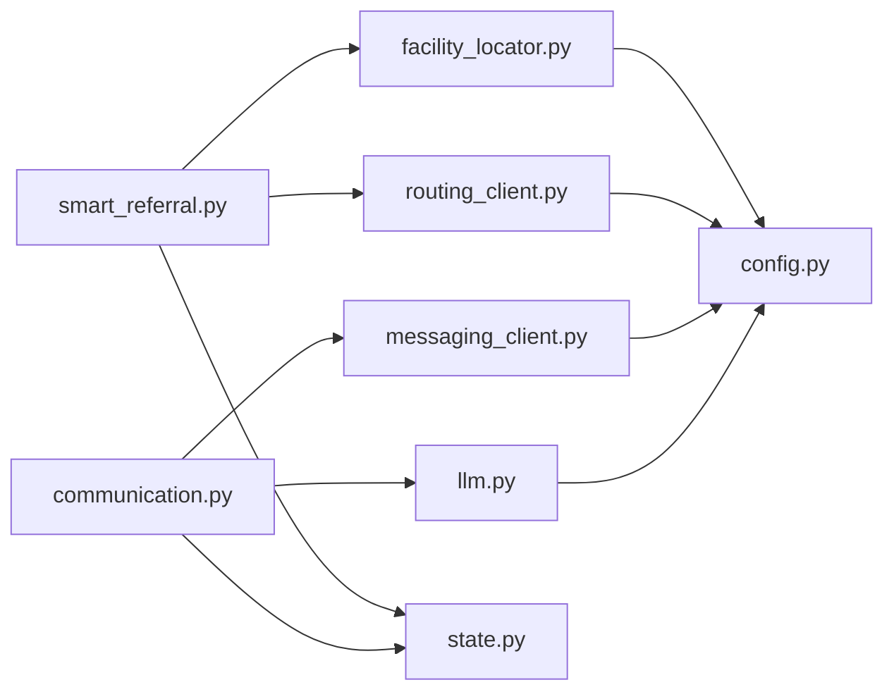

# Referral and Communication Nodes

<cite>
**Referenced Files in This Document**
- [smart_referral.py](file://backend/agents/nodes/smart_referral.py)
- [communication.py](file://backend/agents/nodes/communication.py)
- [facility_locator.py](file://backend/integrations/facility_locator.py)
- [routing_client.py](file://backend/integrations/routing_client.py)
- [messaging_client.py](file://backend/integrations/messaging_client.py)
- [state.py](file://backend/schemas/state.py)
- [referral.py](file://backend/schemas/referral.py)
- [llm.py](file://backend/services/llm.py)
- [config.py](file://backend/config.py)
</cite>

## Table of Contents
1. Introduction
2. Project Structure
3. Core Components
4. Architecture Overview
5. Detailed Component Analysis
6. Dependency Analysis
7. Performance Considerations
8. Troubleshooting Guide
9. Conclusion

## Introduction
This document explains the referral and communication nodes that power facility ranking, referral generation based on urgency and location, and multi-channel messaging (SMS, WhatsApp, emergency alerts). It covers:
- Facility matching algorithms and distance calculations
- Urgency-based routing decisions
- Multi-channel communication strategies with LLM-generated or template messages
- Integration points with external services such as Overpass API, OpenRouteService, and messaging providers

The goal is to make these systems understandable for both technical and non-technical readers while providing precise references to the codebase.

## Project Structure
The referral and communication functionality spans agent nodes, integration clients, schemas, and configuration:
- Agent nodes implement business logic for smart referrals and communication dispatch
- Integration clients abstract external services (facilities, routing, messaging)
- Schemas define shared data contracts
- Configuration centralizes external service endpoints and credentials

**Diagram sources**
- [smart_referral.py:11-118](file://backend/agents/nodes/smart_referral.py#L11-L118)
- [communication.py:38-213](file://backend/agents/nodes/communication.py#L38-L213)
- [facility_locator.py:7-69](file://backend/integrations/facility_locator.py#L7-L69)
- [routing_client.py:8-71](file://backend/integrations/routing_client.py#L8-L71)
- [messaging_client.py:9-78](file://backend/integrations/messaging_client.py#L9-L78)
- [state.py:7-43](file://backend/schemas/state.py#L7-L43)
- [referral.py:7-28](file://backend/schemas/referral.py#L7-L28)
- [llm.py:31-144](file://backend/services/llm.py#L31-L144)
- [config.py:31-42](file://backend/config.py#L31-L42)

**Section sources**
- [smart_referral.py:11-118](file://backend/agents/nodes/smart_referral.py#L11-L118)
- [communication.py:38-213](file://backend/agents/nodes/communication.py#L38-L213)
- [facility_locator.py:7-69](file://backend/integrations/facility_locator.py#L7-L69)
- [routing_client.py:8-71](file://backend/integrations/routing_client.py#L8-L71)
- [messaging_client.py:9-78](file://backend/integrations/messaging_client.py#L9-L78)
- [state.py:7-43](file://backend/schemas/state.py#L7-L43)
- [referral.py:7-28](file://backend/schemas/referral.py#L7-L28)
- [llm.py:31-144](file://backend/services/llm.py#L31-L47)
- [config.py:31-42](file://backend/config.py#L31-L42)

## Core Components
- Smart Referral Node: Finds nearby facilities, ranks them by capability match and distance, plans a route, determines urgency, and creates a referral record.
- Communication Node: Determines message type from state context and sends alerts via SMS, WhatsApp, or emergency alerts; supports LLM-generated or template messages.
- Facility Locator Client: Provides nearby healthcare facilities (stubbed here), returning capabilities and load status.
- Routing Client: Estimates travel time and routes using haversine distance and mode-specific speeds (stubbed here).
- Messaging Client: Sends SMS, WhatsApp, and emergency alerts; tracks delivery status.
- LLM Service: Generates contextual messages for communications when available; falls back to templates if unavailable.
- State and Referral Schemas: Define shared structures for agent state and referral results.

**Section sources**
- [smart_referral.py:11-118](file://backend/agents/nodes/smart_referral.py#L11-L118)
- [communication.py:38-213](file://backend/agents/nodes/communication.py#L38-L213)
- [facility_locator.py:7-69](file://backend/integrations/facility_locator.py#L7-L69)
- [routing_client.py:8-71](file://backend/integrations/routing_client.py#L8-L71)
- [messaging_client.py:9-78](file://backend/integrations/messaging_client.py#L9-L78)
- [llm.py:31-144](file://backend/services/llm.py#L31-L144)
- [state.py:7-43](file://backend/schemas/state.py#L7-L43)
- [referral.py:7-28](file://backend/schemas/referral.py#L7-L28)

## Architecture Overview
The system orchestrates two primary flows:
- Referral Flow: Patient location and risk inputs drive facility search, ranking, route planning, and urgency determination.
- Communication Flow: Based on state context, messages are generated (LLM or template) and dispatched via SMS, WhatsApp, or emergency alerts.

**Diagram sources**
- [smart_referral.py:11-118](file://backend/agents/nodes/smart_referral.py#L11-L118)
- [communication.py:38-213](file://backend/agents/nodes/communication.py#L38-L213)
- [facility_locator.py:14-60](file://backend/integrations/facility_locator.py#L14-L60)
- [routing_client.py:16-59](file://backend/integrations/routing_client.py#L16-L59)
- [messaging_client.py:17-78](file://backend/integrations/messaging_client.py#L17-L78)
- [llm.py:91-99](file://backend/services/llm.py#L91-L99)

## Detailed Component Analysis

### Smart Referral Node
Responsibilities:
- Determine required capabilities (emergency, NICU, maternity) from state flags and clinical/fetal results
- Search nearby facilities within an urgency-dependent radius
- Rank facilities by capability match and distance, penalizing high-load facilities
- Plan route to the top-ranked facility
- Determine urgency level (emergency, urgent, routine)
- Build and return referral result including ranked facilities, selected facility, route info, and estimated travel time

Key behaviors:
- Capability scoring adds points for matching needs and subtracts for high load
- Distance contribution favors closer facilities
- Urgency derived from emergency flag and maternal risk level

**Diagram sources**
- [smart_referral.py:20-98](file://backend/agents/nodes/smart_referral.py#L20-L98)

**Section sources**
- [smart_referral.py:11-118](file://backend/agents/nodes/smart_referral.py#L11-L118)

### Communication Node
Responsibilities:
- Decide message type based on state context (emergency, referral, ANC follow-up, default update)
- Generate message content via LLM with fallback to templates
- Dispatch messages via appropriate channel (SMS, WhatsApp, emergency alerts)
- Track delivery status and aggregate results

Message types and channels:
- Emergency alert: sends to multiple recipients (patient phone and supervisor)
- Referral notification: sends SMS or WhatsApp depending on configured channel
- ANC follow-up reminder: sends SMS or marks for call follow-up
- Default status update: sends SMS with screening outcome

**Diagram sources**
- [communication.py:38-213](file://backend/agents/nodes/communication.py#L38-L213)
- [llm.py:91-99](file://backend/services/llm.py#L91-L99)
- [messaging_client.py:17-78](file://backend/integrations/messaging_client.py#L17-L78)

**Section sources**
- [communication.py:38-213](file://backend/agents/nodes/communication.py#L38-L213)

### Facility Matching Algorithms
- Capability matching: Adds weighted scores for emergency, NICU, and maternity capabilities based on patient needs
- Distance weighting: Closer facilities receive higher scores
- Load penalty: High-load facilities are penalized to balance system load

Algorithm summary:
- Base score = 0
- If need_emergency and has_emergency: +10
- If need_nicu and has_nicu: +10
- If has_maternity: +5
- Distance contribution: max(0, 20 - distance_km)
- Load penalty: -3 if current_load == "high"

**Diagram sources**
- [smart_referral.py:46-63](file://backend/agents/nodes/smart_referral.py#L46-L63)

**Section sources**
- [smart_referral.py:46-63](file://backend/agents/nodes/smart_referral.py#L46-L63)

### Distance Calculations
- Haversine formula computes straight-line distance between origin and destination coordinates
- Travel time estimation uses average speeds per mode (driving, walking, ambulance)
- Stub implementation returns consistent estimates suitable for testing

**Diagram sources**
- [routing_client.py:16-44](file://backend/integrations/routing_client.py#L16-L44)
- [routing_client.py:61-71](file://backend/integrations/routing_client.py#L61-L71)

**Section sources**
- [routing_client.py:16-44](file://backend/integrations/routing_client.py#L16-L44)
- [routing_client.py:61-71](file://backend/integrations/routing_client.py#L61-L71)

### Urgency-Based Routing
- Emergency cases use larger search radius and immediate routing
- Urgent cases derive from high maternal risk levels
- Routine cases use smaller radius and standard routing

Decision flow:
- If emergency flag is true: urgency = "emergency"
- Else if maternal risk is high: urgency = "urgent"
- Else: urgency = "routine"

**Diagram sources**
- [smart_referral.py:74-83](file://backend/agents/nodes/smart_referral.py#L74-L83)

**Section sources**
- [smart_referral.py:74-83](file://backend/agents/nodes/smart_referral.py#L74-L83)

### Multi-Channel Communication Strategies
- Channels: SMS, WhatsApp, emergency alerts
- Priority handling: normal, high, emergency
- LLM integration: optional; falls back to templates when unavailable
- Delivery tracking: aggregated in communication_result

Strategy highlights:
- Emergency alerts broadcast to multiple recipients with high priority
- Referral notifications adapt to configured channel and urgency priority
- ANC reminders adjust message content and priority based on recommended action

**Section sources**
- [communication.py:64-178](file://backend/agents/nodes/communication.py#L64-L178)
- [messaging_client.py:17-78](file://backend/integrations/messaging_client.py#L17-L78)
- [llm.py:91-99](file://backend/services/llm.py#L91-L99)

### Examples of Referral Criteria and Facility Selection Logic
- Criteria include capability matches (emergency, NICU, maternity), distance, and facility load
- Selection logic ranks facilities by composite score and chooses the top candidate
- Route planning provides estimated travel time for decision support

References:
- Capability scoring and ranking: [smart_referral.py:46-63](file://backend/agents/nodes/smart_referral.py#L46-L63)
- Selected facility and route info: [smart_referral.py:65-73](file://backend/agents/nodes/smart_referral.py#L65-L73)
- Referral result structure: [smart_referral.py:84-98](file://backend/agents/nodes/smart_referral.py#L84-L98)

**Section sources**
- [smart_referral.py:46-98](file://backend/agents/nodes/smart_referral.py#L46-L98)

### Message Templates for Different Alert Types
- Emergency alert template includes patient ID, reason, and triage level
- Referral notification template includes facility name, urgency, and estimated travel time
- ANC reminder template includes priority and recommended action
- Default status update template includes risk level

References:
- Emergency alert fallback: [communication.py:67-70](file://backend/agents/nodes/communication.py#L67-L70)
- Referral notification fallback: [communication.py:100-104](file://backend/agents/nodes/communication.py#L100-L104)
- ANC reminder fallback: [communication.py:129-133](file://backend/agents/nodes/communication.py#L129-L133)
- Default update fallback: [communication.py:163-166](file://backend/agents/nodes/communication.py#L163-L166)

**Section sources**
- [communication.py:67-166](file://backend/agents/nodes/communication.py#L67-L166)

### Integration with External Services
- Overpass API: Configured endpoint for facility discovery (currently stubbed with mock facilities)
- OpenRouteService: Configured endpoint for routing (currently stubbed with haversine-based estimates)
- Messaging providers: Configured endpoint for SMS/WhatsApp/emergency alerts (currently stubbed with in-memory logging)

Configuration references:
- External API URLs: [config.py:31-35](file://backend/config.py#L31-L35)
- Facility locator usage: [facility_locator.py:14-60](file://backend/integrations/facility_locator.py#L14-L60)
- Routing client usage: [routing_client.py:16-59](file://backend/integrations/routing_client.py#L16-L59)
- Messaging client usage: [messaging_client.py:17-78](file://backend/integrations/messaging_client.py#L17-L78)

**Section sources**
- [config.py:31-35](file://backend/config.py#L31-L35)
- [facility_locator.py:14-60](file://backend/integrations/facility_locator.py#L14-L60)
- [routing_client.py:16-59](file://backend/integrations/routing_client.py#L16-L59)
- [messaging_client.py:17-78](file://backend/integrations/messaging_client.py#L17-L78)

## Dependency Analysis
The components exhibit clear separation of concerns:
- Smart Referral depends on FacilityLocatorClient and RoutingClient
- Communication depends on MessagingClient and LLM Service
- All integrations depend on configuration for endpoints and timeouts
- Shared state schema ensures consistent data flow across nodes

**Diagram sources**
- [smart_referral.py:11-118](file://backend/agents/nodes/smart_referral.py#L11-L118)
- [communication.py:38-213](file://backend/agents/nodes/communication.py#L38-L213)
- [facility_locator.py:7-69](file://backend/integrations/facility_locator.py#L7-L69)
- [routing_client.py:8-71](file://backend/integrations/routing_client.py#L8-L71)
- [messaging_client.py:9-78](file://backend/integrations/messaging_client.py#L9-L78)
- [llm.py:31-144](file://backend/services/llm.py#L31-L144)
- [state.py:7-43](file://backend/schemas/state.py#L7-L43)
- [config.py:31-42](file://backend/config.py#L31-L42)

**Section sources**
- [smart_referral.py:11-118](file://backend/agents/nodes/smart_referral.py#L11-L118)
- [communication.py:38-213](file://backend/agents/nodes/communication.py#L38-L213)
- [facility_locator.py:7-69](file://backend/integrations/facility_locator.py#L7-L69)
- [routing_client.py:8-71](file://backend/integrations/routing_client.py#L8-L71)
- [messaging_client.py:9-78](file://backend/integrations/messaging_client.py#L9-L78)
- [llm.py:31-144](file://backend/services/llm.py#L31-L144)
- [state.py:7-43](file://backend/schemas/state.py#L7-L43)
- [config.py:31-42](file://backend/config.py#L31-L42)

## Performance Considerations
- Facility search radius adapts to urgency to balance coverage and latency
- Scoring algorithm is O(n log n) due to sorting; efficient for typical facility counts
- Haversine distance calculation is constant-time per pair; travel time estimation is lightweight
- LLM calls are wrapped with fallbacks to avoid blocking critical paths
- In-memory message logging aids testing but should be replaced with persistent storage in production

[No sources needed since this section provides general guidance]

## Troubleshooting Guide
Common issues and resolutions:
- LLM unavailability: The communication node falls back to template messages; ensure Groq package is installed and API key is valid
- Messaging failures: Check configured messaging endpoint and network connectivity; delivery logs help identify failed messages
- Facility lookup errors: Verify Overpass API availability or switch to real implementation; currently stubbed with mock data
- Routing errors: Validate coordinates and ensure routing endpoint is reachable; stub uses haversine estimates

Error handling patterns:
- Smart referral node catches exceptions and returns error entries with audit trails
- Communication node catches exceptions and returns error entries with audit trails
- Messaging client tracks sent messages and provides delivery status queries

**Section sources**
- [smart_referral.py:120-135](file://backend/agents/nodes/smart_referral.py#L120-L135)
- [communication.py:215-230](file://backend/agents/nodes/communication.py#L215-L230)
- [messaging_client.py:61-66](file://backend/integrations/messaging_client.py#L61-L66)
- [llm.py:129-143](file://backend/services/llm.py#L129-L143)

## Conclusion
The referral and communication nodes provide a robust foundation for facility ranking, urgency-based routing, and multi-channel messaging. The design emphasizes resilience through fallback mechanisms, clear separation of concerns, and extensible integration points. With proper configuration and external service availability, the system can deliver timely and accurate referrals and communications for maternal health scenarios.

[No sources needed since this section summarizes without analyzing specific files]