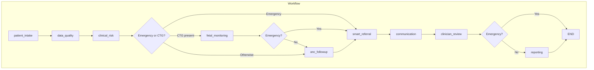
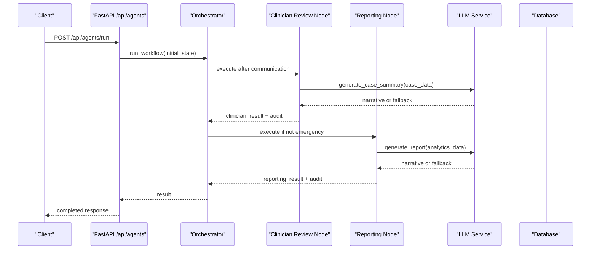
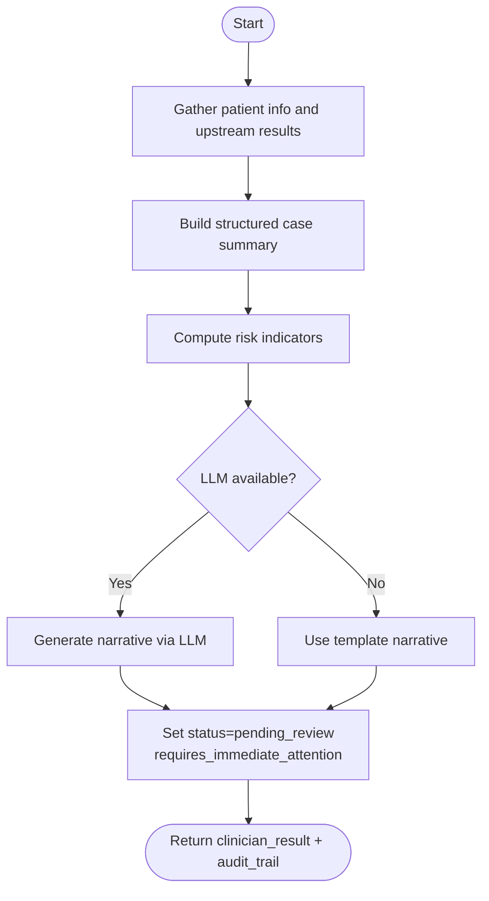
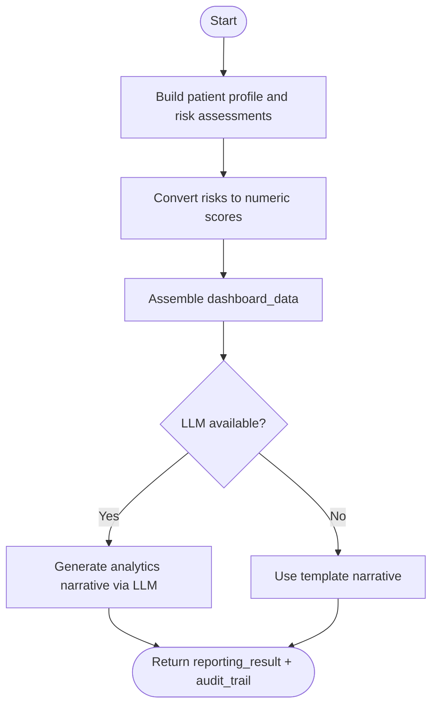
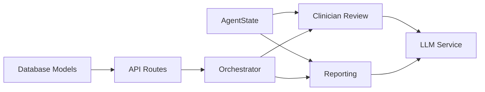

# Review and Reporting Nodes

<cite>
**Referenced Files in This Document**
- [clinician_review.py](file://backend/agents/nodes/clinician_review.py)
- [reporting.py](file://backend/agents/nodes/reporting.py)
- [llm.py](file://backend/services/llm.py)
- [state.py](file://backend/schemas/state.py)
- [orchestrator.py](file://backend/agents/orchestrator.py)
- [agents.py](file://backend/api/routes/agents.py)
- [analytics.py](file://backend/api/routes/analytics.py)
- [models.py](file://backend/db/models.py)
- [config.py](file://backend/config.py)
</cite>

## Table of Contents
1. Introduction
2. Project Structure
3. Core Components
4. Architecture Overview
5. Detailed Component Analysis
6. Dependency Analysis
7. Performance Considerations
8. Troubleshooting Guide
9. Conclusion
10. Appendices

## Introduction
This document explains the review and reporting nodes that power human-in-the-loop decision support and structured clinical report generation. It focuses on:
- Clinician review: aggregation of upstream agent outputs into a case summary, risk indicators, and optional LLM-generated narrative for clinician review.
- Reporting: generation of structured case summaries, dashboard/trend data, and optional LLM-generated analytics narratives.
- Summarization algorithms, key findings extraction, recommendation generation, and report formatting options.
- Integration points with electronic health record (EHR) systems via APIs and database models.
- How LLM integration is used for natural language processing and report generation, including fallback behavior when LLM services are unavailable.

## Project Structure
The review and reporting functionality is implemented as two LangGraph agent nodes within an orchestrated workflow. The orchestrator wires these nodes after communication and before final completion. The nodes consume a shared state schema and optionally call an LLM service to produce narrative text.

**Diagram sources**
- [orchestrator.py:22-55](file://backend/agents/orchestrator.py#L22-L55)
- [orchestrator.py:62-132](file://backend/agents/orchestrator.py#L62-L132)

**Section sources**
- [orchestrator.py:1-167](file://backend/agents/orchestrator.py#L1-L167)
- [state.py:1-43](file://backend/schemas/state.py#L1-L43)

## Core Components
- Clinician review node: Aggregates patient info, vitals, symptoms, demographics, and results from clinical risk, fetal monitoring, ANC follow-up, referral, and communication agents. Produces a structured case summary, risk indicators, and an optional LLM-generated narrative. Marks the case pending_review for human approval.
- Reporting node: Builds a comprehensive case summary payload and dashboard/trend data suitable for dashboards, trend analysis, and export. Optionally generates a narrative analytics report using LLM. Includes numeric risk scorecards and pipeline health metrics.

Key responsibilities:
- Extract key findings from upstream results and synthesize them into concise, actionable summaries.
- Generate recommendations based on risk levels and triage flags.
- Provide structured outputs for downstream systems (dashboards, EHRs).
- Ensure robustness by falling back to template-based narratives if LLM calls fail.

**Section sources**
- [clinician_review.py:13-147](file://backend/agents/nodes/clinician_review.py#L13-L147)
- [reporting.py:13-173](file://backend/agents/nodes/reporting.py#L13-L173)

## Architecture Overview
The review and reporting nodes operate within a LangGraph StateGraph workflow. They read from a shared AgentState and write results back to it. An LLM service provides optional narrative generation. API routes expose endpoints to run the full workflow or invoke individual nodes. Database models persist clinical records and referrals for EHR integration.

**Diagram sources**
- [agents.py:62-79](file://backend/api/routes/agents.py#L62-L79)
- [orchestrator.py:62-132](file://backend/agents/orchestrator.py#L62-L132)
- [clinician_review.py:89-128](file://backend/agents/nodes/clinician_review.py#L89-L128)
- [reporting.py:132-160](file://backend/agents/nodes/reporting.py#L132-L160)
- [llm.py:101-119](file://backend/services/llm.py#L101-L119)

## Detailed Component Analysis

### Clinician Review Node
Purpose:
- Aggregate upstream results into a structured case summary for human-in-the-loop review.
- Compute quick-risk indicators to highlight urgent cases.
- Optionally generate a narrative case summary using LLM; fall back to template if unavailable.

Summarization algorithm:
- Collect patient_id, case_id, emergency flag, vitals, symptoms, demographics.
- Merge clinical risk, fetal monitoring, ANC follow-up, referral, and communication results into a unified structure.
- Derive risk indicators from emergency status, maternal risk level, fetal status, and WHO triage flags.
- Attempt LLM narrative generation; otherwise use a deterministic template.

Key findings extraction:
- Maternal risk level and confidence.
- Gestational risk level.
- Fetal status and preterm risk.
- ANC missed visit risk and priority.
- Referral urgency and selected facility.
- Communication delivery status.

Recommendation generation:
- Risk indicators drive attention flags (e.g., “EMERGENCY FLAGGED”, high maternal risk, pathological/suspicious fetal status, non-green WHO triage).
- Requires immediate attention computed from emergency flag and number of risk indicators.

Report formatting options:
- Structured JSON case_summary with nested sections for easy parsing by downstream systems.
- Optional narrative field containing LLM-generated text or template fallback.
- Audit trail entries documenting actions and timestamps.

Integration points:
- Reads from AgentState fields populated by upstream nodes.
- Writes clinician_result and audit_trail back to state for downstream consumption.
- Can be invoked via API for single-node testing or as part of the full workflow.

**Diagram sources**
- [clinician_review.py:22-147](file://backend/agents/nodes/clinician_review.py#L22-L147)
- [llm.py:101-119](file://backend/services/llm.py#L101-L119)

**Section sources**
- [clinician_review.py:13-165](file://backend/agents/nodes/clinician_review.py#L13-L165)
- [state.py:7-43](file://backend/schemas/state.py#L7-L43)

### Reporting Node
Purpose:
- Generate a comprehensive case summary payload and dashboard/trend data structures.
- Produce numeric risk scorecards and pipeline health metrics.
- Optionally generate a narrative analytics report using LLM; fall back to template if unavailable.

Summarization algorithm:
- Extract patient profile (demographics, vitals, symptoms), risk assessments (maternal, gestational, fetal, preterm, ANC), referral details, communication stats, clinician review status, and data quality metrics.
- Convert risk levels to numeric scores for dashboard visualization.
- Assemble dashboard_data with risk_scorecard, vitals_snapshot, and pipeline_health.

Key findings extraction:
- Risk assessment levels and confidences.
- Fetal status and preterm risk.
- ANC missed visit risk and priority.
- Referral urgency and travel time.
- Data quality score and counts of flags/warnings.

Recommendation generation:
- Numeric scorecards enable threshold-based alerts and prioritization.
- Pipeline health indicates agents executed, total audit entries, errors, and emergency escalation.

Report formatting options:
- Structured JSON case_summary and dashboard_data for programmatic consumption.
- Optional narrative field containing LLM-generated analytics text or template fallback.
- Timestamps and metadata for traceability.

Integration points:
- Consumes AgentState fields from all upstream nodes.
- Writes reporting_result and audit_trail back to state.
- Exposed via API for dashboard queries and analytics endpoints.

**Diagram sources**
- [reporting.py:22-173](file://backend/agents/nodes/reporting.py#L22-L173)
- [reporting.py:193-216](file://backend/agents/nodes/reporting.py#L193-L216)
- [llm.py:112-119](file://backend/services/llm.py#L112-L119)

**Section sources**
- [reporting.py:13-217](file://backend/agents/nodes/reporting.py#L13-L217)
- [state.py:7-43](file://backend/schemas/state.py#L7-L43)

### LLM Integration
- Provides Groq-based text generation for clinical risk summaries, follow-up questions, communication messages, clinician case summaries, and analytics reports.
- All agent nodes treat LLM generation as optional; failures fall back to template text and set llm_generated=False.
- Configuration includes API key and model selection; initialization is guarded so the backend remains functional without the groq package.

Usage in review and reporting:
- Clinician review: generate_case_summary receives the structured case data and returns a narrative for clinician review.
- Reporting: generate_report receives analytics_data (case_summary and dashboard_data) and returns a concise analytics narrative.

Error handling:
- Exceptions during LLM calls are caught and logged; fallback narrative is used.
- get_llm_service returns None if the service cannot be initialized, ensuring graceful degradation.

**Section sources**
- [llm.py:1-144](file://backend/services/llm.py#L1-L144)
- [config.py:37-42](file://backend/config.py#L37-L42)

## Dependency Analysis
- Clinician review depends on:
  - AgentState fields populated by upstream nodes (clinical_risk_result, fetal_result, anc_result, referral_result, communication_result).
  - LLM service for optional narrative generation.
- Reporting depends on:
  - AgentState fields from all upstream nodes, including clinician_result and data_quality_result.
  - LLM service for optional analytics narrative.
- Orchestrator controls flow between nodes and determines whether reporting runs based on emergency status.
- API routes provide entry points to run the full workflow or invoke individual nodes.
- Database models store clinical records and referrals, enabling EHR integration through standard CRUD operations.

**Diagram sources**
- [state.py:7-43](file://backend/schemas/state.py#L7-L43)
- [orchestrator.py:62-132](file://backend/agents/orchestrator.py#L62-L132)
- [agents.py:62-114](file://backend/api/routes/agents.py#L62-L114)
- [models.py:34-64](file://backend/db/models.py#L34-L64)

**Section sources**
- [orchestrator.py:1-167](file://backend/agents/orchestrator.py#L1-L167)
- [agents.py:1-135](file://backend/api/routes/agents.py#L1-L135)
- [models.py:34-64](file://backend/db/models.py#L34-L64)

## Performance Considerations
- LLM calls are executed in worker threads to avoid blocking the async event loop.
- Fallback templates ensure responsiveness when LLM services are unavailable.
- Emergency paths skip reporting to reduce latency for critical cases.
- Numeric conversions for risk scoring optimize dashboard rendering and alerting thresholds.
- Batched analytics queries cap limits to prevent N+1 slowdowns in MVP scenarios.

[No sources needed since this section provides general guidance]

## Troubleshooting Guide
Common issues and resolutions:
- LLM unavailable:
  - Symptom: llm_generated=False and narrative equals template text.
  - Action: Verify groq package installation, API key, and network connectivity. Check logs for initialization warnings.
- Missing upstream results:
  - Symptom: Empty or partial case_summary fields.
  - Action: Ensure prior nodes executed successfully and populated required AgentState keys.
- Emergency path skipping reporting:
  - Symptom: No reporting_result in final state.
  - Action: Confirm emergency flag logic; reporting is intentionally skipped for speed in emergencies.
- API invocation errors:
  - Symptom: HTTP 500 responses from /api/agents/run or /api/agents/{node}/invoke.
  - Action: Inspect exception details and validate request payloads.

**Section sources**
- [llm.py:20-28](file://backend/services/llm.py#L20-L28)
- [clinician_review.py:149-165](file://backend/agents/nodes/clinician_review.py#L149-L165)
- [reporting.py:175-190](file://backend/agents/nodes/reporting.py#L175-L190)
- [agents.py:72-114](file://backend/api/routes/agents.py#L72-L114)

## Conclusion
The review and reporting nodes provide robust, structured outputs for human-in-the-loop decision support and analytics. They aggregate multi-agent results, compute risk indicators, and optionally enhance outputs with LLM-generated narratives while maintaining resilience through fallback mechanisms. Integration points with APIs and database models facilitate EHR interoperability and operational dashboards.

[No sources needed since this section summarizes without analyzing specific files]

## Appendices

### Example Clinical Summary Structure
- Patient overview: demographics, vitals, symptoms count.
- Risk assessments: maternal, gestational, fetal status, preterm risk, ANC missed visit risk, WHO triage.
- Referral details: urgency, selected facility, travel time.
- Communication status: messages sent, delivery confirmation.
- Clinician review: status and attention requirements.
- Data quality: score and counts of flags/warnings.
- Optional narrative: LLM-generated or template-based.

**Section sources**
- [reporting.py:44-100](file://backend/agents/nodes/reporting.py#L44-L100)
- [clinician_review.py:37-71](file://backend/agents/nodes/clinician_review.py#L37-L71)

### Report Templates and Formatting Options
- Structured JSON payloads for programmatic consumption.
- Numeric risk scorecards for dashboards.
- Optional narrative fields for human-readable summaries.
- Audit trails with timestamps and action descriptions.

**Section sources**
- [reporting.py:102-124](file://backend/agents/nodes/reporting.py#L102-L124)
- [reporting.py:154-173](file://backend/agents/nodes/reporting.py#L154-L173)
- [clinician_review.py:120-147](file://backend/agents/nodes/clinician_review.py#L120-L147)

### EHR Integration Points
- API endpoints:
  - Run full workflow: POST /api/agents/run
  - Invoke single node: POST /api/agents/{node_name}/invoke
  - Analytics dashboard: GET /api/analytics/dashboard
- Database persistence:
  - Clinical records include vitals, symptoms, risk levels, model outputs, clinician decisions, and notes.
  - Referrals include facility details, urgency, and status for tracking outcomes.

**Section sources**
- [agents.py:62-114](file://backend/api/routes/agents.py#L62-L114)
- [analytics.py:21-78](file://backend/api/routes/analytics.py#L21-L78)
- [models.py:34-64](file://backend/db/models.py#L34-L64)