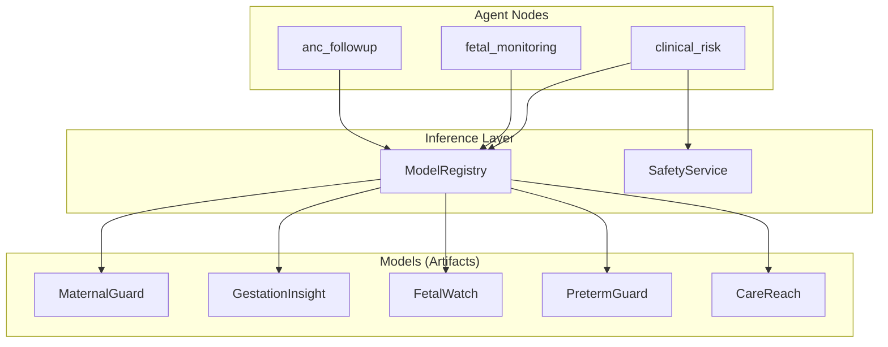
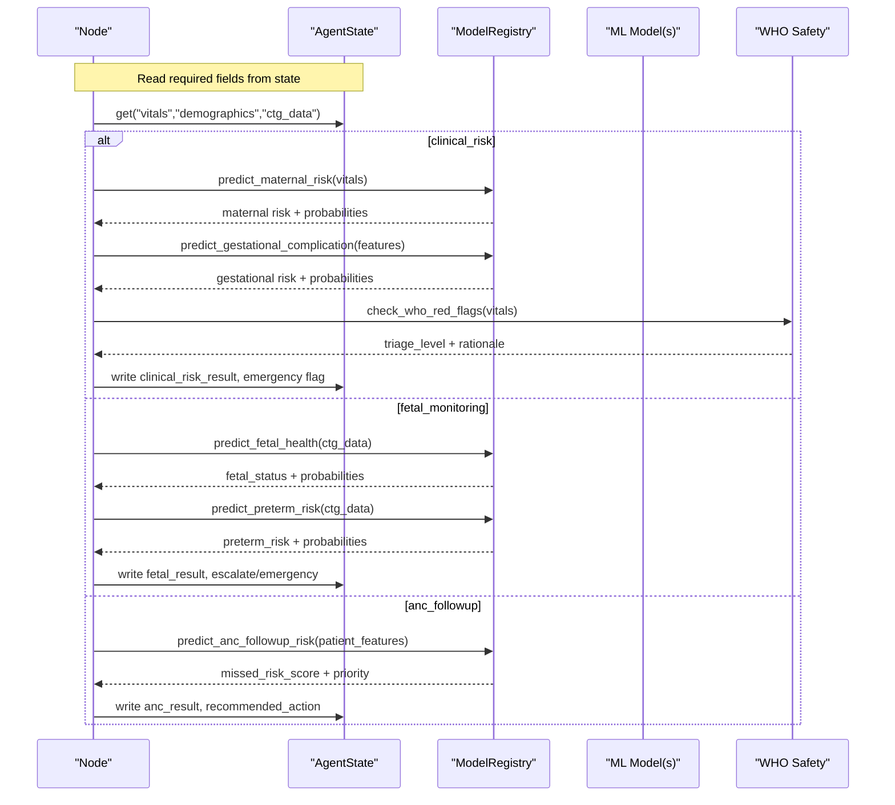
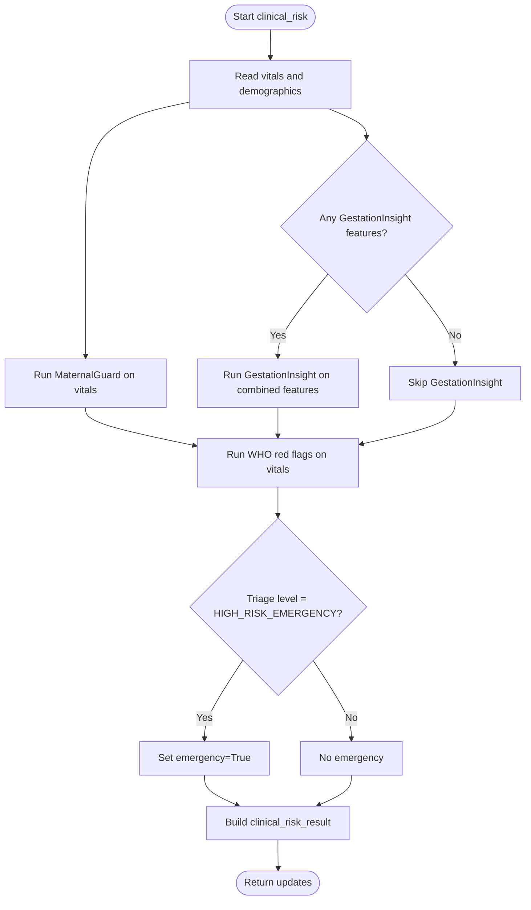
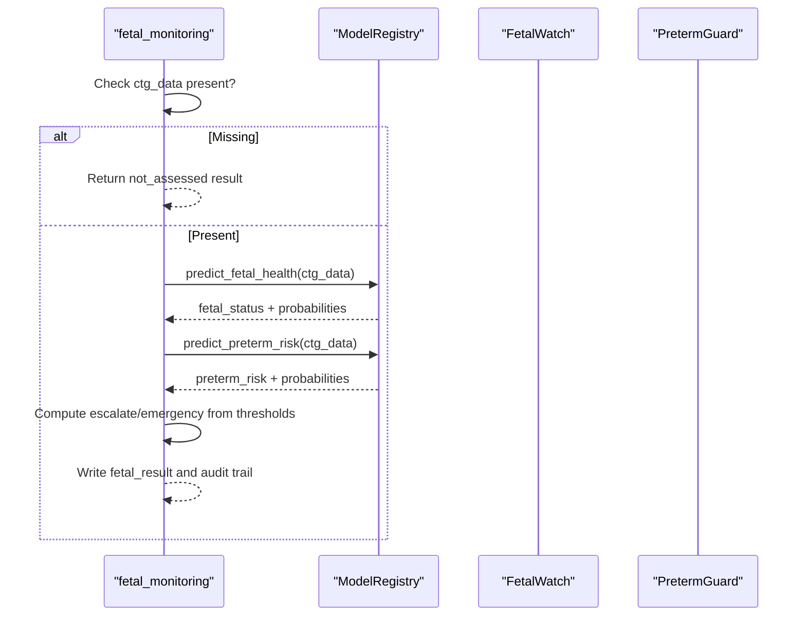
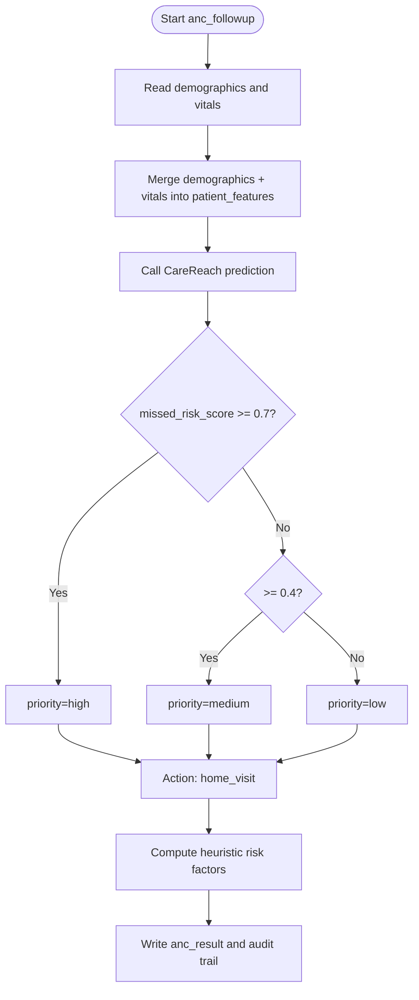
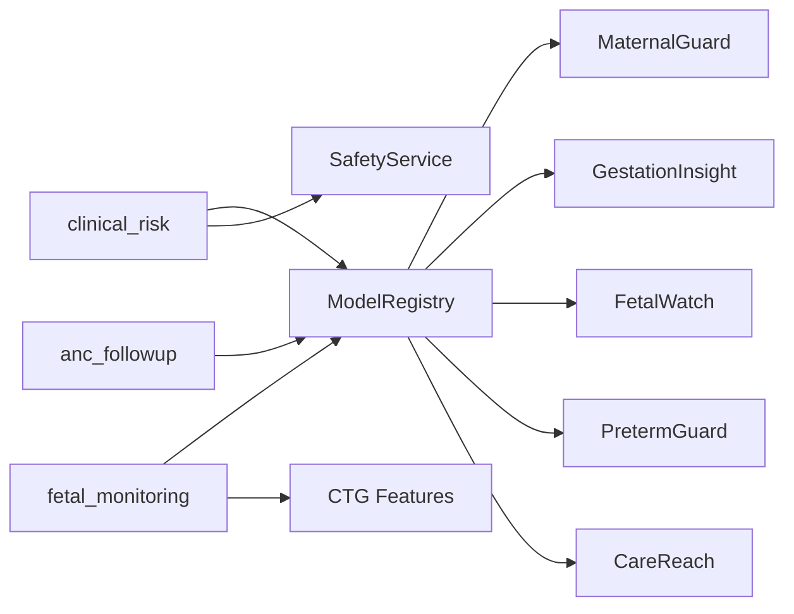

# Risk Assessment Nodes

<cite>
**Referenced Files in This Document**
- [clinical_risk.py](file://backend/agents/nodes/clinical_risk.py)
- [fetal_monitoring.py](file://backend/agents/nodes/fetal_monitoring.py)
- [anc_followup.py](file://backend/agents/nodes/anc_followup.py)
- [inference.py](file://backend/services/inference.py)
- [state.py](file://backend/schemas/state.py)
- [ctg_features.py](file://src/features/ctg_features.py)
- [maternal_guard.py](file://src/models/maternal_guard.py)
- [preterm_guard.py](file://src/models/preterm_guard.py)
- [fetal_watch.py](file://src/models/fetal_watch.py)
- [train_care_reach.py](file://train_care_reach.py)
- [safety.py](file://backend/services/safety.py)
- [config.py](file://backend/config.py)
</cite>

## Table of Contents
1. Introduction
2. Project Structure
3. Core Components
4. Architecture Overview
5. Detailed Component Analysis
6. Dependency Analysis
7. Performance Considerations
8. Troubleshooting Guide
9. Conclusion

## Introduction
This document explains the risk assessment nodes that integrate machine learning models into a clinical workflow:
- clinical_risk: maternal and gestational risk prediction using MaternalGuard and GestationInsight, plus mandatory WHO safety rules.
- fetal_monitoring: CTG-based fetal health and preterm risk using FetalWatch and PretermGuard.
- anc_followup: ANC missed-visit risk scoring with CareReach and recommended follow-up actions.

It covers model inputs, feature engineering, risk score calculations, threshold-based decision logic, example outputs, and required state fields for each node.

## Project Structure
The risk assessment nodes are LangGraph-style agent nodes that read from a shared AgentState, call a ModelRegistry to run ML inference, and write results back into the state. Models are trained separately and loaded as artifacts at runtime.

**Diagram sources**
- [clinical_risk.py:15-109](file://backend/agents/nodes/clinical_risk.py#L15-L109)
- [fetal_monitoring.py:10-93](file://backend/agents/nodes/fetal_monitoring.py#L10-L93)
- [anc_followup.py:10-85](file://backend/agents/nodes/anc_followup.py#L10-L85)
- [inference.py:51-141](file://backend/services/inference.py#L51-L141)
- [safety.py:18-67](file://backend/services/safety.py#L18-L67)

**Section sources**
- [state.py:7-43](file://backend/schemas/state.py#L7-L43)
- [config.py:7-21](file://backend/config.py#L7-L21)

## Core Components
- ModelRegistry: Singleton that loads all models and provides typed predict methods for each model. It normalizes inputs, fills missing features, computes probabilities, and returns consistent result schemas.
- SafetyService: Adapter to the WHO Clinical Safety Rule Engine; always executed in clinical_risk to enforce red-flag triage.
- Feature Engineering: CTG features are extracted from raw signals to match UCI CTG schema used by FetalWatch and PretermGuard.
- Node Orchestration: Each node reads required state fields, calls appropriate predictions, applies thresholds, and writes structured results and audit trails.

**Section sources**
- [inference.py:151-426](file://backend/services/inference.py#L151-L426)
- [ctg_features.py:27-32](file://src/features/ctg_features.py#L27-L32)
- [safety.py:24-67](file://backend/services/safety.py#L24-L67)

## Architecture Overview
End-to-end flow for each node:

**Diagram sources**
- [clinical_risk.py:24-109](file://backend/agents/nodes/clinical_risk.py#L24-L109)
- [fetal_monitoring.py:19-93](file://backend/agents/nodes/fetal_monitoring.py#L19-L93)
- [anc_followup.py:18-85](file://backend/agents/nodes/anc_followup.py#L18-L85)
- [inference.py:151-426](file://backend/services/inference.py#L151-L426)
- [safety.py:24-67](file://backend/services/safety.py#L24-L67)

## Detailed Component Analysis

### clinical_risk Node
Purpose: Combine maternal risk (MaternalGuard), gestational complication risk (GestationInsight), and WHO red-flag triage. Always runs WHO rules; if HIGH_RISK_EMERGENCY, sets emergency=True.

Required state fields:
- vitals: dict with keys such as Age, SystolicBP, DiastolicBP, BS, BodyTemp, HeartRate (for MaternalGuard).
- demographics: dict merged with vitals for GestationInsight features like Glucose, BloodPressure, BMI, Insulin, SkinThickness, Pregnancies.

Inputs and feature engineering:
- MaternalGuard expects a fixed set of vital signs; missing columns are filled with zeros before inference.
- GestationInsight uses a broader clinical feature set; only available keys are passed, missing ones zero-filled.

Risk score calculation and thresholds:
- MaternalGuard returns risk_level, probabilities, confidence.
- GestationInsight returns risk_level (Low/Moderate/High), probabilities, confidence.
- WHO triage_level is mapped to is_emergency when HIGH_RISK_EMERGENCY.

Example output structure (described):
- clinical_risk_result.maternal_risk: {risk_level, probabilities, confidence, model_available}
- clinical_risk_result.gestational_risk: {risk_level, probabilities, confidence, model_available}
- clinical_risk_result.who_red_flags: {triage_level, triggered_rules, clinical_rationale, recommended_actions}
- clinical_risk_result.is_emergency: boolean
- clinical_risk_result.risk_summary: human-readable summary (LLM-generated if available, else template)
- audit_trail: list of entries with timestamp and action

Decision logic:
- Emergency flag is set if WHO triage_level == HIGH_RISK_EMERGENCY.
- LLM summary generation is optional and non-blocking; failure falls back to template summary.

Integration points:
- Uses ModelRegistry.predict_maternal_risk and predict_gestational_complication.
- Uses SafetyService.check_who_red_flags.

**Diagram sources**
- [clinical_risk.py:24-109](file://backend/agents/nodes/clinical_risk.py#L24-L109)
- [inference.py:151-203](file://backend/services/inference.py#L151-L203)
- [inference.py:365-426](file://backend/services/inference.py#L365-L426)
- [safety.py:24-67](file://backend/services/safety.py#L24-L67)

**Section sources**
- [clinical_risk.py:15-127](file://backend/agents/nodes/clinical_risk.py#L15-L127)
- [inference.py:151-203](file://backend/services/inference.py#L151-L203)
- [inference.py:365-426](file://backend/services/inference.py#L365-L426)
- [safety.py:18-67](file://backend/services/safety.py#L18-L67)

### fetal_monitoring Node
Purpose: Run FetalWatch and PretermGuard on CTG features. If fetal status is pathological or preterm risk is high, sets emergency=True. Skips gracefully if no CTG data.

Required state fields:
- ctg_data: dict with 21 CTG features matching UCI CTG schema (LB, AC, FM, UC, DL, DS, DP, ASTV, MSTV, ALTV, MLTV, Width, Min, Max, Nmax, Nzeros, Mode, Mean, Median, Variance, Tendency).

Feature engineering:
- CTG features can be derived from raw FHR/UC signals via extract_features_from_signal to match UCI schema.

Risk score calculation and thresholds:
- FetalWatch returns fetal_status (Normal/Suspect/Pathological), probabilities, confidence.
- PretermGuard returns risk_level (Normal/Suspect/Pathological), probabilities, confidence.
- Escalation: is_high_risk if fetal_status in ("pathological", "suspicious") or preterm_risk in ("high", "high risk").
- Emergency: is_emergency if fetal_status == "pathological".

Example output structure (described):
- fetal_result.fetal_status, .probabilities, .confidence, .model_available
- fetal_result.preterm_risk, .preterm_probabilities, .preterm_confidence, .preterm_model_available
- fetal_result.escalate: boolean based on thresholds
- audit_trail: list of entries

Integration points:
- Uses ModelRegistry.predict_fetal_health and predict_preterm_risk.

**Diagram sources**
- [fetal_monitoring.py:10-93](file://backend/agents/nodes/fetal_monitoring.py#L10-L93)
- [inference.py:204-293](file://backend/services/inference.py#L204-L293)
- [ctg_features.py:506-593](file://src/features/ctg_features.py#L506-L593)

**Section sources**
- [fetal_monitoring.py:10-111](file://backend/agents/nodes/fetal_monitoring.py#L10-L111)
- [inference.py:204-293](file://backend/services/inference.py#L204-L293)
- [ctg_features.py:27-32](file://src/features/ctg_features.py#L27-L32)
- [ctg_features.py:506-593](file://src/features/ctg_features.py#L506-L593)

### anc_followup Node
Purpose: Predict ANC missed-visit risk with CareReach and recommend an action based on priority.

Required state fields:
- demographics: dict including Age, Scholarship, parity, etc.
- vitals: dict merged into patient_features if not already present.

Inputs and feature engineering:
- Patient features include demographic and some vital fields; categorical fields like Gender and age_group must be strings.
- CareReach preprocessor applies RobustScaler and OneHotEncoder during training; at inference, the same preprocessor is applied if available.

Risk score calculation and thresholds:
- CareReach returns missed_risk_score (probability of missed visit), priority, confidence.
- Priority mapping:
  - missed_risk_score >= 0.7 -> high
  - missed_risk_score >= 0.4 -> medium
  - else -> low
- Recommended action mapping:
  - high -> home_visit
  - medium -> call
  - low -> sms
  - unknown -> sms

Additional risk factors are computed heuristically from demographics/vitals (e.g., adolescent pregnancy, advanced maternal age, high parity, no financial support, elevated blood pressure).

Example output structure (described):
- anc_result.missed_visit_risk: float
- anc_result.priority: string
- anc_result.priority_score: rounded missed_risk_score
- anc_result.recommended_action: string
- anc_result.confidence: float
- anc_result.model_available: boolean
- anc_result.risk_factors: list of strings
- audit_trail: list of entries

Integration points:
- Uses ModelRegistry.predict_anc_followup_risk.

**Diagram sources**
- [anc_followup.py:10-85](file://backend/agents/nodes/anc_followup.py#L10-L85)
- [inference.py:297-361](file://backend/services/inference.py#L297-L361)

**Section sources**
- [anc_followup.py:10-103](file://backend/agents/nodes/anc_followup.py#L10-L103)
- [inference.py:297-361](file://backend/services/inference.py#L297-L361)

## Dependency Analysis
- Nodes depend on ModelRegistry for model access and on SafetyService for WHO rules.
- ModelRegistry depends on configuration paths to load artifacts and on feature lists to normalize inputs.
- CTG feature extraction ensures compatibility between raw signals and model expectations.

**Diagram sources**
- [clinical_risk.py:24-109](file://backend/agents/nodes/clinical_risk.py#L24-L109)
- [fetal_monitoring.py:19-93](file://backend/agents/nodes/fetal_monitoring.py#L19-L93)
- [anc_followup.py:18-85](file://backend/agents/nodes/anc_followup.py#L18-L85)
- [inference.py:51-141](file://backend/services/inference.py#L51-L141)
- [ctg_features.py:506-593](file://src/features/ctg_features.py#L506-L593)

**Section sources**
- [inference.py:51-141](file://backend/services/inference.py#L51-L141)
- [config.py:7-21](file://backend/config.py#L7-L21)

## Performance Considerations
- ModelRegistry caches models once per process; repeated calls avoid reload overhead.
- CTG feature extraction performs signal processing; ensure valid FHR/UC signals and sufficient recording duration to avoid quality errors.
- Missing features are zero-filled; ensure upstream pipelines populate required fields to avoid degraded predictions.
- LLM summary generation in clinical_risk is asynchronous and non-blocking; failures fall back to template summaries.

[No sources needed since this section provides general guidance]

## Troubleshooting Guide
Common issues and resolutions:
- Missing CTG data: fetal_monitoring returns not_assessed; ensure ctg_data is populated with 21 UCI CTG features.
- Model not loaded: ModelRegistry logs warnings; verify artifact paths in config and that best_model.joblib files exist.
- Feature mismatch: Ensure input dicts contain expected keys; ModelRegistry fills missing keys with zeros but correct semantics require presence.
- WHO red flags: If HIGH_RISK_EMERGENCY is returned, downstream flows should trigger emergency protocols immediately.
- CareReach preprocessing: If preprocessor is missing, inference logs a warning and uses raw features; retrain or provide preprocessor for optimal performance.

**Section sources**
- [fetal_monitoring.py:19-37](file://backend/agents/nodes/fetal_monitoring.py#L19-L37)
- [inference.py:103-130](file://backend/services/inference.py#L103-L130)
- [inference.py:204-293](file://backend/services/inference.py#L204-L293)
- [inference.py:297-361](file://backend/services/inference.py#L297-L361)
- [safety.py:24-67](file://backend/services/safety.py#L24-L67)

## Conclusion
The three risk assessment nodes integrate specialized ML models with robust safety rules and clear threshold-based decision logic:
- clinical_risk combines maternal and gestational risk with mandatory WHO triage to determine emergencies.
- fetal_monitoring evaluates fetal health and preterm risk from CTG features, escalating or triggering emergencies based on model outputs.
- anc_followup predicts missed-visit risk and recommends actionable follow-up strategies.

Each node requires specific state fields, produces structured outputs, and maintains an audit trail for traceability. Proper feature engineering and model availability are essential for accurate and reliable assessments.

[No sources needed since this section summarizes without analyzing specific files]