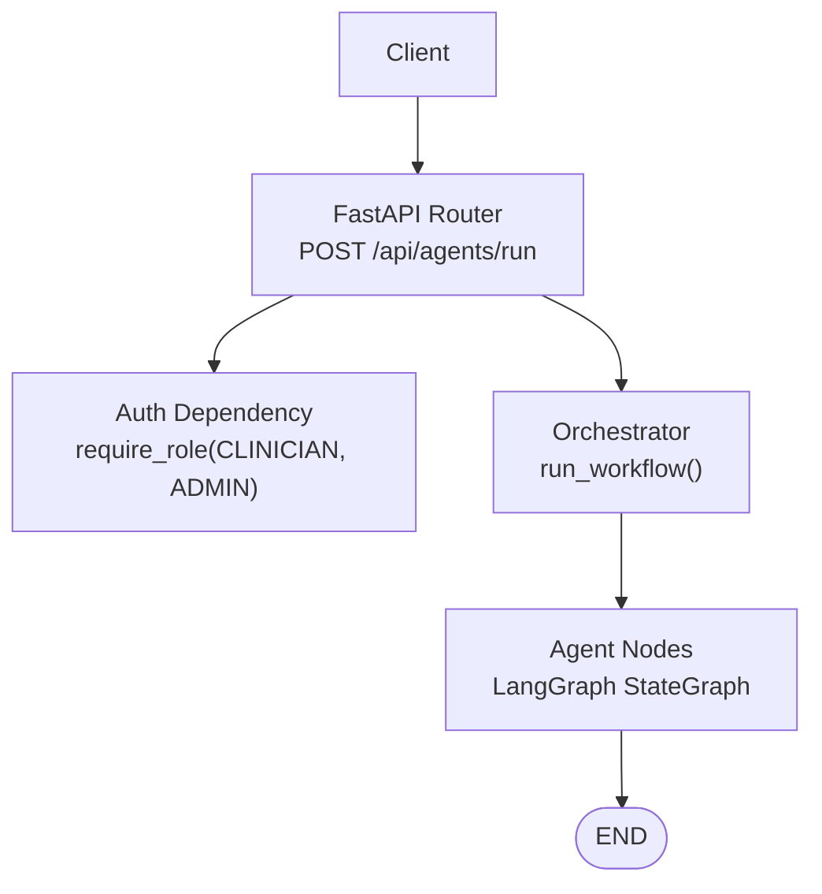
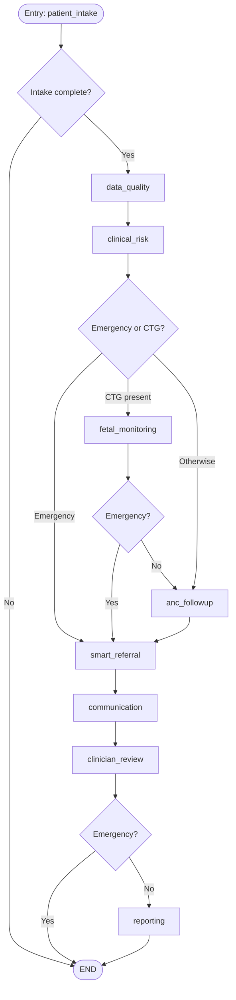
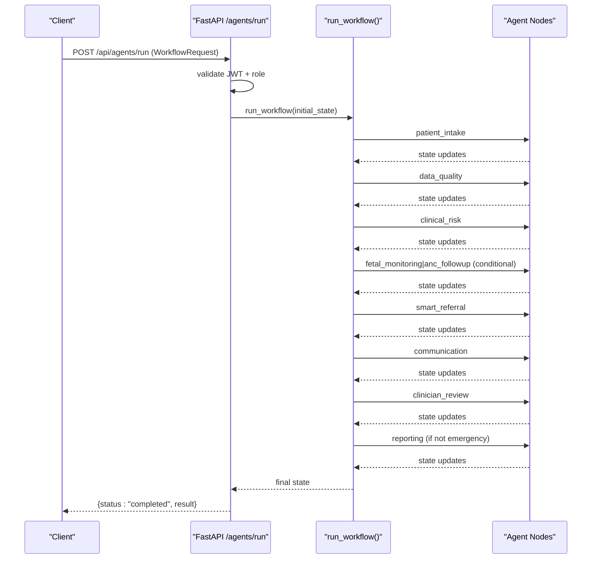
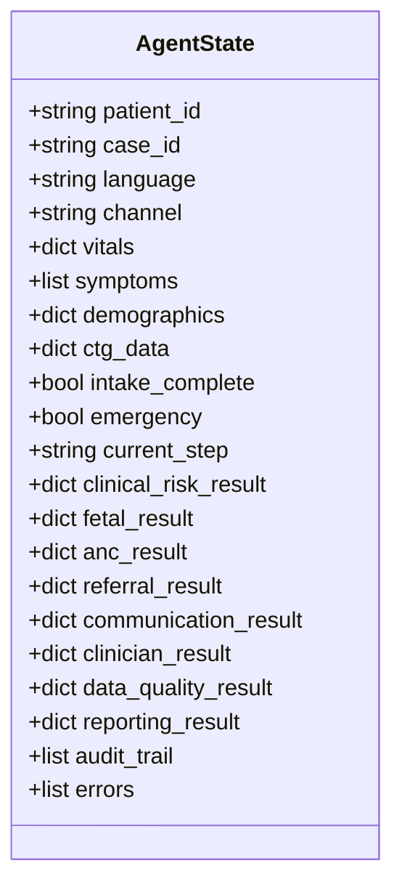
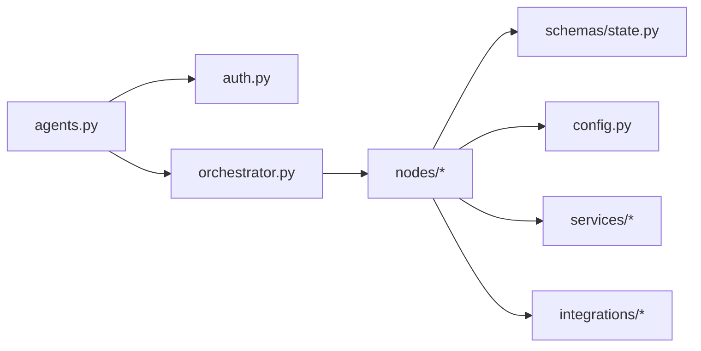

# Workflow Execution Endpoint

<cite>
**Referenced Files in This Document**
- [agents.py](file://backend/api/routes/agents.py)
- [auth.py](file://backend/api/auth.py)
- [orchestrator.py](file://backend/agents/orchestrator.py)
- [state.py](file://backend/schemas/state.py)
- [patient.py](file://backend/schemas/patient.py)
- [config.py](file://backend/config.py)
- [patient_intake.py](file://backend/agents/nodes/patient_intake.py)
- [data_quality.py](file://backend/agents/nodes/data_quality.py)
- [clinical_risk.py](file://backend/agents/nodes/clinical_risk.py)
- [fetal_monitoring.py](file://backend/agents/nodes/fetal_monitoring.py)
- [anc_followup.py](file://backend/agents/nodes/anc_followup.py)
- [smart_referral.py](file://backend/agents/nodes/smart_referral.py)
- [communication.py](file://backend/agents/nodes/communication.py)
- [clinician_review.py](file://backend/agents/nodes/clinician_review.py)
- [reporting.py](file://backend/agents/nodes/reporting.py)
</cite>

## Table of Contents
1. [Introduction](#introduction)
2. [Project Structure](#project-structure)
3. [Core Components](#core-components)
4. [Architecture Overview](#architecture-overview)
5. [Detailed Component Analysis](#detailed-component-analysis)
6. [Dependency Analysis](#dependency-analysis)
7. [Performance Considerations](#performance-considerations)
8. [Troubleshooting Guide](#troubleshooting-guide)
9. [Conclusion](#conclusion)

## Introduction
This document provides detailed API documentation for the full workflow execution endpoint POST /api/agents/run. It explains the WorkflowRequest schema, authentication requirements (clinician or admin role), the multi-agent orchestration flow from patient intake through reporting generation, error handling patterns, and state management across the workflow.

## Project Structure
The endpoint is defined in the agents routes and delegates to a LangGraph-based orchestrator that coordinates nine agent nodes. Shared state is modeled by AgentState, and request/response schemas are validated via Pydantic models.

**Diagram sources**
- [agents.py:62-79](file://backend/api/routes/agents.py#L62-L79)
- [orchestrator.py:62-138](file://backend/agents/orchestrator.py#L62-L138)

**Section sources**
- [agents.py:1-135](file://backend/api/routes/agents.py#L1-L135)
- [orchestrator.py:1-167](file://backend/agents/orchestrator.py#L1-L167)

## Core Components
- Endpoint: POST /api/agents/run
  - Validates JWT and enforces clinician/admin roles.
  - Accepts WorkflowRequest and returns a completed status with serialized result.
- Authentication:
  - Bearer token required; login at /api/auth/login.
  - Roles enforced via require_role(CLINICIAN, ADMIN).
- Request Schema: WorkflowRequest
  - Fields: patient_id, case_id, language (en, ur, ps, sk), channel (app, web, voice, sms, offline), vitals (dict), symptoms (list), demographics (dict), ctg_data (optional dict).
- Response:
  - JSON object with status "completed" and a serialized result containing all agent outputs and audit trail.

Authentication details and endpoints:
- Login: POST /api/auth/login returns access_token, token_type, expires_in.
- Authorization: All protected endpoints use OAuth2 Bearer tokens.

**Section sources**
- [agents.py:35-79](file://backend/api/routes/agents.py#L35-L79)
- [auth.py:65-115](file://backend/api/auth.py#L65-L115)
- [auth.py:125-146](file://backend/api/auth.py#L125-L146)

## Architecture Overview
The workflow is implemented as a LangGraph StateGraph with conditional routing based on clinical context and data availability.

**Diagram sources**
- [orchestrator.py:22-55](file://backend/agents/orchestrator.py#L22-L55)
- [orchestrator.py:75-132](file://backend/agents/orchestrator.py#L75-L132)

## Detailed Component Analysis

### Endpoint: POST /api/agents/run
- Path: /api/agents/run
- Method: POST
- Authentication: Bearer token with role CLINICIAN or ADMIN
- Request body: WorkflowRequest
  - patient_id: string
  - case_id: string
  - language: string (default "ur"; supported: en, ur, ps, sk)
  - channel: string (default "app"; supported: app, web, voice, sms, offline)
  - vitals: object (BP, HR, temp, etc.)
  - symptoms: array of symptom entries
  - demographics: object (age, gestational_age, parity, etc.)
  - ctg_data: optional object (CTG features if available)
- Response:
  - { "status": "completed", "result": <serialized workflow state> }
- Error handling:
  - 500 Internal Server Error when workflow execution fails.

Example requests and responses:
- Normal ANC scenario (no CTG):
  - Request includes patient_id, case_id, language, channel, vitals, symptoms, demographics.
  - Result includes anc_result, communication_result, clinician_result, reporting_result.
- CTG scenario:
  - Include ctg_data; fetal_monitoring runs; may set emergency=True if pathological.
- Emergency scenario:
  - WHO red flags or model outputs set emergency=True; skips reporting for speed; communication sends emergency alerts.

**Section sources**
- [agents.py:35-79](file://backend/api/routes/agents.py#L35-L79)

### Authentication Requirements
- Token acquisition:
  - POST /api/auth/login with username/password form data.
  - Returns access_token, token_type, expires_in.
- Authorization:
  - Protected endpoints depend on get_current_user and require_role(CLINICIAN, ADMIN).
  - Invalid or missing token yields 401 Unauthorized.
  - Insufficient role yields 403 Forbidden.

**Section sources**
- [auth.py:65-115](file://backend/api/auth.py#L65-L115)
- [auth.py:125-146](file://backend/api/auth.py#L125-L146)

### WorkflowRequest Schema
- patient_id: string identifier for the patient.
- case_id: string identifier for the encounter/case.
- language: preferred language for messages and LLM prompts; supported values include en, ur, ps, sk.
- channel: communication channel used for messaging; supports app, web, voice, sms, offline.
- vitals: dictionary of vital signs (e.g., systolic_bp, diastolic_bp, heart_rate, temperature_celsius, respiratory_rate, blood_sugar, gestational_age_weeks, fetal_movement_present).
- symptoms: list of symptom entries (name, severity, duration_hours).
- demographics: dictionary including age, gender, phone, location, gestational_age_weeks, parity, language, channel.
- ctg_data: optional dictionary of CTG features used by fetal monitoring models.

Notes:
- Vitals and symptoms can be enriched by voice transcription during intake.
- Demographics and channel influence referral radius and messaging behavior.

**Section sources**
- [agents.py:35-44](file://backend/api/routes/agents.py#L35-L44)
- [patient.py:14-57](file://backend/schemas/patient.py#L14-L57)

### Multi-Agent Orchestration Process
- Entry node: patient_intake
  - Collects and validates demographics, vitals, symptoms.
  - Optionally transcribes voice input and extracts symptoms.
  - Marks intake_complete and sets follow-up questions if needed.
- Data quality: data_quality
  - Validates vital ranges, flags anomalies, checks model confidence thresholds.
  - Computes overall quality score.
- Clinical risk: clinical_risk
  - Runs maternal risk and gestational complication predictions.
  - Applies WHO safety rules; sets emergency flag if HIGH_RISK_EMERGENCY.
- Conditional routing:
  - If emergency: route to smart_referral.
  - Else if ctg_data present: route to fetal_monitoring.
  - Else: route to anc_followup.
- Fetal monitoring: fetal_monitoring
  - Uses CTG data to predict fetal health and preterm risk.
  - Sets emergency if pathological; otherwise proceeds to anc_followup.
- ANC follow-up: anc_followup
  - Predicts missed-visit risk and recommends action (home_visit, call, sms).
- Smart referral: smart_referral
  - Finds nearby facilities, ranks by capability and distance, plans route.
  - Determines urgency level based on emergency and risk results.
- Communication: communication
  - Sends emergency alerts, referral notifications, or ANC reminders via SMS/WhatsApp.
  - Tracks delivery status and uses LLM-generated messages with fallback templates.
- Clinician review: clinician_review
  - Aggregates upstream results into a structured case summary.
  - Marks case pending_review and highlights risk indicators.
- Reporting: reporting
  - Generates comprehensive case summary payload and dashboard/trend data.
  - Produces narrative report with LLM support and fallbacks.

**Diagram sources**
- [agents.py:62-79](file://backend/api/routes/agents.py#L62-L79)
- [orchestrator.py:62-138](file://backend/agents/orchestrator.py#L62-L138)

**Section sources**
- [patient_intake.py:58-168](file://backend/agents/nodes/patient_intake.py#L58-L168)
- [data_quality.py:25-201](file://backend/agents/nodes/data_quality.py#L25-L201)
- [clinical_risk.py:15-127](file://backend/agents/nodes/clinical_risk.py#L15-L127)
- [fetal_monitoring.py:10-111](file://backend/agents/nodes/fetal_monitoring.py#L10-L111)
- [anc_followup.py:10-103](file://backend/agents/nodes/anc_followup.py#L10-L103)
- [smart_referral.py:11-136](file://backend/agents/nodes/smart_referral.py#L11-L136)
- [communication.py:38-231](file://backend/agents/nodes/communication.py#L38-L231)
- [clinician_review.py:13-165](file://backend/agents/nodes/clinician_review.py#L13-L165)
- [reporting.py:13-217](file://backend/agents/nodes/reporting.py#L13-L217)

### State Management
- Shared state model: AgentState defines keys for identification, patient data, flow control, per-agent outputs, and cross-cutting concerns.
- Append-only logs: audit_trail and errors accumulate entries across nodes.
- Flow control flags: intake_complete, emergency, current_step guide routing and termination.
- Per-agent output namespaces: clinical_risk_result, fetal_result, anc_result, referral_result, communication_result, clinician_result, data_quality_result, reporting_result.

**Diagram sources**
- [state.py:7-43](file://backend/schemas/state.py#L7-L43)

**Section sources**
- [state.py:7-43](file://backend/schemas/state.py#L7-L43)

### Error Handling Patterns
- Node-level exceptions:
  - Each node catches exceptions, records an error entry in errors, and appends an audit entry describing the failure.
- Endpoint-level exception:
  - The run endpoint wraps workflow execution and raises HTTP 500 with a descriptive detail message.
- Validation and routing:
  - Single-node invoke endpoint returns 404 for unknown nodes and 400 for invalid inputs.

Examples:
- Missing CTG data: fetal_monitoring returns not_assessed and continues workflow.
- LLM unavailability: nodes fall back to template messages and summaries without failing.

**Section sources**
- [agents.py:72-79](file://backend/api/routes/agents.py#L72-L79)
- [agents.py:100-114](file://backend/api/routes/agents.py#L100-L114)
- [patient_intake.py:151-168](file://backend/agents/nodes/patient_intake.py#L151-L168)
- [data_quality.py:185-201](file://backend/agents/nodes/data_quality.py#L185-L201)
- [clinical_risk.py:111-127](file://backend/agents/nodes/clinical_risk.py#L111-L127)
- [fetal_monitoring.py:95-111](file://backend/agents/nodes/fetal_monitoring.py#L95-L111)
- [anc_followup.py:87-103](file://backend/agents/nodes/anc_followup.py#L87-L103)
- [smart_referral.py:120-136](file://backend/agents/nodes/smart_referral.py#L120-L136)
- [communication.py:215-231](file://backend/agents/nodes/communication.py#L215-L231)
- [clinician_review.py:149-165](file://backend/agents/nodes/clinician_review.py#L149-L165)
- [reporting.py:175-217](file://backend/agents/nodes/reporting.py#L175-L217)

### Configuration and External Integrations
- JWT configuration: secret, algorithm, expiration minutes.
- Model paths: artifact locations for MaternalGuard, FetalWatch, PretermGuard, CareReach, GestationInsight.
- External services: voice, facility locator, routing, messaging, Groq LLM.

**Section sources**
- [config.py:7-55](file://backend/config.py#L7-L55)

## Dependency Analysis
- API layer depends on auth dependencies and orchestrator functions.
- Orchestrator wires agent nodes and conditional edges.
- Nodes depend on shared state and external services (inference registry, safety service, integrations).

**Diagram sources**
- [agents.py:1-135](file://backend/api/routes/agents.py#L1-L135)
- [orchestrator.py:1-167](file://backend/agents/orchestrator.py#L1-L167)
- [state.py:1-43](file://backend/schemas/state.py#L1-L43)
- [config.py:1-55](file://backend/config.py#L1-L55)

**Section sources**
- [agents.py:1-135](file://backend/api/routes/agents.py#L1-L135)
- [orchestrator.py:1-167](file://backend/agents/orchestrator.py#L1-L167)

## Performance Considerations
- LLM calls are executed in worker threads to avoid blocking the event loop.
- Fallback mechanisms ensure robustness when LLM services are unavailable.
- Emergency path skips reporting to reduce latency.
- Data quality checks compute a quality score efficiently and flag issues early.

[No sources needed since this section provides general guidance]

## Troubleshooting Guide
Common issues and resolutions:
- 401 Unauthorized:
  - Ensure valid JWT in Authorization header; verify token expiry and signature.
- 403 Forbidden:
  - Confirm user role is CLINICIAN or ADMIN for /agents/run.
- 404 Not Found:
  - For single-node invoke, check node_name against available nodes.
- 500 Internal Server Error:
  - Check workflow execution logs; inspect errors and audit_trail in the returned result.
- LLM failures:
  - Nodes fall back to templates; verify GROQ_API_KEY and GROQ_MODEL settings.

**Section sources**
- [auth.py:73-115](file://backend/api/auth.py#L73-L115)
- [agents.py:100-114](file://backend/api/routes/agents.py#L100-L114)
- [config.py:37-42](file://backend/config.py#L37-L42)

## Conclusion
The POST /api/agents/run endpoint provides a secure, role-gated interface to execute a comprehensive multi-agent clinical workflow. It standardizes input via WorkflowRequest, manages state through AgentState, and produces actionable outputs including referrals, communications, clinician-ready summaries, and reports. Robust error handling and LLM fallbacks ensure reliability across varying conditions.