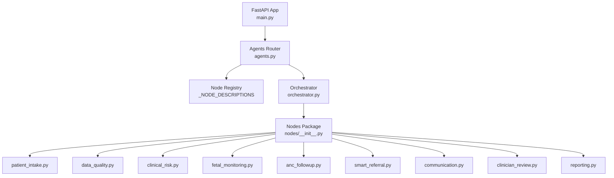
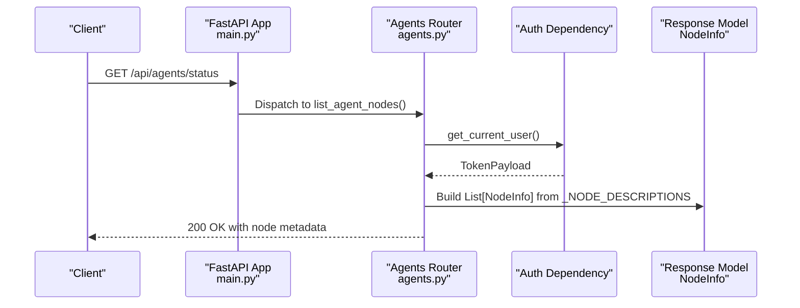
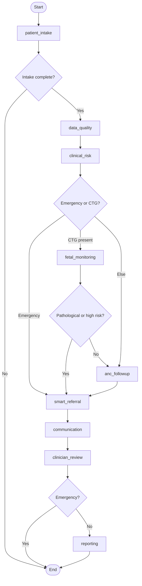
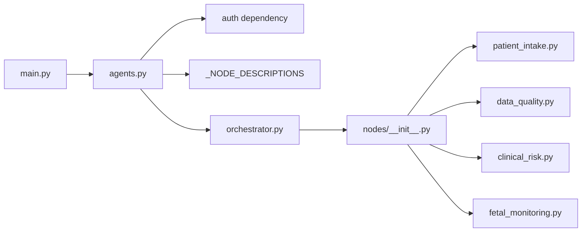

# Workflow Status and Metadata

<cite>
**Referenced Files in This Document**
- [agents.py](file://backend/api/routes/agents.py)
- [orchestrator.py](file://backend/agents/orchestrator.py)
- [state.py](file://backend/schemas/state.py)
- [main.py](file://backend/api/main.py)
- [patient_intake.py](file://backend/agents/nodes/patient_intake.py)
- [data_quality.py](file://backend/agents/nodes/data_quality.py)
- [clinical_risk.py](file://backend/agents/nodes/clinical_risk.py)
- [fetal_monitoring.py](file://backend/agents/nodes/fetal_monitoring.py)
</cite>

## Table of Contents
1. [Introduction](#introduction)
2. [Project Structure](#project-structure)
3. [Core Components](#core-components)
4. [Architecture Overview](#architecture-overview)
5. [Detailed Component Analysis](#detailed-component-analysis)
6. [Dependency Analysis](#dependency-analysis)
7. [Performance Considerations](#performance-considerations)
8. [Troubleshooting Guide](#troubleshooting-guide)
9. [Conclusion](#conclusion)
10. [Appendices](#appendices)

## Introduction
This document explains the GET /api/agents/status endpoint that returns metadata about all available agent nodes and their descriptions. It also documents the NodeInfo response schema, shows how to use this endpoint for dynamic UI generation, node discovery, and system introspection, and provides examples of the complete node registry and client-side usage patterns.

The endpoint is part of a multi-agent workflow orchestration system where each “node” represents a discrete step such as patient intake, data quality checks, clinical risk assessment, fetal monitoring, ANC follow-up, smart referral, communication, clinician review, and reporting.

## Project Structure
The status endpoint lives under the agents API routes and depends on a static registry of node names and descriptions. The orchestrator wires these nodes into a LangGraph StateGraph, which defines the execution flow and routing logic.

**Diagram sources**
- [main.py:122-129](file://backend/api/main.py#L122-L129)
- [agents.py:11-27](file://backend/api/routes/agents.py#L11-L27)
- [orchestrator.py:62-73](file://backend/agents/orchestrator.py#L62-L73)
- [__init__.py:1-24](file://backend/agents/nodes/__init__.py#L1-L24)

**Section sources**
- [main.py:122-129](file://backend/api/main.py#L122-L129)
- [agents.py:11-27](file://backend/api/routes/agents.py#L11-L27)
- [orchestrator.py:62-73](file://backend/agents/orchestrator.py#L62-L73)

## Core Components
- Endpoint: GET /api/agents/status
  - Returns a list of NodeInfo objects describing each available agent node.
  - Requires authentication via the current user dependency.
- Response model: NodeInfo
  - name: string — unique identifier for the node (e.g., patient_intake).
  - description: string — human-readable purpose of the node.
- Node registry: _NODE_DESCRIPTIONS
  - Central mapping of node names to descriptions used by both the status endpoint and single-node invocation validation.

Key behaviors:
- The endpoint enumerates all registered nodes and returns their metadata without executing any workflow logic.
- The same registry is used to validate single-node invocations, ensuring consistency between discovery and execution surfaces.

**Section sources**
- [agents.py:17-27](file://backend/api/routes/agents.py#L17-L27)
- [agents.py:52-55](file://backend/api/routes/agents.py#L52-L55)
- [agents.py:82-87](file://backend/api/routes/agents.py#L82-L87)

## Architecture Overview
The status endpoint is a lightweight read-only operation that exposes the node registry to clients. Clients can use it to build dynamic interfaces, discover capabilities at runtime, and perform system introspection.

**Diagram sources**
- [main.py:122-129](file://backend/api/main.py#L122-L129)
- [agents.py:82-87](file://backend/api/routes/agents.py#L82-L87)

## Detailed Component Analysis

### GET /api/agents/status
- Purpose: Return metadata for all available agent nodes.
- Authentication: Requires an authenticated user via the current user dependency.
- Response: Array of NodeInfo objects, each containing:
  - name: string — the node’s unique key.
  - description: string — a concise explanation of what the node does.

Use cases:
- Dynamic UI generation: Render node cards or steps based on available capabilities.
- Node discovery: Programmatically enumerate supported operations before invoking them.
- System introspection: Inspect the system’s functional surface area during onboarding or diagnostics.

Example responses (conceptual):
- Minimal set: ["patient_intake", "data_quality", "clinical_risk", "fetal_monitoring", "anc_followup", "smart_referral", "communication", "clinician_review", "reporting"]
- Each entry includes a human-readable description aligned with its role in the workflow.

**Section sources**
- [agents.py:82-87](file://backend/api/routes/agents.py#L82-L87)
- [agents.py:52-55](file://backend/api/routes/agents.py#L52-L55)

### NodeInfo Schema
- Fields:
  - name: string — stable identifier for the node.
  - description: string — human-friendly summary of the node’s function.

Validation and typing are enforced by the Pydantic model used by the route.

**Section sources**
- [agents.py:52-55](file://backend/api/routes/agents.py#L52-L55)

### Complete Node Registry
The registry maps each node to a short description. These keys correspond to functions registered in the orchestrator and exported by the nodes package.

Available nodes:
- patient_intake: Validate and normalize incoming patient data
- data_quality: Run data quality checks (missing values, outliers)
- clinical_risk: MaternalGuard + GestationInsight risk prediction
- fetal_monitoring: FetalWatch + PretermGuard CTG analysis
- anc_followup: CareReach ANC missed-visit risk scoring
- smart_referral: Rank nearby facilities and generate referral
- communication: Send SMS / WhatsApp alerts and reminders
- clinician_review: Summarise case for clinician decision
- reporting: Generate structured clinical report

These nodes are wired into the LangGraph StateGraph and executed in a defined order with conditional routing based on state.

**Section sources**
- [agents.py:17-27](file://backend/api/routes/agents.py#L17-L27)
- [orchestrator.py:62-73](file://backend/agents/orchestrator.py#L62-L73)
- [__init__.py:1-24](file://backend/agents/nodes/__init__.py#L1-L24)

### Orchestrator and Execution Flow
The orchestrator builds a StateGraph with all nine nodes and sets up conditional edges that determine the next step based on the current state (e.g., emergency flags, presence of CTG data). While the status endpoint does not execute workflows, understanding the flow helps clients interpret node roles and expected inputs/outputs.

**Diagram sources**
- [orchestrator.py:22-55](file://backend/agents/orchestrator.py#L22-L55)
- [orchestrator.py:75-132](file://backend/agents/orchestrator.py#L75-L132)

### Node Implementations Overview
Each node encapsulates specific responsibilities and writes results into shared state fields defined by AgentState. Examples include:
- patient_intake: Collects demographics, vitals, symptoms; validates completeness; optionally integrates voice transcription and LLM-generated follow-up questions.
- data_quality: Validates vital ranges, detects anomalies, checks model confidence thresholds, and computes an overall quality score.
- clinical_risk: Runs maternal and gestational risk models, applies WHO safety rules, and determines emergency triage.
- fetal_monitoring: Runs FetalWatch and PretermGuard on CTG data, escalates when pathological or high-risk.

These implementations demonstrate how nodes contribute to the overall workflow and why exposing their metadata via /status is valuable for clients.

**Section sources**
- [patient_intake.py:58-168](file://backend/agents/nodes/patient_intake.py#L58-L168)
- [data_quality.py:25-201](file://backend/agents/nodes/data_quality.py#L25-L201)
- [clinical_risk.py:15-127](file://backend/agents/nodes/clinical_risk.py#L15-L127)
- [fetal_monitoring.py:10-111](file://backend/agents/nodes/fetal_monitoring.py#L10-L111)

## Dependency Analysis
- FastAPI app mounts the agents router under /api, making /api/agents/status available.
- The status endpoint depends on:
  - Authentication dependency to ensure only authorized users can query node metadata.
  - Static registry of node descriptions for consistent discovery.
- The orchestrator imports all node functions and registers them in the graph; the nodes package re-exports them for centralized access.

**Diagram sources**
- [main.py:122-129](file://backend/api/main.py#L122-L129)
- [agents.py:11-27](file://backend/api/routes/agents.py#L11-L27)
- [orchestrator.py:62-73](file://backend/agents/orchestrator.py#L62-L73)
- [__init__.py:1-24](file://backend/agents/nodes/__init__.py#L1-L24)

**Section sources**
- [main.py:122-129](file://backend/api/main.py#L122-L129)
- [agents.py:11-27](file://backend/api/routes/agents.py#L11-L27)
- [orchestrator.py:62-73](file://backend/agents/orchestrator.py#L62-L73)
- [__init__.py:1-24](file://backend/agents/nodes/__init__.py#L1-L24)

## Performance Considerations
- The status endpoint is read-only and returns a small, static list; performance impact is negligible.
- Avoid caching the response on the server side unless you intentionally want to decouple discovery from runtime changes; clients may cache briefly if appropriate.
- Keep descriptions concise to minimize payload size.

## Troubleshooting Guide
Common issues and resolutions:
- 401 Unauthorized: Ensure the request includes valid authentication credentials required by the current user dependency.
- 404 Not Found for node invocation: When invoking a single node, verify the node name exists in the registry returned by /status.
- Unexpected empty or stale metadata: Confirm the server process has loaded the latest code and that no custom middleware intercepts or caches responses unexpectedly.

Error handling:
- Global exception handler returns structured JSON errors for unhandled exceptions.
- Single-node invocation endpoints return descriptive error messages for unknown nodes or execution failures.

**Section sources**
- [main.py:83-100](file://backend/api/main.py#L83-L100)
- [agents.py:90-114](file://backend/api/routes/agents.py#L90-L114)

## Conclusion
The GET /api/agents/status endpoint provides a reliable, authenticated way to discover available agent nodes and their descriptions. Clients can leverage this metadata to dynamically render interfaces, adapt workflows to available capabilities, and perform system introspection. Combined with the orchestrator’s execution flow and node implementations, this endpoint serves as the foundation for flexible, client-driven interactions with the multi-agent system.

## Appendices

### Example Usage Scenarios
- Dynamic UI Generation:
  - Fetch /api/agents/status to populate a dashboard showing available nodes.
  - Use descriptions to render tooltips or help text for each node card.
- Node Discovery:
  - Before invoking a single node, call /status to confirm availability and correct naming.
- System Introspection:
  - During onboarding or diagnostics, enumerate nodes to understand system capabilities and guide users through relevant features.

### Data Model Reference
- AgentState fields define shared state across nodes, including identifiers, patient data, flow control flags, per-node outputs, audit trails, errors, and messages.

**Section sources**
- [state.py:7-43](file://backend/schemas/state.py#L7-L43)