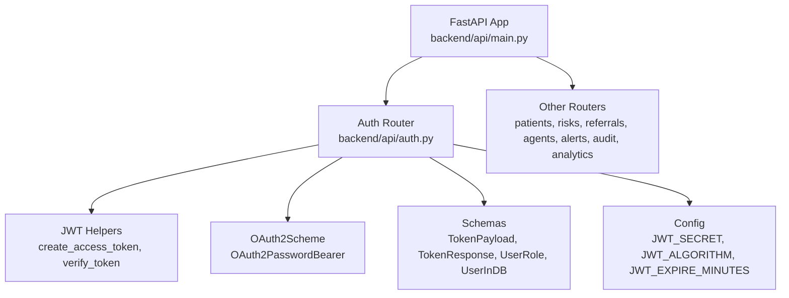
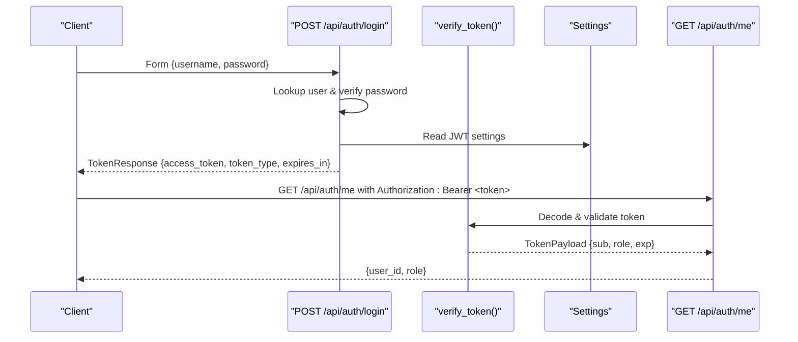
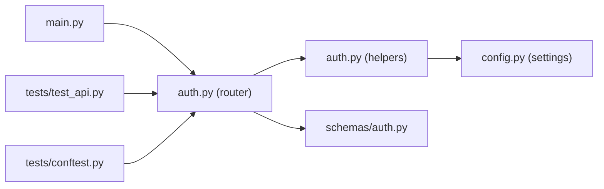

# Authentication API

<cite>
**Referenced Files in This Document**
- [auth.py](file://backend/api/auth.py)
- [auth.py](file://backend/schemas/auth.py)
- [config.py](file://backend/config.py)
- [main.py](file://backend/api/main.py)
- [test_api.py](file://backend/tests/test_api.py)
- [conftest.py](file://backend/tests/conftest.py)
</cite>

## Table of Contents
1. [Introduction](#introduction)
2. [Project Structure](#project-structure)
3. [Core Components](#core-components)
4. [Architecture Overview](#architecture-overview)
5. [Detailed Component Analysis](#detailed-component-analysis)
6. [Dependency Analysis](#dependency-analysis)
7. [Performance Considerations](#performance-considerations)
8. [Troubleshooting Guide](#troubleshooting-guide)
9. [Conclusion](#conclusion)
10. [Appendices](#appendices)

## Introduction
This document provides comprehensive API documentation for the authentication system, focusing on JWT-based authentication and role-based authorization. It covers:
- Login via form data to obtain a JWT access token
- Retrieving current user information with a protected endpoint
- OAuth2PasswordBearer scheme usage for subsequent requests
- Token structure, expiration handling, and error responses
- Hardcoded MVP users and their roles/permissions
- Practical examples of authentication flows and role-based access control patterns

## Project Structure
The authentication endpoints are implemented under the backend API module and mounted at /api/auth. The application is a FastAPI service that includes the auth router alongside other feature routers.

**Diagram sources**
- [main.py:122-134](file://backend/api/main.py#L122-L134)
- [auth.py:18-19](file://backend/api/auth.py#L18-L19)
- [auth.py:65-91](file://backend/api/auth.py#L65-L91)
- [auth.py:122-156](file://backend/api/auth.py#L122-L156)
- [auth.py:1-13](file://backend/schemas/auth.py#L1-L13)
- [config.py:26-29](file://backend/config.py#L26-L29)

**Section sources**
- [main.py:122-134](file://backend/api/main.py#L122-L134)
- [auth.py:122-156](file://backend/api/auth.py#L122-L156)

## Core Components
- OAuth2PasswordBearer scheme configured to use /api/auth/login as the token URL.
- Hardcoded MVP users with hashed passwords and roles (admin, clinician, lhw, patient).
- JWT creation and verification utilities using HS256 algorithm and configurable secret/expiry.
- Role-based authorization dependency factory to enforce required roles per endpoint.
- Pydantic schemas for request/response validation and typing.

Key responsibilities:
- Authenticate users and issue signed JWTs
- Validate tokens on protected routes
- Enforce role-based access control
- Provide current user info from token payload

**Section sources**
- [auth.py:18-19](file://backend/api/auth.py#L18-L19)
- [auth.py:25-58](file://backend/api/auth.py#L25-L58)
- [auth.py:65-91](file://backend/api/auth.py#L65-L91)
- [auth.py:99-115](file://backend/api/auth.py#L99-L115)
- [auth.py:125-156](file://backend/api/auth.py#L125-L156)
- [auth.py:1-13](file://backend/schemas/auth.py#L1-L13)
- [config.py:26-29](file://backend/config.py#L26-L29)

## Architecture Overview
The authentication flow uses FastAPI’s OAuth2PasswordBearer to extract the bearer token from the Authorization header. Protected endpoints depend on get_current_user, which verifies the token and returns a TokenPayload. Role checks are enforced via require_role.

**Diagram sources**
- [auth.py:125-146](file://backend/api/auth.py#L125-L146)
- [auth.py:73-91](file://backend/api/auth.py#L73-L91)
- [auth.py:149-156](file://backend/api/auth.py#L149-L156)
- [config.py:26-29](file://backend/config.py#L26-L29)

## Detailed Component Analysis

### Endpoints

#### POST /api/auth/login
- Purpose: Authenticate a user and return a JWT access token.
- Request:
  - Content-Type: application/x-www-form-urlencoded
  - Fields: username, password
- Response:
  - 200 OK: TokenResponse with access_token, token_type ("bearer"), expires_in (seconds)
  - 401 Unauthorized: Incorrect username or password
- Notes:
  - Uses OAuth2PasswordRequestForm for parsing form data
  - Issues token with sub=user_id and role=role value
  - Expiration based on JWT_EXPIRE_MINUTES setting

Example usage:
- Send form data with username/password to /api/auth/login
- Use returned access_token in Authorization header for subsequent requests

**Section sources**
- [auth.py:125-146](file://backend/api/auth.py#L125-L146)
- [test_api.py:22-33](file://backend/tests/test_api.py#L22-L33)

#### GET /api/auth/me
- Purpose: Retrieve current authenticated user’s identity from the token.
- Authorization: Requires valid Bearer token
- Response:
  - 200 OK: Object containing user_id and role
  - 401 Unauthorized: Invalid or missing token
- Notes:
  - Uses get_current_user dependency to decode and validate token

Example usage:
- Include Authorization: Bearer <access_token> header
- Receive minimal user identity without exposing sensitive fields

**Section sources**
- [auth.py:149-156](file://backend/api/auth.py#L149-L156)
- [auth.py:99-101](file://backend/api/auth.py#L99-L101)

### Schemas and Models

#### Pydantic Models
- TokenPayload: Represents decoded token contents (sub, role, optional exp)
- TokenResponse: Response schema for login endpoint (access_token, token_type, expires_in)
- UserRole: Enum defining allowed roles (patient, lhw, clinician, admin)
- UserInDB: In-memory user model used by MVP (user_id, username, hashed_password, role, full_name, created_at, is_active)

These models ensure consistent serialization and validation across the API.

**Section sources**
- [auth.py:1-13](file://backend/schemas/auth.py#L1-L13)
- [auth.py:15-42](file://backend/schemas/auth.py#L15-L42)

### JWT Configuration and Token Handling

- Algorithm: HS256
- Secret: Configured via JWT_SECRET
- Expiration: Configured via JWT_EXPIRE_MINUTES; converted to seconds in response
- Creation: encode with sub and role claims
- Verification: decode and validate; raises 401 on invalid or malformed tokens

**Section sources**
- [config.py:26-29](file://backend/config.py#L26-L29)
- [auth.py:65-91](file://backend/api/auth.py#L65-L91)

### OAuth2PasswordBearer Scheme
- Configured to use /api/auth/login as the token URL
- Extracts Bearer token from Authorization header for protected endpoints
- Works seamlessly with Swagger UI “Authorize” button

**Section sources**
- [auth.py:18-19](file://backend/api/auth.py#L18-L19)

### Role-Based Authorization
- Dependency factory require_role(*roles) enforces that the current user has one of the specified roles
- Returns 403 Forbidden if the user’s role is not authorized
- Can be applied to any endpoint to restrict access by role

Usage pattern:
- Define endpoint with Depends(require_role(UserRole.ADMIN)) or multiple roles
- Ensure get_current_user runs first to validate token

**Section sources**
- [auth.py:104-115](file://backend/api/auth.py#L104-L115)

### Hardcoded MVP Users and Permissions
- admin: System Administrator (UserRole.ADMIN)
- clinician: Dr. Ayesha Khan (UserRole.CLINICIAN)
- lhw: Fatima Bibi (Lady Health Worker) (UserRole.LHW)
- patient: Sample Patient (UserRole.PATIENT)

Permissions:
- Role-based access can be enforced using require_role on endpoints
- Example: Only ADMIN can manage system settings; CLINICIAN can review cases; LHW can perform field tasks; PATIENT can view own data

Note: These users are stored in memory with hashed passwords for MVP purposes. Replace with a database-backed store in production.

**Section sources**
- [auth.py:25-58](file://backend/api/auth.py#L25-L58)
- [auth.py:8-13](file://backend/schemas/auth.py#L8-L13)

## Dependency Analysis
Authentication components interact through clear dependencies:
- Routes depend on auth_router
- auth_router depends on JWT helpers and schemas
- JWT helpers depend on configuration settings
- Tests demonstrate end-to-end usage and expected behaviors

**Diagram sources**
- [main.py:122-134](file://backend/api/main.py#L122-L134)
- [auth.py:122-156](file://backend/api/auth.py#L122-L156)
- [auth.py:65-91](file://backend/api/auth.py#L65-L91)
- [config.py:26-29](file://backend/config.py#L26-L29)
- [auth.py:1-13](file://backend/schemas/auth.py#L1-L13)
- [test_api.py:22-33](file://backend/tests/test_api.py#L22-L33)
- [conftest.py:58-68](file://backend/tests/conftest.py#L58-L68)

**Section sources**
- [main.py:122-134](file://backend/api/main.py#L122-L134)
- [auth.py:122-156](file://backend/api/auth.py#L122-L156)
- [test_api.py:22-33](file://backend/tests/test_api.py#L22-L33)
- [conftest.py:58-68](file://backend/tests/conftest.py#L58-L68)

## Performance Considerations
- Token decoding is lightweight; ensure JWT_SECRET is strong and rotation strategy is planned
- Expiration times should balance security and usability; adjust JWT_EXPIRE_MINUTES accordingly
- Avoid storing sensitive data in token payloads; keep only necessary claims (sub, role)
- Consider caching user roles or permissions server-side if frequent role checks occur

[No sources needed since this section provides general guidance]

## Troubleshooting Guide
Common issues and resolutions:
- 401 Unauthorized on protected endpoints:
  - Missing or invalid Authorization header
  - Expired or tampered token
  - Check token format: Authorization: Bearer <token>
- 403 Forbidden on role-restricted endpoints:
  - Current user’s role does not meet required roles
  - Verify user role and endpoint requirements
- Login failures:
  - Incorrect username or password
  - Confirm credentials against MVP users or updated user store

Error responses include structured details and WWW-Authenticate headers where applicable.

**Section sources**
- [auth.py:73-91](file://backend/api/auth.py#L73-L91)
- [auth.py:104-115](file://backend/api/auth.py#L104-L115)
- [auth.py:125-146](file://backend/api/auth.py#L125-L146)

## Conclusion
The authentication system implements a secure, JWT-based approach with role-based authorization. It provides straightforward login and user info retrieval endpoints, integrates cleanly with FastAPI’s OAuth2 support, and offers a scalable foundation for enforcing permissions across the platform. For production, replace hardcoded users with a persistent store and consider token refresh mechanisms.

[No sources needed since this section summarizes without analyzing specific files]

## Appendices

### Practical Examples

- Login flow:
  - Submit form data to /api/auth/login
  - Capture access_token from response
  - Use Authorization: Bearer <access_token> on subsequent requests

- Token usage:
  - Include Authorization header with Bearer token
  - Access protected endpoints like /api/auth/me or role-restricted routes

- Role-based access control:
  - Apply require_role to endpoints to restrict by role
  - Ensure tokens contain correct role claims

- Error handling:
  - Handle 401 for invalid/missing tokens
  - Handle 403 for insufficient roles

[No sources needed since this section provides general guidance]