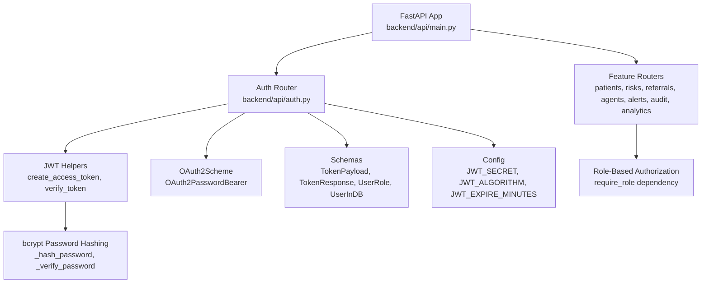
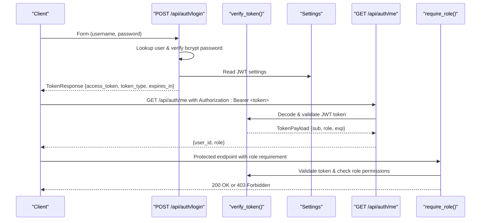
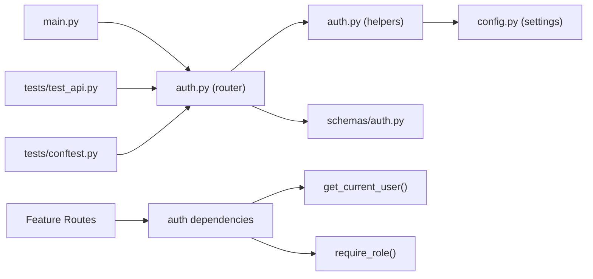

# Authentication API

<cite>
**Referenced Files in This Document**
- [auth.py](file://backend/api/auth.py)
- [auth.py](file://backend/schemas/auth.py)
- [config.py](file://backend/config.py)
- [main.py](file://backend/api/main.py)
- [test_api.py](file://backend/tests/test_api.py)
- [conftest.py](file://backend/tests/conftest.py)
- [agents.py](file://backend/api/routes/agents.py)
- [audit.py](file://backend/api/routes/audit.py)
- [patients.py](file://backend/api/routes/patients.py)
</cite>

## Update Summary
**Changes Made**
- Enhanced JWT-based authentication system with comprehensive role-based access control
- Added support for four distinct user roles: admin, clinician, LHW (Lady Health Worker), and patient
- Implemented secure password hashing with bcrypt and token validation
- Added user signup functionality for dynamic user registration
- Integrated role-based authorization across multiple endpoints using require_role dependency
- Enhanced error handling with proper HTTP status codes and WWW-Authenticate headers
- Updated MVP users with detailed role assignments and permissions

## Table of Contents
1. [Introduction](#introduction)
2. [Project Structure](#project-structure)
3. [Core Components](#core-components)
4. [Architecture Overview](#architecture-overview)
5. [Detailed Component Analysis](#detailed-component-analysis)
6. [Role-Based Access Control](#role-based-access-control)
7. [Dependency Analysis](#dependency-analysis)
8. [Performance Considerations](#performance-considerations)
9. [Troubleshooting Guide](#troubleshooting-guide)
10. [Conclusion](#conclusion)
11. [Appendices](#appendices)

## Introduction
This document provides comprehensive API documentation for the enhanced JWT-based authentication system with role-based authorization. The system supports four distinct user roles (admin, clinician, LHW, patient) with granular permission controls. It covers:
- Login via form data to obtain JWT access tokens with role information
- User registration through the signup endpoint
- Retrieving current user information with protected endpoints
- OAuth2PasswordBearer scheme usage for subsequent requests
- Token structure, expiration handling, and comprehensive error responses
- Role-based access control patterns across all API endpoints
- Practical examples of authentication flows and permission enforcement

## Project Structure
The authentication endpoints are implemented under the backend API module and mounted at /api/auth. The application is a FastAPI service that includes the auth router alongside other feature routers with integrated role-based authorization.



**Diagram sources**
- [main.py:122-134](file://backend/api/main.py#L122-L134)
- [auth.py:18-19](file://backend/api/auth.py#L18-L19)
- [auth.py:65-91](file://backend/api/auth.py#L65-L91)
- [auth.py:122-156](file://backend/api/auth.py#L122-L156)
- [auth.py:1-13](file://backend/schemas/auth.py#L1-L13)
- [config.py:26-29](file://backend/config.py#L26-L29)
- [agents.py:62-66](file://backend/api/routes/agents.py#L62-L66)

**Section sources**
- [main.py:122-134](file://backend/api/main.py#L122-L134)
- [auth.py:122-156](file://backend/api/auth.py#L122-L156)

## Core Components
- OAuth2PasswordBearer scheme configured to use /api/auth/login as the token URL
- Hardcoded MVP users with bcrypt-hashed passwords and role assignments (admin, clinician, lhw, patient)
- JWT creation and verification utilities using HS256 algorithm with configurable secret/expiry
- Role-based authorization dependency factory (require_role) to enforce required roles per endpoint
- Secure password hashing with bcrypt for MVP user credentials
- Pydantic schemas for request/response validation and type safety
- User signup functionality for dynamic user registration

Key responsibilities:
- Authenticate users and issue signed JWTs with role claims
- Validate tokens on protected routes with role verification
- Enforce role-based access control across all endpoints
- Provide current user info from token payload
- Manage MVP user store with hashed credentials

**Section sources**
- [auth.py:18-19](file://backend/api/auth.py#L18-L19)
- [auth.py:25-58](file://backend/api/auth.py#L25-L58)
- [auth.py:65-91](file://backend/api/auth.py#L65-L91)
- [auth.py:99-115](file://backend/api/auth.py#L99-L115)
- [auth.py:125-156](file://backend/api/auth.py#L125-L156)
- [auth.py:1-13](file://backend/schemas/auth.py#L1-L13)
- [config.py:26-29](file://backend/config.py#L26-L29)

## Architecture Overview
The authentication flow uses FastAPI's OAuth2PasswordBearer to extract bearer tokens from the Authorization header. Protected endpoints depend on get_current_user, which verifies tokens and returns TokenPayload. Role checks are enforced via require_role dependency factory.



**Diagram sources**
- [auth.py:125-146](file://backend/api/auth.py#L125-L146)
- [auth.py:73-91](file://backend/api/auth.py#L73-L91)
- [auth.py:149-156](file://backend/api/auth.py#L149-L156)
- [auth.py:112-123](file://backend/api/auth.py#L112-L123)
- [config.py:26-29](file://backend/config.py#L26-L29)

## Detailed Component Analysis

### Endpoints

#### POST /api/auth/login
- Purpose: Authenticate a user and return a JWT access token with role information
- Request:
  - Content-Type: application/x-www-form-urlencoded
  - Fields: username, password
- Response:
  - 200 OK: TokenResponse with access_token, token_type ("bearer"), expires_in (seconds)
  - 401 Unauthorized: Incorrect username or password with WWW-Authenticate header
- Notes:
  - Uses OAuth2PasswordRequestForm for parsing form data
  - Verifies bcrypt-hashed passwords against MVP users
  - Issues token with sub=user_id and role=role value
  - Expiration based on JWT_EXPIRE_MINUTES setting

Example usage:
- Send form data with username/password to /api/auth/login
- Use returned access_token in Authorization header for subsequent requests

**Section sources**
- [auth.py:125-146](file://backend/api/auth.py#L125-L146)
- [test_api.py:22-33](file://backend/tests/test_api.py#L22-L33)

#### POST /api/auth/signup
- Purpose: Register a new user in the in-memory MVP store
- Request:
  - Content-Type: application/json
  - Body: SignupRequest with username, password, full_name, role (defaults to CLINICIAN)
- Response:
  - 201 Created: Success message with new user_id
  - 400 Bad Request: Username already registered
- Notes:
  - Automatically hashes password with bcrypt
  - Assigns default role of CLINICIAN if not specified
  - Generates unique user_id using UUID

**Section sources**
- [auth.py:159-180](file://backend/api/auth.py#L159-L180)

#### GET /api/auth/me
- Purpose: Retrieve current authenticated user's identity from the token
- Authorization: Requires valid Bearer token
- Response:
  - 200 OK: Object containing user_id and role
  - 401 Unauthorized: Invalid or missing token with WWW-Authenticate header
- Notes:
  - Uses get_current_user dependency to decode and validate token
  - Returns minimal user identity without exposing sensitive fields

Example usage:
- Include Authorization: Bearer <access_token> header
- Receive minimal user identity without exposing sensitive fields

**Section sources**
- [auth.py:184-191](file://backend/api/auth.py#L184-L191)
- [auth.py:99-101](file://backend/api/auth.py#L99-L101)

### Schemas and Models

#### Pydantic Models
- TokenPayload: Represents decoded token contents (sub, role, optional exp)
- TokenResponse: Response schema for login endpoint (access_token, token_type, expires_in)
- UserRole: Enum defining allowed roles (patient, lhw, clinician, admin)
- UserInDB: In-memory user model used by MVP (user_id, username, hashed_password, role, full_name, created_at, is_active)
- SignupRequest: Request model for user registration (username, password, full_name, role)
- UserCreate: Alternative request model for user creation (username, password, role, full_name)

These models ensure consistent serialization and validation across the API.

**Section sources**
- [auth.py:1-13](file://backend/schemas/auth.py#L1-L13)
- [auth.py:15-42](file://backend/schemas/auth.py#L15-L42)

### JWT Configuration and Token Handling

- Algorithm: HS256
- Secret: Configured via JWT_SECRET environment variable
- Expiration: Configured via JWT_EXPIRE_MINUTES; converted to seconds in response
- Creation: encode with sub and role claims
- Verification: decode and validate; raises 401 on invalid or malformed tokens with WWW-Authenticate header

**Section sources**
- [config.py:26-29](file://backend/config.py#L26-L29)
- [auth.py:65-91](file://backend/api/auth.py#L65-L91)

### OAuth2PasswordBearer Scheme
- Configured to use /api/auth/login as the token URL
- Extracts Bearer token from Authorization header for protected endpoints
- Works seamlessly with Swagger UI "Authorize" button
- Provides standardized authentication across all endpoints

**Section sources**
- [auth.py:18-19](file://backend/api/auth.py#L18-L19)

### Security Features
- **Password Hashing**: All MVP user passwords are stored as bcrypt hashes
- **Token Validation**: Comprehensive JWT validation with proper error handling
- **WWW-Authenticate Headers**: Standardized authentication error responses
- **Secure Defaults**: Production-ready configuration with environment variables

**Section sources**
- [auth.py:19-26](file://backend/api/auth.py#L19-L26)
- [auth.py:81-99](file://backend/api/auth.py#L81-L99)

## Role-Based Access Control

### Role Hierarchy and Permissions
The system implements four distinct roles with specific permissions:

- **ADMIN**: System Administrator with full system access
- **CLINICIAN**: Medical professionals who can run workflows and manage clinical data
- **LHW**: Lady Health Workers who perform field tasks and patient interactions
- **PATIENT**: End users who can view their own health data

### Implementation Pattern
Role-based authorization is implemented using the `require_role` dependency factory:

```python
@router.post("/run")
async def run_full_workflow(
    request: WorkflowRequest,
    current_user: TokenPayload = Depends(require_role(UserRole.CLINICIAN, UserRole.ADMIN)),
):
    """Requires clinician or admin role"""
```

### Usage Examples
- **Agent Workflows**: Require CLINICIAN or ADMIN roles for running multi-agent workflows
- **Patient Management**: Basic CRUD operations available to authenticated users
- **Audit Logs**: Accessible to all authenticated users for transparency
- **System Administration**: Restricted to ADMIN role only

**Section sources**
- [agents.py:62-66](file://backend/api/routes/agents.py#L62-L66)
- [agents.py:90-95](file://backend/api/routes/agents.py#L90-L95)
- [audit.py:79-89](file://backend/api/routes/audit.py#L79-L89)
- [patients.py:44-53](file://backend/api/routes/patients.py#L44-L53)

### Hardcoded MVP Users and Permissions
- **admin**: System Administrator (UserRole.ADMIN) - Full system access
- **clinician**: Dr. Ayesha Khan (UserRole.CLINICIAN) - Clinical workflows and patient management
- **lhw**: Fatima Bibi (UserRole.LHW) - Field tasks and patient interactions  
- **patient**: Sample Patient (UserRole.PATIENT) - View own health data

Permissions:
- Role-based access enforced using require_role on endpoints
- Example: Only ADMIN can manage system settings; CLINICIAN can run workflows; LHW can perform field tasks; PATIENT can view own data
- All MVP users have bcrypt-hashed passwords for security

Note: These users are stored in memory with hashed passwords for MVP purposes. Replace with a database-backed store in production.

**Section sources**
- [auth.py:25-58](file://backend/api/auth.py#L25-L58)
- [auth.py:8-13](file://backend/schemas/auth.py#L8-L13)

## Dependency Analysis
Authentication components interact through clear dependencies:
- Routes depend on auth_router for authentication endpoints
- Feature routes depend on auth dependencies for authorization
- auth_router depends on JWT helpers and schemas
- JWT helpers depend on configuration settings
- Tests demonstrate end-to-end usage and expected behaviors



**Diagram sources**
- [main.py:122-134](file://backend/api/main.py#L122-L134)
- [auth.py:122-156](file://backend/api/auth.py#L122-L156)
- [auth.py:65-91](file://backend/api/auth.py#L65-L91)
- [config.py:26-29](file://backend/config.py#L26-L29)
- [auth.py:1-13](file://backend/schemas/auth.py#L1-L13)
- [test_api.py:22-33](file://backend/tests/test_api.py#L22-L33)
- [conftest.py:58-68](file://backend/tests/conftest.py#L58-L68)

**Section sources**
- [main.py:122-134](file://backend/api/main.py#L122-L134)
- [auth.py:122-156](file://backend/api/auth.py#L122-L156)
- [test_api.py:22-33](file://backend/tests/test_api.py#L22-L33)
- [conftest.py:58-68](file://backend/tests/conftest.py#L58-L68)

## Performance Considerations
- Token decoding is lightweight; ensure JWT_SECRET is strong and rotation strategy is planned
- Expiration times should balance security and usability; adjust JWT_EXPIRE_MINUTES accordingly
- Avoid storing sensitive data in token payloads; keep only necessary claims (sub, role)
- Consider caching user roles or permissions server-side if frequent role checks occur
- bcrypt password hashing adds computational overhead but ensures security
- In-memory user store is suitable for MVP but should be replaced with database for production

## Troubleshooting Guide
Common issues and resolutions:
- **401 Unauthorized on protected endpoints**:
  - Missing or invalid Authorization header
  - Expired or tampered token
  - Check token format: Authorization: Bearer <token>
  - Verify token hasn't expired based on JWT_EXPIRE_MINUTES
- **403 Forbidden on role-restricted endpoints**:
  - Current user's role does not meet required roles
  - Verify user role and endpoint requirements
  - Check if endpoint requires specific roles (e.g., CLINICIAN, ADMIN)
- **Login failures**:
  - Incorrect username or password
  - Confirm credentials against MVP users or newly registered users
  - Verify bcrypt password hashing is working correctly
- **Signup issues**:
  - Username already exists in MVP store
  - Ensure proper JSON format for signup requests
  - Check role validation for custom user creation

Error responses include structured details and WWW-Authenticate headers where applicable.

**Section sources**
- [auth.py:73-91](file://backend/api/auth.py#L73-L91)
- [auth.py:112-123](file://backend/api/auth.py#L112-L123)
- [auth.py:125-146](file://backend/api/auth.py#L125-L146)
- [auth.py:165-180](file://backend/api/auth.py#L165-L180)

## Conclusion
The enhanced authentication system implements a secure, JWT-based approach with comprehensive role-based authorization supporting four distinct user roles. It provides straightforward login, user registration, and user info retrieval endpoints, integrates cleanly with FastAPI's OAuth2 support, and offers a scalable foundation for enforcing permissions across the platform. The system includes robust security features like bcrypt password hashing and proper error handling. For production, replace hardcoded users with a persistent store and consider implementing token refresh mechanisms.

## Appendices

### Practical Examples

- **Login flow**:
  - Submit form data to /api/auth/login
  - Capture access_token from response
  - Use Authorization: Bearer <access_token> on subsequent requests

- **User Registration**:
  - Send JSON payload to /api/auth/signup with username, password, full_name, role
  - Receive confirmation with new user_id
  - Use new credentials for authentication

- **Token usage**:
  - Include Authorization header with Bearer token
  - Access protected endpoints like /api/auth/me or role-restricted routes

- **Role-based access control**:
  - Apply require_role to endpoints to restrict by role
  - Ensure tokens contain correct role claims
  - Test different roles for appropriate access levels

- **Error handling**:
  - Handle 401 for invalid/missing tokens
  - Handle 403 for insufficient roles
  - Process structured error responses with detail messages

### MVP User Credentials
For testing purposes, the following credentials are available:
- **Admin**: username: `admin`, password: `admin`
- **Clinician**: username: `clinician`, password: `clinician`  
- **LHW**: username: `lhw`, password: `lhw`
- **Patient**: username: `patient`, password: `patient`

All passwords are bcrypt-hashed for security.

[No sources needed since this section provides general guidance]