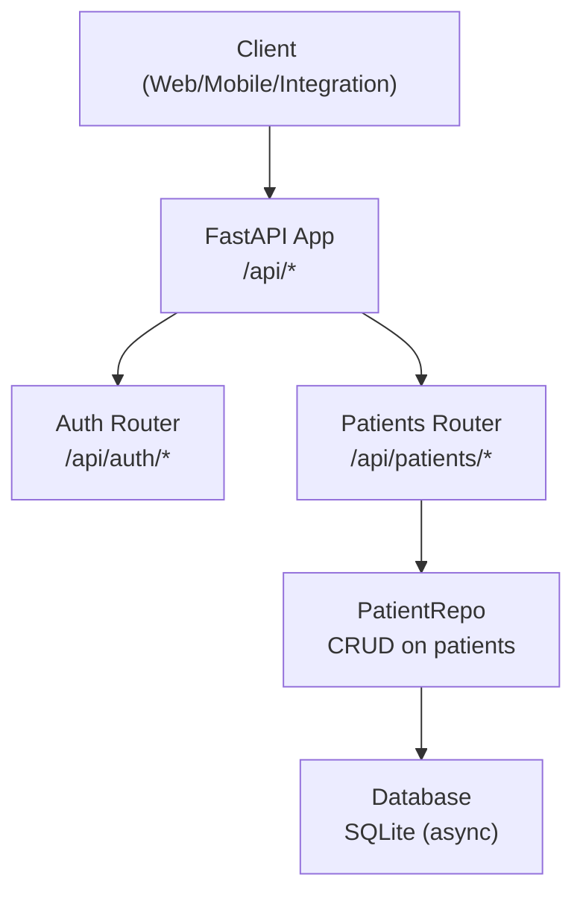
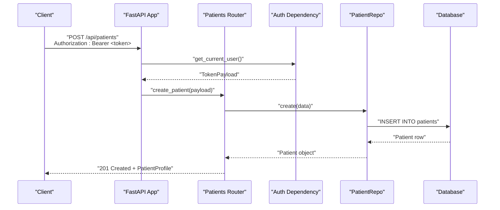
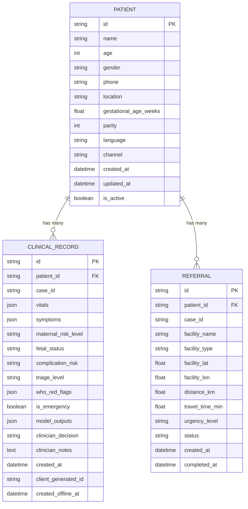
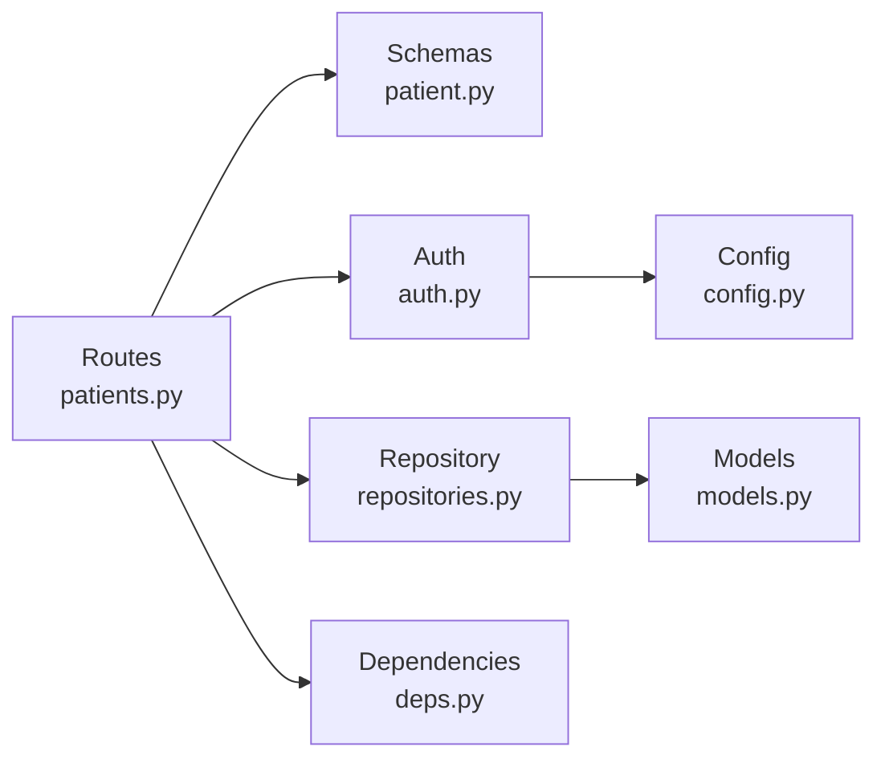

# Patient Management API

<cite>
**Referenced Files in This Document**
- [patients.py](file://backend/api/routes/patients.py)
- [patient.py](file://backend/schemas/patient.py)
- [models.py](file://backend/db/models.py)
- [repositories.py](file://backend/db/repositories.py)
- [auth.py](file://backend/api/auth.py)
- [deps.py](file://backend/api/deps.py)
- [main.py](file://backend/api/main.py)
- [auth.py](file://backend/schemas/auth.py)
- [config.py](file://backend/config.py)
</cite>

## Table of Contents
1. [Introduction](#introduction)
2. [Project Structure](#project-structure)
3. [Core Components](#core-components)
4. [Architecture Overview](#architecture-overview)
5. [Detailed Component Analysis](#detailed-component-analysis)
6. [Dependency Analysis](#dependency-analysis)
7. [Performance Considerations](#performance-considerations)
8. [Troubleshooting Guide](#troubleshooting-guide)
9. [Conclusion](#conclusion)
10. [Appendices](#appendices)

## Introduction
This document provides detailed API documentation for patient management endpoints that support creating, listing, retrieving, and updating patient records. It covers request/response schemas derived from the PatientCreate and PatientProfile models, query parameters for pagination, authentication requirements using JWT tokens, error handling patterns, example data structures, common healthcare workflows, and integration points with other system components such as clinical records, referrals, and analytics.

## Project Structure
The patient management feature is implemented as a FastAPI router under the backend API layer, with Pydantic schemas defining request/response contracts, SQLAlchemy ORM models for persistence, and repository classes encapsulating database operations. Authentication is handled via JWT middleware and dependencies, while the main application wires routers and global exception handling.

**Diagram sources**
- [main.py:122-134](file://backend/api/main.py#L122-L134)
- [patients.py:13-96](file://backend/api/routes/patients.py#L13-L96)
- [repositories.py:9-29](file://backend/db/repositories.py#L9-L29)
- [models.py:11-29](file://backend/db/models.py#L11-L29)

**Section sources**
- [main.py:52-64](file://backend/api/main.py#L52-L64)
- [main.py:122-134](file://backend/api/main.py#L122-L134)

## Core Components
- Routes: Define HTTP endpoints for patient CRUD operations under /api/patients.
- Schemas: Define input validation and response shapes for patient creation and profiles.
- Models: Define the persistent Patient entity and related relationships.
- Repositories: Encapsulate database queries for create, read, update, and list operations.
- Authentication: JWT-based access control protecting all patient endpoints.
- Dependencies: Provide async database sessions and shared services.

Key responsibilities:
- POST /api/patients: Create a new patient record.
- GET /api/patients: List patients with pagination.
- GET /api/patients/{patient_id}: Retrieve a specific patient.
- PUT /api/patients/{patient_id}: Update an existing patient.

**Section sources**
- [patients.py:44-96](file://backend/api/routes/patients.py#L44-L96)
- [patient.py:31-46](file://backend/schemas/patient.py#L31-L46)
- [models.py:11-29](file://backend/db/models.py#L11-L29)
- [repositories.py:9-29](file://backend/db/repositories.py#L9-L29)
- [auth.py:99-115](file://backend/api/auth.py#L99-L115)
- [deps.py:16-24](file://backend/api/deps.py#L16-L24)

## Architecture Overview
The patient management API follows a layered architecture:
- Presentation Layer: FastAPI routes handle HTTP requests and responses.
- Service Layer: Repository classes abstract database interactions.
- Data Layer: SQLAlchemy ORM models map to database tables.
- Security Layer: JWT authentication ensures authorized access.

**Diagram sources**
- [patients.py:44-53](file://backend/api/routes/patients.py#L44-L53)
- [auth.py:99-101](file://backend/api/auth.py#L99-L101)
- [repositories.py:13-17](file://backend/db/repositories.py#L13-L17)
- [models.py:11-29](file://backend/db/models.py#L11-L29)

## Detailed Component Analysis

### Endpoints

#### Create Patient
- Method: POST
- Path: /api/patients
- Authentication: Required (Bearer token)
- Request Body: PatientCreate schema
- Response: PatientProfile schema
- Status Codes:
  - 201 Created: Patient successfully created
  - 401 Unauthorized: Invalid or missing token
  - 422 Unprocessable Entity: Validation errors in request body

Request Schema (PatientCreate):
- name: string (required)
- age: integer, range 10–60 (required)
- gender: enum male/female/other (default female)
- phone: string (optional)
- location: string (optional)
- gestational_age_weeks: float (optional)
- parity: integer (optional)
- language: string (default ur)
- channel: string (default app)

Response Schema (PatientProfile):
- Inherits all fields from PatientCreate
- patient_id: string (generated)
- created_at: datetime
- updated_at: datetime (nullable)

Example Request Payload:
{
  "name": "Ayesha Khan",
  "age": 28,
  "gender": "female",
  "phone": "+923001234567",
  "location": "Lahore",
  "gestational_age_weeks": 24.5,
  "parity": 1,
  "language": "ur",
  "channel": "app"
}

Example Response:
{
  "patient_id": "a1b2c3d4-e5f6-7890-abcd-ef1234567890",
  "name": "Ayesha Khan",
  "age": 28,
  "gender": "female",
  "phone": "+923001234567",
  "location": "Lahore",
  "gestational_age_weeks": 24.5,
  "parity": 1,
  "language": "ur",
  "channel": "app",
  "created_at": "2024-01-15T10:30:00Z",
  "updated_at": null
}

Common Use Cases:
- New patient intake at a clinic or community health center
- Mobile app registration for maternal health monitoring
- Integration with referral systems to onboard referred patients

Integration Patterns:
- After creation, link patient to clinical records and referrals
- Trigger risk assessment workflows based on gestational age and parity
- Notify care team via messaging or voice channels

**Section sources**
- [patients.py:44-53](file://backend/api/routes/patients.py#L44-L53)
- [patient.py:31-46](file://backend/schemas/patient.py#L31-L46)
- [auth.py:99-101](file://backend/api/auth.py#L99-L101)

#### List Patients
- Method: GET
- Path: /api/patients
- Query Parameters:
  - skip: integer, default 0, minimum 0
  - limit: integer, default 100, range 1–500
- Authentication: Required (Bearer token)
- Response: Array of PatientProfile objects
- Status Codes:
  - 200 OK: Successful retrieval
  - 401 Unauthorized: Invalid or missing token

Pagination Behavior:
- Results are ordered by most recently created first
- Use skip to offset and limit to control page size

Example Request:
GET /api/patients?skip=0&limit=20

Example Response:
[
  {
    "patient_id": "p1-uuid",
    "name": "Fatima Bibi",
    "age": 32,
    "gender": "female",
    "phone": "+923007654321",
    "location": "Karachi",
    "gestational_age_weeks": 30.0,
    "parity": 2,
    "language": "ur",
    "channel": "app",
    "created_at": "2024-01-14T08:15:00Z",
    "updated_at": null
  },
  ...
]

Common Use Cases:
- Dashboard view for clinicians to browse recent patients
- Batch export for reporting or analytics
- Search and filter workflows (future enhancement)

Integration Patterns:
- Combine with risk scores to prioritize high-risk patients
- Link to referral status for follow-up actions

**Section sources**
- [patients.py:56-66](file://backend/api/routes/patients.py#L56-L66)
- [repositories.py:27-29](file://backend/db/repositories.py#L27-L29)

#### Get Patient by ID
- Method: GET
- Path: /api/patients/{patient_id}
- Path Parameter: patient_id (string)
- Authentication: Required (Bearer token)
- Response: PatientProfile object
- Status Codes:
  - 200 OK: Patient found
  - 404 Not Found: Patient does not exist
  - 401 Unauthorized: Invalid or missing token

Example Request:
GET /api/patients/a1b2c3d4-e5f6-7890-abcd-ef1234567890

Example Response:
{
  "patient_id": "a1b2c3d4-e5f6-7890-abcd-ef1234567890",
  "name": "Ayesha Khan",
  "age": 28,
  "gender": "female",
  "phone": "+923001234567",
  "location": "Lahore",
  "gestational_age_weeks": 24.5,
  "parity": 1,
  "language": "ur",
  "channel": "app",
  "created_at": "2024-01-15T10:30:00Z",
  "updated_at": null
}

Common Use Cases:
- View full patient profile during consultation
- Pre-populate forms for clinical record entry
- Validate patient existence before initiating referrals

Integration Patterns:
- Fetch associated clinical records and referrals
- Trigger risk assessment updates based on latest vitals

**Section sources**
- [patients.py:69-80](file://backend/api/routes/patients.py#L69-L80)
- [repositories.py:19-21](file://backend/db/repositories.py#L19-L21)

#### Update Patient
- Method: PUT
- Path: /api/patients/{patient_id}
- Path Parameter: patient_id (string)
- Request Body: PatientCreate schema (used for updates)
- Authentication: Required (Bearer token)
- Response: Updated PatientProfile object
- Status Codes:
  - 200 OK: Patient successfully updated
  - 404 Not Found: Patient does not exist
  - 401 Unauthorized: Invalid or missing token
  - 422 Unprocessable Entity: Validation errors in request body

Update Behavior:
- All fields from PatientCreate are applied to the existing patient record
- Timestamps are managed by the database layer

Example Request:
PUT /api/patients/a1b2c3d4-e5f6-7890-abcd-ef1234567890
{
  "name": "Ayesha Khan",
  "age": 29,
  "gender": "female",
  "phone": "+923001234567",
  "location": "Islamabad",
  "gestational_age_weeks": 26.0,
  "parity": 1,
  "language": "ur",
  "channel": "app"
}

Example Response:
{
  "patient_id": "a1b2c3d4-e5f6-7890-abcd-ef1234567890",
  "name": "Ayesha Khan",
  "age": 29,
  "gender": "female",
  "phone": "+923001234567",
  "location": "Islamabad",
  "gestational_age_weeks": 26.0,
  "parity": 1,
  "language": "ur",
  "channel": "app",
  "created_at": "2024-01-15T10:30:00Z",
  "updated_at": "2024-01-16T14:20:00Z"
}

Common Use Cases:
- Correcting demographic information after verification
- Updating gestational age as pregnancy progresses
- Changing communication preferences (language, channel)

Integration Patterns:
- Re-run risk assessments when key fields change
- Log audit events for compliance tracking

**Section sources**
- [patients.py:83-96](file://backend/api/routes/patients.py#L83-L96)
- [repositories.py:23-25](file://backend/db/repositories.py#L23-L25)

### Authentication Requirements
All patient endpoints require a valid JWT bearer token in the Authorization header. Tokens are issued via the login endpoint and validated using the get_current_user dependency. Role-based authorization can be enforced using require_role for future enhancements.

Authentication Flow:
1. Client calls POST /api/auth/login with username and password
2. Server validates credentials and returns a JWT token
3. Client includes Authorization: Bearer <token> in subsequent requests
4. Server decodes and validates the token for each protected endpoint

Supported Roles:
- patient
- lhw (Lady Health Worker)
- clinician
- admin

**Section sources**
- [auth.py:125-146](file://backend/api/auth.py#L125-L146)
- [auth.py:99-115](file://backend/api/auth.py#L99-L115)
- [auth.py:8-13](file://backend/schemas/auth.py#L8-L13)

### Error Handling
Standard HTTP status codes are used for error responses:
- 400 Bad Request: Malformed request
- 401 Unauthorized: Missing or invalid token
- 403 Forbidden: Insufficient permissions (future role checks)
- 404 Not Found: Resource not found
- 422 Unprocessable Entity: Validation errors
- 500 Internal Server Error: Unexpected server errors

Global Exception Handler:
- Returns structured JSON with error message, detail, and path
- Logs unhandled exceptions for debugging

Common Errors:
- Patient not found: 404 with descriptive message
- Validation failures: 422 with field-specific details
- Authentication failures: 401 with WWW-Authenticate header

**Section sources**
- [patients.py:78-79](file://backend/api/routes/patients.py#L78-L79)
- [main.py:83-100](file://backend/api/main.py#L83-L100)
- [auth.py:73-91](file://backend/api/auth.py#L73-L91)

### Data Models and Relationships
The Patient model serves as the core entity with relationships to clinical records and referrals. This enables comprehensive patient management within the broader healthcare platform.

**Diagram sources**
- [models.py:11-68](file://backend/db/models.py#L11-L68)

**Section sources**
- [models.py:11-68](file://backend/db/models.py#L11-L68)

## Dependency Analysis
The patient management system has clear separation of concerns with minimal coupling between layers:

Key Dependencies:
- Routes depend on Schemas for validation and Repository for data access
- Repository depends on Models for database mapping
- Authentication depends on Configuration for JWT settings
- All components use Dependencies for session management

Potential Issues:
- Tight coupling between routes and repository methods
- Limited filtering capabilities in current list endpoint
- No soft delete functionality for patient records

**Diagram sources**
- [patients.py:1-12](file://backend/api/routes/patients.py#L1-L12)
- [repositories.py:1-7](file://backend/db/repositories.py#L1-L7)
- [auth.py:1-13](file://backend/api/auth.py#L1-L13)

**Section sources**
- [patients.py:1-12](file://backend/api/routes/patients.py#L1-L12)
- [repositories.py:1-7](file://backend/db/repositories.py#L1-L7)

## Performance Considerations
- Pagination: The list endpoint supports efficient pagination with skip and limit parameters
- Database Indexing: Consider adding indexes on frequently queried fields like created_at, gender, and location
- Connection Pooling: Async database sessions improve concurrent request handling
- Caching: Implement caching for frequently accessed patient profiles
- Query Optimization: Add filtering capabilities to reduce data transfer

Optimization Opportunities:
- Implement search filters for name, location, and gender
- Add batch operations for bulk updates
- Implement soft deletes instead of hard deletes
- Add audit logging for all patient modifications

## Troubleshooting Guide
Common Issues and Solutions:

Authentication Problems:
- Verify JWT token is included in Authorization header
- Check token expiration and refresh if necessary
- Ensure correct username/password combination for login

Data Validation Errors:
- Review request payload against PatientCreate schema
- Check field constraints (e.g., age range, gestational age limits)
- Validate required fields are present

Database Connectivity:
- Verify database connection string in configuration
- Check database availability and permissions
- Monitor connection pool exhaustion

Performance Issues:
- Optimize pagination parameters for large datasets
- Implement caching for frequently accessed data
- Monitor database query performance

Error Response Format:
- All errors return structured JSON with error details
- Use global exception handler for consistent error formatting
- Log detailed error information for debugging

**Section sources**
- [auth.py:73-91](file://backend/api/auth.py#L73-L91)
- [main.py:83-100](file://backend/api/main.py#L83-L100)
- [patient.py:31-46](file://backend/schemas/patient.py#L31-L46)

## Conclusion
The Patient Management API provides a robust foundation for managing patient records in a maternal health platform. With comprehensive CRUD operations, JWT-based authentication, and clear data models, it supports essential healthcare workflows. The modular architecture enables easy extension with additional features like advanced filtering, search capabilities, and enhanced security measures.

Key Strengths:
- Clean separation of concerns with well-defined layers
- Comprehensive authentication and authorization framework
- Flexible data models supporting various healthcare scenarios
- Efficient pagination for large patient datasets

Recommended Enhancements:
- Add advanced filtering and search capabilities
- Implement role-based access control for different user types
- Add comprehensive audit logging for compliance
- Implement caching strategies for improved performance
- Add bulk operations for administrative tasks

## Appendices

### API Base URL
- Development: http://localhost:8000/api
- Documentation: http://localhost:8000/api/docs
- OpenAPI Spec: http://localhost:8000/api/openapi.json

### Environment Variables
- DATABASE_URL: SQLite database connection string
- JWT_SECRET: Secret key for JWT token signing
- JWT_ALGORITHM: Algorithm for JWT encoding (HS256)
- JWT_EXPIRE_MINUTES: Token expiration time in minutes

### Testing Credentials
- Admin: username=admin, password=admin
- Clinician: username=clinician, password=clinician
- LHW: username=lhw, password=lhw
- Patient: username=patient, password=patient

**Section sources**
- [config.py:23-29](file://backend/config.py#L23-L29)
- [auth.py:25-58](file://backend/api/auth.py#L25-L58)