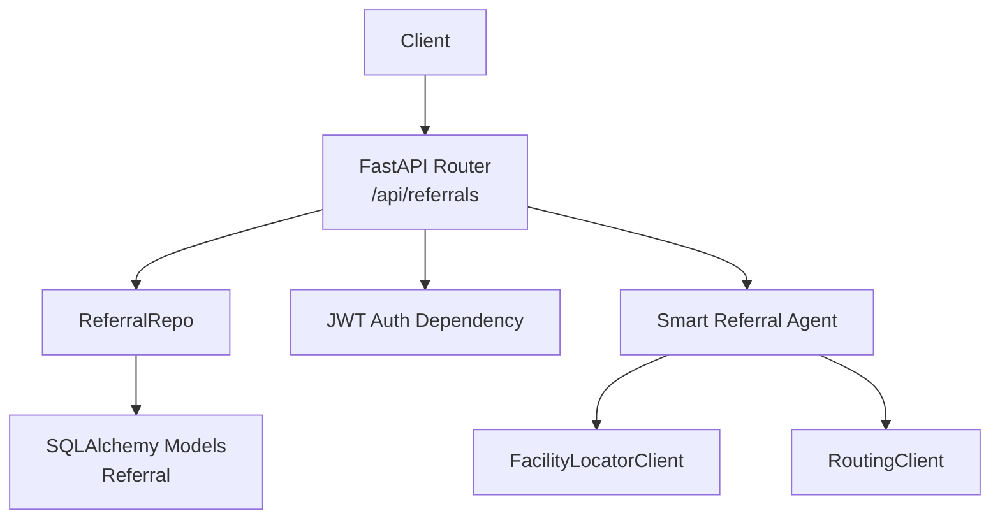
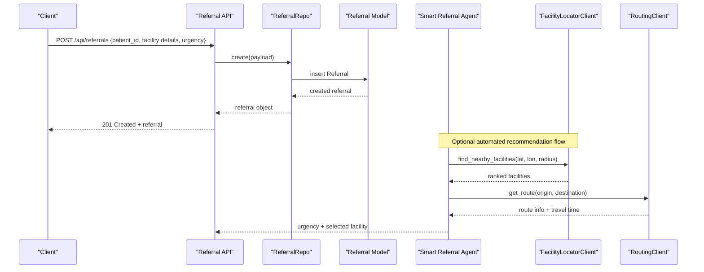
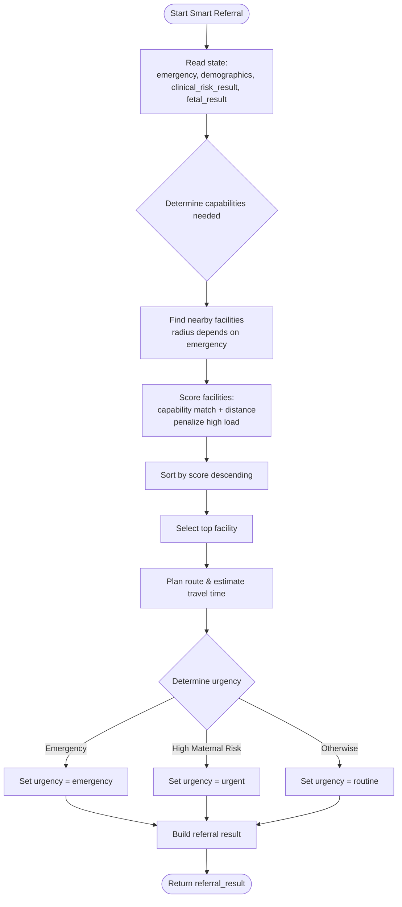
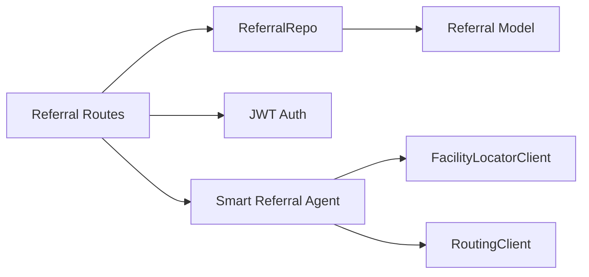

# Referral Management API

<cite>
**Referenced Files in This Document**
- [referrals.py](file://backend/api/routes/referrals.py)
- [referral.py](file://backend/schemas/referral.py)
- [models.py](file://backend/db/models.py)
- [repositories.py](file://backend/db/repositories.py)
- [smart_referral.py](file://backend/agents/nodes/smart_referral.py)
- [facility_locator.py](file://backend/integrations/facility_locator.py)
- [routing_client.py](file://backend/integrations/routing_client.py)
- [main.py](file://backend/api/main.py)
</cite>

## Table of Contents
1. [Introduction](#introduction)
2. [Project Structure](#project-structure)
3. [Core Components](#core-components)
4. [Architecture Overview](#architecture-overview)
5. [Detailed Component Analysis](#detailed-component-analysis)
6. [Dependency Analysis](#dependency-analysis)
7. [Performance Considerations](#performance-considerations)
8. [Troubleshooting Guide](#troubleshooting-guide)
9. [Conclusion](#conclusion)

## Introduction
This document provides detailed API documentation for referral management endpoints, including creation, listing, retrieval, and status updates. It also documents the supported schemas, urgency levels, status transitions, and integration with the smart referral system that recommends facilities based on patient location, clinical risk, and facility capabilities.

The referral endpoints are mounted under /api/referrals and require authentication via JWT tokens. The backend uses FastAPI, SQLAlchemy async models, and repository-based data access.

## Project Structure
Referral functionality spans several layers:
- API routes define HTTP endpoints and request/response validation.
- Schemas define structured Pydantic models for requests and responses.
- Database models represent persistent entities.
- Repositories encapsulate CRUD operations.
- Smart referral agent integrates facility lookup and routing to recommend facilities and determine urgency.

**Diagram sources**
- [referrals.py:60-125](file://backend/api/routes/referrals.py#L60-L125)
- [repositories.py:49-65](file://backend/db/repositories.py#L49-L65)
- [models.py:52-68](file://backend/db/models.py#L52-L68)
- [smart_referral.py:11-118](file://backend/agents/nodes/smart_referral.py#L11-L118)
- [facility_locator.py:14-60](file://backend/integrations/facility_locator.py#L14-L60)
- [routing_client.py:16-59](file://backend/integrations/routing_client.py#L16-L59)

**Section sources**
- [main.py:122-129](file://backend/api/main.py#L122-L129)
- [referrals.py:1-126](file://backend/api/routes/referrals.py#L1-L126)

## Core Components
- ReferralCreate: Request schema for creating a referral with patient and facility details, optional case identifier, coordinates, distance/travel time, and urgency level.
- ReferralStatusUpdate: Request schema for updating a referral’s status.
- Referral model: Persistent entity storing referral metadata, urgency, and lifecycle status.
- ReferralRepo: Repository providing create, get_by_id, and update_status operations.
- Smart referral agent: Determines urgency and ranks facilities based on capability match and distance; optionally plans route and estimates travel time.

Key behaviors:
- POST /api/referrals creates a new referral record using provided facility details or defaults.
- GET /api/referrals lists referrals with filters for urgency and status, supports pagination via skip and limit, and sorts by newest first.
- GET /api/referrals/{referral_id} retrieves a single referral by ID.
- PUT /api/referrals/{referral_id}/status updates the referral status.

Supported values:
- Urgency levels: routine, urgent, emergency
- Status transitions: pending, accepted, in_transit, completed, cancelled

**Section sources**
- [referrals.py:21-35](file://backend/api/routes/referrals.py#L21-L35)
- [models.py:52-68](file://backend/db/models.py#L52-L68)
- [repositories.py:49-65](file://backend/db/repositories.py#L49-L65)
- [smart_referral.py:74-83](file://backend/agents/nodes/smart_referral.py#L74-L83)

## Architecture Overview
The referral API integrates with the smart referral system to automate facility recommendations. When creating or processing referrals, the system can:
- Locate nearby healthcare facilities within a radius based on patient location.
- Rank facilities by capability match (emergency, maternity, NICU) and proximity.
- Estimate travel time and plan routes for the top-ranked facility.
- Determine urgency from emergency flags and clinical risk results.

**Diagram sources**
- [referrals.py:60-69](file://backend/api/routes/referrals.py#L60-L69)
- [repositories.py:53-57](file://backend/db/repositories.py#L53-L57)
- [smart_referral.py:37-72](file://backend/agents/nodes/smart_referral.py#L37-L72)
- [facility_locator.py:14-60](file://backend/integrations/facility_locator.py#L14-L60)
- [routing_client.py:46-59](file://backend/integrations/routing_client.py#L46-L59)

## Detailed Component Analysis

### Endpoints

#### Create Referral
- Method: POST
- Path: /api/referrals
- Authentication: Required (JWT)
- Request body: ReferralCreate schema
- Response: Referral object serialized to dictionary
- Behavior: Creates a new referral record in the database using provided facility details and urgency level.

Request fields:
- patient_id: string (required)
- case_id: string (optional)
- facility_name: string (optional)
- facility_type: string (optional)
- facility_lat: float (optional)
- facility_lon: float (optional)
- distance_km: float (optional)
- travel_time_min: float (optional)
- urgency_level: string (default "routine"; allowed: routine, urgent, emergency)

Response fields:
- id, patient_id, case_id, facility_name, facility_type, facility_lat, facility_lon, distance_km, travel_time_min, urgency_level, status, created_at, completed_at

Error handling:
- Unauthorized: 401 if token missing or invalid
- Validation error: 422 if request body is invalid
- Internal server error: 500 for unhandled exceptions

**Section sources**
- [referrals.py:21-35](file://backend/api/routes/referrals.py#L21-L35)
- [referrals.py:60-69](file://backend/api/routes/referrals.py#L60-L69)
- [referrals.py:37-52](file://backend/api/routes/referrals.py#L37-L52)
- [main.py:83-100](file://backend/api/main.py#L83-L100)

#### List Referrals
- Method: GET
- Path: /api/referrals
- Authentication: Required (JWT)
- Query parameters:
  - urgency: string (optional filter by urgency level)
  - status: string (optional filter by status; alias "status")
  - skip: integer (default 0, minimum 0)
  - limit: integer (default 100, range 1–500)
- Response: Array of referral objects sorted by newest first

Behavior:
- Filters by urgency and/or status when provided.
- Applies pagination with skip and limit.
- Orders results by created_at descending.

Sorting options:
- Default sort: newest first (created_at DESC)
- No explicit ascending/descending parameter exposed; ordering is fixed to newest first.

**Section sources**
- [referrals.py:72-94](file://backend/api/routes/referrals.py#L72-L94)

#### Get Referral
- Method: GET
- Path: /api/referrals/{referral_id}
- Authentication: Required (JWT)
- Path parameter: referral_id (string)
- Response: Single referral object
- Error handling:
  - Not found: 404 if referral_id does not exist

**Section sources**
- [referrals.py:97-108](file://backend/api/routes/referrals.py#L97-L108)

#### Update Referral Status
- Method: PUT
- Path: /api/referrals/{referral_id}/status
- Authentication: Required (JWT)
- Request body: ReferralStatusUpdate schema
- Path parameter: referral_id (string)
- Response: Updated referral object
- Supported statuses: pending, accepted, in_transit, completed, cancelled
- Error handling:
  - Not found: 404 if referral_id does not exist

Validation:
- Status must be one of the allowed values defined in the schema.

**Section sources**
- [referrals.py:33-35](file://backend/api/routes/referrals.py#L33-L35)
- [referrals.py:111-125](file://backend/api/routes/referrals.py#L111-L125)

### Schemas

#### ReferralCreate
Defines the input payload for creating a referral. Includes patient identification, optional case context, facility details (name, type, coordinates), optional distance and travel time, and urgency level.

Fields:
- patient_id: string
- case_id: string (optional)
- facility_name: string (optional)
- facility_type: string (optional)
- facility_lat: float (optional)
- facility_lon: float (optional)
- distance_km: float (optional)
- travel_time_min: float (optional)
- urgency_level: string (default "routine"; allowed: routine, urgent, emergency)

**Section sources**
- [referrals.py:21-31](file://backend/api/routes/referrals.py#L21-L31)

#### ReferralStatusUpdate
Defines the input payload for updating a referral’s status.

Fields:
- status: string (allowed: pending, accepted, in_transit, completed, cancelled)

**Section sources**
- [referrals.py:33-35](file://backend/api/routes/referrals.py#L33-L35)

### Data Model

#### Referral
Persistent entity representing a referral with patient linkage, facility information, urgency, and lifecycle status.

Fields:
- id: string (primary key)
- patient_id: string (foreign key to patients)
- case_id: string (indexed)
- facility_name: string
- facility_type: string
- facility_lat: float
- facility_lon: float
- distance_km: float
- travel_time_min: float
- urgency_level: string (default "routine"; allowed: routine, urgent, emergency)
- status: string (default "pending"; allowed: pending, accepted, in_transit, completed, cancelled)
- created_at: datetime
- completed_at: datetime

Relationships:
- Links to Patient via patient_id.

**Section sources**
- [models.py:52-68](file://backend/db/models.py#L52-L68)

### Smart Referral Integration

The smart referral agent automates facility recommendation and urgency determination:
- Locates nearby facilities using FacilityLocatorClient with configurable radius based on emergency flag.
- Ranks facilities by capability match (emergency, NICU, maternity) and distance, penalizing high-load facilities.
- Plans route and estimates travel time using RoutingClient.
- Determines urgency:
  - Emergency if state indicates emergency.
  - Urgent if maternal risk is high.
  - Routine otherwise.

Output includes ranked facilities, selected facility, estimated travel time, and capabilities needed.

**Diagram sources**
- [smart_referral.py:20-98](file://backend/agents/nodes/smart_referral.py#L20-L98)
- [facility_locator.py:14-60](file://backend/integrations/facility_locator.py#L14-L60)
- [routing_client.py:16-59](file://backend/integrations/routing_client.py#L16-L59)

**Section sources**
- [smart_referral.py:11-118](file://backend/agents/nodes/smart_referral.py#L11-L118)

## Dependency Analysis
The referral system has clear layering and dependencies:
- API routes depend on repositories for data access and on auth middleware for security.
- Repositories depend on SQLAlchemy models for persistence.
- Smart referral agent depends on external integrations for facility discovery and routing.

**Diagram sources**
- [referrals.py:60-125](file://backend/api/routes/referrals.py#L60-L125)
- [repositories.py:49-65](file://backend/db/repositories.py#L49-L65)
- [models.py:52-68](file://backend/db/models.py#L52-L68)
- [smart_referral.py:37-72](file://backend/agents/nodes/smart_referral.py#L37-L72)
- [facility_locator.py:14-60](file://backend/integrations/facility_locator.py#L14-L60)
- [routing_client.py:16-59](file://backend/integrations/routing_client.py#L16-L59)

**Section sources**
- [main.py:122-129](file://backend/api/main.py#L122-L129)

## Performance Considerations
- Pagination: Use skip and limit to control response size; default limit is 100, maximum 500.
- Sorting: Results are ordered by newest first; avoid large offsets for performance.
- Facility search radius: Emergency searches use a larger radius (50 km) compared to non-emergency (20 km).
- Travel time estimation: Uses haversine distance and average speeds; consider real-time traffic integration for accuracy.
- Caching: Consider caching facility lists and route calculations for repeated queries.

[No sources needed since this section provides general guidance]

## Troubleshooting Guide
Common issues and resolutions:
- 401 Unauthorized: Ensure valid JWT token is included in request headers.
- 404 Not Found: Verify referral_id exists before attempting retrieval or status updates.
- 422 Validation Error: Check request body against ReferralCreate or ReferralStatusUpdate schemas; ensure urgency_level and status values are allowed.
- 500 Internal Server Error: Review global exception handler logs for stack traces and underlying causes.

Authentication dependency:
- All referral endpoints require authentication via JWT; ensure token acquisition and inclusion are correct.

Database connectivity:
- If database initialization fails during startup, some endpoints may behave unexpectedly; check logs for DB init warnings.

**Section sources**
- [referrals.py:97-108](file://backend/api/routes/referrals.py#L97-L108)
- [referrals.py:111-125](file://backend/api/routes/referrals.py#L111-L125)
- [main.py:83-100](file://backend/api/main.py#L83-L100)
- [main.py:28-33](file://backend/api/main.py#L28-L33)

## Conclusion
The referral management API provides robust endpoints for creating, listing, retrieving, and updating referrals with support for urgency levels and status transitions. Integration with the smart referral system enables automated facility recommendations based on patient location, clinical risk, and facility capabilities. Proper use of authentication, pagination, and filtering ensures efficient and secure interactions with the system.

[No sources needed since this section summarizes without analyzing specific files]