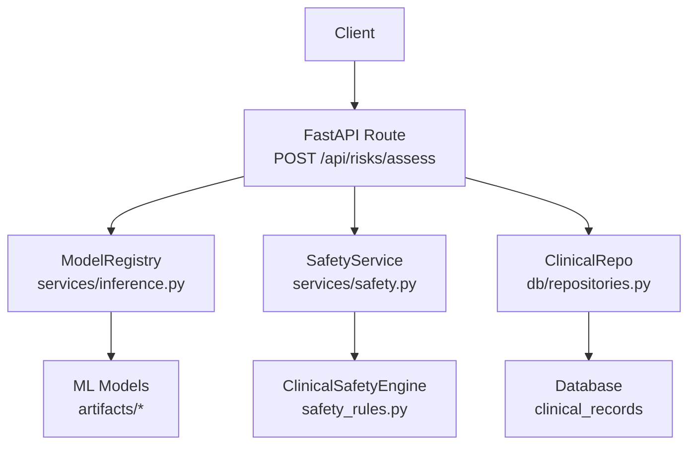
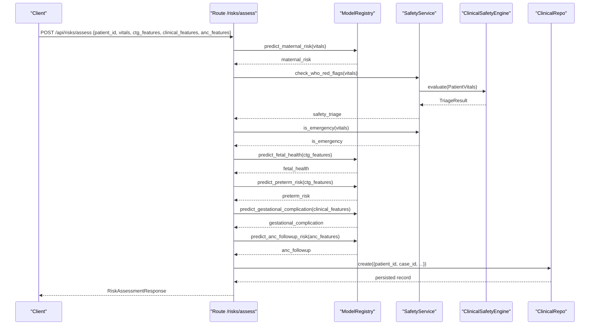
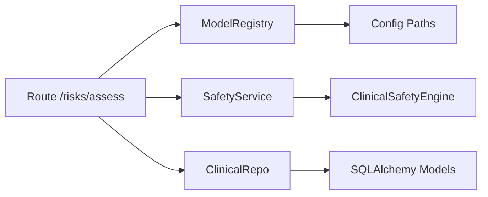

# Risk Assessment API

<cite>
**Referenced Files in This Document**
- [risks.py](file://backend/api/routes/risks.py)
- [inference.py](file://backend/services/inference.py)
- [safety.py](file://backend/services/safety.py)
- [safety_rules.py](file://safety_rules.py)
- [risk.py](file://backend/schemas/risk.py)
- [repositories.py](file://backend/db/repositories.py)
- [models.py](file://backend/db/models.py)
- [config.py](file://backend/config.py)
- [maternal_guard.py](file://src/models/maternal_guard.py)
- [fetal_watch.py](file://src/models/fetal_watch.py)
- [preterm_guard.py](file://src/models/preterm_guard.py)
</cite>

## Table of Contents
1. Introduction
2. Project Structure
3. Core Components
4. Architecture Overview
5. Detailed Component Analysis
6. Dependency Analysis
7. Performance Considerations
8. Troubleshooting Guide
9. Conclusion
10. Appendices

## Introduction
This document provides comprehensive API documentation for the quick risk assessment endpoint POST /api/risks/assess. It performs real-time inference across five ML models: MaternalGuard, FetalWatch, PretermGuard, GestationInsight, and CareReach. The endpoint ingests vitals, CTG features, clinical features, and ANC features to produce maternal risk scores, fetal health classification, preterm birth predictions, gestational complication risks, ANC follow-up assessments, and safety triage results. It also implements WHO red flag detection, emergency determination logic, and automatic persistence to clinical records.

## Project Structure
The risk assessment service is implemented as a FastAPI route that orchestrates model inference via a registry, runs safety rules for WHO triage, and persists results to the database through repositories.

**Diagram sources**
- [risks.py:61-123](file://backend/api/routes/risks.py#L61-L123)
- [inference.py:51-141](file://backend/services/inference.py#L51-L141)
- [safety.py:18-67](file://backend/services/safety.py#L18-L67)
- [safety_rules.py:72-167](file://safety_rules.py#L72-L167)
- [repositories.py:31-47](file://backend/db/repositories.py#L31-L47)

**Section sources**
- [risks.py:1-149](file://backend/api/routes/risks.py#L1-L149)
- [config.py:7-54](file://backend/config.py#L7-L54)

## Core Components
- Endpoint: POST /api/risks/assess
  - Accepts RiskAssessmentRequest with patient_id, case_id, vitals, ctg_features, clinical_features, anc_features.
  - Returns RiskAssessmentResponse containing maternal_risk, fetal_health, preterm_risk, gestational_complication, anc_followup, safety_triage, and is_emergency.
- Model Registry: Loads and caches ML models (MaternalGuard, FetalWatch, PretermGuard, CareReach, GestationInsight) and exposes prediction methods.
- Safety Service: Wraps ClinicalSafetyEngine to evaluate WHO red flags and determine emergencies based on vitals.
- Persistence: Automatically saves assessment results into clinical_records with key fields and full model outputs.

Key request/response schemas are defined inline in the route file and aligned with shared schema definitions used elsewhere in the system.

**Section sources**
- [risks.py:24-53](file://backend/api/routes/risks.py#L24-L53)
- [risk.py:7-43](file://backend/schemas/risk.py#L7-L43)

## Architecture Overview
The endpoint coordinates multiple services to deliver a unified risk assessment:

**Diagram sources**
- [risks.py:61-123](file://backend/api/routes/risks.py#L61-L123)
- [inference.py:153-426](file://backend/services/inference.py#L153-L426)
- [safety.py:24-67](file://backend/services/safety.py#L24-L67)
- [safety_rules.py:89-167](file://safety_rules.py#L89-L167)
- [repositories.py:35-47](file://backend/db/repositories.py#L35-L47)

## Detailed Component Analysis

### Endpoint: POST /api/risks/assess
- Purpose: Quick risk assessment without running the full agent workflow.
- Behavior:
  - Generates or uses provided case_id.
  - Calls MaternalGuard if vitals are present.
  - Runs WHO red flag checks and determines emergency status.
  - Calls FetalWatch and PretermGuard if CTG features are present.
  - Calls GestationInsight if clinical features are present.
  - Calls CareReach if ANC features are present.
  - Persists results to clinical_records including model_outputs and triage information.
  - Provides GET /{case_id} to retrieve stored assessments.

**Section sources**
- [risks.py:61-149](file://backend/api/routes/risks.py#L61-L149)

### Request Schema: RiskAssessmentRequest
- Fields:
  - patient_id: string identifier for the patient.
  - case_id: optional unique identifier; auto-generated if omitted.
  - vitals: dict for MaternalGuard inputs (e.g., Age, SystolicBP, DiastolicBP, BS, BodyTemp, HeartRate).
  - ctg_features: optional dict of 21 CTG features for FetalWatch and PretermGuard.
  - clinical_features: optional dict for GestationInsight inputs.
  - anc_features: optional dict for CareReach ANC follow-up risk.

Notes:
- Missing feature columns are filled with zeros during inference to ensure robustness.
- CareReach requires categorical columns like Gender and age_group to be strings.

**Section sources**
- [risks.py:24-43](file://backend/api/routes/risks.py#L24-L43)
- [inference.py:24-46](file://backend/services/inference.py#L24-L46)
- [inference.py:321-335](file://backend/services/inference.py#L321-L335)

### Response Schema: RiskAssessmentResponse
- Fields:
  - case_id: string identifier for this assessment.
  - maternal_risk: dict from MaternalGuard (risk_level, probabilities, confidence, model_available).
  - fetal_health: dict from FetalWatch (fetal_status, probabilities, confidence, model_available).
  - preterm_risk: dict from PretermGuard (risk_level, probabilities, confidence, model_available).
  - gestational_complication: dict from GestationInsight (risk_level, probabilities, confidence, model_available).
  - anc_followup: dict from CareReach (missed_risk_score, priority, confidence, model_available).
  - safety_triage: dict from SafetyService (triage_level, triggered_rules, clinical_rationale, recommended_actions, override_ml_scores, timestamp).
  - is_emergency: boolean derived from triage level HIGH_RISK_EMERGENCY.

Notes:
- model_available indicates whether the corresponding model was loaded successfully.
- For missing models or errors, fallback responses include unknown levels and zero confidence.

**Section sources**
- [risks.py:45-53](file://backend/api/routes/risks.py#L45-L53)
- [inference.py:147-149](file://backend/services/inference.py#L147-L149)
- [inference.py:153-426](file://backend/services/inference.py#L153-L426)
- [safety.py:24-67](file://backend/services/safety.py#L24-L67)

### Model Inference: ModelRegistry
- Responsibilities:
  - Load all models once at startup using configured artifact paths.
  - Provide prediction methods for each model with consistent output structure.
  - Handle missing features by filling defaults and ensuring correct column order.
  - Decode labels using encoders when available; otherwise use model classes.
  - Return safe fallbacks when models are unavailable or prediction fails.

- Methods:
  - predict_maternal_risk(vitals): returns maternal risk level and probabilities.
  - predict_fetal_health(ctg_features): returns fetal status classification.
  - predict_preterm_risk(ctg_features): returns preterm risk classification.
  - predict_gestational_compilation(clinical_features): returns gestational complication risk.
  - predict_anc_followup_risk(patient_features): returns missed visit risk score and priority.

- Feature sets:
  - CTG_FEATURES: list of 21 CTG feature names used by FetalWatch and PretermGuard.
  - MATERNAL_FEATURES: list of vital signs expected by MaternalGuard.
  - GESTATION_FEATURES: list of clinical features expected by GestationInsight.
  - CAREREACH_RAW_FEATURES: raw patient features for CareReach.

**Section sources**
- [inference.py:24-49](file://backend/services/inference.py#L24-L49)
- [inference.py:51-141](file://backend/services/inference.py#L51-L141)
- [inference.py:153-426](file://backend/services/inference.py#L153-L426)
- [config.py:13-21](file://backend/config.py#L13-L21)

### Safety Triage: SafetyService and ClinicalSafetyEngine
- SafetyService wraps ClinicalSafetyEngine to evaluate WHO danger-sign criteria.
- Inputs:
  - PatientVitals fields mapped from vitals_dict (e.g., systolic_bp, diastolic_bp, heart_rate, temperature_celsius, respiratory_rate, gestational_age_weeks, fetal_movement_present, vaginal_bleeding, headache_severity, visual_disturbance, epigastric_pain, vaginal_discharge_foul, convulsions, consciousness_level).
- Outputs:
  - triage_level: GREEN, YELLOW, ORANGE, RED (mapped to LOW_RISK, MODERATE_RISK, HIGH_RISK, HIGH_RISK_EMERGENCY).
  - triggered_rules: list of rule names that fired.
  - clinical_rationale: human-readable explanations.
  - recommended_actions: actionable steps per rule.
  - override_ml_scores: true if any RED flag triggers, overriding ML-based risk scores.
  - timestamp: evaluation time.

- Emergency determination:
  - is_emergency returns true when triage_level equals HIGH_RISK_EMERGENCY.

- Rule categories:
  - RED: severe hypertension, hemorrhage, imminent eclampsia, eclampsia, sepsis, reduced fetal movement, unconsciousness.
  - ORANGE: moderate hypertension, moderate bleeding, tachycardia, high fever.
  - YELLOW: mild hypertension, mild symptoms.
  - GREEN: default routine care when no flags detected.

**Section sources**
- [safety.py:18-67](file://backend/services/safety.py#L18-L67)
- [safety_rules.py:19-66](file://safety_rules.py#L19-L66)
- [safety_rules.py:89-167](file://safety_rules.py#L89-L167)
- [safety_rules.py:173-462](file://safety_rules.py#L173-L462)
- [safety_rules.py:468-477](file://safety_rules.py#L468-L477)

### Data Persistence: Clinical Records
- Automatic persistence occurs after inference and safety triage.
- Stored fields include:
  - patient_id, case_id, vitals, maternal_risk_level, fetal_status, complication_risk, triage_level, who_red_flags, is_emergency, model_outputs.
- Retrieval endpoint GET /{case_id} returns stored assessment details.

**Section sources**
- [risks.py:100-149](file://backend/api/routes/risks.py#L100-L149)
- [repositories.py:31-47](file://backend/db/repositories.py#L31-L47)
- [models.py:30-50](file://backend/db/models.py#L30-L50)

### Model Outputs Interpretation
- MaternalGuard:
  - Output includes risk_level (e.g., low/mid/high), probabilities across classes, and confidence.
  - Uses label encoder to map numeric classes to human-readable labels.
- FetalWatch:
  - Output includes fetal_status (normal/suspect/pathological), probabilities, and confidence.
- PretermGuard:
  - Output includes risk_level (normal/suspect/pathological), probabilities, and confidence.
- GestationInsight:
  - Output includes risk_level (Low/Moderate/High), probabilities, and confidence.
  - Uses label encoder and label mapping to decode integer classes to readable labels.
- CareReach:
  - Output includes missed_risk_score (probability of missed visit), priority (low/medium/high), and confidence.
  - Priority thresholds: >= 0.7 high, >= 0.4 medium, else low.

**Section sources**
- [inference.py:153-202](file://backend/services/inference.py#L153-L202)
- [inference.py:206-248](file://backend/services/inference.py#L206-L248)
- [inference.py:252-293](file://backend/services/inference.py#L252-L293)
- [inference.py:365-426](file://backend/services/inference.py#L365-L426)
- [inference.py:297-361](file://backend/services/inference.py#L297-L361)

## Dependency Analysis
- Route depends on:
  - ModelRegistry for ML inference.
  - SafetyService for WHO triage.
  - ClinicalRepo for persistence.
- ModelRegistry depends on:
  - Configured artifact paths for model files and preprocessors/encoders.
  - Pandas/NumPy for data preparation and probability handling.
- SafetyService depends on:
  - ClinicalSafetyEngine implementing deterministic WHO rules.
- Repositories depend on:
  - SQLAlchemy ORM models defining database schema.

**Diagram sources**
- [risks.py:61-123](file://backend/api/routes/risks.py#L61-L123)
- [inference.py:51-141](file://backend/services/inference.py#L51-L141)
- [safety.py:18-67](file://backend/services/safety.py#L18-L67)
- [repositories.py:31-47](file://backend/db/repositories.py#L31-L47)
- [models.py:30-50](file://backend/db/models.py#L30-L50)
- [config.py:13-21](file://backend/config.py#L13-L21)

**Section sources**
- [risks.py:61-123](file://backend/api/routes/risks.py#L61-L123)
- [inference.py:51-141](file://backend/services/inference.py#L51-L141)
- [safety.py:18-67](file://backend/services/safety.py#L18-L67)
- [repositories.py:31-47](file://backend/db/repositories.py#L31-L47)
- [models.py:30-50](file://backend/db/models.py#L30-L50)
- [config.py:13-21](file://backend/config.py#L13-L21)

## Performance Considerations
- Model loading is idempotent and cached via singleton; subsequent requests avoid reload overhead.
- Missing features are handled by filling zeros, reducing preprocessing latency.
- Fallback responses ensure continuity when models are unavailable.
- Database writes occur after inference; consider batching or async patterns if throughput increases.
- Safety triage is deterministic and fast; it can override ML scores when RED flags are present.

[No sources needed since this section provides general guidance]

## Troubleshooting Guide
- Model not found:
  - Check artifact paths in configuration; ensure best_model.joblib exists for each model.
  - Inspect logs for warnings about missing model files.
- Prediction failures:
  - Ensure input dicts contain required keys; missing keys are filled with zeros but may affect accuracy.
  - For CareReach, ensure categorical columns are strings.
- Safety triage unexpected results:
  - Verify vitals mapping matches PatientVitals fields; missing values may prevent rule triggering.
  - Review triggered_rules and clinical_rationale in safety_triage response.
- Persistence issues:
  - Confirm database connection and table schema; verify ClinicalRecord fields match stored payloads.
  - Use GET /{case_id} to confirm retrieval after POST.

**Section sources**
- [inference.py:103-130](file://backend/services/inference.py#L103-L130)
- [inference.py:147-149](file://backend/services/inference.py#L147-L149)
- [inference.py:321-335](file://backend/services/inference.py#L321-L335)
- [safety.py:24-67](file://backend/services/safety.py#L24-L67)
- [risks.py:126-149](file://backend/api/routes/risks.py#L126-L149)

## Conclusion
The POST /api/risks/assess endpoint provides a unified, real-time risk assessment by combining multiple ML models with WHO-based safety triage. It standardizes model outputs, handles missing data gracefully, and automatically persists results for clinical review and audit. The design supports extensibility and robust operation even when individual models are unavailable.

[No sources needed since this section summarizes without analyzing specific files]

## Appendices

### Example Workflow: Interpreting Model Outputs
- Input:
  - vitals: {"Age": 32, "SystolicBP": 150, "DiastolicBP": 95, "BS": 110, "BodyTemp": 37.0, "HeartRate": 85}
  - ctg_features: {21 CTG feature keys with numeric values}
  - clinical_features: {Glucose, BloodPressure, BMI, etc.}
  - anc_features: {Age, Scholarship, Hipertension, Diabetes, Alcoholism, Handcap, SMS_received, booking_delta_days, appointment_dow, sms_x_delta, comorbidity_count, Gender, age_group}
- Expected outputs:
  - maternal_risk: risk_level, probabilities, confidence
  - fetal_health: fetal_status, probabilities, confidence
  - preterm_risk: risk_level, probabilities, confidence
  - gestational_complication: risk_level, probabilities, confidence
  - anc_followup: missed_risk_score, priority, confidence
  - safety_triage: triage_level, triggered_rules, clinical_rationale, recommended_actions
  - is_emergency: true if triage_level is HIGH_RISK_EMERGENCY

Interpretation tips:
- If safety_triage.triage_level is HIGH_RISK_EMERGENCY, treat as immediate life-threatening regardless of ML scores.
- For CareReach, prioritize patients with missed_risk_score >= 0.7 (high priority).
- For GestationInsight, map encoded labels to Low/Moderate/High using label encoder or class mapping.

**Section sources**
- [risks.py:61-123](file://backend/api/routes/risks.py#L61-L123)
- [inference.py:153-426](file://backend/services/inference.py#L153-L426)
- [safety.py:24-67](file://backend/services/safety.py#L24-L67)
- [safety_rules.py:89-167](file://safety_rules.py#L89-L167)