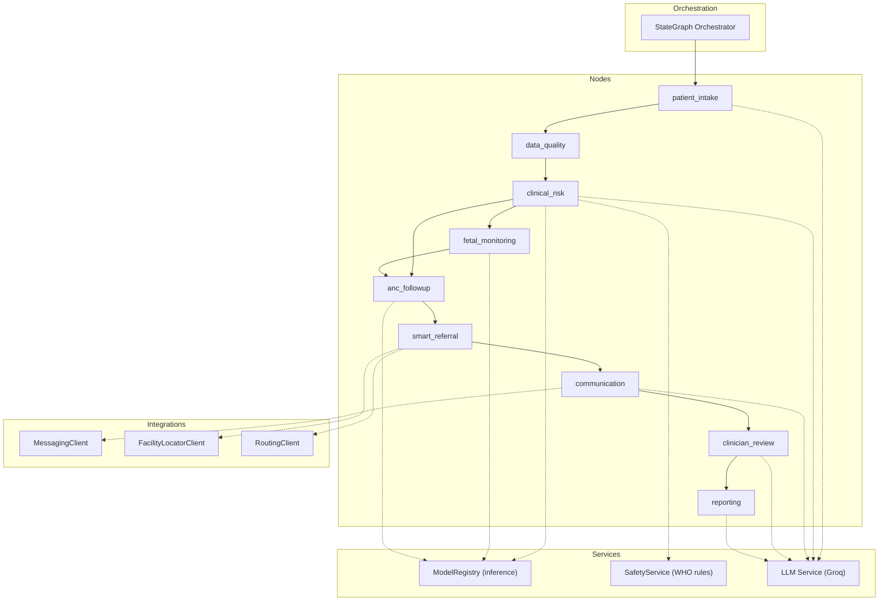
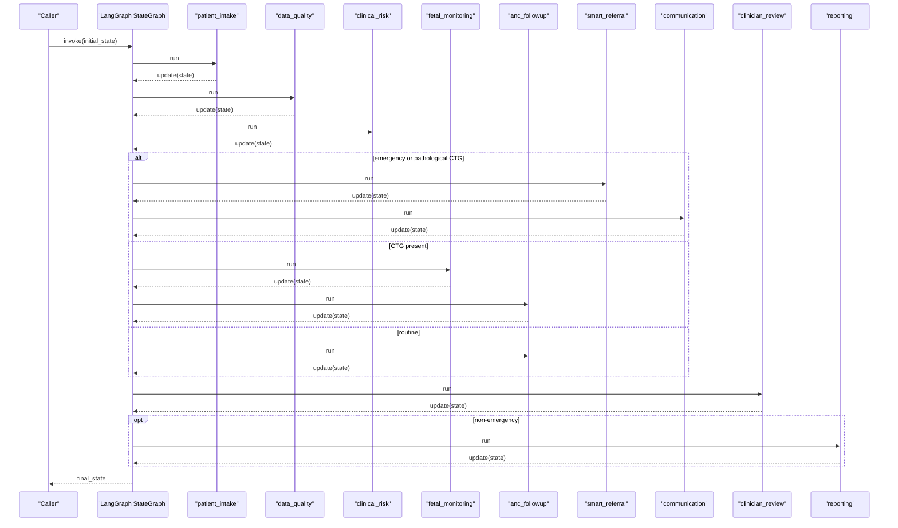
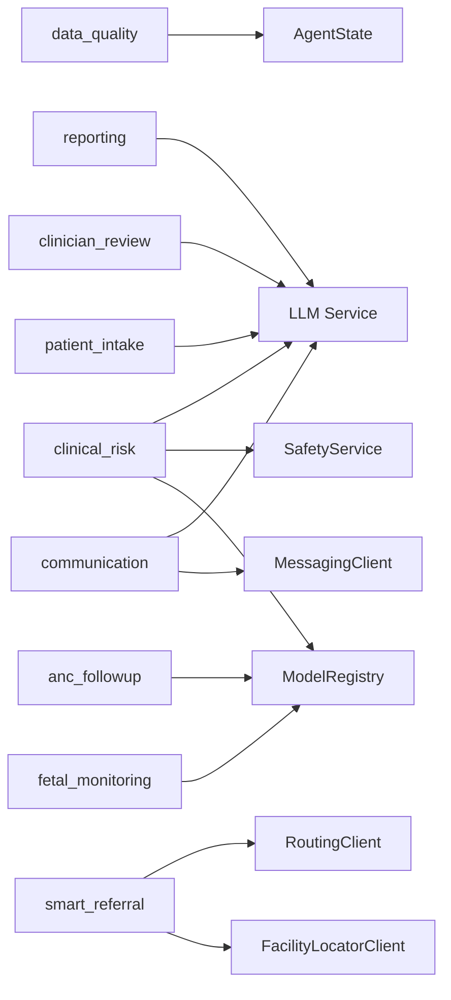

# Agent Nodes Implementation

<cite>
**Referenced Files in This Document**
- [orchestrator.py](file://backend/agents/orchestrator.py)
- [state.py](file://backend/schemas/state.py)
- [config.py](file://backend/config.py)
- [inference.py](file://backend/services/inference.py)
- [safety.py](file://backend/services/safety.py)
- [llm.py](file://backend/services/llm.py)
- [patient_intake.py](file://backend/agents/nodes/patient_intake.py)
- [data_quality.py](file://backend/agents/nodes/data_quality.py)
- [clinical_risk.py](file://backend/agents/nodes/clinical_risk.py)
- [fetal_monitoring.py](file://backend/agents/nodes/fetal_monitoring.py)
- [anc_followup.py](file://backend/agents/nodes/anc_followup.py)
- [smart_referral.py](file://backend/agents/nodes/smart_referral.py)
- [communication.py](file://backend/agents/nodes/communication.py)
- [clinician_review.py](file://backend/agents/nodes/clinician_review.py)
- [reporting.py](file://backend/agents/nodes/reporting.py)
- [messaging_client.py](file://backend/integrations/messaging_client.py)
- [facility_locator.py](file://backend/integrations/facility_locator.py)
- [routing_client.py](file://backend/integrations/routing_client.py)
</cite>

## Table of Contents
1. Introduction
2. Project Structure
3. Core Components
4. Architecture Overview
5. Detailed Component Analysis
6. Dependency Analysis
7. Performance Considerations
8. Troubleshooting Guide
9. Conclusion
10. Appendices

## Introduction
This document provides detailed, code-sourced documentation for the nine specialized agent nodes that implement clinical workflow functions within a maternal and fetal health system. Each node is described in terms of purpose, input/output state requirements, processing logic, integration with external services, error handling patterns, retry strategies, and testing approaches. The system orchestrates these nodes through a LangGraph StateGraph to route cases based on clinical context (e.g., emergency escalation).

## Project Structure
The agent nodes are implemented under backend/agents/nodes and orchestrated by backend/agents/orchestrator.py using LangGraph’s StateGraph. Shared state is defined in backend/schemas/state.py. External integrations include messaging, facility location, routing, model inference, safety rules, and optional LLM text generation. Configuration is centralized in backend/config.py.

**Diagram sources**
- [orchestrator.py:62-138](file://backend/agents/orchestrator.py#L62-L138)
- [state.py:7-43](file://backend/schemas/state.py#L7-L43)
- [inference.py:51-141](file://backend/services/inference.py#L51-L141)
- [safety.py:18-67](file://backend/services/safety.py#L18-L67)
- [llm.py:31-143](file://backend/services/llm.py#L31-L143)
- [messaging_client.py:9-78](file://backend/integrations/messaging_client.py#L9-L78)
- [facility_locator.py:7-69](file://backend/integrations/facility_locator.py#L7-L69)
- [routing_client.py:8-71](file://backend/integrations/routing_client.py#L8-L71)

**Section sources**
- [orchestrator.py:1-167](file://backend/agents/orchestrator.py#L1-L167)
- [state.py:1-43](file://backend/schemas/state.py#L1-L43)
- [config.py:1-55](file://backend/config.py#L1-L55)

## Core Components
- AgentState: TypedDict defining shared fields across all nodes (patient/case identifiers, vitals, symptoms, demographics, CTG data, flow control flags, per-node results, audit trail, errors, messages).
- ModelRegistry: Singleton loading five ML models (MaternalGuard, FetalWatch, PretermGuard, CareReach, GestationInsight) with feature normalization and fallbacks when models are unavailable.
- SafetyService: Adapter over WHO Clinical Safety Rules; mandatory evaluation in clinical risk assessment.
- LLM Service: Optional Groq-based text generation used for follow-up questions, risk summaries, communication messages, case summaries, and reports; always falls back to templates if unavailable.
- Integrations: MessagingClient (SMS/WhatsApp/emergency alerts), FacilityLocatorClient (nearby facilities), RoutingClient (travel time/route estimation).

**Section sources**
- [state.py:7-43](file://backend/schemas/state.py#L7-L43)
- [inference.py:51-141](file://backend/services/inference.py#L51-L141)
- [safety.py:18-67](file://backend/services/safety.py#L18-L67)
- [llm.py:31-143](file://backend/services/llm.py#L31-L143)
- [messaging_client.py:9-78](file://backend/integrations/messaging_client.py#L9-L78)
- [facility_locator.py:7-69](file://backend/integrations/facility_locator.py#L7-L69)
- [routing_client.py:8-71](file://backend/integrations/routing_client.py#L8-L71)

## Architecture Overview
The workflow begins at patient_intake and proceeds through data_quality and clinical_risk. Based on clinical risk and presence of CTG data, it branches to fetal_monitoring or anc_followup. Emergency conditions escalate to smart_referral and communication, followed by clinician_review and reporting. Conditional routing is enforced by the orchestrator.

**Diagram sources**
- [orchestrator.py:22-56](file://backend/agents/orchestrator.py#L22-L56)
- [orchestrator.py:62-138](file://backend/agents/orchestrator.py#L62-L138)

**Section sources**
- [orchestrator.py:1-167](file://backend/agents/orchestrator.py#L1-L167)

## Detailed Component Analysis

### patient_intake
Purpose
- Collects and validates demographic, vital, and symptom data; optionally transcribes voice audio and extracts symptoms; generates LLM-assisted follow-up questions for missing fields.

Input/Output State Requirements
- Inputs: vitals, symptoms, demographics, language, channel, optional audio_data.
- Outputs: intake_complete, profile, missing_fields, followup_questions, llm_generated, current_step, audit_trail, errors.

Processing Logic
- If audio_data exists, transcribe and extract symptoms via VoiceClient.
- Validate required vital fields; mark intake_complete only when all required fields are present.
- Generate follow-up questions via LLM service; fall back to template questions on failure.
- Append audit entries and return structured updates.

Integration Points
- VoiceClient for transcription and symptom extraction.
- LLM service for dynamic question generation.

Error Handling
- Catches exceptions and returns errors list plus audit entry without crashing the workflow.

Retry Strategy
- No explicit retries; LLM calls wrapped in try/except with fallbacks.

Testing Approach
- Unit tests can assert intake_complete behavior with varying vitals completeness.
- Mock VoiceClient and LLM service to validate transcript/symptom merging and fallback behavior.

**Section sources**
- [patient_intake.py:14-168](file://backend/agents/nodes/patient_intake.py#L14-L168)
- [state.py:7-43](file://backend/schemas/state.py#L7-L43)

### data_quality
Purpose
- Validates vital ranges, flags impossible values, checks model confidence scores, and computes an overall quality score.

Input/Output State Requirements
- Inputs: vitals, clinical_risk_result, fetal_result, anc_result.
- Outputs: data_quality_result (flags, warnings, model_confidence_checks, quality_score), current_step, audit_trail, errors.

Processing Logic
- Check each vital against predefined physiological ranges; flag out-of-range or non-numeric values.
- Detect impossible combinations (e.g., diastolic >= systolic).
- Inspect model confidence from upstream results and warn if below threshold.
- Compute quality_score based on issues vs total checks.

Integration Points
- None beyond state inspection.

Error Handling
- Graceful exception handling with audit logging.

Retry Strategy
- Deterministic validation; no retries needed.

Testing Approach
- Provide edge-case vitals (out-of-range, borderline, impossible combos) and assert flags/warnings.
- Verify model confidence checks with varied upstream results.

**Section sources**
- [data_quality.py:9-201](file://backend/agents/nodes/data_quality.py#L9-L201)
- [state.py:7-43](file://backend/schemas/state.py#L7-L43)

### clinical_risk
Purpose
- Runs MaternalGuard and optional GestationInsight predictions, evaluates WHO red-flag rules, and produces a risk summary (with optional LLM narrative).

Input/Output State Requirements
- Inputs: vitals, demographics.
- Outputs: clinical_risk_result (maternal_risk, gestational_risk, who_red_flags, is_emergency, risk_summary, llm_generated), emergency, current_step, audit_trail, errors.

Processing Logic
- Predict maternal risk using ModelRegistry.
- If clinical features exist, predict gestational complication risk.
- Always evaluate WHO red flags; set emergency=True for HIGH_RISK_EMERGENCY triage.
- Optionally generate human-readable risk summary via LLM; fallback to template.

Integration Points
- ModelRegistry for ML predictions.
- SafetyService for WHO rule evaluation.
- LLM service for narrative generation.

Error Handling
- Exceptions captured and logged; core outputs still produced where possible.

Retry Strategy
- No explicit retries; LLM call protected by try/except with fallback.

Testing Approach
- Test with known vitals to verify triage levels and emergency flags.
- Mock ModelRegistry and SafetyService to validate decision paths.

**Section sources**
- [clinical_risk.py:15-127](file://backend/agents/nodes/clinical_risk.py#L15-L127)
- [inference.py:151-203](file://backend/services/inference.py#L151-L203)
- [safety.py:18-67](file://backend/services/safety.py#L18-L67)
- [llm.py:67-76](file://backend/services/llm.py#L67-L76)

### fetal_monitoring
Purpose
- Analyzes CTG data using FetalWatch and PretermGuard; escalates to emergency if pathological or high-risk preterm prediction.

Input/Output State Requirements
- Inputs: ctg_data.
- Outputs: fetal_result (status, probabilities, confidences, model availability, escalate), current_step, audit_trail, errors.

Processing Logic
- Skip assessment if no CTG data; mark as not_assessed.
- Run both models; determine emergency/high-risk conditions.
- Update state with results and emergency flag if applicable.

Integration Points
- ModelRegistry for predictions.

Error Handling
- Exception handling with audit logging; does not crash workflow.

Retry Strategy
- No retries; deterministic model calls.

Testing Approach
- Provide sample CTG features and assert fetal status/preterm risk outcomes.
- Validate emergency escalation logic.

**Section sources**
- [fetal_monitoring.py:10-111](file://backend/agents/nodes/fetal_monitoring.py#L10-L111)
- [inference.py:204-293](file://backend/services/inference.py#L204-L293)

### anc_followup
Purpose
- Predicts missed-visit risk using CareReach and recommends follow-up actions (home visit, call, SMS).

Input/Output State Requirements
- Inputs: demographics, vitals.
- Outputs: anc_result (missed_visit_risk, priority, recommended_action, confidence, model_available, risk_factors), current_step, audit_trail, errors.

Processing Logic
- Build patient features from demographics and vitals.
- Predict missed-visit risk and map priority to recommended action.
- Derive risk factors from demographics/vitals.

Integration Points
- ModelRegistry for CareReach prediction.

Error Handling
- Exception handling with audit logging.

Retry Strategy
- No retries; deterministic prediction.

Testing Approach
- Provide varied patient features and assert priority/action mapping.
- Validate risk factor derivation.

**Section sources**
- [anc_followup.py:10-103](file://backend/agents/nodes/anc_followup.py#L10-L103)
- [inference.py:295-361](file://backend/services/inference.py#L295-L361)

### smart_referral
Purpose
- Finds nearby healthcare facilities, ranks them by capability match and distance, plans routes, and creates referral records with urgency determination.

Input/Output State Requirements
- Inputs: emergency flag, demographics (lat/lon), clinical_risk_result, fetal_result.
- Outputs: referral_result (urgency_level, ranked_facilities, selected_facility, route_info, estimated_travel_time_min, capabilities_needed), current_step, audit_trail, errors.

Processing Logic
- Determine required capabilities (emergency/NICU/maternity) from state.
- Find nearby facilities and rank by scoring function (capability match + distance - load penalty).
- Plan route for top facility; determine urgency based on emergency and maternal risk.

Integration Points
- FacilityLocatorClient for nearby facilities.
- RoutingClient for travel time/route.

Error Handling
- Exception handling with audit logging.

Retry Strategy
- No retries; deterministic ranking and routing.

Testing Approach
- Mock FacilityLocatorClient and RoutingClient to assert ranking and route selection.
- Validate urgency determination logic.

**Section sources**
- [smart_referral.py:11-136](file://backend/agents/nodes/smart_referral.py#L11-L136)
- [facility_locator.py:7-69](file://backend/integrations/facility_locator.py#L7-L69)
- [routing_client.py:8-71](file://backend/integrations/routing_client.py#L8-L71)

### communication
Purpose
- Sends multi-channel messages (SMS/WhatsApp/emergency alerts) based on context; uses LLM-generated messages with template fallbacks.

Input/Output State Requirements
- Inputs: emergency flag, patient_id, channel, demographics (phone), clinical_risk_result, referral_result, anc_result, language.
- Outputs: communication_result (messages_sent, delivery_status, all_delivered, is_emergency_alert, channel_used, language, llm_generated), current_step, audit_trail, errors.

Processing Logic
- Emergency: send emergency alert to multiple recipients.
- Referral: send notification via SMS or WhatsApp depending on channel.
- ANC follow-up: send reminder based on recommended action.
- Default: send screening status update.
- Track delivery logs and compute all_delivered.

Integration Points
- MessagingClient for SMS/WhatsApp/emergency alerts.
- LLM service for message generation.

Error Handling
- Exception handling with audit logging; ensures dispatch continues even if LLM fails.

Retry Strategy
- No explicit retries; relies on stubbed client returning delivered status.

Testing Approach
- Mock MessagingClient to assert message types, channels, and priorities.
- Validate LLM fallback behavior.

**Section sources**
- [communication.py:14-231](file://backend/agents/nodes/communication.py#L14-L231)
- [messaging_client.py:9-78](file://backend/integrations/messaging_client.py#L9-L78)
- [llm.py:91-99](file://backend/services/llm.py#L91-L99)

### clinician_review
Purpose
- Aggregates upstream results into a structured case summary for human-in-the-loop review; marks cases pending_review and highlights risk indicators.

Input/Output State Requirements
- Inputs: patient_id, case_id, emergency, vitals, symptoms, demographics, and all upstream results.
- Outputs: clinician_result (status, case_summary, case_summary_text, risk_indicators, requires_immediate_attention), current_step, audit_trail, errors.

Processing Logic
- Build comprehensive case summary including assessments and communication log.
- Derive quick risk indicators (emergency, high maternal risk, fetal concern, WHO triage).
- Optionally generate narrative summary via LLM; fallback to template.

Integration Points
- LLM service for narrative generation.

Error Handling
- Exception handling with audit logging.

Retry Strategy
- No retries; LLM call protected by try/except.

Testing Approach
- Assert case_summary structure and risk indicator logic.
- Mock LLM to test narrative generation path.

**Section sources**
- [clinician_review.py:13-165](file://backend/agents/nodes/clinician_review.py#L13-L165)
- [llm.py:101-110](file://backend/services/llm.py#L101-L110)

### reporting
Purpose
- Generates comprehensive case summary payload and dashboard/trend data structures suitable for analytics and export.

Input/Output State Requirements
- Inputs: patient/case metadata, emergency flag, vitals, symptoms, demographics, and all upstream results.
- Outputs: reporting_result (case_summary, dashboard_data, narrative, llm_generated), current_step, audit_trail, errors.

Processing Logic
- Assemble case_summary with risk assessments, referral, communication, clinician review, and data quality metrics.
- Produce dashboard_data with numeric risk scorecards and pipeline health metrics.
- Optionally generate narrative report via LLM; fallback to template.

Integration Points
- LLM service for narrative generation.

Error Handling
- Exception handling with audit logging.

Retry Strategy
- No retries; LLM call protected by try/except.

Testing Approach
- Validate numeric mappings and dashboard structure.
- Mock LLM to test narrative path.

**Section sources**
- [reporting.py:13-217](file://backend/agents/nodes/reporting.py#L13-L217)
- [llm.py:112-119](file://backend/services/llm.py#L112-L119)

## Dependency Analysis
Node-to-service dependencies and coupling:
- patient_intake depends on VoiceClient and LLM service.
- data_quality depends only on state.
- clinical_risk depends on ModelRegistry and SafetyService; optionally LLM.
- fetal_monitoring depends on ModelRegistry.
- anc_followup depends on ModelRegistry.
- smart_referral depends on FacilityLocatorClient and RoutingClient.
- communication depends on MessagingClient and LLM service.
- clinician_review depends on LLM service.
- reporting depends on LLM service.

**Diagram sources**
- [patient_intake.py:14-168](file://backend/agents/nodes/patient_intake.py#L14-L168)
- [data_quality.py:25-201](file://backend/agents/nodes/data_quality.py#L25-L201)
- [clinical_risk.py:15-127](file://backend/agents/nodes/clinical_risk.py#L15-L127)
- [fetal_monitoring.py:10-111](file://backend/agents/nodes/fetal_monitoring.py#L10-L111)
- [anc_followup.py:10-103](file://backend/agents/nodes/anc_followup.py#L10-L103)
- [smart_referral.py:11-136](file://backend/agents/nodes/smart_referral.py#L11-L136)
- [communication.py:14-231](file://backend/agents/nodes/communication.py#L14-L231)
- [clinician_review.py:13-165](file://backend/agents/nodes/clinician_review.py#L13-L165)
- [reporting.py:13-217](file://backend/agents/nodes/reporting.py#L13-L217)
- [inference.py:51-141](file://backend/services/inference.py#L51-L141)
- [safety.py:18-67](file://backend/services/safety.py#L18-L67)
- [llm.py:31-143](file://backend/services/llm.py#L31-L143)
- [messaging_client.py:9-78](file://backend/integrations/messaging_client.py#L9-L78)
- [facility_locator.py:7-69](file://backend/integrations/facility_locator.py#L7-L69)
- [routing_client.py:8-71](file://backend/integrations/routing_client.py#L8-L71)

**Section sources**
- [orchestrator.py:62-138](file://backend/agents/orchestrator.py#L62-L138)

## Performance Considerations
- Model loading: ModelRegistry loads models once at startup; ensure artifacts exist to avoid repeated warnings.
- LLM calls: All LLM interactions run in worker threads to avoid blocking the event loop; keep max_tokens low for faster responses.
- I/O timeouts: Integrations use short timeouts (e.g., MessagingClient default 3.0s); tune based on environment.
- Data quality checks: Range validations are O(1) per vital; confidence checks are lightweight.
- Routing: Haversine distance calculation is efficient; consider caching facility lists if frequently accessed.

[No sources needed since this section provides general guidance]

## Troubleshooting Guide
Common issues and resolutions:
- Missing model files: ModelRegistry logs warnings; ensure artifact paths in config point to valid files.
- LLM unavailability: get_llm_service returns None; nodes fall back to templates—verify GROQ_API_KEY and network connectivity.
- External API failures: Messaging/Facility/Routing clients are stubs; replace with real endpoints and handle HTTP errors.
- Emergency escalation: Ensure WHO red flags are evaluated; check SafetyService inputs match expected vital keys.

**Section sources**
- [inference.py:103-130](file://backend/services/inference.py#L103-L130)
- [llm.py:129-143](file://backend/services/llm.py#L129-L143)
- [messaging_client.py:9-78](file://backend/integrations/messaging_client.py#L9-L78)
- [facility_locator.py:7-69](file://backend/integrations/facility_locator.py#L7-L69)
- [routing_client.py:8-71](file://backend/integrations/routing_client.py#L8-L71)
- [safety.py:18-67](file://backend/services/safety.py#L18-L67)

## Conclusion
The nine agent nodes form a robust, modular pipeline for maternal and fetal health workflows. They integrate ML models, safety rules, and optional LLM enhancements while maintaining resilience through fallbacks and comprehensive auditing. The orchestrator enforces conditional routing to prioritize emergencies and streamline care pathways.

[No sources needed since this section summarizes without analyzing specific files]

## Appendices

### Error Handling Patterns Across Nodes
- Each node wraps logic in try/except, appending structured error entries and audit trails to state.
- LLM-dependent nodes treat LLM as optional; failures do not block core processing.
- External clients are stubbed but designed to be replaced; ensure proper error propagation in production.

**Section sources**
- [patient_intake.py:151-168](file://backend/agents/nodes/patient_intake.py#L151-L168)
- [data_quality.py:185-201](file://backend/agents/nodes/data_quality.py#L185-L201)
- [clinical_risk.py:111-127](file://backend/agents/nodes/clinical_risk.py#L111-L127)
- [fetal_monitoring.py:95-111](file://backend/agents/nodes/fetal_monitoring.py#L95-L111)
- [anc_followup.py:87-103](file://backend/agents/nodes/anc_followup.py#L87-L103)
- [smart_referral.py:120-136](file://backend/agents/nodes/smart_referral.py#L120-L136)
- [communication.py:215-231](file://backend/agents/nodes/communication.py#L215-L231)
- [clinician_review.py:149-165](file://backend/agents/nodes/clinician_review.py#L149-L165)
- [reporting.py:175-190](file://backend/agents/nodes/reporting.py#L175-L190)

### Retry Mechanisms
- No built-in retry loops; rely on idempotent operations and external service retries if configured.
- For production, consider adding exponential backoff around external calls (LLM, messaging, routing).

[No sources needed since this section provides general guidance]

### Testing Approaches
- Use pytest fixtures to inject mock clients (VoiceClient, MessagingClient, FacilityLocatorClient, RoutingClient).
- Assert state transitions via orchestrator.run_single_node for isolated node testing.
- Validate edge cases: missing vitals, low-confidence models, emergency escalation, and LLM fallbacks.

**Section sources**
- [orchestrator.py:150-167](file://backend/agents/orchestrator.py#L150-L167)