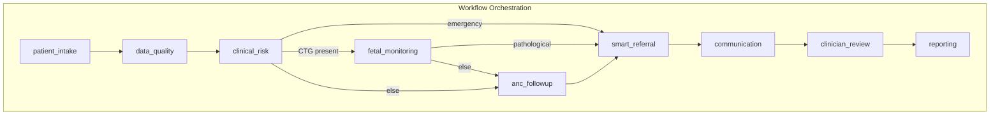
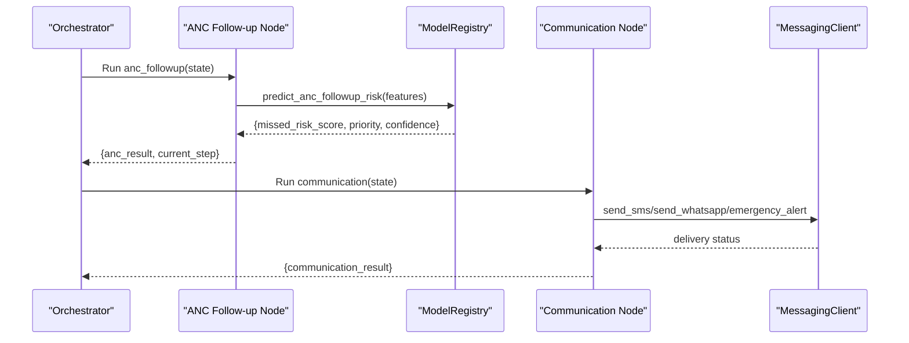
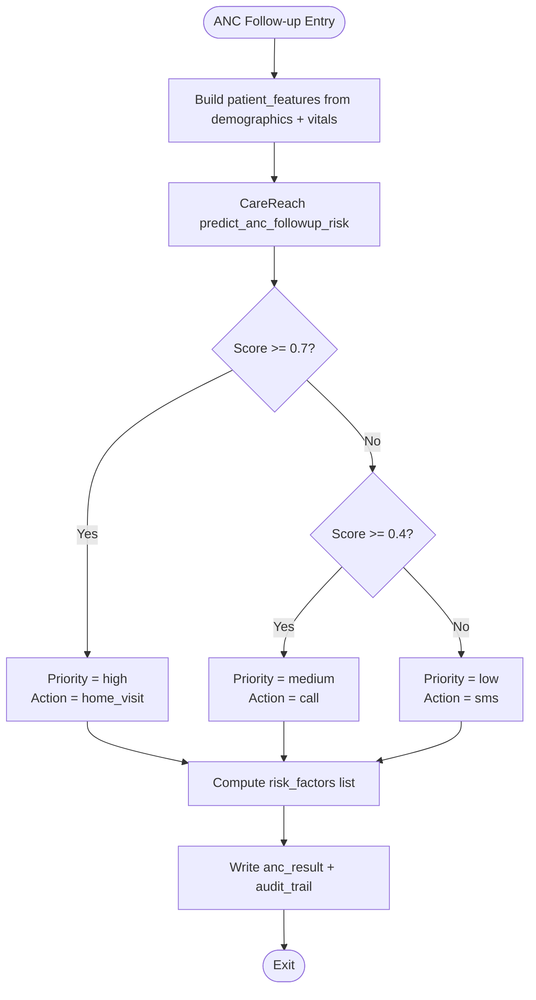
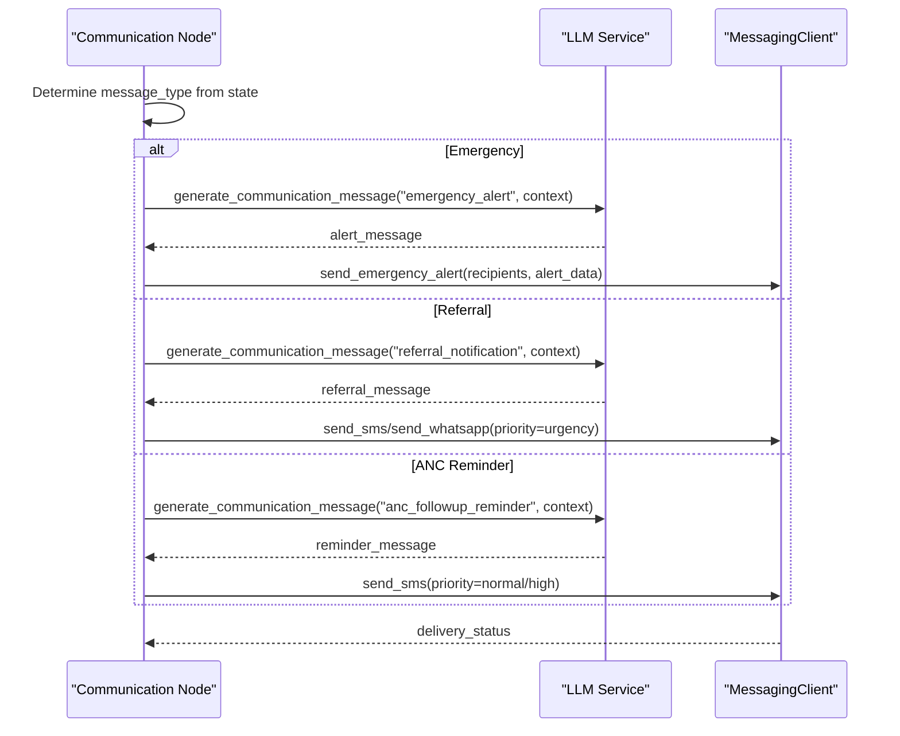
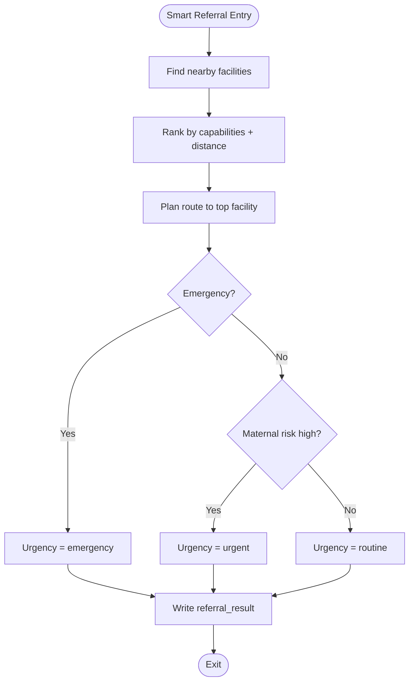
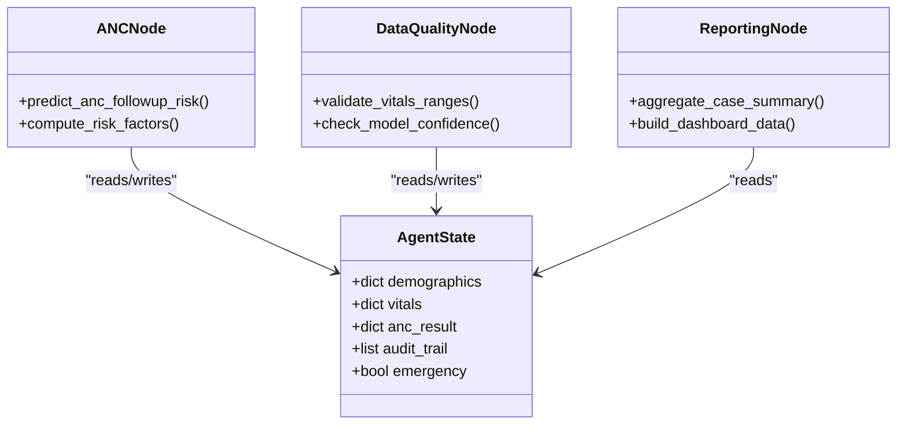
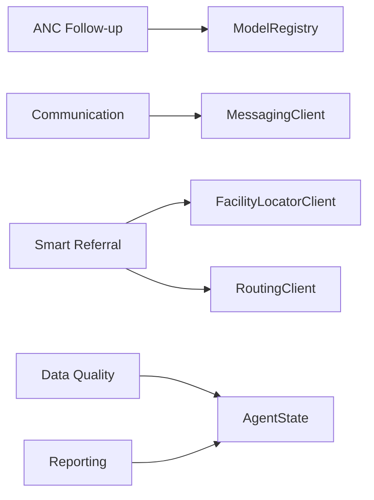

# Antenatal Care Follow-up Node

<cite>
**Referenced Files in This Document**
- [anc_followup.py](file://backend/agents/nodes/anc_followup.py)
- [orchestrator.py](file://backend/agents/orchestrator.py)
- [communication.py](file://backend/agents/nodes/communication.py)
- [smart_referral.py](file://backend/agents/nodes/smart_referral.py)
- [inference.py](file://backend/services/inference.py)
- [messaging_client.py](file://backend/integrations/messaging_client.py)
- [facility_locator.py](file://backend/integrations/facility_locator.py)
- [models.py](file://backend/db/models.py)
- [state.py](file://backend/schemas/state.py)
- [reporting.py](file://backend/agents/nodes/reporting.py)
- [data_quality.py](file://backend/agents/nodes/data_quality.py)
- [config.py](file://backend/config.py)
</cite>

## Table of Contents
1. [Introduction](#introduction)
2. [Project Structure](#project-structure)
3. [Core Components](#core-components)
4. [Architecture Overview](#architecture-overview)
5. [Detailed Component Analysis](#detailed-component-analysis)
6. [Dependency Analysis](#dependency-analysis)
7. [Performance Considerations](#performance-considerations)
8. [Troubleshooting Guide](#troubleshooting-guide)
9. [Conclusion](#conclusion)
10. [Appendices](#appendices)

## Introduction
This document explains the Antenatal Care (ANC) Follow-up Node and its role in scheduling, tracking, and ensuring continuity of prenatal care. It covers:
- The missed-visit risk prediction algorithm that drives follow-up actions
- The reminder system and communication channels used to notify patients
- Compliance monitoring via data quality checks and reporting
- Integration points with facility routing and messaging services
- Rescheduling workflows and automated follow-up procedures
- How the node fits into the broader clinical workflow orchestrated by the agent graph

The ANC Follow-up Node predicts the likelihood that a patient will miss an antenatal appointment and recommends an appropriate follow-up action based on predicted priority. It integrates with the communication node to send reminders or alerts and contributes to compliance monitoring through structured outputs and audit trails.

## Project Structure
The ANC Follow-up Node is one of several agents in a LangGraph-based workflow. The orchestrator wires nodes for intake, data quality, clinical risk, fetal monitoring, ANC follow-up, smart referral, communication, clinician review, and reporting. The ANC node consumes state fields such as demographics and vitals, runs a CareReach model to estimate missed-visit risk, and writes results back to the shared state for downstream processing.

**Diagram sources**
- [orchestrator.py:62-138](file://backend/agents/orchestrator.py#L62-L138)

**Section sources**
- [orchestrator.py:1-167](file://backend/agents/orchestrator.py#L1-L167)

## Core Components
- ANC Follow-up Node: Predicts missed-visit risk and selects recommended action (home visit, call, SMS).
- Inference Service: Loads and runs the CareReach model to produce risk scores and priorities.
- Communication Node: Sends reminders or alerts via SMS/WhatsApp; supports emergency alerts and referral notifications.
- Smart Referral Node: Ranks facilities and plans routes; can escalate to communication when needed.
- Data Quality Node: Validates inputs and model confidence; flags anomalies that affect compliance.
- Reporting Node: Aggregates all results into dashboards and trend data, including ANC metrics.
- Messaging Client: Stub client for SMS/WhatsApp with templates for reminders and emergency alerts.
- State Schema: Shared state structure carrying patient data, intermediate results, and audit logs.

**Section sources**
- [anc_followup.py:10-103](file://backend/agents/nodes/anc_followup.py#L10-L103)
- [inference.py:297-361](file://backend/services/inference.py#L297-L361)
- [communication.py:38-231](file://backend/agents/nodes/communication.py#L38-L231)
- [smart_referral.py:11-136](file://backend/agents/nodes/smart_referral.py#L11-L136)
- [data_quality.py:25-201](file://backend/agents/nodes/data_quality.py#L25-L201)
- [reporting.py:13-217](file://backend/agents/nodes/reporting.py#L13-L217)
- [messaging_client.py:9-78](file://backend/integrations/messaging_client.py#L9-L78)
- [state.py:7-43](file://backend/schemas/state.py#L7-L43)

## Architecture Overview
The ANC Follow-up Node participates in a conditional workflow:
- After intake and data quality, the flow proceeds to clinical risk assessment.
- If no emergency and no CTG data, it routes to ANC follow-up.
- ANC follow-up predicts missed-visit risk and recommends an action.
- The communication node then sends reminders or alerts based on context.
- For emergencies or high-risk referrals, the smart referral node ranks facilities and may trigger urgent communication.

**Diagram sources**
- [orchestrator.py:92-124](file://backend/agents/orchestrator.py#L92-L124)
- [anc_followup.py:10-85](file://backend/agents/nodes/anc_followup.py#L10-L85)
- [inference.py:297-361](file://backend/services/inference.py#L297-L361)
- [communication.py:38-231](file://backend/agents/nodes/communication.py#L38-L231)
- [messaging_client.py:17-78](file://backend/integrations/messaging_client.py#L17-L78)

## Detailed Component Analysis

### ANC Follow-up Node
Responsibilities:
- Build patient features from demographics and vitals.
- Predict missed-visit risk using the CareReach model.
- Map predicted priority to recommended action: high -> home_visit, medium -> call, low -> sms.
- Derive risk factors (e.g., adolescent pregnancy, advanced maternal age, high parity, no financial support, elevated blood pressure).
- Write anc_result to state and append audit entries.

Algorithm highlights:
- Risk thresholds determine priority: high if score >= 0.7, medium if >= 0.4, else low.
- Action selection ensures appropriate follow-up intensity aligned with risk.

**Diagram sources**
- [anc_followup.py:10-85](file://backend/agents/nodes/anc_followup.py#L10-L85)
- [inference.py:297-361](file://backend/services/inference.py#L297-L361)

**Section sources**
- [anc_followup.py:10-103](file://backend/agents/nodes/anc_followup.py#L10-L103)
- [inference.py:297-361](file://backend/services/inference.py#L297-L361)

### Reminder System and Communication Channels
The communication node determines message type from state context:
- Emergency alerts: sent to multiple recipients with high priority.
- Referral notifications: sent via SMS or WhatsApp depending on channel preference.
- ANC follow-up reminders: generated via LLM with fallback templates; sent via SMS or marked for phone call.
- Default status updates: general screening completion messages.

Templates and channels:
- Templates include appointment, medication, and follow-up reminders.
- Channels include SMS and WhatsApp; emergency alerts use SMS with emergency priority.

**Diagram sources**
- [communication.py:14-231](file://backend/agents/nodes/communication.py#L14-L231)
- [messaging_client.py:17-78](file://backend/integrations/messaging_client.py#L17-L78)

**Section sources**
- [communication.py:38-231](file://backend/agents/nodes/communication.py#L38-L231)
- [messaging_client.py:9-78](file://backend/integrations/messaging_client.py#L9-L78)

### Smart Referral and Rescheduling Workflow
When escalation is required (emergency or pathological CTG), the smart referral node:
- Finds nearby facilities within a radius (larger for emergencies).
- Ranks facilities by capability match (emergency, NICU, maternity) and distance.
- Plans route and estimates travel time.
- Determines urgency level based on emergency flag and maternal risk.
- Outputs referral_result which triggers communication for referral notification.

Rescheduling implications:
- If a missed-visit risk is high, the recommended action may be a home visit; otherwise, SMS reminders or calls are sent.
- Referral outcomes inform subsequent scheduling at the selected facility.

**Diagram sources**
- [smart_referral.py:11-136](file://backend/agents/nodes/smart_referral.py#L11-L136)

**Section sources**
- [smart_referral.py:11-136](file://backend/agents/nodes/smart_referral.py#L11-L136)

### Compliance Monitoring and Missed Appointment Detection
Compliance monitoring includes:
- Data quality validation: checks vital ranges, impossible values, and model confidence thresholds.
- ANC missed-visit detection: CareReach model predicts risk and priority; risk factors are recorded.
- Reporting aggregation: ANC metrics (missed risk score, priority) are included in case summaries and dashboard data.

Missed appointment detection:
- The ANC node computes missed_risk_score and maps to priority/action.
- Data quality node warns about low model confidence, prompting caution in decisions.
- Reporting node aggregates ANC metrics for trend analysis and oversight.

**Diagram sources**
- [state.py:7-43](file://backend/schemas/state.py#L7-L43)
- [anc_followup.py:10-85](file://backend/agents/nodes/anc_followup.py#L10-L85)
- [data_quality.py:25-201](file://backend/agents/nodes/data_quality.py#L25-L201)
- [reporting.py:13-217](file://backend/agents/nodes/reporting.py#L13-L217)

**Section sources**
- [data_quality.py:25-201](file://backend/agents/nodes/data_quality.py#L25-L201)
- [reporting.py:13-217](file://backend/agents/nodes/reporting.py#L13-L217)

### Integration with Calendar Systems and External Services
Calendar integration:
- No explicit calendar API integration is implemented in the analyzed files. Scheduling logic relies on internal state and communication templates rather than external calendar systems.

External integrations:
- Facility locator: returns mock facilities near Peshawar for demonstration; can be replaced with real geospatial APIs.
- Routing client: provides route planning between patient location and selected facility.
- Messaging client: stub implementation for SMS/WhatsApp with delivery tracking.

Configuration:
- URLs for external APIs are defined in settings; defaults point to local or public endpoints.

**Section sources**
- [facility_locator.py:7-69](file://backend/integrations/facility_locator.py#L7-L69)
- [messaging_client.py:9-78](file://backend/integrations/messaging_client.py#L9-L78)
- [config.py:7-55](file://backend/config.py#L7-L55)

## Dependency Analysis
Key dependencies and relationships:
- ANC Follow-up depends on ModelRegistry for CareReach predictions.
- Communication depends on MessagingClient and optional LLM service for message generation.
- Smart Referral depends on FacilityLocatorClient and RoutingClient for facility ranking and route planning.
- Data Quality depends on state fields and predefined vital ranges.
- Reporting aggregates outputs from all nodes and produces dashboard-ready structures.

**Diagram sources**
- [anc_followup.py:10-85](file://backend/agents/nodes/anc_followup.py#L10-L85)
- [inference.py:51-141](file://backend/services/inference.py#L51-L141)
- [communication.py:38-231](file://backend/agents/nodes/communication.py#L38-L231)
- [smart_referral.py:11-136](file://backend/agents/nodes/smart_referral.py#L11-L136)
- [data_quality.py:25-201](file://backend/agents/nodes/data_quality.py#L25-L201)
- [reporting.py:13-217](file://backend/agents/nodes/reporting.py#L13-L217)

**Section sources**
- [inference.py:51-141](file://backend/services/inference.py#L51-L141)
- [smart_referral.py:11-136](file://backend/agents/nodes/smart_referral.py#L11-L136)

## Performance Considerations
- Model loading is cached via singleton ModelRegistry to avoid repeated loads.
- LLM calls are executed in worker threads to prevent blocking the event loop.
- Messaging operations are lightweight stubs; production should implement rate limiting and retries.
- Facility lookup uses mock data; replacing with real APIs may introduce latency—consider caching and timeouts.
- Data quality checks run quickly but add overhead proportional to number of vital fields and models assessed.

[No sources needed since this section provides general guidance]

## Troubleshooting Guide
Common issues and mitigations:
- Missing model artifacts: ModelRegistry logs warnings and returns safe fallbacks; ensure model paths exist in configuration.
- LLM unavailability: Communication and reporting fall back to template messages; verify LLM service availability.
- Messaging failures: Delivery status tracked; implement retry logic and alert on persistent failures.
- Data quality flags: Out-of-range vitals or impossible combinations trigger critical flags; validate input sources.
- Audit trail gaps: Ensure each node appends audit entries; check errors accumulator for diagnostics.

**Section sources**
- [inference.py:103-141](file://backend/services/inference.py#L103-L141)
- [communication.py:14-36](file://backend/agents/nodes/communication.py#L14-L36)
- [messaging_client.py:61-78](file://backend/integrations/messaging_client.py#L61-L78)
- [data_quality.py:46-151](file://backend/agents/nodes/data_quality.py#L46-L151)

## Conclusion
The ANC Follow-up Node provides a robust mechanism for predicting missed-visit risk and driving appropriate follow-up actions. Integrated with communication and referral workflows, it supports continuous prenatal care by ensuring timely reminders, escalations, and compliance monitoring. While calendar integration is not explicitly implemented, the system’s modular design allows future extensions for scheduling and calendar synchronization. Reporting and data quality features enable oversight and trend analysis to improve care adherence.

[No sources needed since this section summarizes without analyzing specific files]

## Appendices

### Data Models and Storage
Relevant database models include Patient, ClinicalRecord, Referral, AgentStateRecord, AuditLog, ModelVersion, and FileRecord. These support persistence of case data, referrals, agent states, and audit trails.

**Section sources**
- [models.py:11-115](file://backend/db/models.py#L11-L115)

### Configuration and External APIs
Settings define paths to model artifacts, database URL, JWT parameters, and external API endpoints for voice, facility lookup, routing, and messaging. Adjust these for production environments.

**Section sources**
- [config.py:7-55](file://backend/config.py#L7-L55)