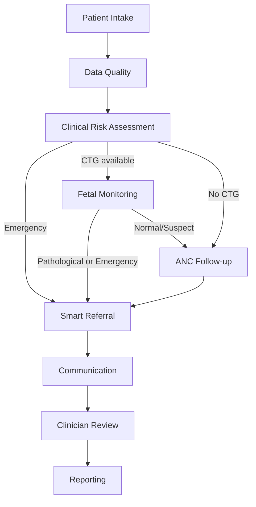
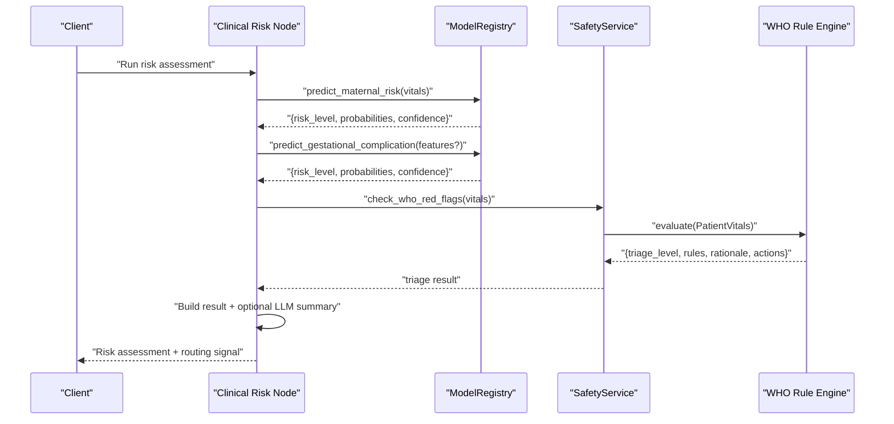
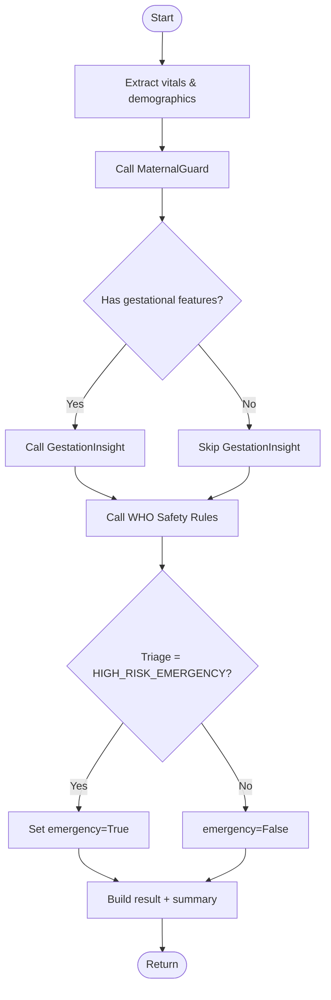
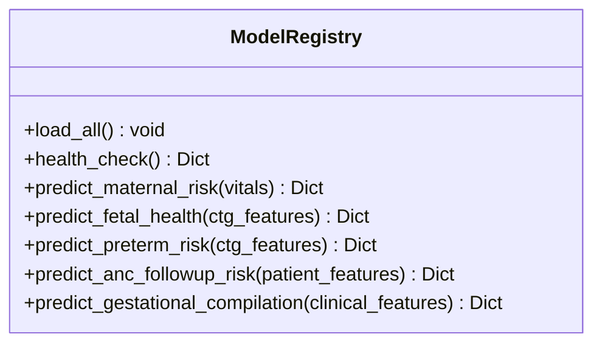
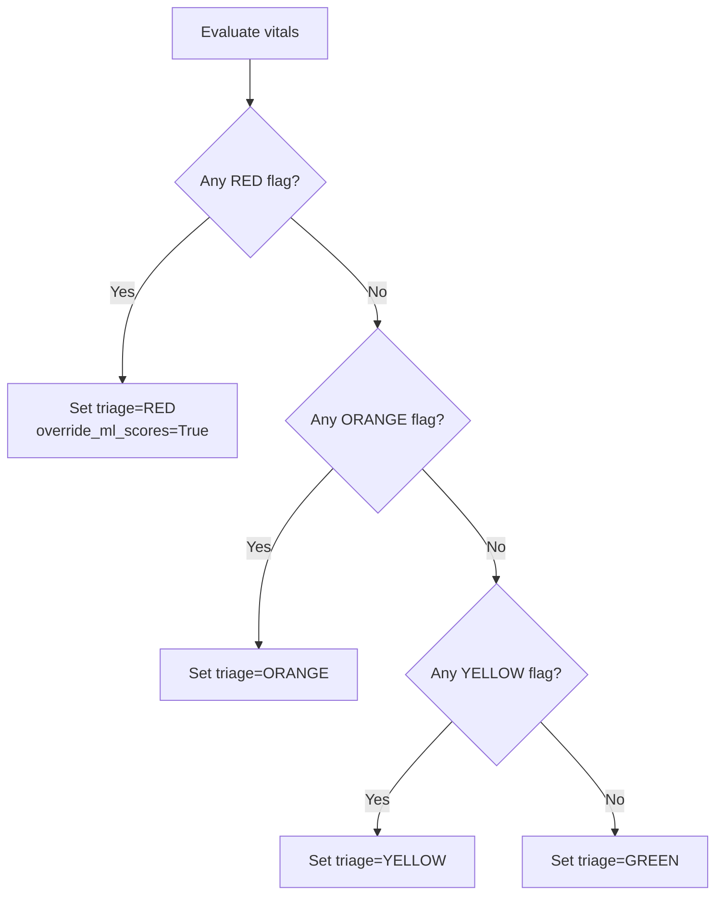
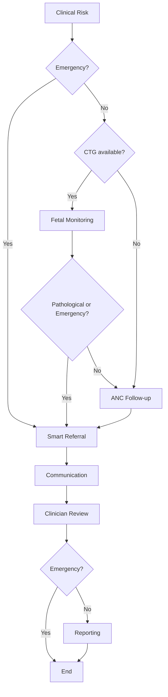
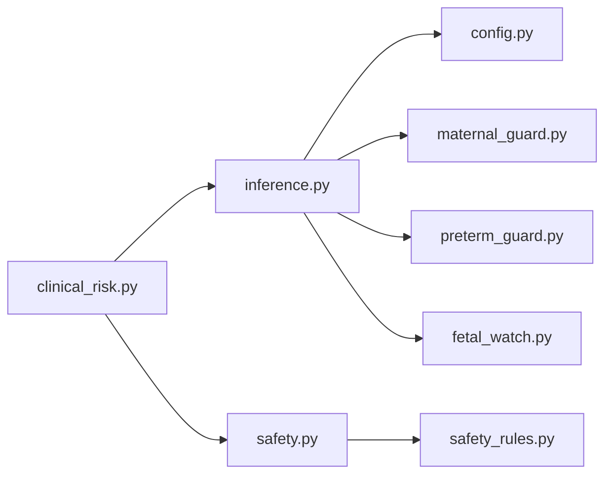

# Clinical Risk Assessment Node

<cite>
**Referenced Files in This Document**
- [clinical_risk.py](file://backend/agents/nodes/clinical_risk.py)
- [inference.py](file://backend/services/inference.py)
- [safety.py](file://backend/services/safety.py)
- [safety_rules.py](file://safety_rules.py)
- [orchestrator.py](file://backend/agents/orchestrator.py)
- [risk.py](file://backend/schemas/risk.py)
- [config.py](file://backend/config.py)
- [maternal_guard.py](file://src/models/maternal_guard.py)
- [preterm_guard.py](file://src/models/preterm_guard.py)
- [fetal_watch.py](file://src/models/fetal_watch.py)
- [results.json (MaternalGuard)](file://artifacts/maternalguard/results.json)
- [results.json (PretermGuard)](file://artifacts/pretermguard/results.json)
- [results.json (FetalWatch)](file://artifacts/fetalwatch/results.json)
</cite>

## Table of Contents
1. [Introduction](#introduction)
2. [Project Structure](#project-structure)
3. [Core Components](#core-components)
4. [Architecture Overview](#architecture-overview)
5. [Detailed Component Analysis](#detailed-component-analysis)
6. [Dependency Analysis](#dependency-analysis)
7. [Performance Considerations](#performance-considerations)
8. [Troubleshooting Guide](#troubleshooting-guide)
9. [Conclusion](#conclusion)
10. [Appendices](#appendices)

## Introduction
This document explains the Clinical Risk Assessment Node that performs AI-powered risk stratification for maternal and fetal health. It orchestrates multiple specialized models (MaternalGuard, PretermGuard, FetalWatch, CareReach, GestationInsight), applies deterministic WHO safety rules, and produces risk categories, confidence scores, and actionable recommendations. The node integrates into a LangGraph-based clinical workflow to route patients appropriately based on risk levels.

## Project Structure
The Clinical Risk Assessment Node is implemented as an agent node within a larger orchestration graph. It:
- Loads model predictions via a centralized inference service
- Applies WHO safety rules deterministically
- Aggregates outputs into a unified risk assessment
- Emits workflow routing signals (e.g., emergency escalation)

**Diagram sources**
- [orchestrator.py:62-138](file://backend/agents/orchestrator.py#L62-L138)

**Section sources**
- [orchestrator.py:1-167](file://backend/agents/orchestrator.py#L1-L167)

## Core Components
- Clinical Risk Assessment Node: Orchestrates model calls, safety checks, and summary generation.
- Model Registry (Inference Service): Singleton loader and predictor for all ML models with robust fallbacks.
- Safety Service: Thin adapter over WHO rule engine; mandatory evaluation at every risk assessment.
- Schemas: Typed structures for risk results, fetal monitoring, and ANC follow-up.
- Configuration: Centralized paths to artifacts and external services.

Key responsibilities:
- Feature alignment per model (vitals, CTG features, clinical features)
- Probability extraction and confidence calculation
- Deterministic override when WHO red flags are triggered
- Human-readable summaries with LLM fallback

**Section sources**
- [clinical_risk.py:15-127](file://backend/agents/nodes/clinical_risk.py#L15-L127)
- [inference.py:51-435](file://backend/services/inference.py#L51-L435)
- [safety.py:18-83](file://backend/services/safety.py#L18-L83)
- [risk.py:1-43](file://backend/schemas/risk.py#L1-L43)
- [config.py:7-55](file://backend/config.py#L7-L55)

## Architecture Overview
The node composes three layers:
1. Inference Layer: Predictions from MaternalGuard, PretermGuard, FetalWatch, CareReach, GestationInsight.
2. Safety Layer: WHO rule engine evaluates vitals and can override ML outputs.
3. Orchestration Layer: LangGraph routes to referral, fetal monitoring, or ANC follow-up based on risk.

**Diagram sources**
- [clinical_risk.py:24-95](file://backend/agents/nodes/clinical_risk.py#L24-L95)
- [inference.py:153-426](file://backend/services/inference.py#L153-L426)
- [safety.py:24-67](file://backend/services/safety.py#L24-L67)
- [safety_rules.py:89-167](file://safety_rules.py#L89-L167)

## Detailed Component Analysis

### Clinical Risk Assessment Node
Responsibilities:
- Extract vitals and demographics from state
- Call MaternalGuard prediction
- Optionally call GestationInsight if relevant clinical features exist
- Always call WHO safety rules; set emergency flag if triage level is HIGH_RISK_EMERGENCY
- Generate short template summary and attempt LLM-generated summary with fallback
- Return structured result including audit trail

Decision logic highlights:
- Gestational complication prediction only runs when required keys are present
- Emergency routing is determined by WHO triage level
- LLM summary is optional and non-blocking; failures fall back to template

**Diagram sources**
- [clinical_risk.py:24-95](file://backend/agents/nodes/clinical_risk.py#L24-L95)

**Section sources**
- [clinical_risk.py:15-127](file://backend/agents/nodes/clinical_risk.py#L15-L127)

### Model Orchestration (Inference Service)
The ModelRegistry provides:
- Singletons loading models once at startup
- Prediction methods for each model with feature alignment and missing-value handling
- Probabilities, confidence, and availability flags
- Robust fallbacks when models are unavailable

Feature sets:
- MaternalGuard: Age, SystolicBP, DiastolicBP, BS, BodyTemp, HeartRate
- FetalWatch/PretermGuard: 21 CTG features
- CareReach: Raw patient features with preprocessor
- GestationInsight: Clinical features with optional preprocessor and label encoder

**Diagram sources**
- [inference.py:51-435](file://backend/services/inference.py#L51-L435)

**Section sources**
- [inference.py:51-435](file://backend/services/inference.py#L51-L435)

### WHO Safety Rules (Deterministic Override)
The SafetyService wraps the WHO rule engine and always runs during risk assessment. It maps vitals to PatientVitals and returns triage level, triggered rules, rationale, and recommended actions. Red flags override ML scores and force emergency routing.

Red/Yellow/Orange/Green thresholds:
- RED: Immediate life-threatening conditions (e.g., severe hypertension, hemorrhage, eclampsia, sepsis, reduced fetal movement after 28 weeks, unconsciousness)
- ORANGE: Urgent attention within 15 minutes (moderate hypertension, moderate bleeding, tachycardia, high fever)
- YELLOW: Requires attention within 1 hour (mild hypertension, mild symptoms)
- GREEN: Routine care

**Diagram sources**
- [safety_rules.py:89-167](file://safety_rules.py#L89-L167)
- [safety_rules.py:173-462](file://safety_rules.py#L173-L462)

**Section sources**
- [safety.py:18-83](file://backend/services/safety.py#L18-L83)
- [safety_rules.py:18-167](file://safety_rules.py#L18-L167)

### Risk Categories, Confidence Scores, and Recommendations
- Risk categories:
  - Maternal: low/mid/high (from MaternalGuard classes)
  - Gestational: Low/Moderate/High (from GestationInsight mapping)
  - Fetal: normal/suspicious/pathological (from FetalWatch/PretermGuard)
  - WHO triage: GREEN/YELLOW/ORANGE/RED
- Confidence scores:
  - Derived from predicted probability of the chosen class
  - Stored alongside risk level and full probability distributions
- Recommendations:
  - Generated by WHO rules (recommended_actions)
  - Optional LLM-generated human-readable summary with fallback

Examples of inputs and outputs are provided in the Appendices.

**Section sources**
- [inference.py:153-426](file://backend/services/inference.py#L153-L426)
- [risk.py:7-43](file://backend/schemas/risk.py#L7-L43)
- [clinical_risk.py:46-95](file://backend/agents/nodes/clinical_risk.py#L46-L95)

### Workflow Routing and Decision Tree
After risk assessment:
- If emergency (RED triage), route to smart referral immediately
- Else if CTG data present, run fetal monitoring; pathological or emergency leads to referral
- Else proceed to ANC follow-up; then referral and communication

**Diagram sources**
- [orchestrator.py:22-55](file://backend/agents/orchestrator.py#L22-L55)
- [orchestrator.py:80-132](file://backend/agents/orchestrator.py#L80-L132)

**Section sources**
- [orchestrator.py:1-167](file://backend/agents/orchestrator.py#L1-L167)

## Dependency Analysis
- Clinical Risk Node depends on:
  - ModelRegistry for predictions
  - SafetyService for WHO rules
  - Optional LLM service for summaries
- ModelRegistry depends on:
  - Config for artifact paths
  - joblib for model loading
  - scikit-learn/lightgbm/xgboost for predictions
- SafetyService depends on:
  - safety_rules.ClinicalSafetyEngine for deterministic triage

**Diagram sources**
- [clinical_risk.py:24-95](file://backend/agents/nodes/clinical_risk.py#L24-L95)
- [inference.py:68-101](file://backend/services/inference.py#L68-L101)
- [safety.py:18-67](file://backend/services/safety.py#L18-L67)
- [config.py:7-55](file://backend/config.py#L7-L55)

**Section sources**
- [clinical_risk.py:15-127](file://backend/agents/nodes/clinical_risk.py#L15-L127)
- [inference.py:51-435](file://backend/services/inference.py#L51-L435)
- [safety.py:18-83](file://backend/services/safety.py#L18-L83)
- [config.py:7-55](file://backend/config.py#L7-L55)

## Performance Considerations
- Model loading is cached via singleton; load_all is idempotent
- Missing features are filled with zeros to avoid errors
- LLM summary generation runs asynchronously and falls back gracefully
- Early stopping used during training to prevent overfitting
- Balanced class weights and SMOTE mitigate class imbalance

[No sources needed since this section provides general guidance]

## Troubleshooting Guide
Common issues and resolutions:
- Model file not found: Ensure artifact paths in config point to existing files; registry logs warnings and returns fallback predictions
- Missing features: Registry fills absent columns with zeros; verify input schema matches expected feature lists
- WHO override: If RED triage is detected, emergency routing occurs regardless of ML scores; check vitals and rule triggers
- LLM failure: Summary falls back to template; no impact on risk assessment integrity

Diagnostic tips:
- Use registry.health_check to confirm loaded models
- Inspect who_red_flags.triggered_rules and clinical_rationale for decision context
- Validate vitals fields match PatientVitals expectations

**Section sources**
- [inference.py:103-130](file://backend/services/inference.py#L103-L130)
- [inference.py:147-149](file://backend/services/inference.py#L147-L149)
- [safety_rules.py:89-167](file://safety_rules.py#L89-L167)
- [clinical_risk.py:67-95](file://backend/agents/nodes/clinical_risk.py#L67-L95)

## Conclusion
The Clinical Risk Assessment Node integrates multiple ML models with deterministic WHO safety rules to provide robust, auditable risk stratification. It ensures safety-first behavior through mandatory red-flag checks, supports flexible feature inputs, and routes patients appropriately within the clinical workflow. Confidence scores and detailed probabilities enable transparency, while LLM summaries enhance interpretability without compromising reliability.

[No sources needed since this section summarizes without analyzing specific files]

## Appendices

### Example Inputs and Outputs

- MaternalGuard example:
  - Input: vitals with Age, SystolicBP, DiastolicBP, BS, BodyTemp, HeartRate
  - Output: risk_level (low/mid/high), probabilities, confidence
  - Reference metrics: best model LightGBM macro-F1 ~0.83, AUROC ~0.94

- PretermGuard example:
  - Input: 21 CTG features
  - Output: risk_level (Normal/Suspect/Pathological), probabilities, confidence
  - Reference metrics: best model LightGBM macro-F1 ~0.85, AUROC ~0.96

- FetalWatch example:
  - Input: 21 CTG features
  - Output: fetal_status (normal/suspicious/pathological), probabilities, confidence
  - Reference metrics: best model XGBoost macro-F1 ~0.93, AUROC ~0.98

- GestationInsight example:
  - Input: clinical features (Glucose, BloodPressure, BMI, etc.)
  - Output: risk_level (Low/Moderate/High), probabilities, confidence

- WHO triage example:
  - Input: vitals including BP, temperature, heart rate, symptoms
  - Output: triage_level (GREEN/YELLOW/ORANGE/RED), triggered_rules, recommended_actions

**Section sources**
- [results.json (MaternalGuard):1-96](file://artifacts/maternalguard/results.json#L1-L96)
- [results.json (PretermGuard):1-164](file://artifacts/pretermguard/results.json#L1-L164)
- [results.json (FetalWatch):1-249](file://artifacts/fetalwatch/results.json#L1-L249)
- [inference.py:31-46](file://backend/services/inference.py#L31-L46)
- [safety_rules.py:173-462](file://safety_rules.py#L173-L462)