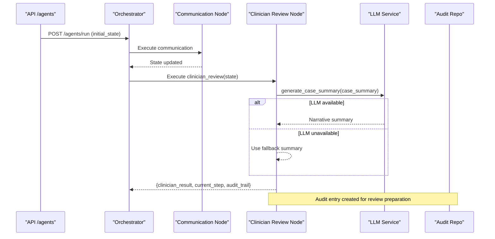
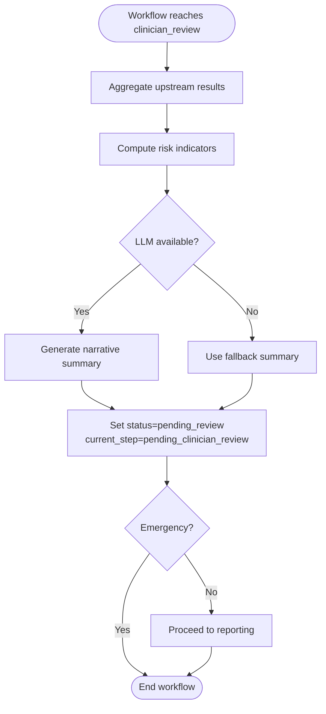
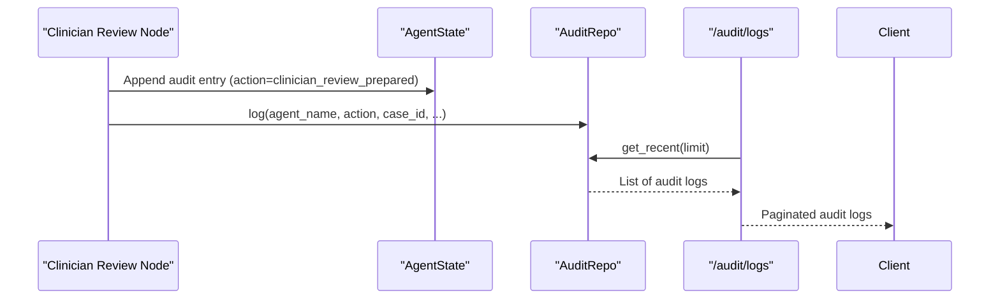
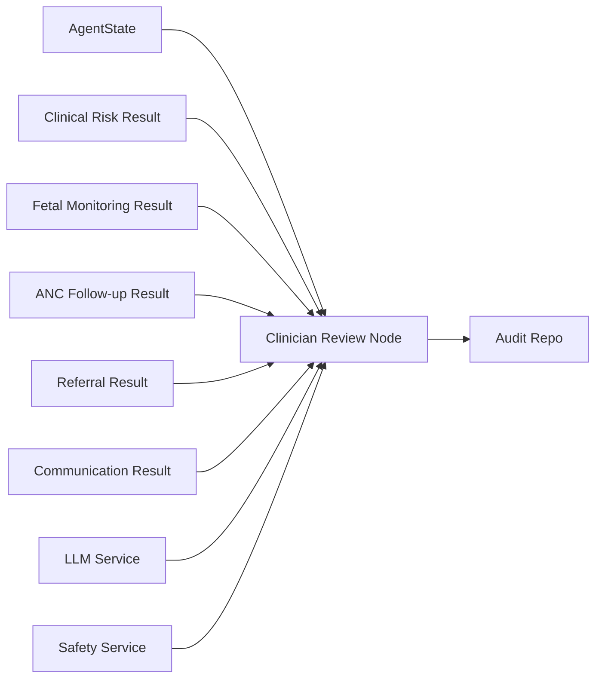

# Clinician Review Node

<cite>
**Referenced Files in This Document**
- [clinician_review.py](file://backend/agents/nodes/clinician_review.py)
- [orchestrator.py](file://backend/agents/orchestrator.py)
- [state.py](file://backend/schemas/state.py)
- [audit.py](file://backend/api/routes/audit.py)
- [models.py](file://backend/db/models.py)
- [repositories.py](file://backend/db/repositories.py)
- [agents.py](file://backend/api/routes/agents.py)
- [inference.py](file://backend/services/inference.py)
- [safety.py](file://backend/services/safety.py)
- [config.py](file://backend/config.py)
</cite>

## Table of Contents
1. [Introduction](#introduction)
2. [Project Structure](#project-structure)
3. [Core Components](#core-components)
4. [Architecture Overview](#architecture-overview)
5. [Detailed Component Analysis](#detailed-component-analysis)
6. [Dependency Analysis](#dependency-analysis)
7. [Performance Considerations](#performance-considerations)
8. [Troubleshooting Guide](#troubleshooting-guide)
9. [Conclusion](#conclusion)
10. [Appendices](#appendices)

## Introduction
This document explains the Clinician Review Node, which enables human-in-the-loop clinical decision making by assembling a comprehensive case presentation for clinician review. It documents how the node aggregates upstream agent outputs, generates risk indicators and optional narrative summaries, and transitions workflow state to await clinician approval or escalation. It also covers audit logging, integration points with electronic health records (EHR), quality oversight, traceability for regulatory compliance, and procedures for escalation and second opinions.

## Project Structure
The Clinician Review Node is part of a multi-agent orchestration pipeline that processes patient intake, data quality checks, clinical risk assessment, fetal monitoring, ANC follow-up, referral routing, communication, and reporting. The orchestrator wires these nodes into a directed graph and routes execution based on clinical signals such as emergency status and available CTG data.

```mermaid
graph TB
intake["patient_intake"] --> dq["data_quality"]
dq --> cr["clinical_risk"]
cr --> |emergency| ref["smart_referral"]
cr --> |CTG present| fm["fetal_monitoring"]
cr --> |else| anc["anc_followup"]
fm --> |emergency| ref
fm --> |else| anc
anc --> ref
ref --> comm["communication"]
comm --> rev["clinician_review"]
rev --> |normal| rpt["reporting"]
rev --> |emergency| end["END"]
rpt --> end
```

**Diagram sources**
- [orchestrator.py:62-138](file://backend/agents/orchestrator.py#L62-L138)

**Section sources**
- [orchestrator.py:1-167](file://backend/agents/orchestrator.py#L1-L167)

## Core Components
- Case aggregation and summary generation: The Clinician Review Node consolidates structured results from upstream agents into a single case summary, including patient info, clinical and fetal assessments, ANC follow-up, referral details, and communication logs.
- Risk indicator computation: Quick-risk flags are derived from emergency status, maternal risk level, fetal status, and WHO triage levels to highlight cases requiring immediate attention.
- Optional LLM-generated narrative: A concise narrative summary can be generated via an LLM service; if unavailable, a deterministic fallback text is used.
- Workflow state transition: The node sets the workflow state to pending clinician review and emits audit trail entries for traceability.

Key responsibilities:
- Present complete, structured case data to clinicians without making clinical decisions.
- Surface actionable risk indicators to prioritize urgent reviews.
- Ensure every preparation step is auditable.

**Section sources**
- [clinician_review.py:13-147](file://backend/agents/nodes/clinician_review.py#L13-L147)

## Architecture Overview
The Clinician Review Node sits after communication and before reporting in the orchestrated workflow. It consumes the shared AgentState populated by prior nodes and returns a result that includes a clinician_result payload, current_step set to pending_clinician_review, and an audit_trail entry.



**Diagram sources**
- [agents.py:62-79](file://backend/api/routes/agents.py#L62-L79)
- [orchestrator.py:120-130](file://backend/agents/orchestrator.py#L120-L130)
- [clinician_review.py:103-147](file://backend/agents/nodes/clinician_review.py#L103-L147)
- [config.py:37-42](file://backend/config.py#L37-L42)

## Detailed Component Analysis

### Case Presentation Interface
- Inputs: Patient identifiers, emergency flag, vitals, symptoms, demographics, and aggregated results from clinical risk, fetal monitoring, ANC follow-up, referral, and communication nodes.
- Outputs: Structured case_summary containing:
  - Patient info: demographics, vitals, symptoms
  - Clinical assessment: maternal risk, gestational risk, WHO triage flags
  - Fetal assessment: fetal status, preterm risk, escalation flag
  - ANC follow-up: missed visit risk, priority, recommended action
  - Referral: urgency, selected facility, estimated travel time
  - Communication log: messages sent, delivery status
  - Review timestamp and risk indicators list
- Optional narrative: An LLM-generated summary may accompany the structured data; a deterministic fallback ensures availability even when LLM services fail.

Implementation highlights:
- Emergency and risk-driven prioritization: requires_immediate_attention is true when emergency is flagged or multiple risk indicators exist.
- Robustness: LLM calls run off the event loop to avoid blocking; failures fall back to template text.

**Section sources**
- [clinician_review.py:22-128](file://backend/agents/nodes/clinician_review.py#L22-L128)

### Review Workflow
- Entry point: After communication completes, the orchestrator routes to clinician_review.
- State change: Sets current_step to pending_clinician_review and writes a clinician_result with status pending_review.
- Post-review routing: If not emergency, the workflow proceeds to reporting; otherwise it ends quickly to expedite emergency handling.



**Diagram sources**
- [orchestrator.py:120-132](file://backend/agents/orchestrator.py#L120-L132)
- [clinician_review.py:120-147](file://backend/agents/nodes/clinician_review.py#L120-L147)

### Decision Capture Mechanisms
- Decision capture fields:
  - clinician_decision and clinician_notes are stored in the ClinicalRecord model for persistence.
  - These fields are intended to record the final approved decision and any notes from the reviewing clinician.
- Integration with EHR:
  - The system maintains structured clinical_records with JSON payloads for model outputs and vital signs, enabling interoperable exchange with external systems.
  - Referrals include facility metadata and urgency, supporting handoff to care facilities.

Note: While the repository defines storage structures for capturing decisions and notes, explicit API endpoints for submitting clinician decisions are not shown in the analyzed files. Implementers should use the existing repositories and models to persist decisions and integrate with EHR systems through appropriate adapters.

**Section sources**
- [models.py:30-50](file://backend/db/models.py#L30-L50)
- [repositories.py:31-47](file://backend/db/repositories.py#L31-L47)

### Audit Logging and Traceability
- In-process audit trail: Each node appends audit entries to the shared audit_trail list within AgentState, recording actions, timestamps, and summaries.
- Persistent audit logs: The AuditRepo provides methods to log and retrieve audit entries, and the /audit/logs endpoint exposes recent logs with filtering and pagination for admin users.
- Compliance: Audit entries capture agent_name, action, case_id, timestamps, and optional details, enabling full traceability across the workflow.



**Diagram sources**
- [clinician_review.py:136-147](file://backend/agents/nodes/clinician_review.py#L136-L147)
- [repositories.py:66-82](file://backend/db/repositories.py#L66-L82)
- [audit.py:21-87](file://backend/api/routes/audit.py#L21-L87)

**Section sources**
- [audit.py:21-87](file://backend/api/routes/audit.py#L21-L87)
- [repositories.py:66-82](file://backend/db/repositories.py#L66-L82)
- [models.py:81-93](file://backend/db/models.py#L81-L93)

### Escalation Procedures and Second Opinion Requests
- Automatic escalation triggers:
  - Emergency detection via safety rules marks cases as high-risk emergencies, bypassing reporting and ending the workflow quickly.
  - Multiple risk indicators or pathological fetal status trigger requires_immediate_attention to prioritize review.
- Second opinion:
  - The repository does not define a dedicated second-opinion node. However, the architecture supports adding a second-opinion step post-clinician_review by extending the orchestrator’s conditional edges and introducing a new node that re-runs relevant assessments or consults additional experts.
  - For now, escalation is handled by emergency routing and risk indicator flags.

Best practices:
- Use the existing safety service to detect emergencies and WHO red flags consistently.
- Persist escalation reasons and timestamps in audit logs for accountability.

**Section sources**
- [safety.py:24-67](file://backend/services/safety.py#L24-L67)
- [clinician_review.py:73-87](file://backend/agents/nodes/clinician_review.py#L73-L87)
- [orchestrator.py:34-55](file://backend/agents/orchestrator.py#L34-L55)

### Documentation Requirements
- Required documentation elements captured per case:
  - Structured case_summary with all upstream assessments and risk indicators.
  - Optional LLM-generated narrative for context.
  - Audit trail entries documenting each step taken.
  - Stored clinician_decision and clinician_notes upon approval.
- Quality assurance:
  - Model outputs and confidence scores are retained in model_outputs and related fields for traceability.
  - Safety rule evaluations and WHO triage results provide standardized clinical rationale.

**Section sources**
- [models.py:30-50](file://backend/db/models.py#L30-L50)
- [clinician_review.py:36-128](file://backend/agents/nodes/clinician_review.py#L36-L128)

### Role in Maintaining Clinical Oversight and Regulatory Compliance
- Human-in-the-loop: The node explicitly avoids making clinical decisions and instead prepares a comprehensive case for clinician review, ensuring oversight remains with licensed professionals.
- Traceability: Audit logs and persistent records enable regulatory audits and incident investigations.
- Safety: Integration with WHO-based safety rules ensures consistent identification of emergencies and high-risk scenarios.

**Section sources**
- [clinician_review.py:13-18](file://backend/agents/nodes/clinician_review.py#L13-L18)
- [audit.py:21-87](file://backend/api/routes/audit.py#L21-L87)
- [safety.py:24-67](file://backend/services/safety.py#L24-L67)

## Dependency Analysis
The Clinician Review Node depends on:
- Shared AgentState schema for input/output contracts.
- Upstream nodes’ results (clinical risk, fetal monitoring, ANC follow-up, referral, communication).
- Optional LLM service for narrative generation.
- Safety service for emergency detection and WHO triage.
- Repository layer for audit logging and future decision persistence.



**Diagram sources**
- [state.py:7-43](file://backend/schemas/state.py#L7-L43)
- [clinician_review.py:22-128](file://backend/agents/nodes/clinician_review.py#L22-L128)
- [repositories.py:66-82](file://backend/db/repositories.py#L66-L82)

**Section sources**
- [state.py:7-43](file://backend/schemas/state.py#L7-L43)
- [clinician_review.py:22-128](file://backend/agents/nodes/clinician_review.py#L22-L128)
- [repositories.py:66-82](file://backend/db/repositories.py#L66-L82)

## Performance Considerations
- Non-blocking LLM calls: LLM requests are executed in worker threads to prevent event loop blocking during case summary generation.
- Conditional reporting: Emergency cases skip reporting to reduce latency and expedite critical handling.
- Efficient aggregation: The node constructs summaries from already computed upstream results, minimizing redundant processing.

Recommendations:
- Monitor LLM availability and response times; ensure fallback behavior is robust.
- Consider caching frequently accessed reference data (e.g., facility lists) to reduce external API calls.

[No sources needed since this section provides general guidance]

## Troubleshooting Guide
Common issues and resolutions:
- LLM failure:
  - Symptom: No narrative summary or llm_generated=false.
  - Resolution: Verify LLM configuration and network connectivity; rely on fallback summary.
- Missing upstream results:
  - Symptom: Empty or partial case_summary sections.
  - Resolution: Ensure prior nodes execute successfully and populate required state fields.
- Emergency misclassification:
  - Symptom: Unexpected requires_immediate_attention or routing.
  - Resolution: Validate safety service inputs and WHO triage logic; check vitals and symptom data completeness.
- Audit log gaps:
  - Symptom: Missing audit entries for review preparation.
  - Resolution: Confirm audit_trail appending and repository logging; verify database connectivity.

Operational tips:
- Use /audit/logs to inspect recent activity and filter by agent_name or patient_id.
- Inspect AgentState.current_step to confirm workflow progression.

**Section sources**
- [clinician_review.py:103-118](file://backend/agents/nodes/clinician_review.py#L103-L118)
- [audit.py:21-87](file://backend/api/routes/audit.py#L21-L87)
- [safety.py:24-67](file://backend/services/safety.py#L24-L67)

## Conclusion
The Clinician Review Node centralizes case presentation, risk signaling, and auditability to support safe, transparent, and compliant human-in-the-loop clinical decision making. By aggregating structured outputs from upstream agents, generating actionable risk indicators, and providing both structured and narrative summaries, it equips clinicians with the necessary information to approve, escalate, or request second opinions. The system’s design emphasizes traceability through comprehensive audit logging and persistent records, facilitating regulatory compliance and quality oversight.

[No sources needed since this section summarizes without analyzing specific files]

## Appendices

### API Access Points
- Run full workflow: POST /agents/run
- Invoke single node: POST /agents/{node_name}/invoke
- View audit logs: GET /audit/logs (admin-only)

These endpoints enable operational control and inspection of the workflow and its audit trail.

**Section sources**
- [agents.py:62-114](file://backend/api/routes/agents.py#L62-L114)
- [audit.py:21-87](file://backend/api/routes/audit.py#L21-L87)

### Data Models Relevant to Clinician Review
- ClinicalRecord: Stores case-level clinical data, model outputs, and clinician decisions/notes.
- AuditLog: Captures agent actions, timestamps, and details for traceability.
- AgentStateRecord: Persists workflow state snapshots for recovery and auditing.

**Section sources**
- [models.py:30-93](file://backend/db/models.py#L30-L93)