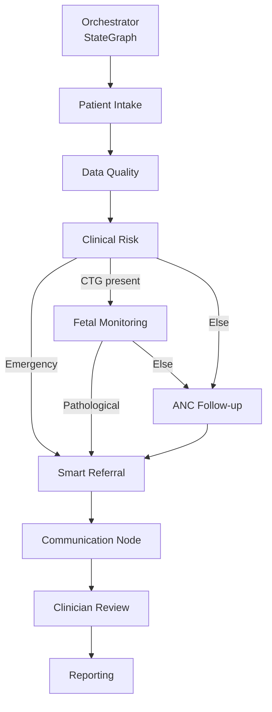
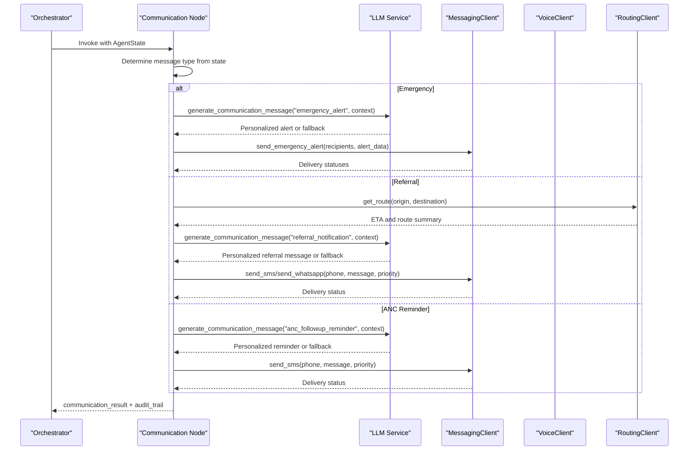
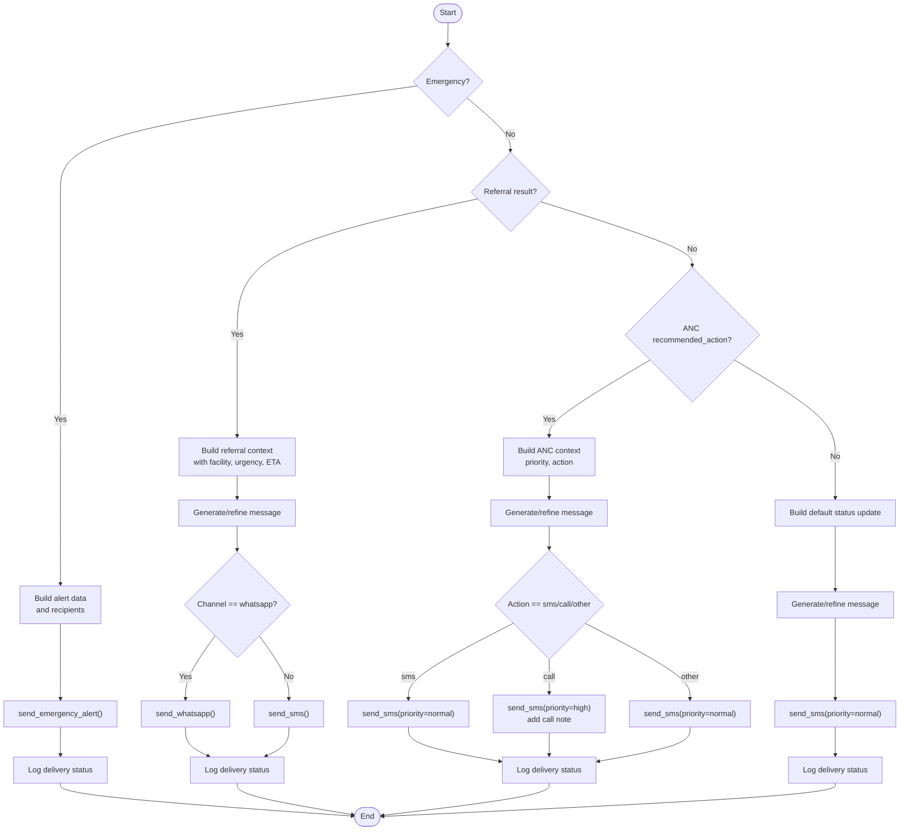
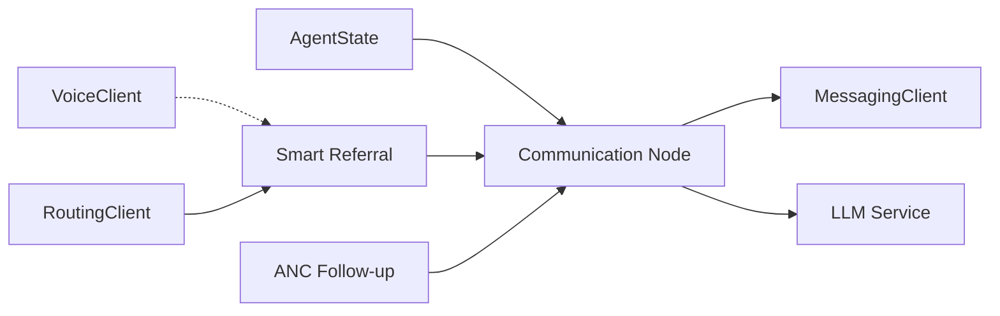

# Communication Node

<cite>
**Referenced Files in This Document**
- [communication.py](file://backend/agents/nodes/communication.py)
- [messaging_client.py](file://backend/integrations/messaging_client.py)
- [voice_client.py](file://backend/integrations/voice_client.py)
- [routing_client.py](file://backend/integrations/routing_client.py)
- [llm.py](file://backend/services/llm.py)
- [orchestrator.py](file://backend/agents/orchestrator.py)
- [state.py](file://backend/schemas/state.py)
- [config.py](file://backend/config.py)
- [anc_followup.py](file://backend/agents/nodes/anc_followup.py)
- [smart_referral.py](file://backend/agents/nodes/smart_referral.py)
- [alerts.py](file://backend/api/routes/alerts.py)
</cite>

## Table of Contents
1. [Introduction](#introduction)
2. [Project Structure](#project-structure)
3. [Core Components](#core-components)
4. [Architecture Overview](#architecture-overview)
5. [Detailed Component Analysis](#detailed-component-analysis)
6. [Dependency Analysis](#dependency-analysis)
7. [Performance Considerations](#performance-considerations)
8. [Troubleshooting Guide](#troubleshooting-guide)
9. [Conclusion](#conclusion)
10. [Appendices](#appendices)

## Introduction
This document explains the Communication Node that manages multi-channel messaging for maternal health workflows. It covers message routing logic, template and personalization management, delivery status tracking, and integrations with messaging clients, voice synthesis services, and notification systems. It also details how the node supports patient engagement, alert notifications, and care coordination across SMS, WhatsApp, app/web channels, and voice inputs.

## Project Structure
The Communication Node is part of a LangGraph-based orchestration pipeline. The orchestrator wires multiple agent nodes, including communication, which runs after referral or ANC follow-up to dispatch messages. The node reads shared state (patient context, language, channel), generates personalized messages using templates or an LLM, and sends them via a messaging client. Voice and routing clients support richer interactions and travel-time estimates used in referrals.

**Diagram sources**
- [orchestrator.py:62-138](file://backend/agents/orchestrator.py#L62-L138)

**Section sources**
- [orchestrator.py:1-167](file://backend/agents/orchestrator.py#L1-L167)

## Core Components
- Communication Node: Determines message type from state and dispatches via MessagingClient; tracks delivery status and audit trails.
- Messaging Client: Provides SMS and WhatsApp sending, emergency alerts, reminders, and delivery status lookup.
- LLM Service: Optional text generation for personalized messages with fallback to templates.
- Voice Client: Transcription, language detection, and symptom extraction to enrich intake and risk assessment.
- Routing Client: Travel time and route estimation used by smart referral to inform urgency and ETA in messages.
- State Schema: Shared typed state carrying patient info, language, channel, and outputs from each node.
- Configuration: External API URLs and model settings.

**Section sources**
- [communication.py:1-231](file://backend/agents/nodes/communication.py#L1-L231)
- [messaging_client.py:1-78](file://backend/integrations/messaging_client.py#L1-L78)
- [llm.py:1-144](file://backend/services/llm.py#L1-L144)
- [voice_client.py:1-48](file://backend/integrations/voice_client.py#L1-L48)
- [routing_client.py:1-71](file://backend/integrations/routing_client.py#L1-L71)
- [state.py:1-43](file://backend/schemas/state.py#L1-L43)
- [config.py:1-55](file://backend/config.py#L1-L55)

## Architecture Overview
The Communication Node integrates into the workflow as follows:
- Input: AgentState containing patient demographics, clinical results, referral outcomes, ANC recommendations, preferred channel, and language.
- Processing: Selects message type (emergency, referral, ANC reminder, or default update), optionally generates personalized content via LLM, and routes to appropriate channel (SMS or WhatsApp).
- Output: Returns communication_result with delivery logs, flags, and audit entries; updates current_step to continue the workflow.

**Diagram sources**
- [communication.py:38-213](file://backend/agents/nodes/communication.py#L38-L213)
- [messaging_client.py:17-77](file://backend/integrations/messaging_client.py#L17-L77)
- [llm.py:91-99](file://backend/services/llm.py#L91-L99)
- [routing_client.py:46-59](file://backend/integrations/routing_client.py#L46-L59)

## Detailed Component Analysis

### Communication Node: Message Routing Logic
- Decision tree based on state:
  - Emergency: Sends emergency alerts to patient phone and supervisor with high-priority SMS.
  - Referral: Uses selected facility and urgency to send SMS or WhatsApp with estimated travel time.
  - ANC follow-up: Sends reminders based on recommended action (sms/call/home visit); call action includes additional note about worker call.
  - Default: Status update with risk level.
- Channel selection:
  - Reads channel from state; defaults to SMS; supports WhatsApp for referral notifications.
- Language support:
  - Reads language from state; passes to LLM for bilingual output when available; falls back to English/Roman Urdu templates.
- Delivery tracking:
  - Collects delivery logs per message; aggregates all_delivered flag; records timestamp and audit trail.

**Diagram sources**
- [communication.py:49-178](file://backend/agents/nodes/communication.py#L49-L178)

**Section sources**
- [communication.py:38-213](file://backend/agents/nodes/communication.py#L38-L213)

### Template Management and Personalization
- Fallback templates:
  - Emergency alert, referral notice, ANC reminder, screening status update.
- LLM integration:
  - Optional generation via Groq service; if unavailable or empty, uses fallback template.
  - Context includes patient_id, facility_name, urgency, travel time, priority, recommended_action, risk_level, and language.
- Bilingual support:
  - LLM prompts request both English and Roman Urdu versions; language field passed to guide tone and phrasing.
- Reminders:
  - MessagingClient provides built-in templates for appointment, medication, and followup reminders with placeholders.

**Section sources**
- [communication.py:14-35](file://backend/agents/nodes/communication.py#L14-L35)
- [communication.py:64-178](file://backend/agents/nodes/communication.py#L64-L178)
- [messaging_client.py:68-77](file://backend/integrations/messaging_client.py#L68-L77)
- [llm.py:91-99](file://backend/services/llm.py#L91-L99)

### Delivery Status Tracking
- Per-message delivery log:
  - Each send returns a record with message_id, channel, recipient, status, sent_at, priority.
- Aggregation:
  - all_delivered computed from delivery_log; communication_result includes counts and flags.
- Querying:
  - MessagingClient.get_delivery_status allows retrieving status by message_id from in-memory store.
- API exposure:
  - Alerts API stores and exposes alert status endpoints for external monitoring.

**Section sources**
- [communication.py:180-213](file://backend/agents/nodes/communication.py#L180-L213)
- [messaging_client.py:61-66](file://backend/integrations/messaging_client.py#L61-L66)
- [alerts.py:96-124](file://backend/api/routes/alerts.py#L96-L124)

### Integrations: Messaging Clients, Voice Synthesis, Notifications
- MessagingClient:
  - send_sms, send_whatsapp, send_emergency_alert, send_reminder, get_delivery_status.
  - Stub implementation always returns delivered status; suitable for testing and future replacement with real providers.
- VoiceClient:
  - transcribe audio to text with language hint and confidence; detect_language; extract symptoms via keyword matching.
  - Supports voice-based intake and enrichment of symptoms for downstream nodes.
- RoutingClient:
  - Estimates travel time and route between origin and destination; used by smart referral to compute ETA included in referral messages.

**Section sources**
- [messaging_client.py:9-77](file://backend/integrations/messaging_client.py#L9-L77)
- [voice_client.py:7-47](file://backend/integrations/voice_client.py#L7-L47)
- [routing_client.py:8-70](file://backend/integrations/routing_client.py#L8-L70)

### Role in Patient Engagement, Alert Notifications, Care Coordination
- Patient engagement:
  - ANC reminders encourage adherence to scheduled visits; call actions prompt human follow-up.
- Alert notifications:
  - Emergency alerts notify patient and supervisor immediately with critical condition details and triage level.
- Care coordination:
  - Referral notifications include facility name, urgency, and estimated travel time; routing insights improve clarity and timeliness.

**Section sources**
- [communication.py:64-178](file://backend/agents/nodes/communication.py#L64-L178)
- [smart_referral.py:11-118](file://backend/agents/nodes/smart_referral.py#L11-L118)
- [anc_followup.py:10-85](file://backend/agents/nodes/anc_followup.py#L10-L85)

## Dependency Analysis
- Communication Node depends on:
  - AgentState schema for input fields (patient_id, channel, language, demographics, results).
  - MessagingClient for outbound communications.
  - LLM Service for optional message generation.
  - Orchestrator wiring for execution flow.
- Ancillary dependencies:
  - Smart Referral uses FacilityLocator and RoutingClient to produce referral context consumed by Communication.
  - ANC Follow-up produces recommended_action driving message behavior.

**Diagram sources**
- [state.py:7-43](file://backend/schemas/state.py#L7-L43)
- [communication.py:8-9](file://backend/agents/nodes/communication.py#L8-L9)
- [smart_referral.py:6-8](file://backend/agents/nodes/smart_referral.py#L6-L8)
- [anc_followup.py:6-7](file://backend/agents/nodes/anc_followup.py#L6-L7)

**Section sources**
- [state.py:1-43](file://backend/schemas/state.py#L1-L43)
- [communication.py:1-231](file://backend/agents/nodes/communication.py#L1-L231)
- [smart_referral.py:1-136](file://backend/agents/nodes/smart_referral.py#L1-L136)
- [anc_followup.py:1-103](file://backend/agents/nodes/anc_followup.py#L1-L103)

## Performance Considerations
- Non-blocking LLM calls:
  - LLM generation runs in a worker thread to avoid blocking the event loop.
- Short timeouts:
  - Clients use small timeouts for responsiveness; adjust for production environments.
- Minimal payload:
  - Messages are concise to fit token budgets and reduce latency.
- In-memory logging:
  - MessagingClient stores recent messages in memory for quick status checks; replace with persistent storage in production.

[No sources needed since this section provides general guidance]

## Troubleshooting Guide
- LLM unavailability:
  - If LLM service is None or raises exceptions, the node falls back to template messages; check logs for warnings and ensure environment variables are set.
- Channel misconfiguration:
  - Ensure channel in state matches supported values; unknown channels will default to SMS.
- Delivery failures:
  - Current stub always returns delivered; integrate with real provider callbacks to update status accurately.
- Voice transcription issues:
  - Validate language_hint and audio quality; symptom extraction relies on keywords—expand vocabulary as needed.
- Routing inaccuracies:
  - Haversine distance approximates travel time; integrate with real routing APIs for precise ETAs.

**Section sources**
- [llm.py:20-28](file://backend/services/llm.py#L20-L28)
- [communication.py:14-35](file://backend/agents/nodes/communication.py#L14-L35)
- [messaging_client.py:17-66](file://backend/integrations/messaging_client.py#L17-L66)
- [voice_client.py:14-47](file://backend/integrations/voice_client.py#L14-L47)
- [routing_client.py:16-44](file://backend/integrations/routing_client.py#L16-L44)

## Conclusion
The Communication Node provides robust, multi-channel messaging for maternal health workflows, combining deterministic routing with optional LLM-generated personalization. It integrates with voice and routing services to enrich context and deliver timely alerts, reminders, and referral notifications. With clear delivery tracking and audit trails, it supports patient engagement and care coordination while remaining resilient to external service failures through fallback templates.

[No sources needed since this section summarizes without analyzing specific files]

## Appendices

### Configuration Keys Relevant to Communication
- Messaging API URL: MESSAGING_API_URL
- Voice API URL: VOICE_API_URL
- Routing API URL: ROUTING_API_URL
- LLM model and key: GROQ_MODEL, GROQ_API_KEY

**Section sources**
- [config.py:31-42](file://backend/config.py#L31-L42)