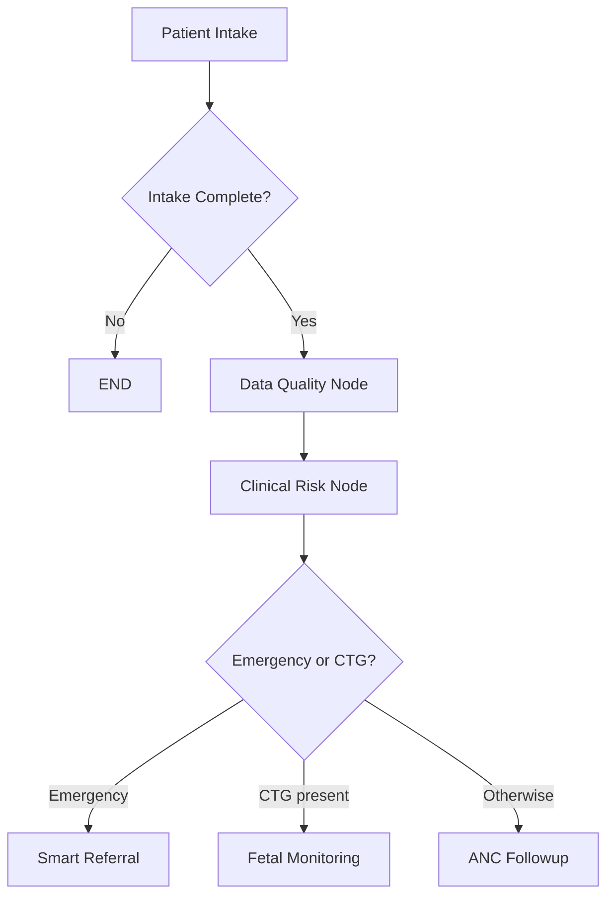
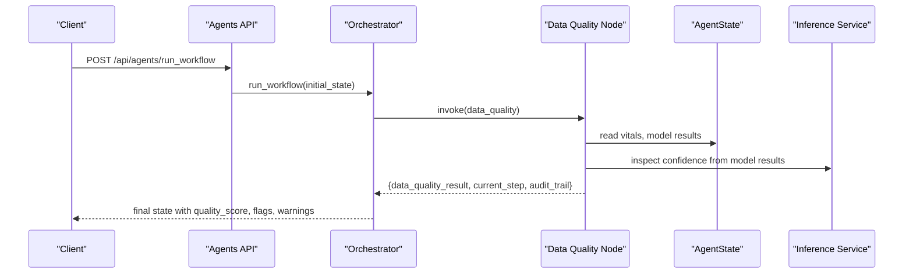
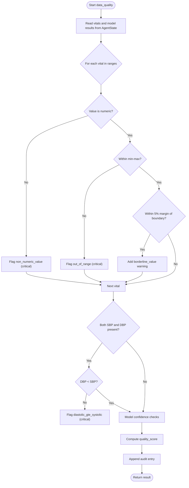
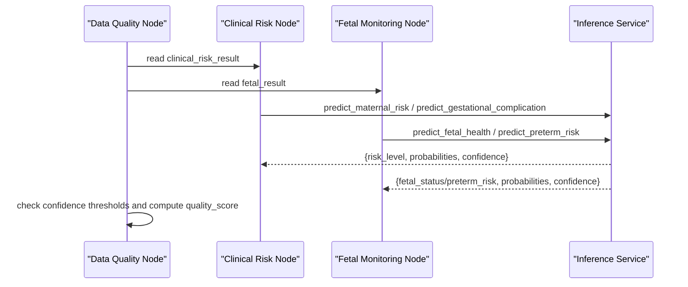
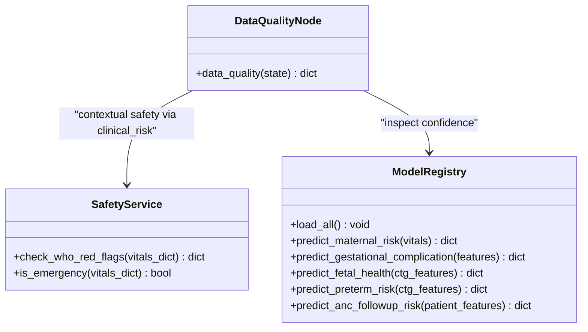
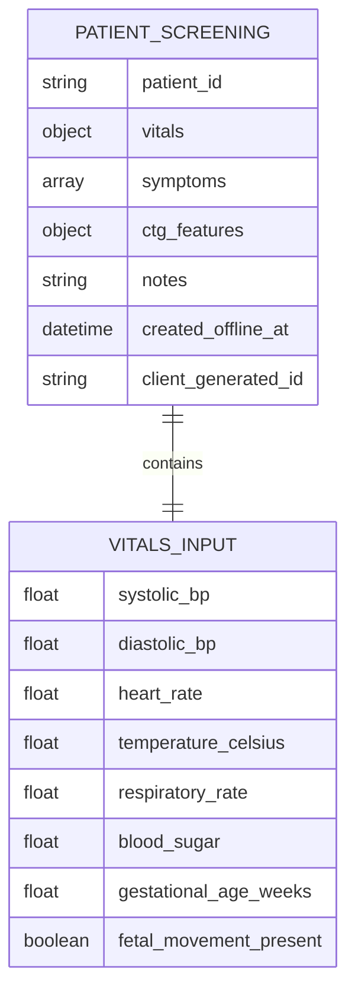
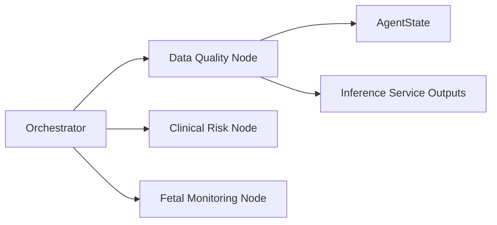

# Data Quality Node

<cite>
**Referenced Files in This Document**
- [data_quality.py](file://backend/agents/nodes/data_quality.py)
- [state.py](file://backend/schemas/state.py)
- [orchestrator.py](file://backend/agents/orchestrator.py)
- [inference.py](file://backend/services/inference.py)
- [clinical_risk.py](file://backend/agents/nodes/clinical_risk.py)
- [fetal_monitoring.py](file://backend/agents/nodes/fetal_monitoring.py)
- [safety.py](file://backend/services/safety.py)
- [patient.py](file://backend/schemas/patient.py)
- [agents.py](file://backend/api/routes/agents.py)
</cite>

## Table of Contents
1. [Introduction](#introduction)
2. [Project Structure](#project-structure)
3. [Core Components](#core-components)
4. [Architecture Overview](#architecture-overview)
5. [Detailed Component Analysis](#detailed-component-analysis)
6. [Dependency Analysis](#dependency-analysis)
7. [Performance Considerations](#performance-considerations)
8. [Troubleshooting Guide](#troubleshooting-guide)
9. [Conclusion](#conclusion)
10. [Appendices](#appendices)

## Introduction
This document explains the Data Quality Node that validates clinical data completeness, consistency, and accuracy before downstream processing. It covers validation rules for patient vitals and clinical measurements, missing data detection, outlier identification, quality scoring, error reporting, and integration with external validation services (WHO safety rules and ML model confidence checks). It also describes how the node fits into the overall agent workflow to ensure data integrity prior to risk assessment and referral steps.

## Project Structure
The Data Quality Node is part of a LangGraph-based orchestration pipeline. After patient intake, the workflow routes to the Data Quality Node, which validates inputs and model outputs, then proceeds to clinical risk assessment and other nodes. The node reads from and writes to a shared state object used by all agents.

**Diagram sources**
- [orchestrator.py:22-41](file://backend/agents/orchestrator.py#L22-L41)
- [orchestrator.py:62-132](file://backend/agents/orchestrator.py#L62-L132)

**Section sources**
- [orchestrator.py:22-41](file://backend/agents/orchestrator.py#L22-L41)
- [orchestrator.py:62-132](file://backend/agents/orchestrator.py#L62-L132)

## Core Components
- Data Quality Node: Validates vital ranges, detects non-numeric values, flags impossible combinations, assesses model confidence, computes an overall quality score, and records audit entries.
- Shared State: Typed dictionary carrying patient data, intermediate results, and cross-cutting fields such as audit_trail and errors.
- Inference Service: Provides model predictions and confidence scores used by downstream nodes; Data Quality Node inspects these confidences.
- Safety Service: Wraps WHO red-flag rules; while primarily invoked by Clinical Risk, its outputs influence emergency routing and indirectly affect data quality context.
- API Routes: Expose endpoints to run the full workflow or individual nodes, including Data Quality.

Key responsibilities of the Data Quality Node:
- Vitals range validation using predefined physiological bounds.
- Non-numeric value detection and conversion attempts.
- Impossible value checks (e.g., diastolic ≥ systolic).
- Model confidence checks across MaternalGuard, GestationInsight, FetalWatch, PretermGuard, and CareReach.
- Overall quality score computation based on issues vs total checks.
- Audit trail logging and error capture.

**Section sources**
- [data_quality.py:9-22](file://backend/agents/nodes/data_quality.py#L9-L22)
- [data_quality.py:25-183](file://backend/agents/nodes/data_quality.py#L25-L183)
- [state.py:7-42](file://backend/schemas/state.py#L7-L42)
- [inference.py:51-141](file://backend/services/inference.py#L51-L141)
- [safety.py:18-67](file://backend/services/safety.py#L18-L67)
- [agents.py:17-27](file://backend/api/routes/agents.py#L17-L27)

## Architecture Overview
The Data Quality Node sits between intake and clinical risk assessment. It ensures that vitals are plausible and that downstream model predictions have acceptable confidence levels. If critical issues are found, they are flagged; borderline concerns generate warnings. The node’s output feeds into subsequent nodes and contributes to the global audit trail.

**Diagram sources**
- [orchestrator.py:144-147](file://backend/agents/orchestrator.py#L144-L147)
- [data_quality.py:25-183](file://backend/agents/nodes/data_quality.py#L25-L183)
- [inference.py:151-426](file://backend/services/inference.py#L151-L426)

## Detailed Component Analysis

### Data Quality Node: Validation Rules and Scoring
The node performs:
- Range checks for each vital against defined min/max bounds.
- Type checks to detect non-numeric values.
- Consistency checks for blood pressure (diastolic must be less than systolic).
- Borderline value warnings within 5% margins near boundaries.
- Confidence checks for models: MaternalGuard, GestationInsight, FetalWatch, PretermGuard, CareReach.
- Quality score calculation: 1 - (issues / total_checks), clamped to [0, 1].

Quality score formula:
- total_checks = number of vital ranges + number of model confidence checks performed
- issues = number of flags + number of models below confidence threshold
- quality_score = round(max(0, 1.0 - (issues / max(total_checks, 1))), 4)

Missing data handling:
- Missing vitals are skipped during range checks; this does not penalize the quality score directly but may reduce total_checks if no values are present.
- Missing model results are handled gracefully; only available results contribute to checks.

Outlier identification:
- Out-of-range values are flagged as critical issues.
- Borderline values near thresholds generate soft warnings.

Error handling:
- Any exception inside the node returns structured errors and an audit entry describing the failure.

**Diagram sources**
- [data_quality.py:46-155](file://backend/agents/nodes/data_quality.py#L46-L155)
- [data_quality.py:152-183](file://backend/agents/nodes/data_quality.py#L152-L183)

**Section sources**
- [data_quality.py:9-22](file://backend/agents/nodes/data_quality.py#L9-L22)
- [data_quality.py:25-183](file://backend/agents/nodes/data_quality.py#L25-L183)

### Integration with Clinical Risk and Fetal Monitoring
- Clinical Risk Node runs maternal and gestational risk models and applies WHO red-flag rules. Its outputs (including confidence) are consumed by Data Quality Node for confidence checks.
- Fetal Monitoring Node runs FetalWatch and PretermGuard on CTG features; its confidence metrics are also checked by Data Quality Node.
- Emergency routing can be influenced by both Clinical Risk and Fetal Monitoring outcomes; Data Quality Node ensures that low-confidence predictions are flagged as warnings.

**Diagram sources**
- [clinical_risk.py:15-109](file://backend/agents/nodes/clinical_risk.py#L15-L109)
- [fetal_monitoring.py:10-93](file://backend/agents/nodes/fetal_monitoring.py#L10-L93)
- [inference.py:151-426](file://backend/services/inference.py#L151-L426)
- [data_quality.py:100-155](file://backend/agents/nodes/data_quality.py#L100-L155)

**Section sources**
- [clinical_risk.py:15-109](file://backend/agents/nodes/clinical_risk.py#L15-L109)
- [fetal_monitoring.py:10-93](file://backend/agents/nodes/fetal_monitoring.py#L10-L93)
- [data_quality.py:100-155](file://backend/agents/nodes/data_quality.py#L100-L155)

### External Validation Services
- WHO Red Flags: The Safety Service wraps the ClinicalSafetyEngine to evaluate danger signs and triage levels. While invoked by Clinical Risk, it influences downstream flow and contextualizes data quality assessments.
- Model Registry: Loads and caches ML models; provides prediction functions returning confidence scores. Data Quality Node uses these confidences to flag low-confidence predictions.

**Diagram sources**
- [safety.py:18-67](file://backend/services/safety.py#L18-L67)
- [inference.py:51-141](file://backend/services/inference.py#L51-L141)
- [data_quality.py:25-183](file://backend/agents/nodes/data_quality.py#L25-L183)

**Section sources**
- [safety.py:18-67](file://backend/services/safety.py#L18-L67)
- [inference.py:51-141](file://backend/services/inference.py#L51-L141)
- [data_quality.py:25-183](file://backend/agents/nodes/data_quality.py#L25-L183)

### Data Models and Input Schemas
- Patient schemas define expected fields and constraints for vitals and screening data. These provide baseline validation at ingestion; Data Quality Node enforces additional runtime checks.
- AgentState defines the shared structure for passing data between nodes, including vitals, model results, audit trails, and errors.

**Diagram sources**
- [patient.py:14-57](file://backend/schemas/patient.py#L14-L57)
- [state.py:7-42](file://backend/schemas/state.py#L7-L42)

**Section sources**
- [patient.py:14-57](file://backend/schemas/patient.py#L14-L57)
- [state.py:7-42](file://backend/schemas/state.py#L7-L42)

## Dependency Analysis
The Data Quality Node depends on:
- AgentState for reading vitals and model results.
- Inference Service outputs (model confidences) embedded in state by upstream nodes.
- Orchestrator wiring to route after intake and to clinical risk.

Potential coupling points:
- Changes to vital keys or ranges require updates in both schemas and Data Quality Node.
- Model confidence field names must remain consistent across inference outputs and Data Quality checks.

**Diagram sources**
- [data_quality.py:25-183](file://backend/agents/nodes/data_quality.py#L25-L183)
- [state.py:7-42](file://backend/schemas/state.py#L7-L42)
- [orchestrator.py:62-132](file://backend/agents/orchestrator.py#L62-L132)

**Section sources**
- [data_quality.py:25-183](file://backend/agents/nodes/data_quality.py#L25-L183)
- [state.py:7-42](file://backend/schemas/state.py#L7-L42)
- [orchestrator.py:62-132](file://backend/agents/orchestrator.py#L62-L132)

## Performance Considerations
- The Data Quality Node performs lightweight checks over a fixed set of vital ranges and model confidence fields; complexity is O(n) where n is the number of vitals plus number of model checks.
- Avoid unnecessary conversions by ensuring vitals are numeric early in intake to minimize try/except overhead.
- Cache or precompute derived fields if repeated validations occur across multiple nodes.

[No sources needed since this section provides general guidance]

## Troubleshooting Guide
Common issues and resolutions:
- Non-numeric vital values: Ensure input sanitization at intake; Data Quality Node will flag non-numeric values as critical.
- Out-of-range vitals: Review measurement devices and unit conversions; correct values should fall within defined physiological ranges.
- Diastolic ≥ Systolic: Indicates data entry error; prompt re-entry or correction.
- Low model confidence: Investigate input feature completeness and model availability; consider re-running with corrected inputs.
- Errors during validation: Check audit_trail for error entries; resolve underlying exceptions and retry.

Error reporting mechanisms:
- The node appends structured error entries and audit logs when exceptions occur.
- Upstream nodes also append their own audit entries and errors to the shared state.

**Section sources**
- [data_quality.py:185-200](file://backend/agents/nodes/data_quality.py#L185-L200)
- [state.py:39-42](file://backend/schemas/state.py#L39-L42)

## Conclusion
The Data Quality Node ensures clinical data integrity by validating ranges, detecting anomalies, assessing model confidence, and computing an overall quality score. It integrates with the broader agent workflow to gate downstream processing until data quality is satisfactory. By combining rule-based checks with model confidence evaluation, it provides robust safeguards for accurate and safe clinical decision-making.

[No sources needed since this section summarizes without analyzing specific files]

## Appendices

### Validation Rules Summary
- Vital ranges: Defined per field with min/max bounds and units.
- Non-numeric detection: Converts to float; flags failures.
- Blood pressure consistency: Diastolic must be less than systolic.
- Borderline warnings: Values within 5% margin of boundaries.
- Model confidence: Threshold-based warnings for low confidence.

**Section sources**
- [data_quality.py:9-22](file://backend/agents/nodes/data_quality.py#L9-L22)
- [data_quality.py:46-155](file://backend/agents/nodes/data_quality.py#L46-L155)

### Example Workflows
- Normal case: All vitals within range, high confidence → quality_score near 1.0, minimal warnings.
- Abnormal case: One vital out of range, one model below threshold → quality_score reduced proportionally.
- Error case: Exception during validation → errors and audit entries recorded; downstream nodes can handle gracefully.

**Section sources**
- [data_quality.py:152-183](file://backend/agents/nodes/data_quality.py#L152-L183)
- [data_quality.py:185-200](file://backend/agents/nodes/data_quality.py#L185-L200)