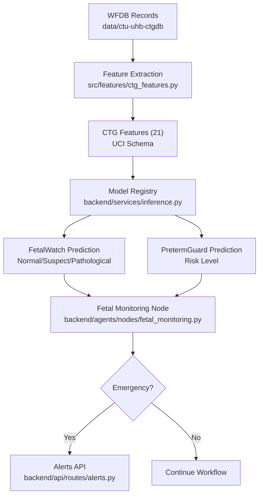
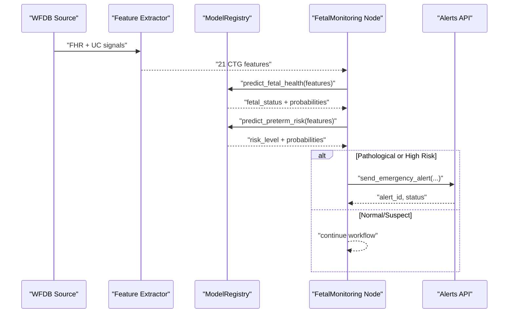
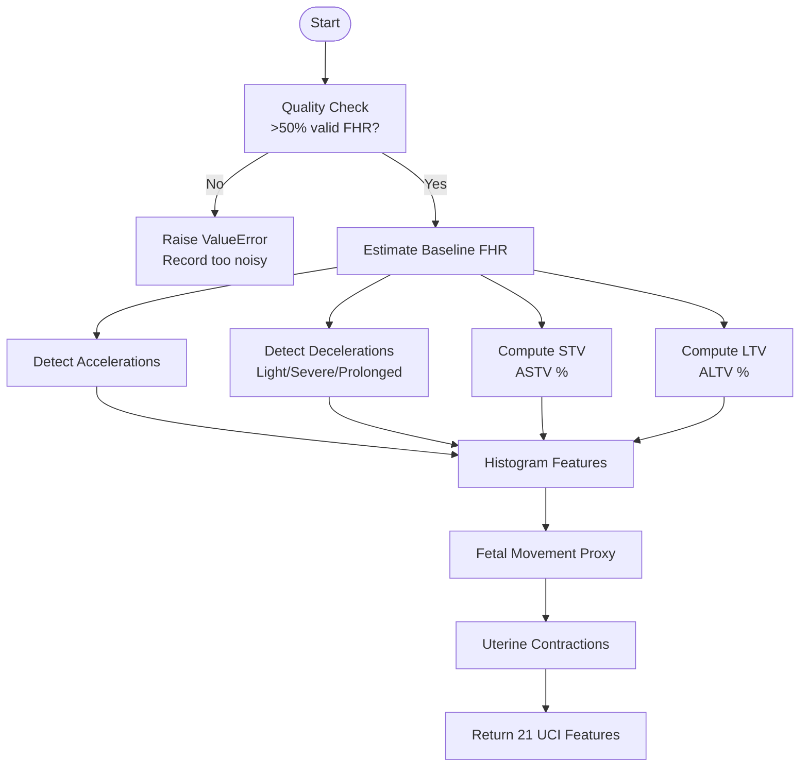
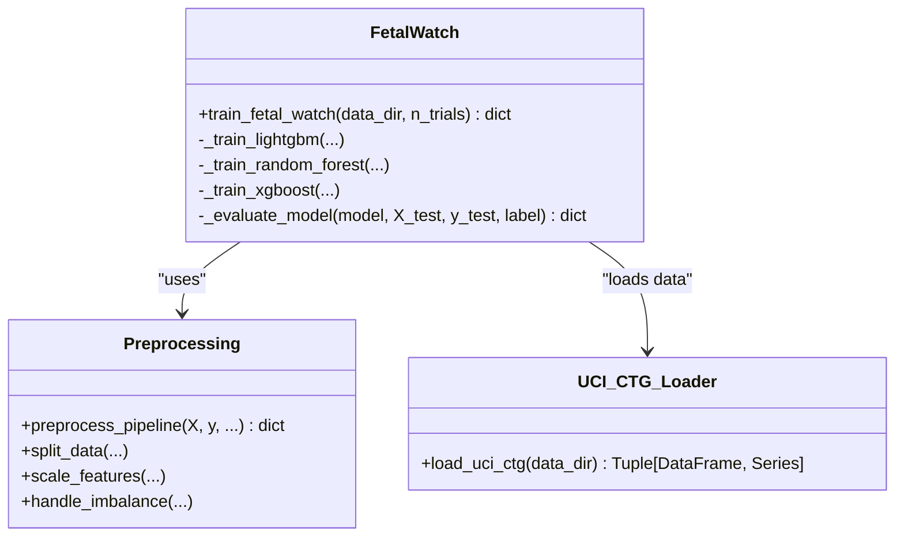
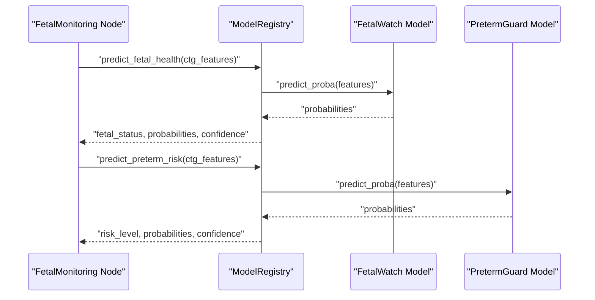
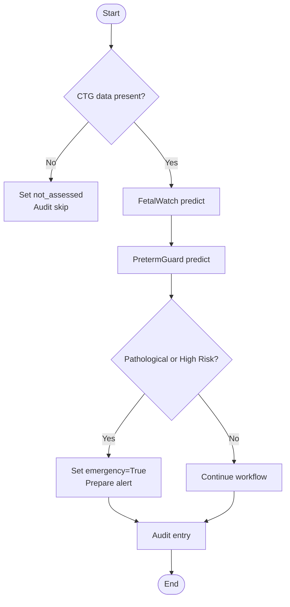
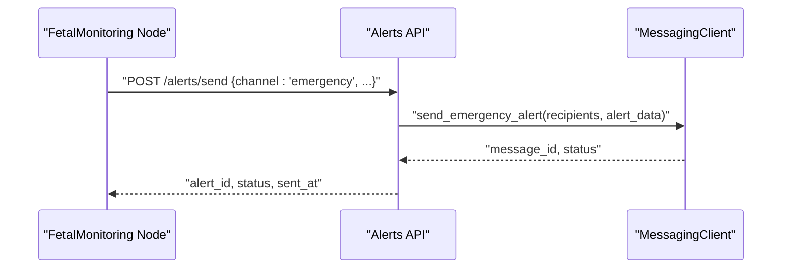
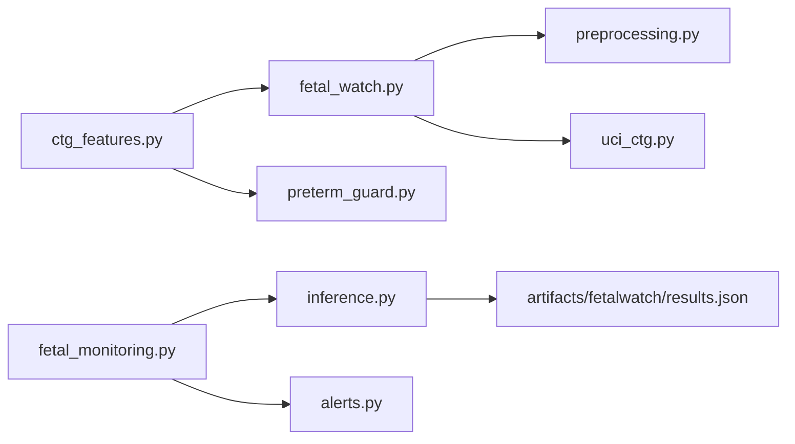

# Fetal Monitoring Node

<cite>
**Referenced Files in This Document**
- [fetal_monitoring.py](file://backend/agents/nodes/fetal_monitoring.py)
- [fetal_watch.py](file://src/models/fetal_watch.py)
- [preterm_guard.py](file://src/models/preterm_guard.py)
- [ctg_features.py](file://src/features/ctg_features.py)
- [preprocessing.py](file://src/data/preprocessing.py)
- [uci_ctg.py](file://src/data/loaders/uci_ctg.py)
- [inference.py](file://backend/services/inference.py)
- [state.py](file://backend/schemas/state.py)
- [alerts.py](file://backend/api/routes/alerts.py)
- [results.json](file://artifacts/fetalwatch/results.json)
</cite>

## Table of Contents
1. [Introduction](#introduction)
2. [Project Structure](#project-structure)
3. [Core Components](#core-components)
4. [Architecture Overview](#architecture-overview)
5. [Detailed Component Analysis](#detailed-component-analysis)
6. [Dependency Analysis](#dependency-analysis)
7. [Performance Considerations](#performance-considerations)
8. [Troubleshooting Guide](#troubleshooting-guide)
9. [Conclusion](#conclusion)

## Introduction
This document describes the Fetal Monitoring Node that analyzes cardiotocography (CTG) recordings to assess fetal health and preterm risk. It explains the end-to-end signal processing pipeline, feature extraction from fetal heart rate (FHR) and uterine contraction (UC) signals, classification into Normal/Suspect/Pathological categories via the FetalWatch model, integration with PretermGuard for preterm risk, real-time monitoring capabilities, alert generation for abnormal readings, and emergency escalation workflows. It also documents performance metrics and validation against clinical standards using the UCI CTG dataset.

## Project Structure
The system is organized into:
- Signal ingestion and feature extraction (CTU-UHB WFDB records or raw arrays)
- Feature engineering aligned to the UCI CTG 21-feature schema
- Model training and evaluation (FetalWatch and PretermGuard)
- Inference service that loads models once and serves predictions
- Agent node orchestration that runs assessments and sets emergency flags
- Alerting API for SMS/WhatsApp/emergency broadcasts

**Diagram sources**
- [ctg_features.py:506-593](file://src/features/ctg_features.py#L506-L593)
- [inference.py:206-248](file://backend/services/inference.py#L206-L248)
- [inference.py:252-293](file://backend/services/inference.py#L252-L293)
- [fetal_monitoring.py:10-93](file://backend/agents/nodes/fetal_monitoring.py#L10-L93)
- [alerts.py:49-109](file://backend/api/routes/alerts.py#L49-L109)

**Section sources**
- [ctg_features.py:506-593](file://src/features/ctg_features.py#L506-L593)
- [inference.py:206-293](file://backend/services/inference.py#L206-L293)
- [fetal_monitoring.py:10-93](file://backend/agents/nodes/fetal_monitoring.py#L10-L93)
- [alerts.py:49-109](file://backend/api/routes/alerts.py#L49-L109)

## Core Components
- CTG Feature Extraction: Converts raw FHR and UC signals into 21 UCI-compatible features including baseline FHR, accelerations, decelerations, variability measures, histogram descriptors, fetal movement proxy, and uterine contractions.
- FetalWatch Model: Three-class classifier (Normal/Suspect/Pathological) trained on UCI CTG data with LightGBM/XGBoost/Random Forest; best model selected by macro-F1.
- PretermGuard Model: Predicts preterm birth risk level using CTG features.
- Inference Service: Singleton registry that loads models at startup and provides prediction APIs with robust fallbacks.
- Fetal Monitoring Node: Orchestrates predictions, computes escalation logic, and updates agent state with audit trails.
- Alerts API: Sends SMS/WhatsApp/emergency alerts and tracks delivery status.

**Section sources**
- [ctg_features.py:27-32](file://src/features/ctg_features.py#L27-L32)
- [fetal_watch.py:1-6](file://src/models/fetal_watch.py#L1-L6)
- [preterm_guard.py:1-6](file://src/models/preterm_guard.py#L1-L6)
- [inference.py:51-101](file://backend/services/inference.py#L51-L101)
- [fetal_monitoring.py:10-93](file://backend/agents/nodes/fetal_monitoring.py#L10-L93)
- [alerts.py:49-109](file://backend/api/routes/alerts.py#L49-L109)

## Architecture Overview
The Fetal Monitoring Node integrates signal processing, feature engineering, and ML inference within an agent workflow. Real-time monitoring is supported by streaming WFDB records into the feature extractor and invoking the inference service per recording window. Emergency escalation triggers alerts through the messaging client.

**Diagram sources**
- [ctg_features.py:506-593](file://src/features/ctg_features.py#L506-L593)
- [inference.py:206-293](file://backend/services/inference.py#L206-L293)
- [fetal_monitoring.py:10-93](file://backend/agents/nodes/fetal_monitoring.py#L10-L93)
- [alerts.py:49-109](file://backend/api/routes/alerts.py#L49-L109)

## Detailed Component Analysis

### CTG Signal Processing and Feature Extraction
- Baseline detection: Iterative median-based estimation excluding outliers to compute baseline FHR.
- Acceleration detection: Identifies sustained increases ≥15 bpm above baseline for ≥15 seconds.
- Deceleration detection: Classifies light (15–30 bpm drop), severe (>30 bpm drop), and prolonged (>60 seconds).
- Variability: Short-term variability (mean absolute difference per minute windows) and long-term variability (amplitude per minute windows); ASTV and ALTV percentages computed.
- Histogram features: Width, Min, Max, Nmax (histogram peaks), Nzeros, Mode, Mean, Median, Variance, Tendency (skewness indicator).
- Fetal movement proxy: Counts rapid short-duration FHR changes (≥10 bpm within 2-second windows).
- Uterine contractions: Peak detection with minimum distance and prominence thresholds.
- Quality control: Requires >50% valid FHR samples; otherwise raises a quality error.

**Diagram sources**
- [ctg_features.py:39-76](file://src/features/ctg_features.py#L39-L76)
- [ctg_features.py:84-131](file://src/features/ctg_features.py#L84-L131)
- [ctg_features.py:139-224](file://src/features/ctg_features.py#L139-L224)
- [ctg_features.py:232-329](file://src/features/ctg_features.py#L232-L329)
- [ctg_features.py:337-409](file://src/features/ctg_features.py#L337-L409)
- [ctg_features.py:417-459](file://src/features/ctg_features.py#L417-L459)
- [ctg_features.py:467-498](file://src/features/ctg_features.py#L467-L498)
- [ctg_features.py:506-593](file://src/features/ctg_features.py#L506-L593)

**Section sources**
- [ctg_features.py:39-76](file://src/features/ctg_features.py#L39-L76)
- [ctg_features.py:84-131](file://src/features/ctg_features.py#L84-L131)
- [ctg_features.py:139-224](file://src/features/ctg_features.py#L139-L224)
- [ctg_features.py:232-329](file://src/features/ctg_features.py#L232-L329)
- [ctg_features.py:337-409](file://src/features/ctg_features.py#L337-L409)
- [ctg_features.py:417-459](file://src/features/ctg_features.py#L417-L459)
- [ctg_features.py:467-498](file://src/features/ctg_features.py#L467-L498)
- [ctg_features.py:506-593](file://src/features/ctg_features.py#L506-L593)

### FetalWatch Model Training and Evaluation
- Data loading: Reads UCI CTG Parquet file and maps NSP labels to human-readable classes.
- Preprocessing: Stratified train/validation/test split, scaling (RobustScaler), and class balancing (SMOTE).
- Models: LightGBM (Optuna HPO), Random Forest (baseline), XGBoost (Optuna HPO).
- Metrics: Macro-F1, AUROC (one-vs-rest), per-class precision/recall/F1, confusion matrix.
- Best model selection: Highest macro-F1; saved as joblib artifact; results serialized to JSON.

**Diagram sources**
- [fetal_watch.py:282-432](file://src/models/fetal_watch.py#L282-L432)
- [preprocessing.py:196-261](file://src/data/preprocessing.py#L196-L261)
- [uci_ctg.py:14-52](file://src/data/loaders/uci_ctg.py#L14-L52)

**Section sources**
- [fetal_watch.py:282-432](file://src/models/fetal_watch.py#L282-L432)
- [preprocessing.py:196-261](file://src/data/preprocessing.py#L196-L261)
- [uci_ctg.py:14-52](file://src/data/loaders/uci_ctg.py#L14-L52)

### PretermGuard Model
- Purpose: Predicts preterm birth risk levels using CTG features.
- Training: LightGBM with Optuna HPO and Random Forest baseline; similar evaluation pipeline to FetalWatch.
- Integration: Invoked alongside FetalWatch in the fetal monitoring node to inform escalation decisions.

**Section sources**
- [preterm_guard.py:1-200](file://src/models/preterm_guard.py#L1-L200)

### Inference Service and Model Registry
- Loads all models once at startup (singleton pattern).
- Provides prediction methods for FetalWatch and PretermGuard with robust fallbacks when models are unavailable.
- Ensures feature alignment to expected columns and returns probabilities, confidence, and availability flags.

**Diagram sources**
- [inference.py:206-248](file://backend/services/inference.py#L206-L248)
- [inference.py:252-293](file://backend/services/inference.py#L252-L293)

**Section sources**
- [inference.py:51-101](file://backend/services/inference.py#L51-L101)
- [inference.py:206-293](file://backend/services/inference.py#L206-L293)

### Fetal Monitoring Node Orchestration
- Reads CTG features from agent state.
- Skips gracefully if no CTG data available.
- Calls FetalWatch and PretermGuard predictions.
- Determines escalation: high risk if fetal status is pathological or suspicious, or preterm risk is high.
- Sets emergency flag when pathological fetal status detected.
- Produces audit trail entries for assessment and errors.

**Diagram sources**
- [fetal_monitoring.py:10-93](file://backend/agents/nodes/fetal_monitoring.py#L10-L93)

**Section sources**
- [fetal_monitoring.py:10-93](file://backend/agents/nodes/fetal_monitoring.py#L10-L93)
- [state.py:7-43](file://backend/schemas/state.py#L7-L43)

### Alerts and Emergency Escalation
- Alerts API supports SMS, WhatsApp, and emergency broadcast channels.
- Emergency alerts include patient context and reason; delivery status tracked in-memory.
- Communication node can trigger emergency alerts based on triage levels and critical conditions.

**Diagram sources**
- [alerts.py:49-109](file://backend/api/routes/alerts.py#L49-L109)

**Section sources**
- [alerts.py:49-109](file://backend/api/routes/alerts.py#L49-L109)

## Dependency Analysis
- Feature extraction depends on SciPy peak detection and WFDB reading for CTU-UHB records.
- Model training depends on scikit-learn, LightGBM, XGBoost, Optuna, and imbalanced-learn.
- Inference service depends on joblib for model serialization and configuration paths.
- Fetal monitoring node depends on agent state schema and inference service.
- Alerts depend on messaging integrations and FastAPI routing.

**Diagram sources**
- [ctg_features.py:506-593](file://src/features/ctg_features.py#L506-L593)
- [fetal_watch.py:282-432](file://src/models/fetal_watch.py#L282-L432)
- [preprocessing.py:196-261](file://src/data/preprocessing.py#L196-L261)
- [uci_ctg.py:14-52](file://src/data/loaders/uci_ctg.py#L14-L52)
- [fetal_monitoring.py:10-93](file://backend/agents/nodes/fetal_monitoring.py#L10-L93)
- [inference.py:206-293](file://backend/services/inference.py#L206-L293)
- [alerts.py:49-109](file://backend/api/routes/alerts.py#L49-L109)

**Section sources**
- [ctg_features.py:506-593](file://src/features/ctg_features.py#L506-L593)
- [fetal_watch.py:282-432](file://src/models/fetal_watch.py#L282-L432)
- [preprocessing.py:196-261](file://src/data/preprocessing.py#L196-L261)
- [uci_ctg.py:14-52](file://src/data/loaders/uci_ctg.py#L14-L52)
- [fetal_monitoring.py:10-93](file://backend/agents/nodes/fetal_monitoring.py#L10-L93)
- [inference.py:206-293](file://backend/services/inference.py#L206-L293)
- [alerts.py:49-109](file://backend/api/routes/alerts.py#L49-L109)

## Performance Considerations
- Feature extraction uses efficient windowed computations and vectorized operations; ensure sampling frequency is correctly set to avoid mis-scaling.
- Model inference is lightweight after initial load; batch processing can be enabled by feeding multiple feature vectors to the inference service.
- Early stopping in tree-based models reduces overfitting and improves generalization.
- SMOTE balances classes during training but should be applied only to training splits to prevent data leakage.
- For real-time monitoring, consider streaming windows (e.g., 1-minute segments) to produce rolling features and predictions with minimal latency.

[No sources needed since this section provides general guidance]

## Troubleshooting Guide
- Missing CTG data: The fetal monitoring node skips assessment and logs an audit entry; ensure upstream components populate ctg_data.
- Low-quality signals: Feature extraction raises a ValueError if <50% valid FHR samples; check sensor connectivity and preprocessing steps.
- Model loading failures: Inference service logs warnings when artifacts are missing; verify model paths in configuration and artifacts directory.
- Alert delivery issues: Alerts API returns HTTP errors on failure; inspect messaging client logs and recipient formatting.

**Section sources**
- [fetal_monitoring.py:20-37](file://backend/agents/nodes/fetal_monitoring.py#L20-L37)
- [ctg_features.py:532-545](file://src/features/ctg_features.py#L532-L545)
- [inference.py:103-130](file://backend/services/inference.py#L103-L130)
- [alerts.py:49-109](file://backend/api/routes/alerts.py#L49-L109)

## Conclusion
The Fetal Monitoring Node provides a robust pipeline for CTG analysis, combining clinically grounded feature extraction with validated machine learning models to classify fetal health and assess preterm risk. It integrates seamlessly into an agent workflow, supports real-time monitoring, and triggers appropriate alerts and escalations for abnormal findings. Performance metrics demonstrate strong classification accuracy and recall, particularly for pathological cases, aligning with clinical safety requirements.

[No sources needed since this section summarizes without analyzing specific files]