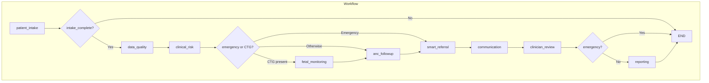
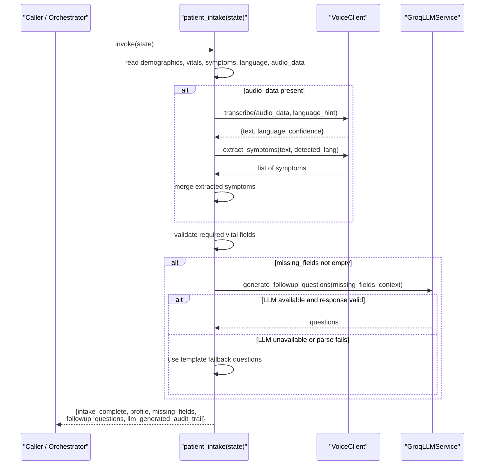
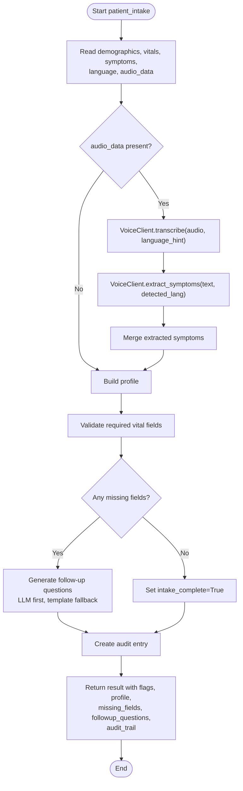
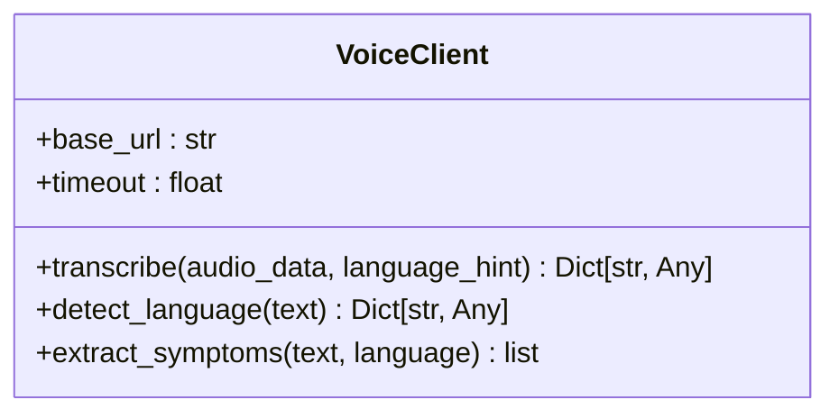
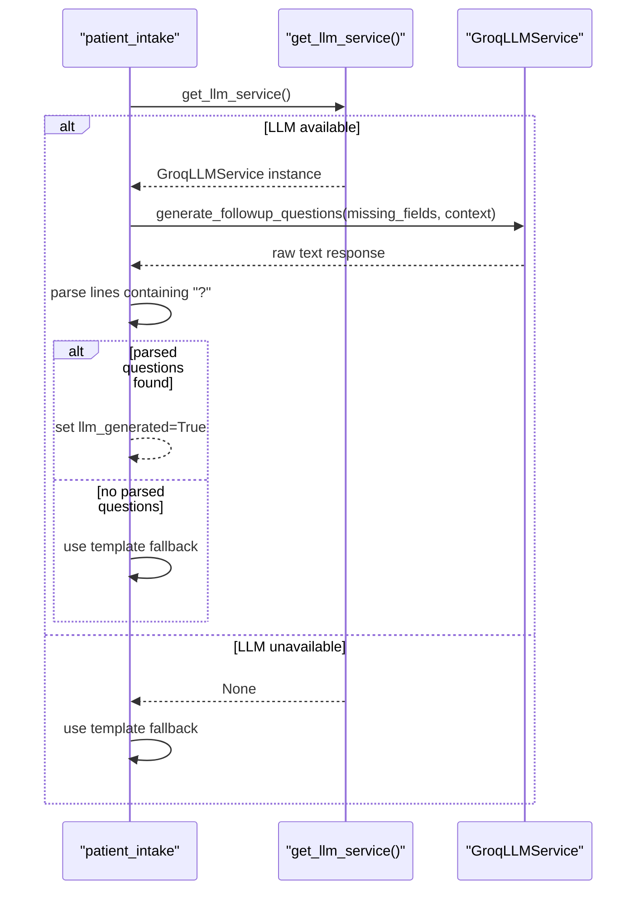
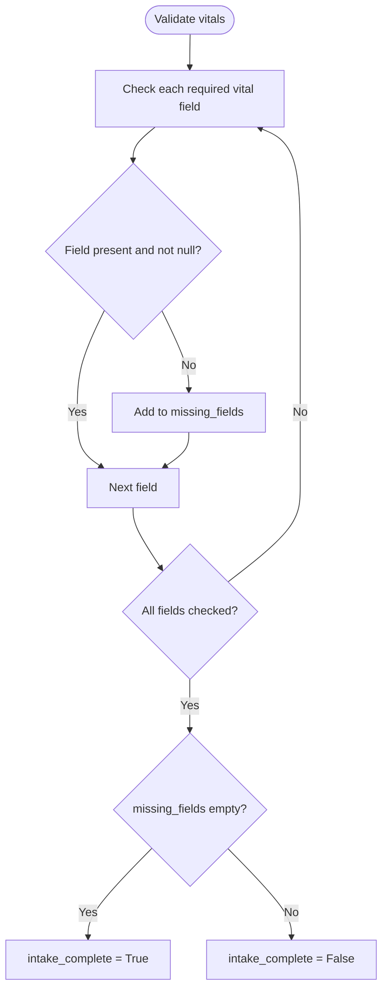
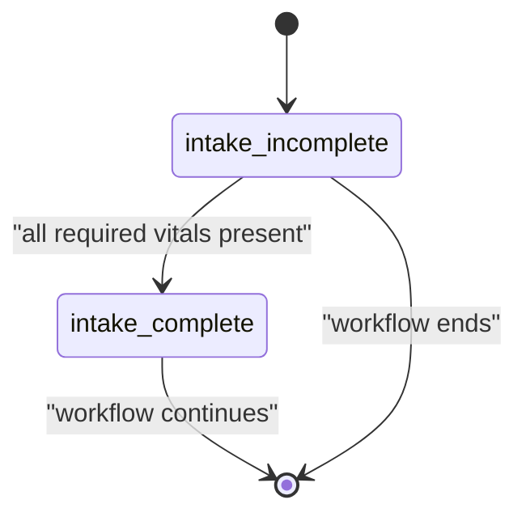
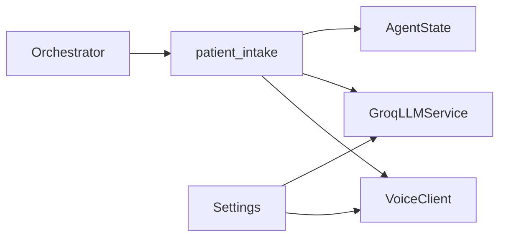

# Patient Intake Node

<cite>
**Referenced Files in This Document**
- [patient_intake.py](file://backend/agents/nodes/patient_intake.py)
- [voice_client.py](file://backend/integrations/voice_client.py)
- [llm.py](file://backend/services/llm.py)
- [state.py](file://backend/schemas/state.py)
- [orchestrator.py](file://backend/agents/orchestrator.py)
- [config.py](file://backend/config.py)
- [test_orchestrator.py](file://backend/tests/test_orchestrator.py)
</cite>

## Table of Contents
1. [Introduction](#introduction)
2. [Project Structure](#project-structure)
3. [Core Components](#core-components)
4. [Architecture Overview](#architecture-overview)
5. [Detailed Component Analysis](#detailed-component-analysis)
6. [Dependency Analysis](#dependency-analysis)
7. [Performance Considerations](#performance-considerations)
8. [Troubleshooting Guide](#troubleshooting-guide)
9. [Conclusion](#conclusion)
10. [Appendices](#appendices)

## Introduction
This document provides comprehensive documentation for the Patient Intake Node, which collects and validates demographic data, processes vital signs, extracts symptoms (including from voice input), and generates intelligent follow-up questions when required fields are missing. It explains the async function signature, input state requirements, voice transcription workflow via VoiceClient integration, LLM-powered question generation with robust fallbacks, validation logic for required vital fields, state transitions, error handling patterns, and audit trail generation. It also documents the integration with the Groq LLM service and how the system gracefully degrades when LLM services are unavailable.

## Project Structure
The Patient Intake Node is part of a LangGraph-based agent workflow that orchestrates multiple specialized nodes. The intake node is the entry point and determines whether the workflow proceeds to downstream processing or terminates early if intake is incomplete.

**Diagram sources**
- [orchestrator.py:62-138](file://backend/agents/orchestrator.py#L62-L138)

**Section sources**
- [orchestrator.py:62-138](file://backend/agents/orchestrator.py#L62-L138)

## Core Components
- Patient Intake Node: Async function that gathers demographics, vitals, symptoms, optional audio_data; performs voice transcription and symptom extraction; validates required vital fields; generates follow-up questions; returns structured results and audit entries.
- Voice Client: Provides speech-to-text transcription and symptom extraction from text.
- LLM Service: Integrates with Groq to generate culturally sensitive follow-up questions; includes guarded import and fallback behavior.
- State Schema: Defines shared AgentState used across all nodes, including intake-related fields and append-only logs.
- Orchestrator: Wires the workflow graph, sets entry point, and routes based on intake completeness and clinical signals.

**Section sources**
- [patient_intake.py:58-168](file://backend/agents/nodes/patient_intake.py#L58-L168)
- [voice_client.py:7-48](file://backend/integrations/voice_client.py#L7-L48)
- [llm.py:31-144](file://backend/services/llm.py#L31-L144)
- [state.py:7-43](file://backend/schemas/state.py#L7-L43)
- [orchestrator.py:22-26](file://backend/agents/orchestrator.py#L22-L26)

## Architecture Overview
The intake node sits at the start of the workflow. It reads the current AgentState, optionally transcribes audio into text, extracts symptoms, validates required vital fields, and decides whether intake is complete. If incomplete, it generates follow-up questions (LLM-first with template fallback) and returns control to the caller or ends the workflow depending on orchestration routing.

**Diagram sources**
- [patient_intake.py:58-168](file://backend/agents/nodes/patient_intake.py#L58-L168)
- [voice_client.py:14-48](file://backend/integrations/voice_client.py#L14-L48)
- [llm.py:78-89](file://backend/services/llm.py#L78-L89)
- [llm.py:129-144](file://backend/services/llm.py#L129-L144)

## Detailed Component Analysis

### Patient Intake Node
- Function signature: async patient_intake(state: AgentState) -> dict
- Input state requirements:
  - demographics: dict (e.g., age, gestational_age, parity)
  - vitals: dict (must include required fields for completion)
  - symptoms: list (structured symptom objects)
  - language: string (default "ur")
  - channel: string (e.g., "app", "voice")
  - audio_data: bytes (optional; triggers voice transcription and symptom extraction)
  - patient_id: string (for context)
- Processing steps:
  - Reads demographics, vitals, symptoms, language, and optional audio_data from state.
  - If audio_data is present, calls VoiceClient.transcribe and VoiceClient.extract_symptoms, merging extracted symptoms into the existing list.
  - Builds a structured profile containing patient_id, language, channel, demographics, vitals, symptoms, and optional voice_transcript.
  - Validates required vital fields: systolic_bp, diastolic_bp, heart_rate, temperature_celsius, gestational_age_weeks. Missing or null values mark intake as incomplete.
  - Generates follow-up questions using LLM if missing fields exist; otherwise uses template fallback.
  - Returns result with intake_complete flag, updated vitals/symptoms/demographics, current_step, audit_trail, profile, missing_fields, followup_questions, and llm_generated flag.
  - On exceptions, returns an error payload with errors and audit_trail entries.

**Diagram sources**
- [patient_intake.py:58-168](file://backend/agents/nodes/patient_intake.py#L58-L168)

**Section sources**
- [patient_intake.py:58-168](file://backend/agents/nodes/patient_intake.py#L58-L168)

### Voice Client Integration
- Purpose: Convert audio to text and detect language; extract structured symptoms from free-form text.
- Methods:
  - transcribe(audio_data, language_hint): Returns text, detected language, confidence, and optionally symptoms_extracted.
  - detect_language(text): Returns language and script metadata.
  - extract_symptoms(text, language): Returns a list of structured symptoms with name, severity, and source.
- Behavior: Currently implemented as stubs returning mock data; can be replaced with real STT endpoints later.

**Diagram sources**
- [voice_client.py:7-48](file://backend/integrations/voice_client.py#L7-L48)

**Section sources**
- [voice_client.py:7-48](file://backend/integrations/voice_client.py#L7-L48)

### LLM-Powered Follow-Up Question Generation
- Integration: Uses GroqLLMService to generate culturally sensitive follow-up questions for missing fields.
- Guarded availability: get_llm_service() returns None if the Groq package is unavailable or initialization fails; callers must treat None as “LLM unavailable.”
- Fallback mechanism: If LLM is unavailable or parsing fails, the intake node falls back to simple template questions constructed from missing field names.
- Execution model: Calls are run in a worker thread via asyncio.to_thread to avoid blocking the event loop.

**Diagram sources**
- [patient_intake.py:14-55](file://backend/agents/nodes/patient_intake.py#L14-L55)
- [llm.py:129-144](file://backend/services/llm.py#L129-L144)
- [llm.py:78-89](file://backend/services/llm.py#L78-L89)

**Section sources**
- [patient_intake.py:14-55](file://backend/agents/nodes/patient_intake.py#L14-L55)
- [llm.py:20-28](file://backend/services/llm.py#L20-L28)
- [llm.py:78-89](file://backend/services/llm.py#L78-L89)
- [llm.py:129-144](file://backend/services/llm.py#L129-L144)

### Data Validation Logic for Required Vital Fields
- Required fields: systolic_bp, diastolic_bp, heart_rate, temperature_celsius, gestational_age_weeks.
- Validation rule: Any missing or null value marks intake as incomplete.
- Outcome: Sets intake_complete accordingly and populates missing_fields for downstream handling.

**Diagram sources**
- [patient_intake.py:99-108](file://backend/agents/nodes/patient_intake.py#L99-L108)

**Section sources**
- [patient_intake.py:99-108](file://backend/agents/nodes/patient_intake.py#L99-L108)

### State Transitions and Orchestration Routing
- Entry point: patient_intake is the first node in the workflow.
- Routing after intake:
  - If intake_complete is False, the workflow ends immediately (no further processing).
  - If intake_complete is True, the workflow proceeds to data_quality and subsequent nodes.
- Tests demonstrate expected behaviors for normal, emergency, and incomplete intake scenarios.

**Diagram sources**
- [orchestrator.py:22-26](file://backend/agents/orchestrator.py#L22-L26)
- [test_orchestrator.py:114-135](file://backend/tests/test_orchestrator.py#L114-L135)

**Section sources**
- [orchestrator.py:22-26](file://backend/agents/orchestrator.py#L22-L26)
- [test_orchestrator.py:52-80](file://backend/tests/test_orchestrator.py#L52-L80)
- [test_orchestrator.py:114-135](file://backend/tests/test_orchestrator.py#L114-L135)

### Error Handling Patterns
- Exception path: If any exception occurs during intake processing, the node returns a structured error payload including errors and audit_trail entries, ensuring the workflow remains resilient.
- LLM failure handling: If LLM generation fails or returns empty content, the node logs a warning and falls back to template questions without crashing.
- Voice client stubs: Current implementation returns deterministic mock responses; future replacements should maintain similar contracts and error handling.

**Section sources**
- [patient_intake.py:151-168](file://backend/agents/nodes/patient_intake.py#L151-L168)
- [patient_intake.py:29-55](file://backend/agents/nodes/patient_intake.py#L29-L55)
- [llm.py:48-65](file://backend/services/llm.py#L48-L65)

### Audit Trail Generation
- Successful intake: Creates an audit entry with agent name, timestamp, action ("patient_data_collection"), and result summary indicating counts of vitals, symptoms, and missing fields.
- Errors: Creates an audit entry with agent name, timestamp, action ("patient_intake_error"), and result summary describing the error.
- Append-only log: The AgentState schema defines audit_trail as an annotated list with operator.add semantics, enabling accumulation across nodes.

**Section sources**
- [patient_intake.py:125-149](file://backend/agents/nodes/patient_intake.py#L125-L149)
- [patient_intake.py:151-168](file://backend/agents/nodes/patient_intake.py#L151-L168)
- [state.py:39-43](file://backend/schemas/state.py#L39-L43)

## Dependency Analysis
- Internal dependencies:
  - patient_intake depends on VoiceClient for transcription and symptom extraction.
  - patient_intake optionally depends on GroqLLMService for follow-up question generation.
  - All nodes share AgentState for consistent data flow and logging.
- External dependencies:
  - Groq API for LLM generation (guarded import; optional).
  - Voice API endpoint configured via settings (currently stubbed).

**Diagram sources**
- [patient_intake.py:58-168](file://backend/agents/nodes/patient_intake.py#L58-L168)
- [voice_client.py:7-48](file://backend/integrations/voice_client.py#L7-L48)
- [llm.py:31-144](file://backend/services/llm.py#L31-L144)
- [state.py:7-43](file://backend/schemas/state.py#L7-L43)
- [orchestrator.py:62-138](file://backend/agents/orchestrator.py#L62-L138)
- [config.py:7-55](file://backend/config.py#L7-L55)

**Section sources**
- [config.py:31-42](file://backend/config.py#L31-L42)
- [llm.py:20-28](file://backend/services/llm.py#L20-L28)
- [voice_client.py:10-12](file://backend/integrations/voice_client.py#L10-L12)

## Performance Considerations
- Non-blocking LLM calls: LLM requests are executed in a worker thread to prevent blocking the async event loop.
- Short timeouts: VoiceClient defaults to a short timeout to keep responsiveness high.
- Minimal token budgets: LLM prompts use constrained max_tokens to reduce latency and cost.
- Stub implementations: Current voice transcription is mocked; replacing with real STT may introduce network latency and should be monitored.

[No sources needed since this section provides general guidance]

## Troubleshooting Guide
- Intake remains incomplete:
  - Ensure all required vital fields are present and non-null: systolic_bp, diastolic_bp, heart_rate, temperature_celsius, gestational_age_weeks.
  - Verify that audio transcription and symptom extraction are functioning if audio_data is provided.
- No follow-up questions generated:
  - Check LLM availability via get_llm_service(); if None, template fallback will be used.
  - Confirm that LLM response parsing finds lines containing question marks; otherwise fallback applies.
- Workflow ends prematurely:
  - If intake_complete is False, the orchestrator routes to END; provide complete vitals to proceed.
- Audit trail missing entries:
  - Confirm that the node completes successfully; errors produce separate audit entries.

**Section sources**
- [patient_intake.py:99-108](file://backend/agents/nodes/patient_intake.py#L99-L108)
- [patient_intake.py:125-168](file://backend/agents/nodes/patient_intake.py#L125-L168)
- [orchestrator.py:22-26](file://backend/agents/orchestrator.py#L22-L26)

## Conclusion
The Patient Intake Node is a resilient, asynchronous component that collects and validates essential patient data, integrates voice transcription and symptom extraction, and generates intelligent follow-up questions with robust fallbacks. It ensures the workflow only proceeds when intake is complete, maintains detailed audit trails, and gracefully handles LLM unavailability. Its design supports extensibility for real voice APIs and advanced LLM capabilities while preserving reliability and performance.

[No sources needed since this section summarizes without analyzing specific files]

## Appendices

### Input State Requirements Summary
- demographics: dict
- vitals: dict (required fields: systolic_bp, diastolic_bp, heart_rate, temperature_celsius, gestational_age_weeks)
- symptoms: list
- language: string (default "ur")
- channel: string (e.g., "app", "voice")
- audio_data: bytes (optional)
- patient_id: string

**Section sources**
- [state.py:7-43](file://backend/schemas/state.py#L7-L43)
- [patient_intake.py:67-74](file://backend/agents/nodes/patient_intake.py#L67-L74)

### Example Scenarios
- Normal intake: Provide all required vitals; workflow proceeds through data_quality, clinical_risk, and reporting.
- Emergency intake: Dangerous vitals trigger smart_referral and communication; intake still must be complete to enter downstream nodes.
- Incomplete intake: Missing required vitals cause immediate termination after patient_intake; follow-up questions guide collection.

**Section sources**
- [test_orchestrator.py:52-80](file://backend/tests/test_orchestrator.py#L52-L80)
- [test_orchestrator.py:83-113](file://backend/tests/test_orchestrator.py#L83-L113)
- [test_orchestrator.py:114-135](file://backend/tests/test_orchestrator.py#L114-L135)