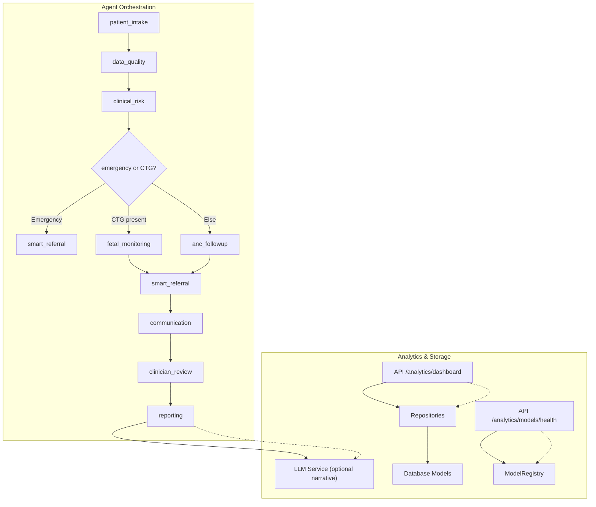
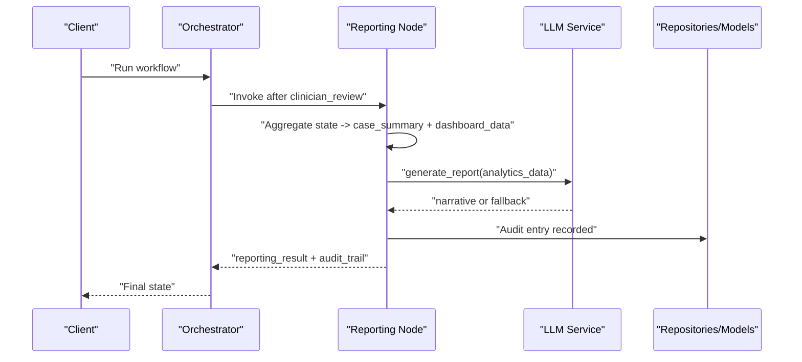
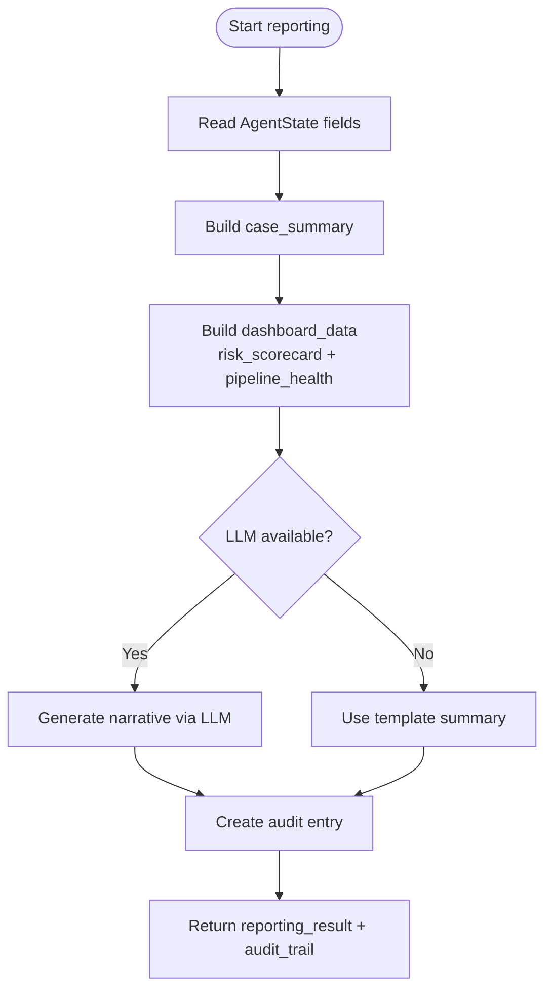
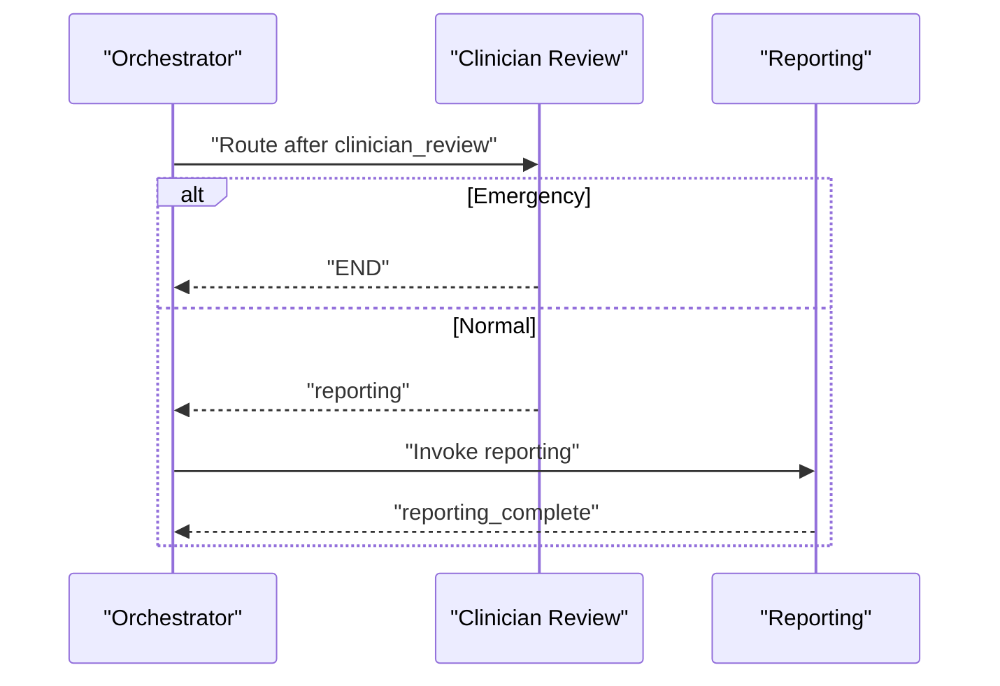
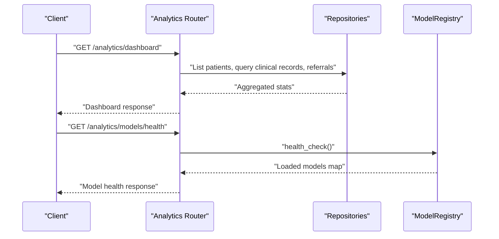
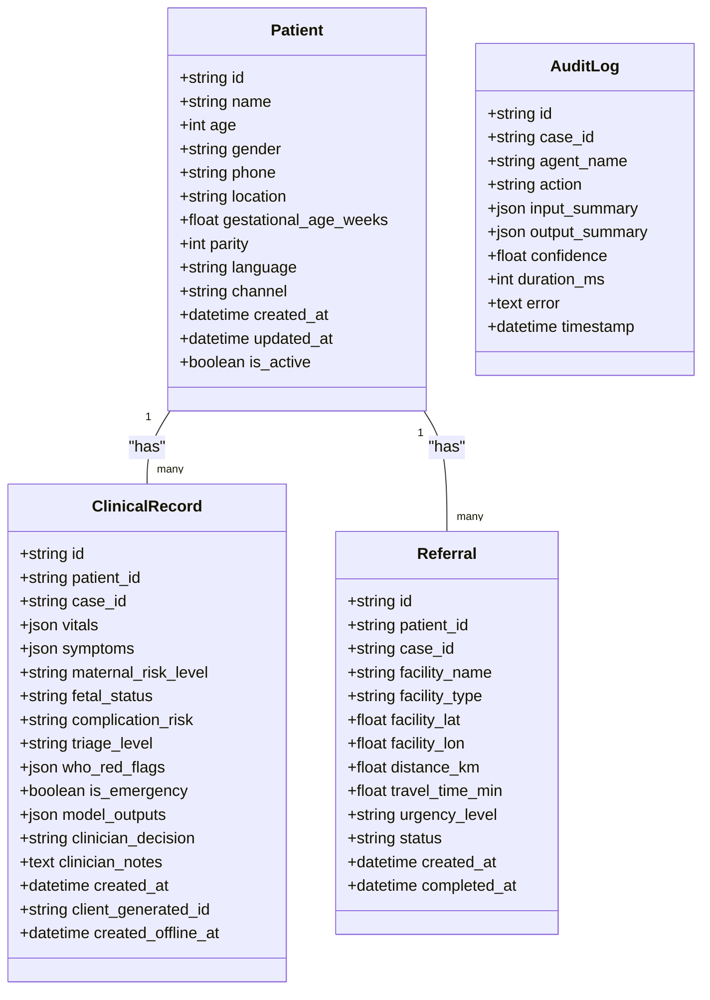
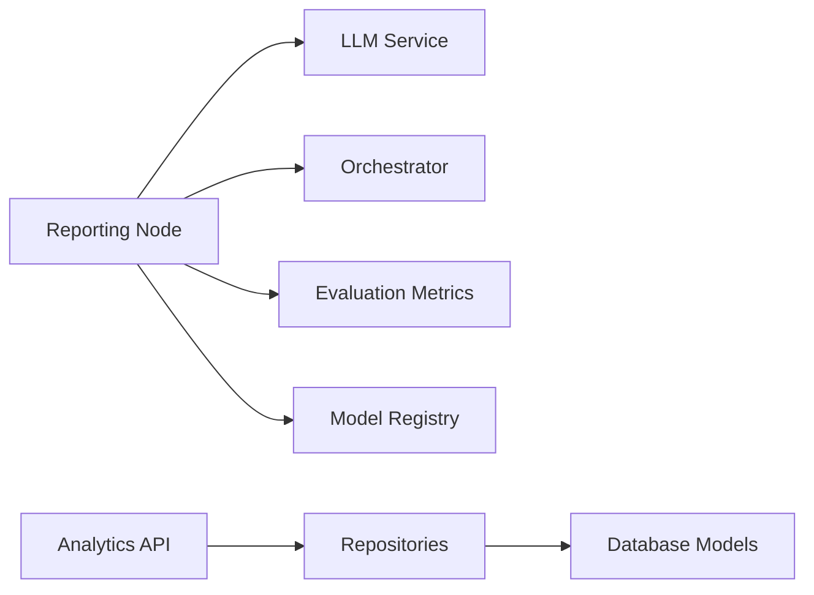

# Reporting Node

<cite>
**Referenced Files in This Document**
- [reporting.py](file://backend/agents/nodes/reporting.py)
- [orchestrator.py](file://backend/agents/orchestrator.py)
- [analytics.py](file://backend/api/routes/analytics.py)
- [inference.py](file://backend/services/inference.py)
- [metrics.py](file://src/evaluation/metrics.py)
- [models.py](file://backend/db/models.py)
- [repositories.py](file://backend/db/repositories.py)
- [llm.py](file://backend/services/llm.py)
- [audit.py](file://backend/api/routes/audit.py)
</cite>

## Table of Contents
1. [Introduction](#introduction)
2. [Project Structure](#project-structure)
3. [Core Components](#core-components)
4. [Architecture Overview](#architecture-overview)
5. [Detailed Component Analysis](#detailed-component-analysis)
6. [Dependency Analysis](#dependency-analysis)
7. [Performance Considerations](#performance-considerations)
8. [Troubleshooting Guide](#troubleshooting-guide)
9. [Conclusion](#conclusion)
10. [Appendices](#appendices)

## Introduction
This document explains the Reporting Node that aggregates multi-agent workflow results into analytics-ready payloads, supports dashboards and trend analysis, and integrates with model health checks and evaluation metrics. It covers data aggregation processes, metric calculations, report generation workflows, integration points with analytics databases, visualization tools, and export formats. It also addresses performance monitoring, model accuracy tracking, operational dashboards, and how the node supports system monitoring, quality assurance, and regulatory reporting needs for healthcare applications.

## Project Structure
The Reporting Node is part of a LangGraph-based agent orchestration pipeline. The orchestrator routes cases through intake, data quality, clinical risk, fetal monitoring, ANC follow-up, referral, communication, clinician review, and finally reporting. The Reporting Node consumes state from upstream nodes to build structured case summaries and dashboard data, optionally generates narrative reports via an LLM service, and emits audit entries. Analytics endpoints expose aggregated statistics and model health information for dashboards. Evaluation utilities provide visualization and comparison outputs for model accuracy tracking.

**Diagram sources**
- [orchestrator.py:62-133](file://backend/agents/orchestrator.py#L62-L133)
- [reporting.py:13-173](file://backend/agents/nodes/reporting.py#L13-L173)
- [analytics.py:21-101](file://backend/api/routes/analytics.py#L21-L101)
- [inference.py:51-141](file://backend/services/inference.py#L51-L141)
- [models.py:11-115](file://backend/db/models.py#L11-L115)

**Section sources**
- [orchestrator.py:1-167](file://backend/agents/orchestrator.py#L1-L167)
- [reporting.py:1-217](file://backend/agents/nodes/reporting.py#L1-L217)
- [analytics.py:1-102](file://backend/api/routes/analytics.py#L1-L102)
- [models.py:1-115](file://backend/db/models.py#L1-L115)

## Core Components
- Reporting Node: Aggregates upstream agent results into a structured case summary and dashboard payload; optionally generates narrative text via LLM; records audit entries.
- Orchestrator: Defines the workflow graph and conditional routing that includes the Reporting Node as the final step for non-emergency flows.
- Analytics API: Provides dashboard statistics and model health endpoints for operational dashboards.
- Model Registry: Loads and caches ML models; exposes health status used by analytics endpoints.
- Evaluation Metrics: Generates confusion matrices, ROC curves, calibration plots, classification reports, SHAP summaries, and model comparison tables for accuracy tracking.
- Data Layer: SQLAlchemy models and repositories persist patient, clinical, referral, audit, model version, and file records.

**Section sources**
- [reporting.py:13-173](file://backend/agents/nodes/reporting.py#L13-L173)
- [orchestrator.py:62-133](file://backend/agents/orchestrator.py#L62-L133)
- [analytics.py:21-101](file://backend/api/routes/analytics.py#L21-L101)
- [inference.py:51-141](file://backend/services/inference.py#L51-L141)
- [metrics.py:49-465](file://src/evaluation/metrics.py#L49-L465)
- [models.py:11-115](file://backend/db/models.py#L11-L115)
- [repositories.py:9-125](file://backend/db/repositories.py#L9-L125)

## Architecture Overview
The Reporting Node sits at the end of the agent workflow. It reads the current AgentState, builds two primary structures:
- Case Summary: Patient profile, risk assessments, referral details, communication outcomes, clinician review status, data quality metrics, and error counts.
- Dashboard Data: Numeric risk scorecard, vitals snapshot, and pipeline health indicators derived from audit trail and errors.

Optionally, it calls the LLM service to generate a narrative report based on the structured data. Errors are captured and returned alongside audit entries.

**Diagram sources**
- [orchestrator.py:126-133](file://backend/agents/orchestrator.py#L126-L133)
- [reporting.py:133-173](file://backend/agents/nodes/reporting.py#L133-L173)
- [llm.py:112-119](file://backend/services/llm.py#L112-L119)

**Section sources**
- [reporting.py:13-173](file://backend/agents/nodes/reporting.py#L13-L173)
- [llm.py:1-144](file://backend/services/llm.py#L1-L144)
- [orchestrator.py:126-133](file://backend/agents/orchestrator.py#L126-L133)

## Detailed Component Analysis

### Reporting Node
Responsibilities:
- Aggregate upstream results into a comprehensive case summary and dashboard payload.
- Convert categorical risk levels and statuses to numeric scores for dashboards.
- Optionally generate narrative reports using the LLM service; fall back to template if unavailable.
- Record audit entries and handle errors gracefully.

Key behaviors:
- Reads patient demographics, vitals, symptoms, and results from clinical risk, fetal monitoring, ANC follow-up, referral, communication, clinician review, and data quality nodes.
- Builds a risk scorecard mapping maternal, gestational, fetal, preterm, ANC missed visit risk, and data quality to numeric values.
- Captures pipeline health metrics including agents executed, total audit entries, total errors, and emergency escalation flag.
- Emits a reporting result containing case summary, dashboard data, optional narrative, and metadata.

**Diagram sources**
- [reporting.py:22-124](file://backend/agents/nodes/reporting.py#L22-L124)
- [reporting.py:132-173](file://backend/agents/nodes/reporting.py#L132-L173)

**Section sources**
- [reporting.py:13-173](file://backend/agents/nodes/reporting.py#L13-L173)
- [reporting.py:193-217](file://backend/agents/nodes/reporting.py#L193-L217)

### Orchestrator Integration
The orchestrator wires the Reporting Node as the terminal step for normal flows. Conditional routing ensures that emergencies may skip reporting to prioritize speed, while standard cases proceed to reporting after clinician review.

**Diagram sources**
- [orchestrator.py:51-56](file://backend/agents/orchestrator.py#L51-L56)
- [orchestrator.py:126-133](file://backend/agents/orchestrator.py#L126-L133)

**Section sources**
- [orchestrator.py:51-56](file://backend/agents/orchestrator.py#L51-L56)
- [orchestrator.py:126-133](file://backend/agents/orchestrator.py#L126-L133)

### Analytics API Endpoints
- Dashboard endpoint returns summary statistics: total patients, risk distribution, referral stats, and recent cases count. It queries repositories and aggregates clinical records to compute risk buckets.
- Model health endpoint returns which models are loaded and overall health status via the ModelRegistry.

**Diagram sources**
- [analytics.py:21-78](file://backend/api/routes/analytics.py#L21-L78)
- [analytics.py:81-101](file://backend/api/routes/analytics.py#L81-L101)
- [inference.py:135-141](file://backend/services/inference.py#L135-L141)

**Section sources**
- [analytics.py:21-101](file://backend/api/routes/analytics.py#L21-L101)
- [inference.py:135-141](file://backend/services/inference.py#L135-L141)

### Model Accuracy Tracking and Visualization
Evaluation utilities support model accuracy tracking and visualization:
- Confusion matrix plotting with normalized heatmaps and raw counts overlay.
- ROC curves for multiclass one-vs-rest with macro-average AUC.
- Feature importance bar charts for tree-based models.
- Calibration curves to assess probability reliability per class.
- Classification reports with per-class precision, recall, F1, and support.
- SHAP summary plots for interpretability.
- Model comparison tables with macro-F1, weighted-F1, AUROC, and per-class recall, optionally saved as CSV.

These outputs enable ongoing model performance monitoring and quality assurance.

**Section sources**
- [metrics.py:49-111](file://src/evaluation/metrics.py#L49-L111)
- [metrics.py:118-182](file://src/evaluation/metrics.py#L118-L182)
- [metrics.py:189-231](file://src/evaluation/metrics.py#L189-L231)
- [metrics.py:238-285](file://src/evaluation/metrics.py#L238-L285)
- [metrics.py:292-341](file://src/evaluation/metrics.py#L292-L341)
- [metrics.py:348-403](file://src/evaluation/metrics.py#L348-L403)
- [metrics.py:409-465](file://src/evaluation/metrics.py#L409-L465)

### Data Layer and Audit Trail
Data persistence and auditability are supported by:
- Database models for patients, clinical records, referrals, agent states, audit logs, model versions, and files.
- Repositories providing CRUD operations and queries for dashboard aggregation and audit retrieval.
- Audit log routes enabling admin access to system audit trails with filtering by agent name, patient ID, and date ranges.

**Diagram sources**
- [models.py:11-115](file://backend/db/models.py#L11-L115)

**Section sources**
- [models.py:11-115](file://backend/db/models.py#L11-L115)
- [repositories.py:9-125](file://backend/db/repositories.py#L9-L125)
- [audit.py:21-32](file://backend/api/routes/audit.py#L21-L32)

## Dependency Analysis
The Reporting Node depends on:
- AgentState fields populated by upstream nodes (clinical risk, fetal monitoring, ANC follow-up, referral, communication, clinician review, data quality).
- Optional LLM service for narrative generation; falls back to template if unavailable.
- Orchestrator routing to include reporting in normal flows.
- Analytics API for dashboard and model health endpoints.
- Evaluation metrics for model accuracy tracking and visualization.
- Data layer for persistence and auditability.

**Diagram sources**
- [reporting.py:133-173](file://backend/agents/nodes/reporting.py#L133-L173)
- [orchestrator.py:126-133](file://backend/agents/orchestrator.py#L126-L133)
- [analytics.py:21-101](file://backend/api/routes/analytics.py#L21-L101)
- [repositories.py:9-125](file://backend/db/repositories.py#L9-L125)
- [models.py:11-115](file://backend/db/models.py#L11-L115)
- [metrics.py:49-465](file://src/evaluation/metrics.py#L49-L465)
- [inference.py:51-141](file://backend/services/inference.py#L51-L141)

**Section sources**
- [reporting.py:13-173](file://backend/agents/nodes/reporting.py#L13-L173)
- [analytics.py:21-101](file://backend/api/routes/analytics.py#L21-L101)
- [repositories.py:9-125](file://backend/db/repositories.py#L9-L125)
- [models.py:11-115](file://backend/db/models.py#L11-L115)
- [metrics.py:49-465](file://src/evaluation/metrics.py#L49-L465)
- [inference.py:51-141](file://backend/services/inference.py#L51-L141)

## Performance Considerations
- Asynchronous execution: The Reporting Node runs within an async workflow; LLM calls are offloaded to a worker thread to avoid blocking the event loop.
- Dashboard aggregation limits: The dashboard endpoint caps patient iteration to avoid N+1 query slowdowns during MVP.
- Model loading: The ModelRegistry loads models once at startup and caches them; health checks quickly indicate availability.
- Error resilience: Graceful degradation when LLM is unavailable or tables are empty; fallback templates ensure reporting continuity.

[No sources needed since this section provides general guidance]

## Troubleshooting Guide
Common issues and mitigations:
- LLM unavailability: If the Groq package is missing or network fails, the Reporting Node falls back to template narratives and sets llm_generated=False. Check logs for warnings about LLM initialization failures.
- Empty or missing tables: Dashboard endpoint handles exceptions when referral tables are empty and continues with partial stats.
- Low model confidence: Data quality node flags low-confidence predictions; reporting includes data quality metrics and warning counts.
- Audit visibility: Admins can retrieve audit logs filtered by agent name, patient ID, and date range to investigate issues.

**Section sources**
- [llm.py:20-28](file://backend/services/llm.py#L20-L28)
- [llm.py:129-143](file://backend/services/llm.py#L129-L143)
- [analytics.py:57-65](file://backend/api/routes/analytics.py#L57-L65)
- [audit.py:21-32](file://backend/api/routes/audit.py#L21-L32)

## Conclusion
The Reporting Node centralizes analytics and reporting across the multi-agent workflow, producing structured case summaries and dashboard data, optionally enriched with LLM-generated narratives. It integrates with analytics endpoints for operational dashboards and model health checks, supports model accuracy tracking via evaluation metrics, and maintains robust audit trails for system monitoring and regulatory compliance. Its design emphasizes resilience, performance, and clarity for both technical and non-technical stakeholders.

[No sources needed since this section summarizes without analyzing specific files]

## Appendices

### Export Formats and Visualization Outputs
- Evaluation metrics produce visualizations (confusion matrices, ROC curves, calibration plots, feature importance, SHAP summaries) and tabular outputs (classification reports, model comparison tables). Comparison tables can be saved as CSV for further analysis.

**Section sources**
- [metrics.py:49-111](file://src/evaluation/metrics.py#L49-L111)
- [metrics.py:118-182](file://src/evaluation/metrics.py#L118-L182)
- [metrics.py:189-231](file://src/evaluation/metrics.py#L189-L231)
- [metrics.py:238-285](file://src/evaluation/metrics.py#L238-L285)
- [metrics.py:292-341](file://src/evaluation/metrics.py#L292-L341)
- [metrics.py:348-403](file://src/evaluation/metrics.py#L348-L403)
- [metrics.py:409-465](file://src/evaluation/metrics.py#L409-L465)

### Healthcare Regulatory Reporting Support
- Audit logs capture agent actions, inputs, outputs, confidence, duration, and errors with timestamps, supporting traceability and compliance requirements.
- Model versioning persists metrics and features, enabling accountability for model changes and performance over time.

**Section sources**
- [models.py:81-104](file://backend/db/models.py#L81-L104)
- [repositories.py:66-110](file://backend/db/repositories.py#L66-L110)
- [audit.py:21-32](file://backend/api/routes/audit.py#L21-L32)