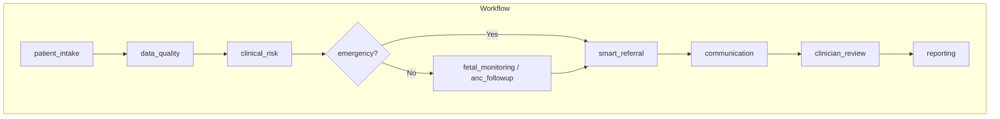
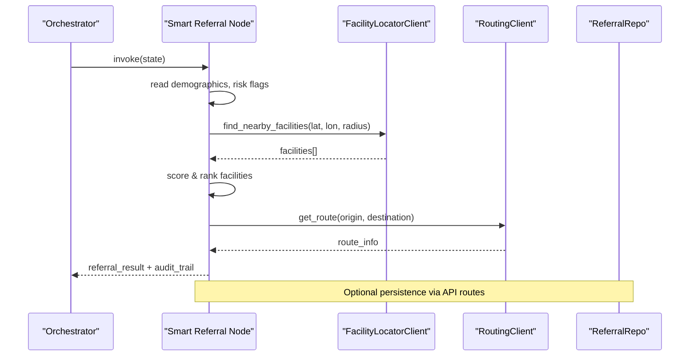
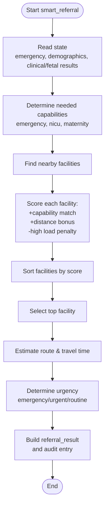
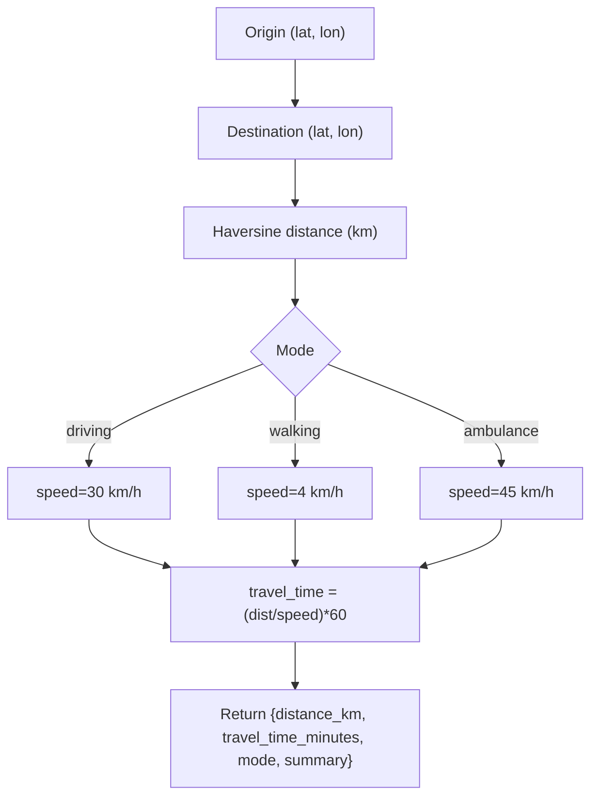
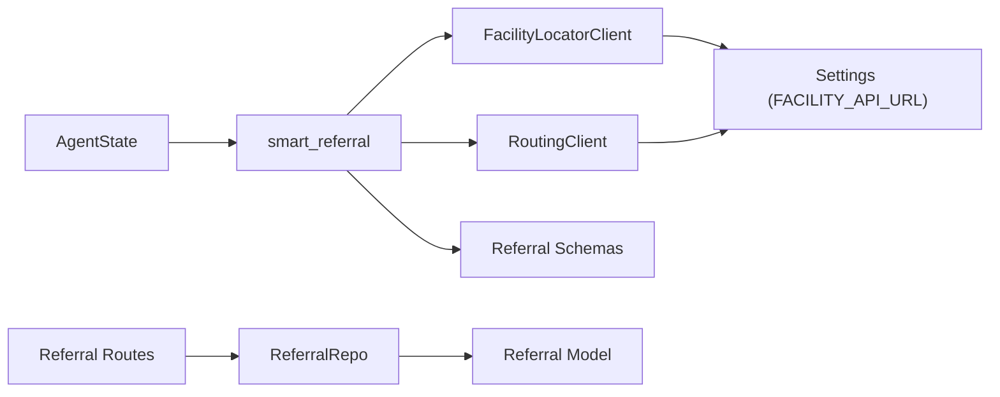

# Smart Referral Node

<cite>
**Referenced Files in This Document**
- [smart_referral.py](file://backend/agents/nodes/smart_referral.py)
- [facility_locator.py](file://backend/integrations/facility_locator.py)
- [routing_client.py](file://backend/integrations/routing_client.py)
- [referral.py](file://backend/schemas/referral.py)
- [referrals.py](file://backend/api/routes/referrals.py)
- [orchestrator.py](file://backend/agents/orchestrator.py)
- [state.py](file://backend/schemas/state.py)
- [models.py](file://backend/db/models.py)
- [repositories.py](file://backend/db/repositories.py)
- [config.py](file://backend/config.py)
</cite>

## Table of Contents
1. [Introduction](#introduction)
2. [Project Structure](#project-structure)
3. [Core Components](#core-components)
4. [Architecture Overview](#architecture-overview)
5. [Detailed Component Analysis](#detailed-component-analysis)
6. [Dependency Analysis](#dependency-analysis)
7. [Performance Considerations](#performance-considerations)
8. [Troubleshooting Guide](#troubleshooting-guide)
9. [Conclusion](#conclusion)
10. [Appendices](#appendices)

## Introduction
This document explains the Smart Referral Node, which automatically determines appropriate healthcare facility recommendations based on patient needs and location. It covers:
- Facility matching algorithm (capability scoring and distance weighting)
- Distance calculations and travel time estimation
- Urgency-based routing decisions
- Capacity considerations (current load)
- Integration with facility locator services (Overpass API), OpenRouteService for travel time estimation, and internal state management
- Examples of referral criteria, facility selection logic, and multi-modal transportation options
- Handling rural healthcare challenges and optimal referral pathways

## Project Structure
The Smart Referral Node is part of a LangGraph-based workflow that orchestrates multiple agents. The node integrates with external services to locate facilities and estimate routes, then produces a ranked list and selected facility for referral.

**Diagram sources**
- [orchestrator.py:22-55](file://backend/agents/orchestrator.py#L22-L55)
- [orchestrator.py:62-132](file://backend/agents/orchestrator.py#L62-L132)

**Section sources**
- [orchestrator.py:1-167](file://backend/agents/orchestrator.py#L1-L167)

## Core Components
- Smart Referral Node: Reads patient demographics and risk signals, finds nearby facilities, ranks them by capability match and distance, estimates travel time, and outputs urgency and selected facility.
- Facility Locator Client: Provides nearby facilities (stubbed; configured to use Overpass API URL).
- Routing Client: Estimates travel time and route information using haversine distance and mode-specific speeds (stubbed; configured to use OpenRouteService URL).
- Schemas: Define data contracts for facilities and referrals.
- API Routes: Expose endpoints to create, list, retrieve, and update referrals.
- Database Models and Repositories: Persist referrals and related records.

**Section sources**
- [smart_referral.py:11-136](file://backend/agents/nodes/smart_referral.py#L11-L136)
- [facility_locator.py:7-69](file://backend/integrations/facility_locator.py#L7-L69)
- [routing_client.py:8-71](file://backend/integrations/routing_client.py#L8-L71)
- [referral.py:7-28](file://backend/schemas/referral.py#L7-L28)
- [referrals.py:21-126](file://backend/api/routes/referrals.py#L21-L126)
- [models.py:52-68](file://backend/db/models.py#L52-L68)
- [repositories.py:49-65](file://backend/db/repositories.py#L49-L65)

## Architecture Overview
The Smart Referral Node sits within the agent workflow and coordinates with two integration clients:
- FacilityLocatorClient: Returns candidate facilities near the patient’s location.
- RoutingClient: Computes travel time and route details for the top-ranked facility.

**Diagram sources**
- [smart_referral.py:11-118](file://backend/agents/nodes/smart_referral.py#L11-L118)
- [facility_locator.py:14-60](file://backend/integrations/facility_locator.py#L14-L60)
- [routing_client.py:16-59](file://backend/integrations/routing_client.py#L16-L59)
- [referrals.py:60-126](file://backend/api/routes/referrals.py#L60-L126)

## Detailed Component Analysis

### Smart Referral Node
Responsibilities:
- Extracts emergency flag, demographics, and clinical/fetal results from shared state.
- Determines required capabilities (emergency, NICU, maternity).
- Finds nearby facilities and ranks them by capability match and distance.
- Estimates travel time for the top facility.
- Determines urgency level (emergency, urgent, routine).
- Produces a structured referral result and audit trail.

Key behaviors:
- Capability scoring adds points for matching needs (e.g., emergency/NICU) and maternity support.
- Distance contributes positively to score; lower distance yields higher score.
- High current load penalizes ranking slightly to avoid overloading busy facilities.
- Urgency derived from emergency flag or maternal risk level.

**Diagram sources**
- [smart_referral.py:20-118](file://backend/agents/nodes/smart_referral.py#L20-L118)

**Section sources**
- [smart_referral.py:11-136](file://backend/agents/nodes/smart_referral.py#L11-L136)

### Facility Matching Algorithm
- Inputs: Patient lat/lon, emergency flag, fetal/maternal risk indicators.
- Scoring components:
  - Capability match: +10 for emergency if needed, +10 for NICU if needed, +5 for maternity.
  - Distance bonus: up to +20 decreasing with distance_km.
  - Load penalty: -3 if current_load is high.
- Ranking: Descending score selects best facility.

Complexity:
- O(n log n) due to sorting n facilities.
- Space: O(n) for facility list and scores.

Optimization opportunities:
- Early filtering by critical capabilities before scoring.
- Caching facility metadata and load status.
- Parallelizing distance computations if using real geospatial APIs.

**Section sources**
- [smart_referral.py:30-63](file://backend/agents/nodes/smart_referral.py#L30-L63)

### Distance Calculations and Travel Time Estimation
- Haversine formula computes straight-line distance between origin and destination.
- Travel time estimated using average speeds per mode:
  - driving: 30 km/h
  - walking: 4 km/h
  - ambulance: 45 km/h
- Mode selection supports multi-modal planning (driving, walking, ambulance).

Integration points:
- Configured base URLs for Overpass API (facility locator) and OpenRouteService (routing).
- Stub implementations return deterministic mock data for development/testing.

**Diagram sources**
- [routing_client.py:16-71](file://backend/integrations/routing_client.py#L16-L71)

**Section sources**
- [routing_client.py:16-71](file://backend/integrations/routing_client.py#L16-L71)
- [config.py:31-35](file://backend/config.py#L31-L35)

### Urgency-Based Routing
- Emergency: If state emergency flag is true, urgency set to "emergency".
- High maternal risk: If clinical risk indicates high/high risk, urgency set to "urgent".
- Otherwise: Routine.

Routing implications:
- Emergency cases may prioritize nearest capable facility regardless of load.
- Urgent cases balance capability and distance more aggressively.
- Routine cases can tolerate longer travel times and consider capacity.

**Section sources**
- [smart_referral.py:74-82](file://backend/agents/nodes/smart_referral.py#L74-L82)

### Capacity Considerations
- Facilities with current_load "high" receive a small penalty in scoring to reduce likelihood of selecting overloaded facilities.
- Future enhancements could include real-time bed availability, staff ratios, and service closures.

**Section sources**
- [smart_referral.py:58-61](file://backend/agents/nodes/smart_referral.py#L58-L61)

### Integration with External Services
- Facility Locator Client:
  - Uses settings.FACILITY_API_URL (Overpass API endpoint).
  - Currently returns mock facilities near Peshawar; replace with live queries for production.
- Routing Client:
  - Uses settings.ROUTING_API_URL (OpenRouteService endpoint).
  - Currently estimates travel time via haversine and mode-based speeds; integrate with OpenRouteService for real routing.

Configuration:
- Base URLs and timeouts are configurable via settings.

**Section sources**
- [facility_locator.py:7-22](file://backend/integrations/facility_locator.py#L7-L22)
- [routing_client.py:8-15](file://backend/integrations/routing_client.py#L8-L15)
- [config.py:31-35](file://backend/config.py#L31-L35)

### API and Persistence
- Endpoints:
  - POST /referrals: Create referral manually.
  - GET /referrals: List referrals with filters (urgency, status) and pagination.
  - GET /referrals/{id}: Retrieve referral by ID.
  - PUT /referrals/{id}/status: Update referral status.
- Data model:
  - Referral entity stores patient_id, case_id, facility info, distance, travel time, urgency, and status.
- Repository:
  - CRUD operations for referrals and other entities.

**Section sources**
- [referrals.py:21-126](file://backend/api/routes/referrals.py#L21-L126)
- [models.py:52-68](file://backend/db/models.py#L52-L68)
- [repositories.py:49-65](file://backend/db/repositories.py#L49-L65)

### Multi-Modal Transportation Options
- Modes supported: driving, walking, ambulance.
- Speed assumptions reflect regional road conditions.
- Use cases:
  - Ambulance: Fastest for emergencies.
  - Driving: Standard transport when no ambulance available.
  - Walking: Last resort for very close facilities or when vehicles unavailable.

**Section sources**
- [routing_client.py:16-44](file://backend/integrations/routing_client.py#L16-L44)

### Rural Healthcare Challenges and Optimal Pathways
- Default search radius adapts to urgency:
  - Emergency: larger radius (50 km) to increase chances of finding capable facilities quickly.
  - Non-emergency: smaller radius (20 km) to minimize travel burden.
- Capability prioritization ensures patients reach facilities equipped for their needs (e.g., NICU for high-risk fetuses).
- Load penalties help distribute demand across facilities, reducing bottlenecks in rural areas.
- Future improvements:
  - Real-time traffic and road condition data.
  - Dynamic radius expansion based on facility availability.
  - Offline-first caching for low-connectivity environments.

**Section sources**
- [smart_referral.py:37-44](file://backend/agents/nodes/smart_referral.py#L37-L44)
- [smart_referral.py:58-61](file://backend/agents/nodes/smart_referral.py#L58-L61)

## Dependency Analysis

**Diagram sources**
- [smart_referral.py:6-8](file://backend/agents/nodes/smart_referral.py#L6-L8)
- [facility_locator.py:1-5](file://backend/integrations/facility_locator.py#L1-L5)
- [routing_client.py:1-5](file://backend/integrations/routing_client.py#L1-L5)
- [referral.py:1-28](file://backend/schemas/referral.py#L1-L28)
- [referrals.py:8-11](file://backend/api/routes/referrals.py#L8-L11)
- [models.py:52-68](file://backend/db/models.py#L52-L68)
- [repositories.py:49-65](file://backend/db/repositories.py#L49-L65)
- [config.py:31-35](file://backend/config.py#L31-L35)

**Section sources**
- [smart_referral.py:1-136](file://backend/agents/nodes/smart_referral.py#L1-L136)
- [facility_locator.py:1-69](file://backend/integrations/facility_locator.py#L1-L69)
- [routing_client.py:1-71](file://backend/integrations/routing_client.py#L1-L71)
- [referral.py:1-28](file://backend/schemas/referral.py#L1-L28)
- [referrals.py:1-126](file://backend/api/routes/referrals.py#L1-L126)
- [models.py:52-68](file://backend/db/models.py#L52-L68)
- [repositories.py:49-65](file://backend/db/repositories.py#L49-L65)
- [config.py:31-35](file://backend/config.py#L31-L35)

## Performance Considerations
- Sorting facilities: O(n log n); acceptable for typical neighborhood radii.
- Distance computation: O(1) per pair; negligible overhead.
- External calls:
  - Facility locator and routing clients currently stubbed; ensure timeouts and retries in production.
  - Consider batching requests and caching facility metadata to reduce latency.
- Concurrency:
  - Async functions allow non-blocking I/O; ensure proper error handling and circuit breakers for external services.

[No sources needed since this section provides general guidance]

## Troubleshooting Guide
Common issues and resolutions:
- Missing location data: Defaults to Peshawar region; ensure demographics include accurate latitude/longitude.
- No facilities found: Increase radius or adjust facility type filters; verify Overpass API connectivity.
- Routing failures: Validate coordinates and network access to OpenRouteService; fallback to haversine estimates.
- High load bias: Adjust penalty weights if necessary to better reflect local constraints.
- Error handling: Exceptions are captured and returned with audit entries; inspect errors list and audit trail.

**Section sources**
- [smart_referral.py:20-28](file://backend/agents/nodes/smart_referral.py#L20-L28)
- [smart_referral.py:120-136](file://backend/agents/nodes/smart_referral.py#L120-L136)
- [facility_locator.py:14-60](file://backend/integrations/facility_locator.py#L14-L60)
- [routing_client.py:16-59](file://backend/integrations/routing_client.py#L16-L59)

## Conclusion
The Smart Referral Node provides an automated, capability-aware, and distance-sensitive mechanism to recommend healthcare facilities tailored to patient needs and urgency. It integrates with facility locators and routing services to produce actionable referral pathways, including multi-modal transportation options. With configurable parameters and robust error handling, it addresses rural healthcare challenges by balancing capability, distance, and capacity to optimize referral outcomes.

[No sources needed since this section summarizes without analyzing specific files]

## Appendices

### Example Referral Criteria
- Emergency: Immediate transfer to nearest facility with emergency services.
- High-risk fetus: Prefer facilities with NICU capability.
- Maternity care: Prioritize facilities with maternity wards when NICU not required.

**Section sources**
- [smart_referral.py:30-35](file://backend/agents/nodes/smart_referral.py#L30-L35)

### Facility Selection Logic Summary
- Score = capability_match_score + distance_bonus - load_penalty
- Sort descending to select top facility
- Estimate travel time for selected facility
- Determine urgency and output referral result

**Section sources**
- [smart_referral.py:46-63](file://backend/agents/nodes/smart_referral.py#L46-L63)
- [smart_referral.py:74-98](file://backend/agents/nodes/smart_referral.py#L74-L98)

### Multi-Modal Transportation Options
- Driving: Standard transport with moderate speed.
- Walking: For very short distances or limited mobility scenarios.
- Ambulance: Fastest option for emergencies.

**Section sources**
- [routing_client.py:16-44](file://backend/integrations/routing_client.py#L16-L44)