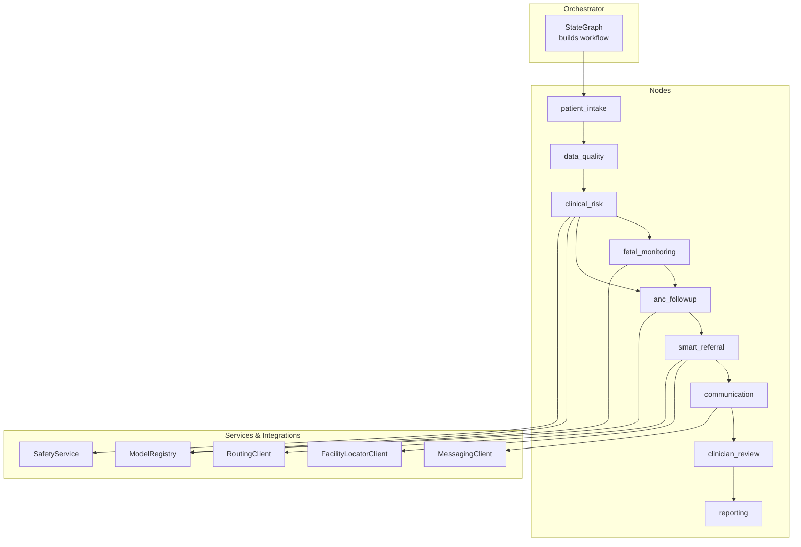
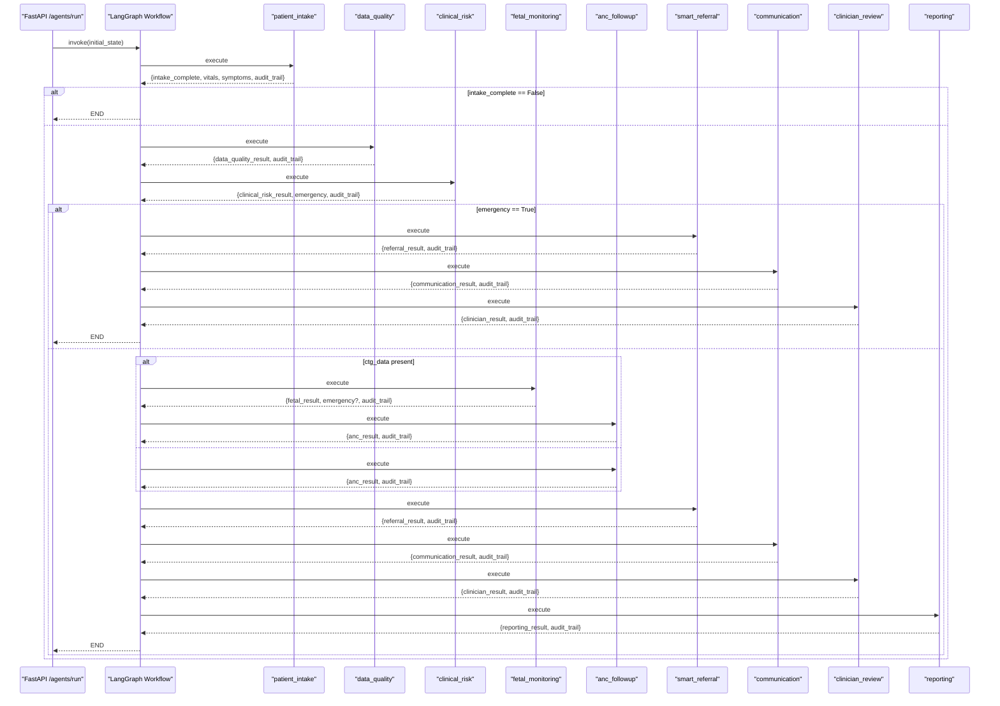
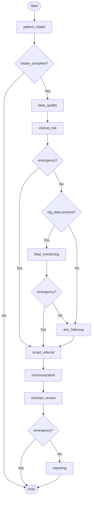
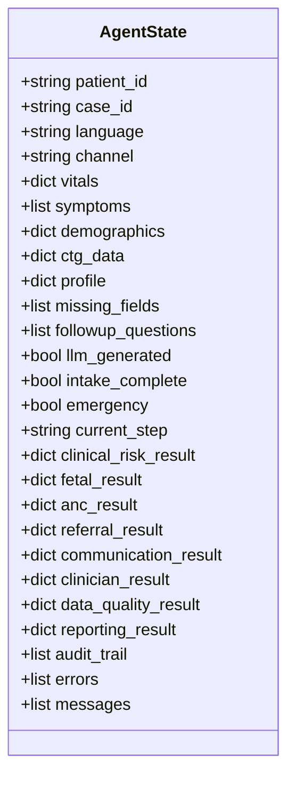
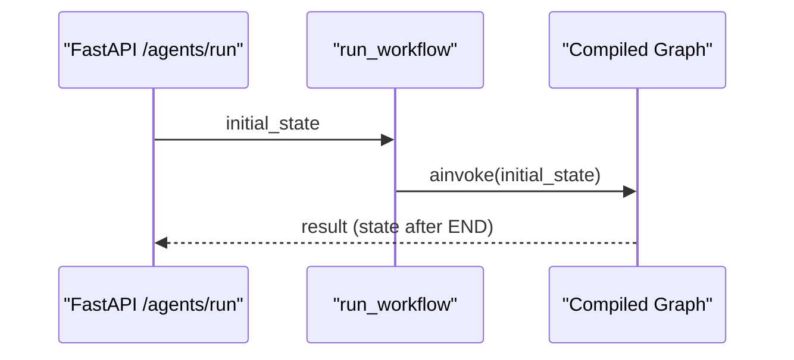
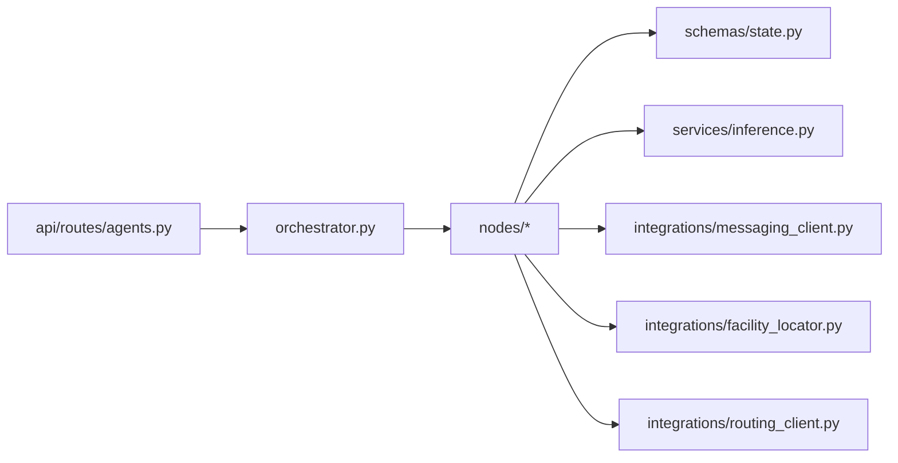

# Agent Orchestration System

<cite>
**Referenced Files in This Document**
- [orchestrator.py](file://backend/agents/orchestrator.py)
- [state.py](file://backend/schemas/state.py)
- [patient_intake.py](file://backend/agents/nodes/patient_intake.py)
- [data_quality.py](file://backend/agents/nodes/data_quality.py)
- [clinical_risk.py](file://backend/agents/nodes/clinical_risk.py)
- [fetal_monitoring.py](file://backend/agents/nodes/fetal_monitoring.py)
- [anc_followup.py](file://backend/agents/nodes/anc_followup.py)
- [smart_referral.py](file://backend/agents/nodes/smart_referral.py)
- [communication.py](file://backend/agents/nodes/communication.py)
- [clinician_review.py](file://backend/agents/nodes/clinician_review.py)
- [reporting.py](file://backend/agents/nodes/reporting.py)
- [inference.py](file://backend/services/inference.py)
- [messaging_client.py](file://backend/integrations/messaging_client.py)
- [config.py](file://backend/config.py)
- [agents.py](file://backend/api/routes/agents.py)
- [test_orchestrator.py](file://backend/tests/test_orchestrator.py)
</cite>

## Table of Contents
1. Introduction
2. Project Structure
3. Core Components
4. Architecture Overview
5. Detailed Component Analysis
6. Dependency Analysis
7. Performance Considerations
8. Troubleshooting Guide
9. Conclusion
10. Appendices

## Introduction
This document describes the LangGraph-based agent orchestration system that manages clinical workflows for maternal and fetal health. The system coordinates nine specialized agent nodes to process patient intake, validate data quality, assess clinical risk, analyze fetal monitoring signals, recommend ANC follow-up, generate smart referrals, communicate alerts, prepare clinician review summaries, and produce reports. It implements a state machine pattern with conditional routing based on patient status and available data, robust error handling, audit trails, and integration points with external services (LLM, messaging, facility/routing).

## Project Structure
The system is organized into:
- Orchestrator: builds a LangGraph StateGraph wiring all nine agent nodes and defines conditional edges.
- Nodes: each agent node encapsulates a specific task and writes results into a shared state.
- Schemas: a shared AgentState TypedDict defines the workflow state contract.
- Services: inference registry loads ML models; safety service applies WHO rules; LLM service provides optional narrative generation.
- Integrations: messaging client for SMS/WhatsApp; facility locator and routing clients for referral planning.
- API routes: FastAPI endpoints to run the full workflow or invoke single nodes.
- Tests: integration tests validating normal, emergency, and incomplete-intake flows.

**Diagram sources**
- [orchestrator.py:62-138](file://backend/agents/orchestrator.py#L62-L138)
- [inference.py:51-141](file://backend/services/inference.py#L51-L141)
- [messaging_client.py:9-78](file://backend/integrations/messaging_client.py#L9-L78)

**Section sources**
- [orchestrator.py:1-167](file://backend/agents/orchestrator.py#L1-L167)
- [state.py:1-43](file://backend/schemas/state.py#L1-L43)

## Core Components
- Shared state: AgentState defines fields for patient identification, vitals, symptoms, demographics, CTG data, flow control flags, per-agent outputs, and cross-cutting lists (audit_trail, errors, messages).
- Orchestrator: constructs a LangGraph StateGraph, adds nine nodes, sets entry point, wires conditional edges, compiles the workflow, and exposes helpers to run the full workflow or a single node.
- Nodes: each async function reads/writes AgentState, performs domain logic, appends audit entries, and returns updates.
- Services: ModelRegistry loads ML models once and provides prediction methods; SafetyService enforces WHO red-flag checks; LLM service is used optionally for narrative generation with fallbacks.
- Integrations: MessagingClient sends SMS/WhatsApp/emergency alerts; FacilityLocatorClient finds nearby facilities; RoutingClient plans routes.

Key responsibilities by node:
- patient_intake: collects and validates required vitals, supports voice input, generates follow-up questions via LLM with fallbacks.
- data_quality: validates vital ranges, flags anomalies, checks model confidence, computes quality score.
- clinical_risk: runs MaternalGuard and GestationInsight predictions, applies WHO red-flag rules, sets emergency flag if needed.
- fetal_monitoring: runs FetalWatch and PretermGuard on CTG features; escalates to emergency when pathological/high risk.
- anc_followup: predicts missed-visit risk using CareReach and recommends action (home visit/call/sms).
- smart_referral: ranks facilities by capability and distance, plans route, determines urgency, creates referral record.
- communication: dispatches emergency alerts, referral notifications, or ANC reminders via SMS/WhatsApp; tracks delivery.
- clinician_review: aggregates upstream results into a case summary for human review; marks pending_review and highlights risk indicators.
- reporting: produces structured case summary and dashboard/trend data; optional narrative report.

**Section sources**
- [state.py:7-43](file://backend/schemas/state.py#L7-L43)
- [orchestrator.py:62-138](file://backend/agents/orchestrator.py#L62-L138)
- [patient_intake.py:58-168](file://backend/agents/nodes/patient_intake.py#L58-L168)
- [data_quality.py:25-201](file://backend/agents/nodes/data_quality.py#L25-L201)
- [clinical_risk.py:15-127](file://backend/agents/nodes/clinical_risk.py#L15-L127)
- [fetal_monitoring.py:10-111](file://backend/agents/nodes/fetal_monitoring.py#L10-L111)
- [anc_followup.py:10-103](file://backend/agents/nodes/anc_followup.py#L10-L103)
- [smart_referral.py:11-136](file://backend/agents/nodes/smart_referral.py#L11-L136)
- [communication.py:38-231](file://backend/agents/nodes/communication.py#L38-L231)
- [clinician_review.py:13-165](file://backend/agents/nodes/clinician_review.py#L13-L165)
- [reporting.py:13-217](file://backend/agents/nodes/reporting.py#L13-L217)

## Architecture Overview
The orchestrator implements a state machine where each node transforms the shared AgentState and returns updates. Conditional edges decide the next step based on flags like intake_complete and emergency, and on availability of data such as CTG features.

**Diagram sources**
- [orchestrator.py:22-132](file://backend/agents/orchestrator.py#L22-L132)
- [agents.py:62-79](file://backend/api/routes/agents.py#L62-L79)

**Section sources**
- [orchestrator.py:22-132](file://backend/agents/orchestrator.py#L22-L132)
- [agents.py:62-79](file://backend/api/routes/agents.py#L62-L79)

## Detailed Component Analysis

### State Machine Pattern and Conditional Routing
- Entry point: patient_intake.
- After intake: if intake_complete is False, route to END; otherwise proceed to data_quality.
- After data_quality: always proceed to clinical_risk.
- After clinical_risk:
  - If emergency is True: route to smart_referral.
  - Else if CTG data is present: route to fetal_monitoring then anc_followup.
  - Else: route to anc_followup.
- After fetal_monitoring: if emergency is True: route to smart_referral; else anc_followup.
- After anc_followup: route to smart_referral.
- After smart_referral: route to communication.
- After communication: route to clinician_review.
- After clinician_review: if emergency is True: END; else reporting.
- After reporting: END.

**Diagram sources**
- [orchestrator.py:22-132](file://backend/agents/orchestrator.py#L22-L132)

**Section sources**
- [orchestrator.py:22-132](file://backend/agents/orchestrator.py#L22-L132)

### Node-by-Node Behavior and Error Handling
- patient_intake:
  - Reads vitals, symptoms, demographics, language; optional audio transcription and symptom extraction.
  - Validates required vital fields; generates follow-up questions via LLM with template fallback.
  - Writes profile, missing_fields, followup_questions, intake_complete; appends audit entries; catches exceptions and records errors.
- data_quality:
  - Validates vital ranges and impossible values; checks model confidence scores from upstream nodes; computes quality_score; logs flags and warnings; appends audit entries; handles exceptions.
- clinical_risk:
  - Runs MaternalGuard and optional GestationInsight predictions; always calls SafetyService for WHO red flags; sets emergency if triage_level indicates HIGH_RISK_EMERGENCY; optional LLM-generated risk summary with fallback; appends audit entries; handles exceptions.
- fetal_monitoring:
  - Skips gracefully if no CTG data; runs FetalWatch and PretermGuard; sets emergency=True if pathological or high preterm risk; appends audit entries; handles exceptions.
- anc_followup:
  - Predicts missed-visit risk using CareReach; maps priority to recommended_action (home_visit/call/sms); appends audit entries; handles exceptions.
- smart_referral:
  - Finds nearby facilities within radius based on emergency; ranks by capability match + distance; plans route; determines urgency; creates referral_result; appends audit entries; handles exceptions.
- communication:
  - Sends emergency_alerts, referral notifications, or ANC reminders via SMS/WhatsApp; uses LLM message generation with fallback; tracks delivery_status; appends audit entries; handles exceptions.
- clinician_review:
  - Aggregates upstream results into case_summary; identifies risk_indicators; optional LLM narrative; marks pending_review; appends audit entries; handles exceptions.
- reporting:
  - Produces case_summary and dashboard_data; optional LLM narrative; appends audit entries; handles exceptions.

**Diagram sources**
- [state.py:7-43](file://backend/schemas/state.py#L7-L43)

**Section sources**
- [patient_intake.py:58-168](file://backend/agents/nodes/patient_intake.py#L58-L168)
- [data_quality.py:25-201](file://backend/agents/nodes/data_quality.py#L25-L201)
- [clinical_risk.py:15-127](file://backend/agents/nodes/clinical_risk.py#L15-L127)
- [fetal_monitoring.py:10-111](file://backend/agents/nodes/fetal_monitoring.py#L10-L111)
- [anc_followup.py:10-103](file://backend/agents/nodes/anc_followup.py#L10-L103)
- [smart_referral.py:11-136](file://backend/agents/nodes/smart_referral.py#L11-L136)
- [communication.py:38-231](file://backend/agents/nodes/communication.py#L38-L231)
- [clinician_review.py:13-165](file://backend/agents/nodes/clinician_review.py#L13-L165)
- [reporting.py:13-217](file://backend/agents/nodes/reporting.py#L13-L217)

### Workflow Execution Flow Examples
- Normal flow: intake complete → data_quality → clinical_risk → fetal_monitoring (if CTG present) → anc_followup → smart_referral → communication → clinician_review → reporting → END.
- Emergency flow: intake complete → data_quality → clinical_risk (emergency=True) → smart_referral → communication → clinician_review → END.
- Incomplete intake: intake incomplete → END early without further processing.

**Diagram sources**
- [orchestrator.py:144-147](file://backend/agents/orchestrator.py#L144-L147)
- [agents.py:62-79](file://backend/api/routes/agents.py#L62-L79)

**Section sources**
- [test_orchestrator.py:52-136](file://backend/tests/test_orchestrator.py#L52-L136)

### Integration Points
- External ML models: ModelRegistry loads MaternalGuard, FetalWatch, PretermGuard, CareReach, GestationInsight; provides prediction methods with fallbacks when models are unavailable.
- Safety rules: SafetyService enforces WHO red-flag checks; mandatory path ensures emergency escalation when indicated.
- Messaging: MessagingClient sends SMS/WhatsApp/emergency alerts; includes delivery tracking and templates.
- Facility and routing: smart_referral uses FacilityLocatorClient and RoutingClient to rank facilities and plan routes.
- Configuration: settings define paths to artifacts, database URL, JWT keys, external API URLs, and LLM configuration.

**Section sources**
- [inference.py:51-435](file://backend/services/inference.py#L51-L435)
- [messaging_client.py:9-78](file://backend/integrations/messaging_client.py#L9-L78)
- [config.py:7-55](file://backend/config.py#L7-L55)

## Dependency Analysis
- Orchestrator depends on all nine nodes and LangGraph primitives.
- Nodes depend on:
  - AgentState schema for consistent state shape.
  - ModelRegistry for ML predictions.
  - SafetyService for WHO rules.
  - MessagingClient for communications.
  - FacilityLocatorClient and RoutingClient for referrals.
  - LLM service for optional narrative generation with fallbacks.
- API routes depend on orchestrator helpers and authentication dependencies.

**Diagram sources**
- [orchestrator.py:62-138](file://backend/agents/orchestrator.py#L62-L138)
- [agents.py:62-114](file://backend/api/routes/agents.py#L62-L114)

**Section sources**
- [orchestrator.py:62-138](file://backend/agents/orchestrator.py#L62-L138)
- [agents.py:62-114](file://backend/api/routes/agents.py#L62-L114)

## Performance Considerations
- Concurrency: Nodes use async functions; LLM calls are executed in worker threads to avoid blocking the event loop.
- Model loading: ModelRegistry is a singleton that loads models once at startup; health checks indicate which models are available.
- Graceful degradation: LLM failures fall back to templates; missing CTG data skips fetal assessment; missing models return safe defaults.
- Audit trail: Append-only list accumulates entries across nodes; useful for tracing execution and debugging performance bottlenecks.
- Scalability patterns:
  - Stateless nodes: Each node reads/writes state and can be scaled horizontally if refactored to isolate side effects.
  - External services: Use timeouts and retries at integration boundaries (e.g., messaging, routing) to handle transient failures.
  - Batch processing: For high throughput, consider batching requests to LLM and ML services where supported.

[No sources needed since this section provides general guidance]

## Troubleshooting Guide
- Common issues:
  - Missing required vitals: patient_intake will mark intake_incomplete and stop the workflow; ensure all required fields are provided.
  - Model unavailability: ModelRegistry returns fallback responses; verify artifact paths and model files exist.
  - LLM failures: Narrative generation falls back to templates; check LLM service configuration and network connectivity.
  - Messaging failures: MessagingClient stubs always succeed in tests; in production, monitor delivery_status and implement retries.
  - Emergency escalation: Ensure WHO red-flag checks are enabled; verify triage_level mapping and emergency flag propagation.
- Debugging steps:
  - Inspect audit_trail for timestamps, actions, and result summaries from each node.
  - Use /agents/{node_name}/invoke to test individual nodes with controlled state inputs.
  - Validate state transitions by checking current_step and flags like intake_complete and emergency.
  - Review errors list for exception details and timestamps.

**Section sources**
- [patient_intake.py:151-168](file://backend/agents/nodes/patient_intake.py#L151-L168)
- [data_quality.py:185-201](file://backend/agents/nodes/data_quality.py#L185-L201)
- [clinical_risk.py:111-127](file://backend/agents/nodes/clinical_risk.py#L111-L127)
- [fetal_monitoring.py:95-111](file://backend/agents/nodes/fetal_monitoring.py#L95-L111)
- [anc_followup.py:87-103](file://backend/agents/nodes/anc_followup.py#L87-L103)
- [smart_referral.py:120-136](file://backend/agents/nodes/smart_referral.py#L120-L136)
- [communication.py:215-231](file://backend/agents/nodes/communication.py#L215-L231)
- [clinician_review.py:149-165](file://backend/agents/nodes/clinician_review.py#L149-L165)
- [reporting.py:175-217](file://backend/agents/nodes/reporting.py#L175-L217)
- [agents.py:90-114](file://backend/api/routes/agents.py#L90-L114)

## Conclusion
The system implements a robust, extensible state machine for clinical workflow orchestration. It balances automated assessments with human-in-the-loop review, integrates external services safely, and maintains comprehensive audit trails. The modular design allows customization of workflows, addition of new agents, and scaling for concurrent processing while ensuring reliability through fallbacks and error handling.

[No sources needed since this section summarizes without analyzing specific files]

## Appendices

### Customizing Workflows and Adding New Agents
- Add a new node file under backend/agents/nodes/ implementing an async function that reads/writes AgentState and appends audit entries.
- Register the node in orchestrator.py: add_node, set_entry_point if needed, and wire conditional edges.
- Expose via API: update _NODE_DESCRIPTIONS and ensure run_single_node mapping includes the new node.
- Test: write integration tests similar to test_orchestrator.py to validate behavior.

**Section sources**
- [orchestrator.py:62-138](file://backend/agents/orchestrator.py#L62-L138)
- [agents.py:17-27](file://backend/api/routes/agents.py#L17-L27)
- [test_orchestrator.py:52-136](file://backend/tests/test_orchestrator.py#L52-L136)

### Example: Emergency Workflow Path
- Triggered when WHO red flags indicate HIGH_RISK_EMERGENCY or fetal status is pathological/high risk.
- Flow: clinical_risk → smart_referral → communication → clinician_review → END.
- Communication sends emergency_alert to multiple recipients; referral ranks facilities and plans route.

**Section sources**
- [clinical_risk.py:39-58](file://backend/agents/nodes/clinical_risk.py#L39-L58)
- [fetal_monitoring.py:47-69](file://backend/agents/nodes/fetal_monitoring.py#L47-L69)
- [smart_referral.py:74-98](file://backend/agents/nodes/smart_referral.py#L74-L98)
- [communication.py:64-93](file://backend/agents/nodes/communication.py#L64-L93)

### Example: Data Quality Checks
- Validates vital ranges and impossible values; checks model confidence thresholds; computes quality_score; logs flags and warnings.
- Useful for detecting outliers and low-confidence predictions before downstream decisions.

**Section sources**
- [data_quality.py:46-155](file://backend/agents/nodes/data_quality.py#L46-L155)