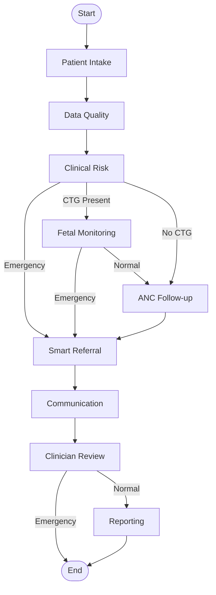
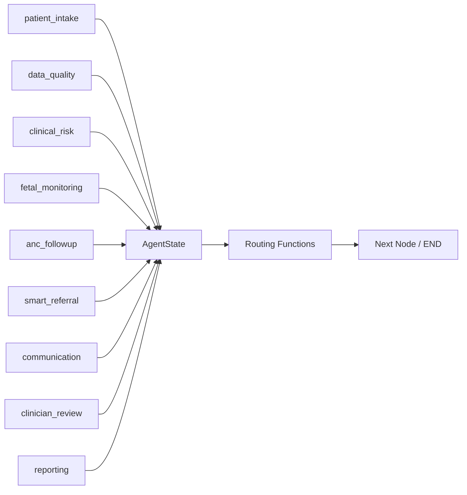

# Conditional Routing & Decision Logic

<cite>
**Referenced Files in This Document**
- [orchestrator.py](file://backend/agents/orchestrator.py)
- [patient_intake.py](file://backend/agents/nodes/patient_intake.py)
- [data_quality.py](file://backend/agents/nodes/data_quality.py)
- [clinical_risk.py](file://backend/agents/nodes/clinical_risk.py)
- [fetal_monitoring.py](file://backend/agents/nodes/fetal_monitoring.py)
- [anc_followup.py](file://backend/agents/nodes/anc_followup.py)
- [smart_referral.py](file://backend/agents/nodes/smart_referral.py)
- [communication.py](file://backend/agents/nodes/communication.py)
- [clinician_review.py](file://backend/agents/nodes/clinician_review.py)
- [reporting.py](file://backend/agents/nodes/reporting.py)
- [state.py](file://backend/schemas/state.py)
</cite>

## Table of Contents
1. Introduction
2. Project Structure
3. Core Components
4. Architecture Overview
5. Detailed Component Analysis
6. Dependency Analysis
7. Performance Considerations
8. Troubleshooting Guide
9. Conclusion
10. Appendices

## Introduction
This document explains the conditional routing system that determines workflow progression based on patient status and available data. It focuses on the routing functions route_after_intake, route_after_data_quality, route_after_clinical_risk, route_after_fetal, and route_after_clinician. It also documents decision criteria such as emergency detection, CTG data availability, risk assessment results, and clinical findings that trigger different workflow paths. Finally, it provides guidance for customizing routing logic, adding new decision points, debugging routing issues, and maintaining performance and clarity.

## Project Structure
The routing system is implemented as a LangGraph StateGraph with nine agent nodes. The orchestrator wires these nodes and defines conditional edges using dedicated routing functions. Each node updates the shared AgentState and appends audit entries to support observability and debugging.

```mermaid
graph TB
intake["patient_intake"] --> dq["data_quality"]
dq --> cr["clinical_risk"]
cr --> |emergency| ref["smart_referral"]
cr --> |CTG present| fm["fetal_monitoring"]
cr --> |else| anc["anc_followup"]
fm --> |emergency| ref
fm --> |else| anc
anc --> ref
ref --> comm["communication"]
comm --> clin["clinician_review"]
clin --> |emergency| end["END"]
clin --> |normal| rep["reporting"]
rep --> end
```

**Diagram sources**
- [orchestrator.py:62-138](file://backend/agents/orchestrator.py#L62-L138)

**Section sources**
- [orchestrator.py:1-167](file://backend/agents/orchestrator.py#L1-L167)
- [state.py:1-43](file://backend/schemas/state.py#L1-L43)

## Core Components
- Orchestrator: Defines the graph, adds nodes, sets entry point, registers conditional edges, compiles the workflow, and exposes helpers to run the full workflow or a single node.
- Routing functions: Pure functions that inspect state and return the next node or END.
- Nodes: Implement business logic (intake, data quality, risk assessment, fetal monitoring, ANC follow-up, referral, communication, clinician review, reporting).
- State schema: TypedDict defining all fields passed between nodes.

Key responsibilities by component:
- Intake: Validates required vitals and symptoms; marks intake_complete.
- Data Quality: Validates vital ranges, flags anomalies, checks model confidence thresholds.
- Clinical Risk: Runs maternal/gestational models and WHO safety rules; sets emergency when triage indicates high-risk emergency.
- Fetal Monitoring: Runs FetalWatch and PretermGuard on CTG; sets emergency if pathological or high preterm risk.
- ANC Follow-up: Predicts missed-visit risk and recommends action.
- Smart Referral: Ranks facilities by capability and distance; plans routes; sets urgency.
- Communication: Sends alerts or notifications via SMS/WhatsApp/emergency channels.
- Clinician Review: Aggregates upstream results into a case summary for human review.
- Reporting: Produces structured reports and dashboard/trend data.

**Section sources**
- [orchestrator.py:22-56](file://backend/agents/orchestrator.py#L22-L56)
- [patient_intake.py:58-168](file://backend/agents/nodes/patient_intake.py#L58-L168)
- [data_quality.py:25-201](file://backend/agents/nodes/data_quality.py#L25-L201)
- [clinical_risk.py:15-127](file://backend/agents/nodes/clinical_risk.py#L15-L127)
- [fetal_monitoring.py:10-111](file://backend/agents/nodes/fetal_monitoring.py#L10-L111)
- [anc_followup.py:10-103](file://backend/agents/nodes/anc_followup.py#L10-L103)
- [smart_referral.py:11-136](file://backend/agents/nodes/smart_referral.py#L11-L136)
- [communication.py:38-231](file://backend/agents/nodes/communication.py#L38-L231)
- [clinician_review.py:13-165](file://backend/agents/nodes/clinician_review.py#L13-L165)
- [reporting.py:13-217](file://backend/agents/nodes/reporting.py#L13-L217)
- [state.py:7-43](file://backend/schemas/state.py#L7-L43)

## Architecture Overview
The workflow begins at patient_intake and proceeds through data_quality and clinical_risk. Based on state flags and data availability, the router directs execution to smart_referral, fetal_monitoring, or anc_followup. After fetal monitoring, an emergency path escalates to smart_referral; otherwise, it continues to anc_followup. All paths converge to communication and clinician_review. In emergencies, reporting is skipped to reduce latency.

```mermaid
sequenceDiagram
participant Client as "Caller"
participant Graph as "LangGraph Workflow"
participant Intake as "patient_intake"
participant DQ as "data_quality"
participant CR as "clinical_risk"
participant FM as "fetal_monitoring"
participant ANC as "anc_followup"
participant Ref as "smart_referral"
participant Comm as "communication"
participant Clin as "clinician_review"
participant Rep as "reporting"
Client->>Graph : invoke(initial_state)
Graph->>Intake : execute
Intake-->>Graph : state.update(intake_complete,...)
Graph->>DQ : execute
DQ-->>Graph : state.update(data_quality_result,...)
Graph->>CR : execute
CR-->>Graph : state.update(clinical_risk_result, emergency?)
alt Emergency or CTG present
Graph->>FM : execute
FM-->>Graph : state.update(fetal_result, emergency?)
opt Pathological or High Risk
Graph->>Ref : execute
else Normal
Graph->>ANC : execute
ANC-->>Graph : state.update(anc_result)
Graph->>Ref : execute
end
else No CTG
Graph->>ANC : execute
ANC-->>Graph : state.update(anc_result)
Graph->>Ref : execute
end
Graph->>Comm : execute
Comm-->>Graph : state.update(communication_result)
Graph->>Clin : execute
Clin-->>Graph : state.update(clinician_result)
alt Emergency
Graph->>END : terminate
else Normal
Graph->>Rep : execute
Rep-->>Graph : state.update(reporting_result)
Graph->>END : terminate
end
```

**Diagram sources**
- [orchestrator.py:78-138](file://backend/agents/orchestrator.py#L78-L138)
- [clinical_risk.py:39-57](file://backend/agents/nodes/clinical_risk.py#L39-L57)
- [fetal_monitoring.py:47-93](file://backend/agents/nodes/fetal_monitoring.py#L47-L93)
- [smart_referral.py:30-83](file://backend/agents/nodes/smart_referral.py#L30-L83)
- [communication.py:64-178](file://backend/agents/nodes/communication.py#L64-L178)
- [clinician_review.py:73-128](file://backend/agents/nodes/clinician_review.py#L73-L128)
- [reporting.py:132-173](file://backend/agents/nodes/reporting.py#L132-L173)

## Detailed Component Analysis

### Routing Functions
- route_after_intake(state): If intake_complete is False, ends the workflow; otherwise proceeds to data_quality.
- route_after_data_quality(state): Always proceeds to clinical_risk.
- route_after_clinical_risk(state): If emergency is True, goes to smart_referral; else if vitals.ctg_data is present, goes to fetal_monitoring; otherwise anc_followup.
- route_after_fetal(state): If emergency is True, goes to smart_referral; otherwise anc_followup.
- route_after_clinician(state): If emergency is True, ends the workflow; otherwise reporting.

These functions are pure and rely solely on state fields to decide the next step.

**Section sources**
- [orchestrator.py:22-56](file://backend/agents/orchestrator.py#L22-L56)

### Decision Criteria and Triggers
- Emergency detection:
  - From clinical risk: WHO triage level HIGH_RISK_EMERGENCY sets emergency=True.
  - From fetal monitoring: fetal_status pathological or preterm_risk high/high risk sets emergency=True.
- CTG data availability:
  - Presence of vitals.ctg_data triggers fetal_monitoring after clinical_risk.
- Risk assessment results:
  - Maternal and gestational risk levels influence referral urgency and reporting.
- Clinical findings:
  - Vitals range validation and impossible value checks produce flags/warnings that inform downstream decisions and reporting.

Examples of where these criteria are applied:
- Emergency flag from clinical risk and fetal monitoring.
- CTG presence gating fetal monitoring.
- ANC priority mapping to recommended actions.
- Facility ranking considering emergency/NICU/maternity capabilities and distance.

**Section sources**
- [clinical_risk.py:39-57](file://backend/agents/nodes/clinical_risk.py#L39-L57)
- [fetal_monitoring.py:47-93](file://backend/agents/nodes/fetal_monitoring.py#L47-L93)
- [data_quality.py:46-155](file://backend/agents/nodes/data_quality.py#L46-L155)
- [anc_followup.py:36-43](file://backend/agents/nodes/anc_followup.py#L36-L43)
- [smart_referral.py:30-83](file://backend/agents/nodes/smart_referral.py#L30-L83)

### Workflow Paths
- Normal path: intake → data_quality → clinical_risk → (no CTG) → anc_followup → smart_referral → communication → clinician_review → reporting → END.
- Fetal monitoring path: intake → data_quality → clinical_risk → (CTG present) → fetal_monitoring → (pathological/high risk) → smart_referral → communication → clinician_review → reporting → END.
- Emergency path: Any stage setting emergency=True routes to smart_referral → communication → clinician_review → END (skips reporting).



**Diagram sources**
- [orchestrator.py:78-138](file://backend/agents/orchestrator.py#L78-L138)
- [clinical_risk.py:39-57](file://backend/agents/nodes/clinical_risk.py#L39-L57)
- [fetal_monitoring.py:47-93](file://backend/agents/nodes/fetal_monitoring.py#L47-L93)

### Customizing Routing Logic
- Add a new decision point:
  - Create a new routing function that inspects state fields and returns the next node or END.
  - Register the function with add_conditional_edges at the appropriate source node.
  - Ensure the target node exists and is added to the graph.
- Modify existing conditions:
  - Update the relevant route_after_* function to include additional state checks (e.g., new flags or thresholds).
  - Validate behavior with tests using run_single_node for isolated node execution.
- Example patterns:
  - Adding a “triage” branch after clinical_risk based on a new field like state.get("triage_level").
  - Skipping ANC follow-up when specific high-risk indicators are present.

Best practices:
- Keep routing functions small and focused on one decision.
- Use explicit state keys defined in AgentState to avoid drift.
- Log or append audit entries in nodes to trace decisions.

**Section sources**
- [orchestrator.py:78-138](file://backend/agents/orchestrator.py#L78-L138)
- [state.py:7-43](file://backend/schemas/state.py#L7-L43)

### Debugging Routing Issues
- Inspect state evolution:
  - Check current_step and audit_trail appended by each node to see which steps executed and what outputs were produced.
- Verify condition evaluation:
  - Print or log key state fields used by routing functions (e.g., emergency, vitals.ctg_data, clinical_risk_result.who_red_flags.triage_level).
- Isolate nodes:
  - Use run_single_node to execute a specific node with a crafted state and verify its output.
- Common pitfalls:
  - Missing required intake fields causing premature END.
  - Incorrect CTG data shape leading to skipped fetal monitoring.
  - LLM fallbacks producing unexpected messages or summaries.

**Section sources**
- [orchestrator.py:144-167](file://backend/agents/orchestrator.py#L144-L167)
- [patient_intake.py:99-149](file://backend/agents/nodes/patient_intake.py#L99-L149)
- [data_quality.py:152-183](file://backend/agents/nodes/data_quality.py#L152-L183)
- [communication.py:180-213](file://backend/agents/nodes/communication.py#L180-L213)

## Dependency Analysis
The routing system depends on:
- State schema fields for decision-making.
- Node outputs that populate state fields consumed by subsequent nodes and routing functions.
- External integrations (voice, messaging, facility locator, routing client) invoked within nodes.



**Diagram sources**
- [state.py:7-43](file://backend/schemas/state.py#L7-L43)
- [orchestrator.py:62-138](file://backend/agents/orchestrator.py#L62-L138)

**Section sources**
- [state.py:7-43](file://backend/schemas/state.py#L7-L43)
- [orchestrator.py:62-138](file://backend/agents/orchestrator.py#L62-L138)

## Performance Considerations
- Skip reporting in emergencies to reduce latency.
- Avoid unnecessary LLM calls:
  - Nodes fall back to templates when LLM services are unavailable; this keeps critical paths robust.
- Minimize branching complexity:
  - Keep routing functions simple and deterministic to reduce evaluation overhead.
- Batch or cache external calls where possible:
  - Facility lookup and routing are called once per referral; ensure efficient queries.
- Monitor audit trails:
  - Use audit_trail counts and error accumulators to detect bottlenecks or failures.

[No sources needed since this section provides general guidance]

## Troubleshooting Guide
- Intake incomplete:
  - Ensure required vitals are present; missing fields cause early termination.
- Unexpected fetal monitoring skip:
  - Confirm ctg_data is provided under vitals or state; absence leads to skipped assessment.
- Emergency not triggered:
  - Verify WHO triage logic and fetal model outputs set emergency correctly.
- Communication failures:
  - Check delivery logs and message types; confirm channel and phone number.
- Reporting not generated:
  - Confirm clinician_review did not set emergency; otherwise reporting is intentionally skipped.

Use run_single_node to test individual nodes with controlled inputs and validate outputs before integrating into the full workflow.

**Section sources**
- [patient_intake.py:99-149](file://backend/agents/nodes/patient_intake.py#L99-L149)
- [fetal_monitoring.py:22-37](file://backend/agents/nodes/fetal_monitoring.py#L22-L37)
- [clinical_risk.py:39-57](file://backend/agents/nodes/clinical_risk.py#L39-L57)
- [communication.py:180-213](file://backend/agents/nodes/communication.py#L180-L213)
- [reporting.py:132-173](file://backend/agents/nodes/reporting.py#L132-L173)

## Conclusion
The conditional routing system uses clear, state-driven decision points to direct workflow progression based on emergency status, CTG availability, and risk assessments. By keeping routing functions simple, leveraging robust node implementations, and relying on audit trails for observability, the system maintains both reliability and performance. Customization should focus on extending state fields and routing logic while preserving clarity and testability.

[No sources needed since this section summarizes without analyzing specific files]

## Appendices

### Appendix A: Key State Fields Used by Routing
- intake_complete: Controls post-intake routing.
- emergency: Escalation flag influencing multiple routing decisions.
- vitals.ctg_data: Determines whether fetal monitoring runs.
- clinical_risk_result.who_red_flags.triage_level: Drives emergency determination.
- fetal_result.fetal_status and fetal_result.preterm_risk: Influence escalation and referral urgency.

**Section sources**
- [state.py:7-43](file://backend/schemas/state.py#L7-L43)
- [clinical_risk.py:39-57](file://backend/agents/nodes/clinical_risk.py#L39-L57)
- [fetal_monitoring.py:47-93](file://backend/agents/nodes/fetal_monitoring.py#L47-L93)

### Appendix B: Best Practices for Maintaining Clear Workflow Logic
- Define explicit state contracts in AgentState and enforce them across nodes.
- Keep routing functions minimal and focused on a single decision criterion.
- Prefer deterministic checks over complex nested conditions.
- Maintain comprehensive audit_trail entries for every node to aid debugging.
- Test routing changes with run_single_node and representative states.

**Section sources**
- [orchestrator.py:144-167](file://backend/agents/orchestrator.py#L144-L167)
- [state.py:7-43](file://backend/schemas/state.py#L7-L43)