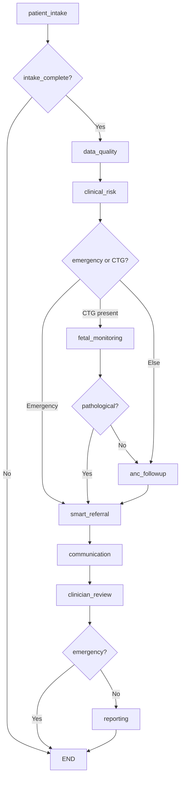
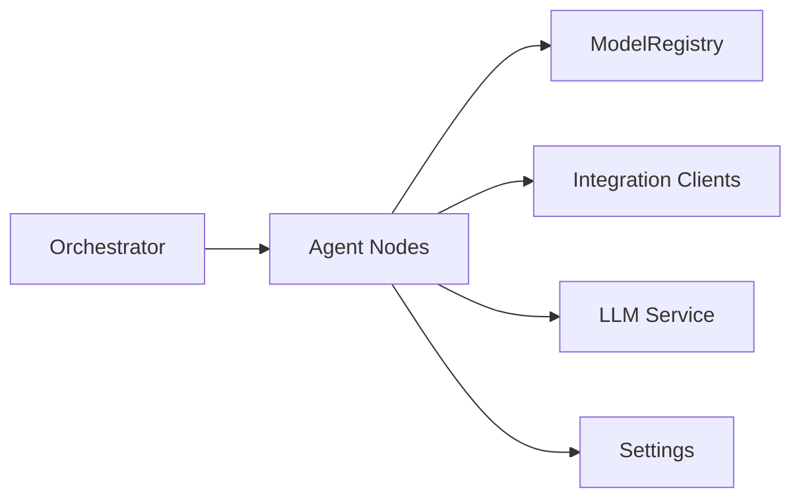

# Error Handling & Retry Mechanisms

<cite>
**Referenced Files in This Document**
- [orchestrator.py](file://backend/agents/orchestrator.py)
- [patient_intake.py](file://backend/agents/nodes/patient_intake.py)
- [data_quality.py](file://backend/agents/nodes/data_quality.py)
- [clinical_risk.py](file://backend/agents/nodes/clinical_risk.py)
- [fetal_monitoring.py](file://backend/agents/nodes/fetal_monitoring.py)
- [anc_followup.py](file://backend/agents/nodes/anc_followup.py)
- [smart_referral.py](file://backend/agents/nodes/smart_referral.py)
- [communication.py](file://backend/agents/nodes/communication.py)
- [clinician_review.py](file://backend/agents/nodes/clinician_review.py)
- [reporting.py](file://backend/agents/nodes/reporting.py)
- [inference.py](file://backend/services/inference.py)
- [messaging_client.py](file://backend/integrations/messaging_client.py)
- [config.py](file://backend/config.py)
- [test_orchestrator.py](file://backend/tests/test_orchestrator.py)
</cite>

## Table of Contents
1. Introduction
2. Project Structure
3. Core Components
4. Architecture Overview
5. Detailed Component Analysis
6. Dependency Analysis
7. Performance Considerations
8. Troubleshooting Guide
9. Conclusion
10. Appendices

## Introduction
This document explains how the agent orchestration system handles errors and maintains reliability across node failures, network timeouts, service unavailability, and invalid data states. It details the error capture strategy used by each node, the workflow-level behavior when errors occur, and the patterns for logging, auditing, and recovery. It also addresses retry strategies, exponential backoff, circuit breaker patterns, monitoring and alerting, debugging techniques, and best practices for resilient clinical workflows.

## Project Structure
The system is a LangGraph StateGraph composed of nine agent nodes that process patient intake, data quality, risk assessment, fetal monitoring, ANC follow-up, referral, communication, clinician review, and reporting. Each node encapsulates its own error handling and contributes audit entries to a shared state. The orchestrator wires conditional routing based on state flags (e.g., emergency, intake_complete).



**Diagram sources**
- [orchestrator.py:22-55](file://backend/agents/orchestrator.py#L22-L55)
- [orchestrator.py:62-138](file://backend/agents/orchestrator.py#L62-L138)

**Section sources**
- [orchestrator.py:1-167](file://backend/agents/orchestrator.py#L1-L167)

## Core Components
- Orchestrator: Builds and compiles the workflow graph; provides helpers to run the full workflow or a single node.
- Nodes: Each node implements try/except to capture exceptions, append structured error entries, and always return an audit trail entry describing the action outcome.
- Inference Service: Loads models once and returns safe fallbacks when models are unavailable or predictions fail.
- Integrations: External clients (voice, messaging, routing, facility locator) expose timeouts and stubbed behaviors for resilience during development/testing.
- Configuration: Centralized settings for API URLs, model paths, and timeouts.

Key responsibilities:
- Fail fast with clear, structured errors at the node level.
- Preserve workflow continuity by returning partial results and audit trails even on failure.
- Escalate emergencies via routing decisions rather than crashing the pipeline.

**Section sources**
- [orchestrator.py:144-167](file://backend/agents/orchestrator.py#L144-L167)
- [inference.py:51-141](file://backend/services/inference.py#L51-L141)
- [messaging_client.py:9-78](file://backend/integrations/messaging_client.py#L9-L78)
- [config.py:7-55](file://backend/config.py#L7-L55)

## Architecture Overview
The workflow uses conditional edges to route execution based on state. Errors do not stop the entire workflow; instead, nodes record errors and continue where possible. Emergency detection short-circuits non-essential steps (e.g., reporting) to speed up response.

```mermaid
sequenceDiagram
participant Caller as "Caller"
participant Graph as "StateGraph"
participant NodeA as "patient_intake"
participant NodeB as "data_quality"
participant NodeC as "clinical_risk"
participant NodeD as "fetal_monitoring"
participant NodeE as "anc_followup"
participant NodeF as "smart_referral"
participant NodeG as "communication"
participant NodeH as "clinician_review"
participant NodeI as "reporting"
Caller->>Graph : invoke(initial_state)
Graph->>NodeA : execute
NodeA-->>Graph : {intake_complete, audit_trail, errors?}
alt incomplete
Graph-->>Caller : END
else complete
Graph->>NodeB : execute
NodeB-->>Graph : {data_quality_result, audit_trail}
Graph->>NodeC : execute
NodeC-->>Graph : {clinical_risk_result, emergency?, audit_trail}
alt emergency
Graph->>NodeF : execute
NodeF-->>Graph : {referral_result, audit_trail}
Graph->>NodeG : execute
NodeG-->>Graph : {communication_result, audit_trail}
Graph->>NodeH : execute
NodeH-->>Graph : {clinician_result, audit_trail}
Graph-->>Caller : END
else no emergency
alt CTG available
Graph->>NodeD : execute
NodeD-->>Graph : {fetal_result, emergency?, audit_trail}
alt pathological
Graph->>NodeF : execute
...
else
Graph->>NodeE : execute
NodeE-->>Graph : {anc_result, audit_trail}
Graph->>NodeF : execute
...
end
else no CTG
Graph->>NodeE : execute
NodeE-->>Graph : {anc_result, audit_trail}
Graph->>NodeF : execute
...
end
Graph->>NodeH : execute
NodeH-->>Graph : {clinician_result, audit_trail}
Graph->>NodeI : execute
NodeI-->>Graph : {reporting_result, audit_trail}
Graph-->>Caller : END
end
end
```

**Diagram sources**
- [orchestrator.py:22-138](file://backend/agents/orchestrator.py#L22-L138)
- [patient_intake.py:58-167](file://backend/agents/nodes/patient_intake.py#L58-L167)
- [data_quality.py:25-200](file://backend/agents/nodes/data_quality.py#L25-L200)
- [clinical_risk.py:15-127](file://backend/agents/nodes/clinical_risk.py#L15-L127)
- [fetal_monitoring.py:10-111](file://backend/agents/nodes/fetal_monitoring.py#L10-L111)
- [anc_followup.py:10-103](file://backend/agents/nodes/anc_followup.py#L10-L103)
- [smart_referral.py:11-136](file://backend/agents/nodes/smart_referral.py#L11-L136)
- [communication.py:212-230](file://backend/agents/nodes/communication.py#L212-L230)
- [clinician_review.py:13-165](file://backend/agents/nodes/clinician_review.py#L13-L165)
- [reporting.py:13-217](file://backend/agents/nodes/reporting.py#L13-L217)

## Detailed Component Analysis

### Orchestrator Error Handling and Routing
- The orchestrator compiles a StateGraph and exposes helpers to run the workflow or a single node.
- Conditional routing depends on state fields such as intake_complete and emergency.
- When intake is incomplete, the workflow ends early to avoid downstream processing on insufficient data.
- When emergency is flagged, non-essential steps like reporting can be skipped to accelerate response.

Operational implications:
- Early termination prevents wasted work on invalid inputs.
- Emergency routing ensures critical actions (referral, communication) are prioritized.

**Section sources**
- [orchestrator.py:22-55](file://backend/agents/orchestrator.py#L22-L55)
- [orchestrator.py:62-138](file://backend/agents/orchestrator.py#L62-L138)
- [test_orchestrator.py:52-123](file://backend/tests/test_orchestrator.py#L52-L123)

### Patient Intake Node
- Validates required vital fields and marks intake_complete accordingly.
- Uses optional voice transcription and symptom extraction; falls back gracefully if unavailable.
- On any exception, records an error entry and audit trail, then returns with intake_complete=False to signal upstream issues.

Error handling pattern:
- Try/except around core logic.
- Always appends audit_trail with action and summary.
- Returns structured errors list for downstream aggregation.

**Section sources**
- [patient_intake.py:14-55](file://backend/agents/nodes/patient_intake.py#L14-L55)
- [patient_intake.py:58-167](file://backend/agents/nodes/patient_intake.py#L58-L167)

### Data Quality Node
- Validates vital ranges and flags impossible values (e.g., diastolic >= systolic).
- Checks model confidence scores against a minimum threshold and emits warnings for low confidence.
- Computes an overall quality score and includes counts of flags and warnings.

Error handling pattern:
- Robust numeric parsing with type checks.
- Exception path captures error and audit entries without halting the workflow.

**Section sources**
- [data_quality.py:9-23](file://backend/agents/nodes/data_quality.py#L9-L23)
- [data_quality.py:25-200](file://backend/agents/nodes/data_quality.py#L25-L200)

### Clinical Risk Node
- Runs maternal and gestational risk predictions and mandatory WHO red-flag safety check.
- Sets emergency=True when WHO triage indicates high-risk emergency.
- Optional LLM-generated summaries fall back to template text if LLM calls fail.

Error handling pattern:
- Safety checks are always executed.
- LLM integration is wrapped in try/except to ensure core risk assessment remains reliable.

**Section sources**
- [clinical_risk.py:15-127](file://backend/agents/nodes/clinical_risk.py#L15-L127)

### Fetal Monitoring Node
- Skips gracefully when CTG data is missing, marking status as not_assessed.
- If fetal status is pathological or preterm risk is high, sets escalation flags; may set emergency=True.

Error handling pattern:
- Defensive checks for missing data.
- Exception path logs error and audit entries.

**Section sources**
- [fetal_monitoring.py:10-111](file://backend/agents/nodes/fetal_monitoring.py#L10-L111)

### ANC Follow-Up Node
- Predicts missed visit risk and recommends action based on priority thresholds.
- Derives risk factors from demographics and vitals.

Error handling pattern:
- Safe defaults when model unavailable or prediction fails.
- Consistent audit trail and error capture.

**Section sources**
- [anc_followup.py:10-103](file://backend/agents/nodes/anc_followup.py#L10-L103)

### Smart Referral Node
- Ranks facilities by capability match and distance; plans routes for top candidates.
- Determines urgency based on emergency flag and clinical risk results.

Error handling pattern:
- Handles missing location defaults and external client failures by recording errors and continuing.

**Section sources**
- [smart_referral.py:11-136](file://backend/agents/nodes/smart_referral.py#L11-L136)

### Communication Node
- Sends messages and emergency alerts; records delivery statuses.
- On exceptions, captures error and audit entries.

Error handling pattern:
- Structured error and audit output ensures downstream reporting reflects failures.

**Section sources**
- [communication.py:212-230](file://backend/agents/nodes/communication.py#L212-L230)

### Clinician Review Node
- Aggregates upstream results into a case summary for human review.
- Generates risk indicators and optional LLM narrative with fallbacks.

Error handling pattern:
- Ensures review payload is produced even if LLM generation fails.
- Captures errors and audit entries consistently.

**Section sources**
- [clinician_review.py:13-165](file://backend/agents/nodes/clinician_review.py#L13-L165)

### Reporting Node
- Produces comprehensive case summary and dashboard/trend structures.
- Includes pipeline health metrics (agents executed, total audit entries, total errors, emergency escalated).

Error handling pattern:
- LLM narrative generation is optional and safely falls back to template text.
- Errors captured and appended to audit trail.

**Section sources**
- [reporting.py:13-217](file://backend/agents/nodes/reporting.py#L13-L217)

### Inference Service Resilience
- ModelRegistry loads models once and caches them; provides health checks.
- Prediction methods return safe fallbacks when models are missing or predictions fail, ensuring nodes remain functional.

Error handling pattern:
- Graceful degradation with model_available flags and default values.
- Logging of load and prediction failures for observability.

**Section sources**
- [inference.py:51-141](file://backend/services/inference.py#L51-L141)
- [inference.py:147-149](file://backend/services/inference.py#L147-L149)
- [inference.py:153-202](file://backend/services/inference.py#L153-L202)
- [inference.py:206-248](file://backend/services/inference.py#L206-L248)
- [inference.py:252-293](file://backend/services/inference.py#L252-L293)
- [inference.py:297-361](file://backend/services/inference.py#L297-L361)
- [inference.py:365-426](file://backend/services/inference.py#L365-L426)

### Integration Clients and Timeouts
- MessagingClient, FacilityLocatorClient, RoutingClient, VoiceClient accept timeout parameters and use configured base URLs.
- MessagingClient currently stubs success responses for testing; production should implement retries and circuit breaking.

Error handling pattern:
- Timeouts configurable per client; consistent structure for message IDs and timestamps.

**Section sources**
- [messaging_client.py:9-78](file://backend/integrations/messaging_client.py#L9-L78)
- [config.py:31-35](file://backend/config.py#L31-L35)

## Dependency Analysis
Nodes depend on:
- AgentState schema for input/output contracts.
- ModelRegistry for ML predictions with fallbacks.
- Integration clients for external services (voice, messaging, routing, facility lookup).
- LLM service for optional narrative generation with robust fallbacks.



**Diagram sources**
- [orchestrator.py:62-138](file://backend/agents/orchestrator.py#L62-L138)
- [inference.py:51-141](file://backend/services/inference.py#L51-L141)
- [messaging_client.py:9-78](file://backend/integrations/messaging_client.py#L9-L78)
- [config.py:7-55](file://backend/config.py#L7-L55)

**Section sources**
- [orchestrator.py:62-138](file://backend/agents/orchestrator.py#L62-L138)
- [inference.py:51-141](file://backend/services/inference.py#L51-L141)
- [messaging_client.py:9-78](file://backend/integrations/messaging_client.py#L9-L78)
- [config.py:7-55](file://backend/config.py#L7-L55)

## Performance Considerations
- Short-circuit reporting in emergencies reduces latency for critical cases.
- LLM calls are offloaded to worker threads to avoid blocking the event loop.
- Model loading is cached via singleton registry to minimize startup overhead.
- Data quality checks compute lightweight metrics to guide downstream decisions quickly.

[No sources needed since this section provides general guidance]

## Troubleshooting Guide
Common issues and diagnostics:
- Missing or invalid vitals: Check data_quality flags and warnings; validate required fields in patient_intake.
- Model unavailability: Inspect inference service health and model_available flags; verify artifact paths in configuration.
- External service failures: Review integration client timeouts and error entries in audit_trail; confirm base URLs and credentials.
- LLM failures: Confirm optional nature of LLM outputs; rely on template fallbacks and check logs for warnings.

Recovery procedures:
- Re-run failed nodes using run_single_node with the same state to isolate issues.
- Use test_orchestrator scenarios to validate normal and emergency flows.
- Aggregate errors from audit_trail and errors lists to identify bottlenecks.

Monitoring and alerting:
- Track pipeline_health metrics in reporting (agents_executed, total_audit_entries, total_errors, emergency_escalated).
- Alert on repeated errors in specific nodes or sustained low model confidence.
- Monitor emergency escalation frequency and referral outcomes.

Debugging techniques:
- Enable detailed logging in nodes and services to capture stack traces and context.
- Inspect state snapshots at each step to trace decision points (e.g., emergency flags, intake completeness).
- Use unit tests to simulate edge cases (incomplete intake, dangerous vitals) and assert expected routing.

**Section sources**
- [reporting.py:102-124](file://backend/agents/nodes/reporting.py#L102-L124)
- [test_orchestrator.py:52-123](file://backend/tests/test_orchestrator.py#L52-L123)
- [inference.py:135-141](file://backend/services/inference.py#L135-L141)
- [messaging_client.py:61-78](file://backend/integrations/messaging_client.py#L61-L78)

## Conclusion
The system employs a consistent error-handling strategy across all nodes: capture exceptions, record structured errors and audit trails, and maintain workflow continuity. Routing logic ensures emergencies are handled promptly while non-essential steps can be bypassed. Reliability is further enhanced by safe fallbacks in ML inference and optional LLM features. For production resilience, add explicit retry policies with exponential backoff, circuit breakers for external integrations, and robust monitoring/alerting pipelines built on the existing audit and reporting structures.

[No sources needed since this section summarizes without analyzing specific files]

## Appendices

### Error Capture Pattern Across Nodes
Each node follows a uniform pattern:
- Initialize timestamp and node_name.
- Wrap core logic in try/except.
- On success, produce structured result and audit_entry.
- On failure, create error_entry and audit_entry, then return with errors and audit_trail.

Examples:
- patient_intake error handling
- data_quality error handling
- clinical_risk error handling
- fetal_monitoring error handling
- anc_followup error handling
- smart_referral error handling
- communication error handling
- clinician_review error handling
- reporting error handling

**Section sources**
- [patient_intake.py:151-167](file://backend/agents/nodes/patient_intake.py#L151-L167)
- [data_quality.py:185-200](file://backend/agents/nodes/data_quality.py#L185-L200)
- [clinical_risk.py:111-127](file://backend/agents/nodes/clinical_risk.py#L111-L127)
- [fetal_monitoring.py:95-111](file://backend/agents/nodes/fetal_monitoring.py#L95-L111)
- [anc_followup.py:87-103](file://backend/agents/nodes/anc_followup.py#L87-L103)
- [smart_referral.py:120-136](file://backend/agents/nodes/smart_referral.py#L120-L136)
- [communication.py:212-230](file://backend/agents/nodes/communication.py#L212-L230)
- [clinician_review.py:149-165](file://backend/agents/nodes/clinician_review.py#L149-L165)
- [reporting.py:175-190](file://backend/agents/nodes/reporting.py#L175-L190)

### Recommended Retry Policies and Backoff Strategies
- Implement retries with exponential backoff for external API calls (messaging, routing, facility locator, voice).
- Configure max attempts and jitter to avoid thundering herds.
- Apply idempotency keys to prevent duplicate messages or referrals.
- Use circuit breakers to temporarily halt calls to failing services and recover automatically.

[No sources needed since this section provides general guidance]

### Circuit Breaker Patterns
- Per-service circuit breakers with states: closed, open, half-open.
- Thresholds based on error rates and latency percentiles.
- Automatic fallbacks (e.g., queue messages locally, defer routing queries) when circuits are open.

[No sources needed since this section provides general guidance]

### Custom Error Handlers and Logging
- Extend node functions to log contextual information (patient_id, case_id, inputs) alongside errors.
- Emit structured logs with severity levels and correlation IDs for tracing across services.
- Persist audit_trail entries to durable storage for post-mortem analysis.

[No sources needed since this section provides general guidance]

### Recovery Procedures
- Re-run failed nodes with persisted state snapshots.
- Use run_single_node to isolate and debug problematic steps.
- Validate state transitions and routing decisions after recovery runs.

**Section sources**
- [orchestrator.py:150-167](file://backend/agents/orchestrator.py#L150-L167)
- [test_orchestrator.py:52-123](file://backend/tests/test_orchestrator.py#L52-L123)

### Monitoring and Alerting for Workflow Failures
- Track error counts, audit entry volumes, and emergency escalations from reporting pipeline_health.
- Alert on anomalies: spikes in errors, prolonged low model confidence, or repeated external service timeouts.
- Build dashboards aggregating node-level metrics for operational visibility.

**Section sources**
- [reporting.py:102-124](file://backend/agents/nodes/reporting.py#L102-L124)

### Best Practices for Resilient Clinical Workflows
- Always enforce mandatory safety checks (e.g., WHO red flags) before proceeding.
- Prefer graceful degradation over hard failures for non-critical features (LLM narratives).
- Maintain clear state contracts and validate inputs at boundaries (intake, data quality).
- Design routing to prioritize life-saving actions under emergency conditions.
- Instrument every node with audit trails and structured errors for observability.

[No sources needed since this section provides general guidance]