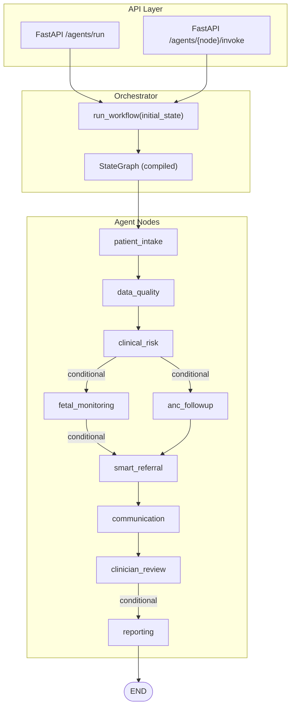
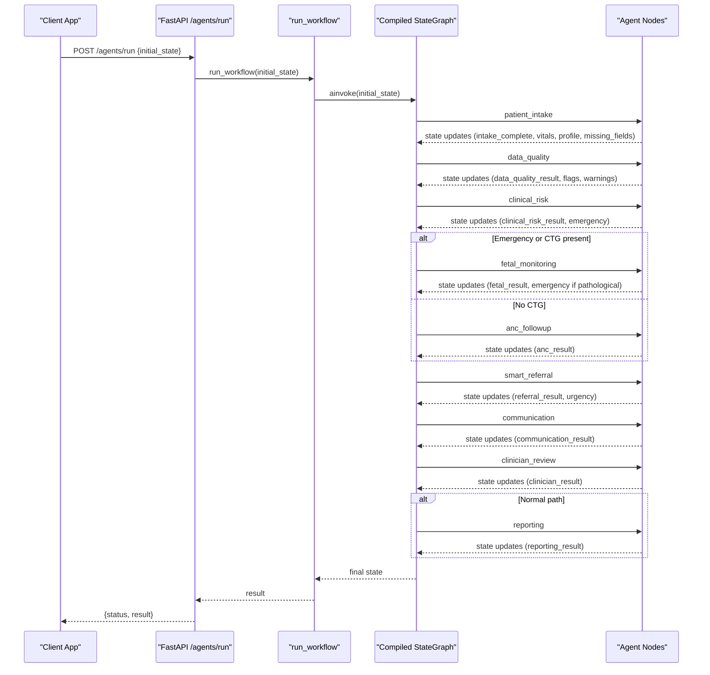
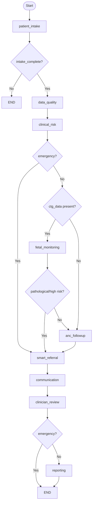
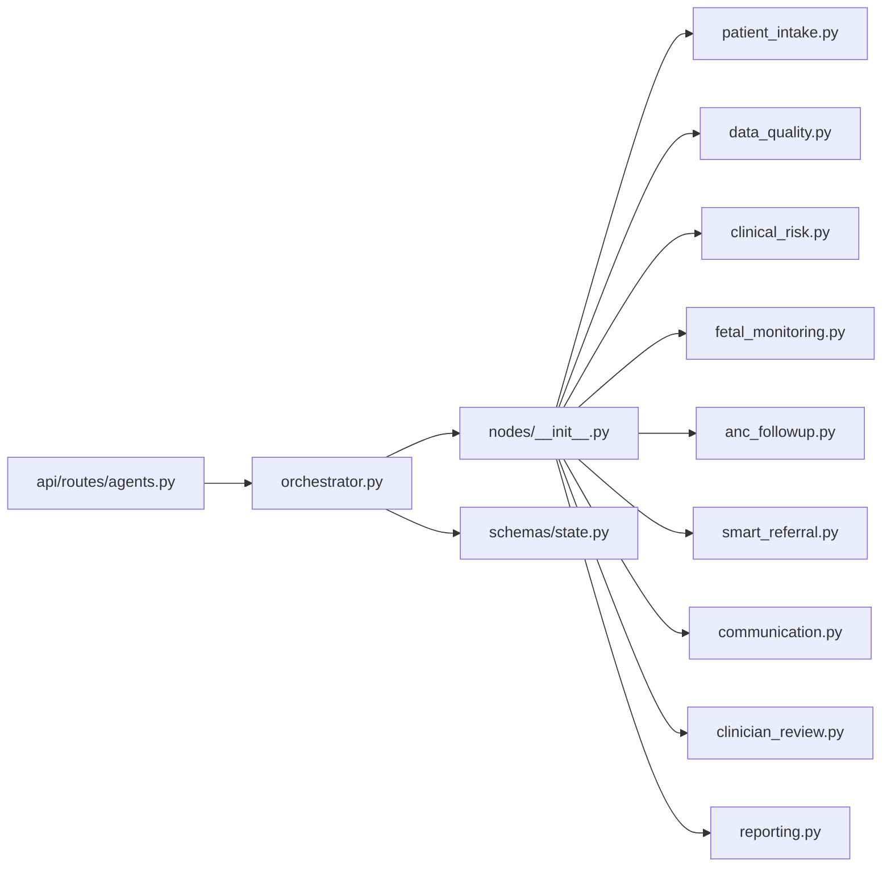

# Workflow Architecture & State Management

<cite>
**Referenced Files in This Document**
- [orchestrator.py](file://backend/agents/orchestrator.py)
- [state.py](file://backend/schemas/state.py)
- [patient_intake.py](file://backend/agents/nodes/patient_intake.py)
- [data_quality.py](file://backend/agents/nodes/data_quality.py)
- [clinical_risk.py](file://backend/agents/nodes/clinical_risk.py)
- [fetal_monitoring.py](file://backend/agents/nodes/fetal_monitoring.py)
- [anc_followup.py](file://backend/agents/nodes/anc_followup.py)
- [smart_referral.py](file://backend/agents/nodes/smart_referral.py)
- [communication.py](file://backend/agents/nodes/communication.py)
- [clinician_review.py](file://backend/agents/nodes/clinician_review.py)
- [reporting.py](file://backend/agents/nodes/reporting.py)
- [agents.py](file://backend/api/routes/agents.py)
- [config.py](file://backend/config.py)
</cite>

## Table of Contents
1. Introduction
2. Project Structure
3. Core Components
4. Architecture Overview
5. Detailed Component Analysis
6. Dependency Analysis
7. Performance Considerations
8. Troubleshooting Guide
9. Conclusion
10. Appendices

## Introduction
This document explains the LangGraph-based workflow architecture and state management system that coordinates nine specialized agent nodes through conditional routing logic. It covers the AgentState schema, state transitions, patient data flow through the clinical workflow, entry point configuration, conditional edges, and routing functions that determine progression based on emergency detection, CTG availability, and risk levels. It also provides guidance for customizing workflow paths, adding new routing conditions, debugging state transitions, and considerations for concurrent execution and memory management.

## Project Structure
The workflow is implemented as a LangGraph StateGraph with nine nodes:
- patient_intake
- data_quality
- clinical_risk
- fetal_monitoring
- anc_followup
- smart_referral
- communication
- clinician_review
- reporting

The API exposes endpoints to run the full workflow or invoke individual nodes. Configuration for models, databases, and external services is centralized.

**Diagram sources**
- [agents.py:62-114](file://backend/api/routes/agents.py#L62-L114)
- [orchestrator.py:62-138](file://backend/agents/orchestrator.py#L62-L138)

**Section sources**
- [agents.py:62-114](file://backend/api/routes/agents.py#L62-L114)
- [orchestrator.py:62-138](file://backend/agents/orchestrator.py#L62-L138)

## Core Components
- AgentState schema defines all fields shared across nodes, including identifiers, patient data, flow control flags, per-agent result namespaces, and append-only accumulators for audit_trail, errors, and messages.
- Orchestrator wires the nine nodes into a StateGraph, sets the entry point, defines conditional edges, compiles the graph, and exposes helpers to run the full workflow or a single node.
- Each node reads from and writes to the shared state, producing structured results and appending audit entries.

Key responsibilities:
- patient_intake: collects demographics, vitals, symptoms; optional voice transcription; validates completeness; generates follow-up questions if needed.
- data_quality: validates vital ranges, detects anomalies, checks model confidence thresholds, computes quality score.
- clinical_risk: runs maternal and gestational risk predictions, mandatory WHO safety rule check, sets emergency flag when required.
- fetal_monitoring: runs FetalWatch and PretermGuard on CTG features; sets emergency for pathological findings.
- anc_followup: predicts missed ANC visit risk and recommends action (home_visit/call/sms).
- smart_referral: ranks nearby facilities by capability and distance, plans route, determines urgency.
- communication: sends emergency alerts, referral notifications, or ANC reminders via SMS/WhatsApp; tracks delivery.
- clinician_review: aggregates upstream results into a case summary for human review; marks pending_review.
- reporting: builds comprehensive report payload and dashboard/trend data structures.

**Section sources**
- [state.py:7-43](file://backend/schemas/state.py#L7-L43)
- [orchestrator.py:22-56](file://backend/agents/orchestrator.py#L22-L56)
- [patient_intake.py:58-168](file://backend/agents/nodes/patient_intake.py#L58-L168)
- [data_quality.py:25-201](file://backend/agents/nodes/data_quality.py#L25-L201)
- [clinical_risk.py:15-127](file://backend/agents/nodes/clinical_risk.py#L15-L127)
- [fetal_monitoring.py:10-111](file://backend/agents/nodes/fetal_monitoring.py#L10-L111)
- [anc_followup.py:10-103](file://backend/agents/nodes/anc_followup.py#L10-L103)
- [smart_referral.py:11-136](file://backend/agents/nodes/smart_referral.py#L11-L136)
- [communication.py:38-231](file://backend/agents/nodes/communication.py#L38-L231)
- [clinician_review.py:13-165](file://backend/agents/nodes/clinician_review.py#L13-L165)
- [reporting.py:13-217](file://backend/agents/nodes/reporting.py#L13-L217)

## Architecture Overview
The workflow begins at patient_intake and proceeds through data_quality and clinical_risk. Based on clinical_risk outcomes and CTG availability, it branches to fetal_monitoring or anc_followup. Emergency or high-risk pathways escalate to smart_referral, followed by communication and clinician_review. Reporting concludes normal flows; emergencies may skip reporting to reduce latency.

**Diagram sources**
- [agents.py:62-114](file://backend/api/routes/agents.py#L62-L114)
- [orchestrator.py:75-138](file://backend/agents/orchestrator.py#L75-L138)
- [clinical_risk.py:15-127](file://backend/agents/nodes/clinical_risk.py#L15-L127)
- [fetal_monitoring.py:10-111](file://backend/agents/nodes/fetal_monitoring.py#L10-L111)
- [anc_followup.py:10-103](file://backend/agents/nodes/anc_followup.py#L10-L103)
- [smart_referral.py:11-136](file://backend/agents/nodes/smart_referral.py#L11-L136)
- [communication.py:38-231](file://backend/agents/nodes/communication.py#L38-L231)
- [clinician_review.py:13-165](file://backend/agents/nodes/clinician_review.py#L13-L165)
- [reporting.py:13-217](file://backend/agents/nodes/reporting.py#L13-L217)

## Detailed Component Analysis

### AgentState Schema
- Identifiers: patient_id, case_id, language, channel
- Patient data: vitals, symptoms, demographics, ctg_data, profile, missing_fields, followup_questions, llm_generated
- Flow control: intake_complete, emergency, current_step
- Per-agent outputs: clinical_risk_result, fetal_result, anc_result, referral_result, communication_result, clinician_result, data_quality_result, reporting_result
- Cross-cutting: audit_trail (append-only), errors (append-only), messages (append-only)

These fields are read/written by nodes to coordinate decisions and maintain an immutable history of actions and errors.

**Section sources**
- [state.py:7-43](file://backend/schemas/state.py#L7-L43)

### Entry Point and Conditional Routing
- Entry point: patient_intake
- Conditional edges:
  - After intake: END if incomplete; otherwise data_quality
  - After data_quality: clinical_risk
  - After clinical_risk:
    - Emergency → smart_referral
    - CTG present → fetal_monitoring
    - Else → anc_followup
  - After fetal_monitoring:
    - Emergency (pathological CTG) → smart_referral
    - Else → anc_followup
  - After anc_followup: smart_referral
  - After smart_referral: communication
  - After communication: clinician_review
  - After clinician_review:
    - Emergency → END (skip reporting)
    - Else → reporting
  - After reporting: END

Routing functions evaluate state fields such as intake_complete, emergency, and vitals.ctg_data to decide next steps.

**Section sources**
- [orchestrator.py:22-56](file://backend/agents/orchestrator.py#L22-L56)
- [orchestrator.py:75-138](file://backend/agents/orchestrator.py#L75-L138)

### Data Flow Through Clinical Workflow
- patient_intake gathers and validates data; may generate follow-up questions; sets intake_complete and current_step
- data_quality validates vitals and model confidences; produces flags and warnings; computes quality_score
- clinical_risk runs MaternalGuard/GestationInsight and WHO red-flag checks; sets emergency when triage_level indicates HIGH_RISK_EMERGENCY
- fetal_monitoring runs FetalWatch/PretermGuard; sets emergency for pathological status; skips gracefully without CTG
- anc_followup predicts missed-visit risk and recommends action
- smart_referral ranks facilities, plans routes, determines urgency
- communication dispatches alerts/messages and records delivery
- clinician_review aggregates results into a case summary for human review
- reporting builds structured payloads for dashboards and trends

**Diagram sources**
- [orchestrator.py:75-138](file://backend/agents/orchestrator.py#L75-L138)
- [clinical_risk.py:15-127](file://backend/agents/nodes/clinical_risk.py#L15-L127)
- [fetal_monitoring.py:10-111](file://backend/agents/nodes/fetal_monitoring.py#L10-L111)
- [anc_followup.py:10-103](file://backend/agents/nodes/anc_followup.py#L10-L103)
- [smart_referral.py:11-136](file://backend/agents/nodes/smart_referral.py#L11-L136)
- [communication.py:38-231](file://backend/agents/nodes/communication.py#L38-L231)
- [clinician_review.py:13-165](file://backend/agents/nodes/clinician_review.py#L13-L165)
- [reporting.py:13-217](file://backend/agents/nodes/reporting.py#L13-L217)

### Customizing Workflow Paths
To add or modify routing:
- Add a new conditional edge after any node using add_conditional_edges with a routing function that inspects state fields (e.g., emergency, vitals.ctg_data, anc_result.priority).
- Implement a new node function that reads relevant state fields, performs processing, and returns updates to the state dictionary.
- Register the node in the orchestrator’s graph.add_node and map it in run_single_node for testing.
- Ensure each node appends audit entries and errors consistently.

Examples:
- New branch after clinical_risk based on gestational complication risk level
- Additional escalation condition in fetal_monitoring based on combined fetal and preterm risk
- Optional post-clinician_review step for specific risk indicators

**Section sources**
- [orchestrator.py:62-138](file://backend/agents/orchestrator.py#L62-L138)
- [patient_intake.py:58-168](file://backend/agents/nodes/patient_intake.py#L58-L168)
- [clinical_risk.py:15-127](file://backend/agents/nodes/clinical_risk.py#L15-L127)
- [fetal_monitoring.py:10-111](file://backend/agents/nodes/fetal_monitoring.py#L10-L111)
- [anc_followup.py:10-103](file://backend/agents/nodes/anc_followup.py#L10-L103)
- [smart_referral.py:11-136](file://backend/agents/nodes/smart_referral.py#L11-L136)
- [communication.py:38-231](file://backend/agents/nodes/communication.py#L38-L231)
- [clinician_review.py:13-165](file://backend/agents/nodes/clinician_review.py#L13-L165)
- [reporting.py:13-217](file://backend/agents/nodes/reporting.py#L13-L217)

### Debugging State Transitions
- Use the single-node invocation endpoint to isolate behavior: POST /agents/{node_name}/invoke with a minimal state dict containing required fields.
- Inspect audit_trail and errors appended by each node to trace execution and failures.
- Validate state fields before invoking downstream nodes (e.g., ensure vitals contain required keys for intake_complete).
- For LLM-dependent steps, confirm fallbacks are triggered when services are unavailable.

**Section sources**
- [agents.py:90-114](file://backend/api/routes/agents.py#L90-L114)
- [patient_intake.py:58-168](file://backend/agents/nodes/patient_intake.py#L58-L168)
- [data_quality.py:25-201](file://backend/agents/nodes/data_quality.py#L25-L201)
- [clinical_risk.py:15-127](file://backend/agents/nodes/clinical_risk.py#L15-L127)
- [fetal_monitoring.py:10-111](file://backend/agents/nodes/fetal_monitoring.py#L10-L111)
- [anc_followup.py:10-103](file://backend/agents/nodes/anc_followup.py#L10-L103)
- [smart_referral.py:11-136](file://backend/agents/nodes/smart_referral.py#L11-L136)
- [communication.py:38-231](file://backend/agents/nodes/communication.py#L38-L231)
- [clinician_review.py:13-165](file://backend/agents/nodes/clinician_review.py#L13-L165)
- [reporting.py:13-217](file://backend/agents/nodes/reporting.py#L13-L217)

## Dependency Analysis
The orchestrator depends on:
- LangGraph StateGraph and END for workflow definition
- Node functions imported from backend.agents.nodes
- AgentState schema for type hints and shared structure
- External integrations and services used by nodes (voice, messaging, facility locator, routing, inference, safety, LLM)

**Diagram sources**
- [orchestrator.py:1-167](file://backend/agents/orchestrator.py#L1-L167)
- [__init__.py:1-24](file://backend/agents/nodes/__init__.py#L1-L24)
- [state.py:1-43](file://backend/schemas/state.py#L1-L43)
- [agents.py:1-135](file://backend/api/routes/agents.py#L1-L135)

**Section sources**
- [orchestrator.py:1-167](file://backend/agents/orchestrator.py#L1-L167)
- [__init__.py:1-24](file://backend/agents/nodes/__init__.py#L1-L24)
- [state.py:1-43](file://backend/schemas/state.py#L1-L43)
- [agents.py:1-135](file://backend/api/routes/agents.py#L1-L135)

## Performance Considerations
- Concurrency: The workflow uses async functions and LangGraph’s ainvoke for non-blocking execution. LLM calls are executed in worker threads to avoid blocking the event loop.
- Memory management:
  - Prefer returning only necessary state updates from nodes to minimize state growth.
  - Use append-only lists for audit_trail, errors, and messages; monitor their size in long-running sessions.
  - Avoid storing large payloads (e.g., raw audio) in state; pass references or use external storage.
- Latency optimization:
  - Skip reporting in emergency paths to reduce time-to-alert.
  - Short-circuit unnecessary nodes when data is missing (e.g., fetal_monitoring skipped without CTG).
- External service resilience:
  - LLM fallbacks ensure critical paths remain functional even if services fail.
  - Graceful handling of missing or invalid inputs prevents cascading failures.

[No sources needed since this section provides general guidance]

## Troubleshooting Guide
Common issues and remedies:
- Missing required vitals: patient_intake sets intake_complete=False; ensure all required fields are provided or handle follow-up questions.
- Out-of-range vitals: data_quality flags critical issues; validate input sources and correct measurement units.
- Model unavailability: nodes fall back to templates; verify model registry and artifact paths in configuration.
- LLM failures: communication, reporting, and other nodes fall back to template text; check API keys and model availability.
- Emergency escalation: ensure clinical_risk and fetal_monitoring correctly set emergency based on WHO rules and CTG findings.
- Audit and errors: inspect audit_trail and errors appended by nodes to identify failure points and context.

**Section sources**
- [patient_intake.py:58-168](file://backend/agents/nodes/patient_intake.py#L58-L168)
- [data_quality.py:25-201](file://backend/agents/nodes/data_quality.py#L25-L201)
- [clinical_risk.py:15-127](file://backend/agents/nodes/clinical_risk.py#L15-L127)
- [fetal_monitoring.py:10-111](file://backend/agents/nodes/fetal_monitoring.py#L10-L111)
- [communication.py:38-231](file://backend/agents/nodes/communication.py#L38-L231)
- [reporting.py:13-217](file://backend/agents/nodes/reporting.py#L13-L217)

## Conclusion
The LangGraph-based workflow provides a robust, extensible pipeline for maternal and fetal health assessment. By centralizing state management and using conditional routing, it adapts to varying patient conditions while maintaining clear audit trails and error handling. The design supports customization, debugging, and performance tuning for production use.

[No sources needed since this section summarizes without analyzing specific files]

## Appendices

### API Endpoints Summary
- POST /agents/run: Executes the full workflow with an initial state payload.
- GET /agents/status: Lists available agent nodes and descriptions.
- POST /agents/{node_name}/invoke: Runs a single node for testing/debugging.

**Section sources**
- [agents.py:62-114](file://backend/api/routes/agents.py#L62-L114)

### Configuration Highlights
- Model paths, database URL, JWT settings, external API URLs, and LLM settings are defined centrally.
- Adjust paths and credentials as needed for different environments.

**Section sources**
- [config.py:7-55](file://backend/config.py#L7-L55)