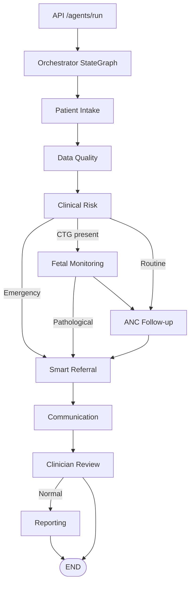
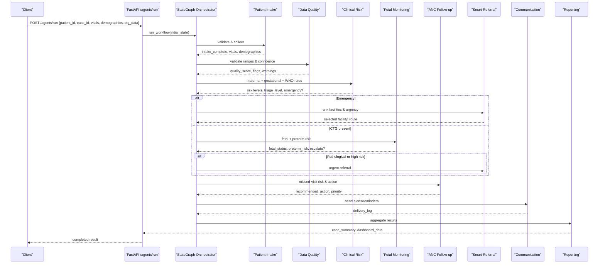
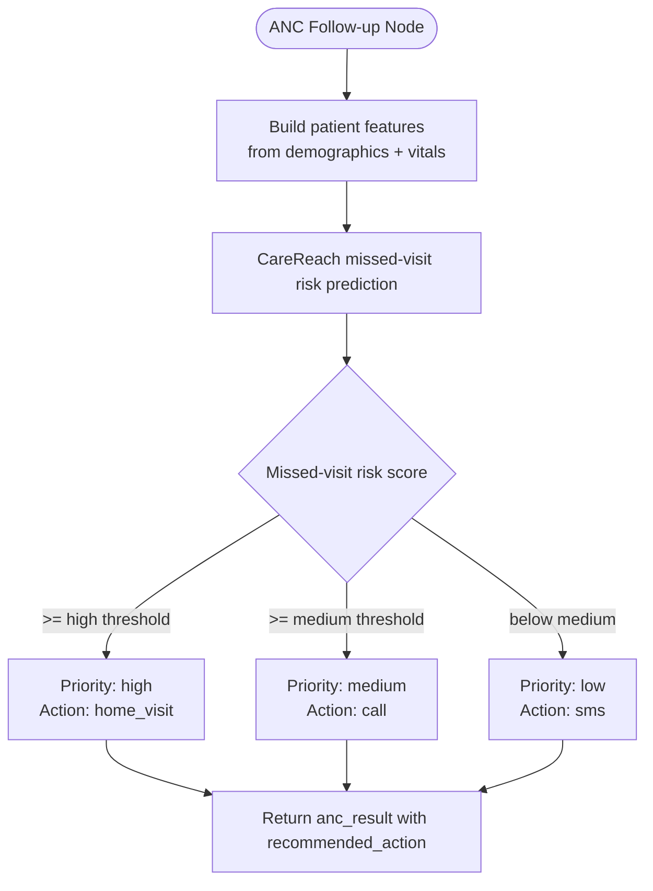
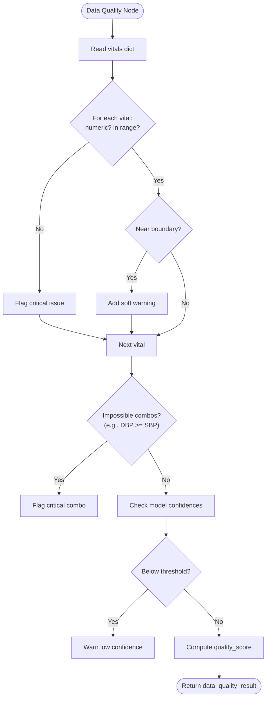
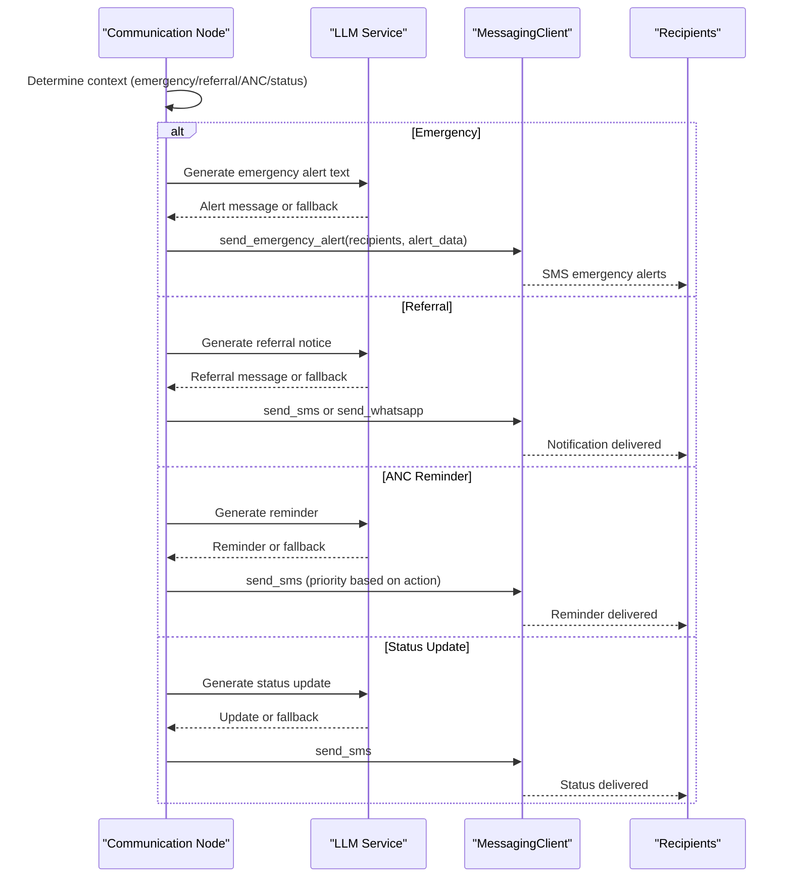
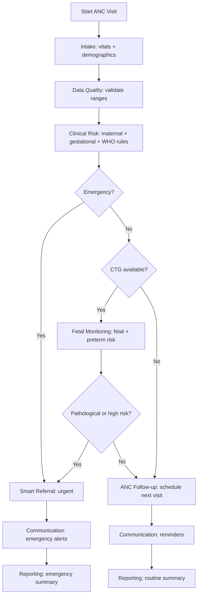
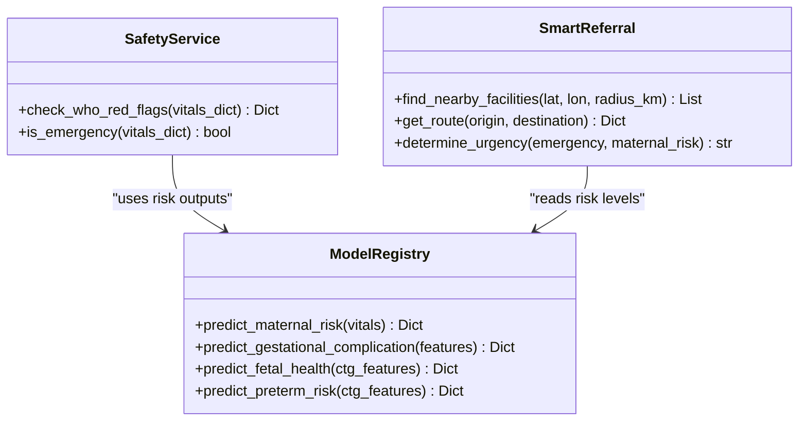
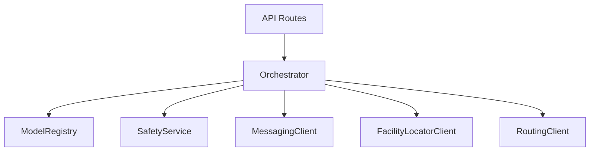

# Antenatal Care Follow-up Workflow

<cite>
**Referenced Files in This Document**
- [orchestrator.py](file://backend/agents/orchestrator.py)
- [patient_intake.py](file://backend/agents/nodes/patient_intake.py)
- [data_quality.py](file://backend/agents/nodes/data_quality.py)
- [clinical_risk.py](file://backend/agents/nodes/clinical_risk.py)
- [fetal_monitoring.py](file://backend/agents/nodes/fetal_monitoring.py)
- [anc_followup.py](file://backend/agents/nodes/anc_followup.py)
- [smart_referral.py](file://backend/agents/nodes/smart_referral.py)
- [communication.py](file://backend/agents/nodes/communication.py)
- [reporting.py](file://backend/agents/nodes/reporting.py)
- [inference.py](file://backend/services/inference.py)
- [safety.py](file://backend/services/safety.py)
- [messaging_client.py](file://backend/integrations/messaging_client.py)
- [state.py](file://backend/schemas/state.py)
- [agents.py](file://backend/api/routes/agents.py)
</cite>

## Table of Contents
1. Introduction
2. Project Structure
3. Core Components
4. Architecture Overview
5. Detailed Component Analysis
6. Dependency Analysis
7. Performance Considerations
8. Troubleshooting Guide
9. Conclusion

## Introduction
This document describes the antenatal care (ANC) follow-up workflow that manages routine prenatal visits, monitoring schedules, and preventive care interventions. It explains how visit scheduling is driven by risk stratification and local ANC guidelines, how data quality checks are performed at each step, and how automated communications are dispatched for reminders, test results, and care plan updates. It also outlines standard ANC visit flows, high-risk pregnancy protocols, and integration points with referral routing and reporting systems.

## Project Structure
The system implements a multi-agent pipeline orchestrated by a state machine. Each agent node performs a specific task: intake, data quality validation, clinical risk assessment, fetal monitoring, ANC follow-up planning, smart referral, communication dispatch, clinician review, and reporting. The API exposes endpoints to run the full workflow or invoke individual nodes.

**Diagram sources**
- [orchestrator.py:62-132](file://backend/agents/orchestrator.py#L62-L132)
- [agents.py:62-79](file://backend/api/routes/agents.py#L62-L79)

**Section sources**
- [orchestrator.py:1-167](file://backend/agents/orchestrator.py#L1-L167)
- [agents.py:1-135](file://backend/api/routes/agents.py#L1-L135)

## Core Components
- Patient Intake: Collects demographics, vitals, symptoms; optional voice transcription and symptom extraction; validates required fields and generates follow-up questions when missing.
- Data Quality: Validates vital ranges, flags impossible values, checks model confidence thresholds, and computes an overall quality score.
- Clinical Risk: Runs maternal risk prediction, gestational complication prediction (when features available), and mandatory WHO red-flag safety check to determine emergency status.
- Fetal Monitoring: Analyzes CTG-derived features using fetal health and preterm risk models; escalates to emergency if pathological or high-risk.
- ANC Follow-up: Predicts missed-visit risk and recommends action (SMS, call, home visit) based on priority thresholds.
- Smart Referral: Ranks nearby facilities by capability match and distance, plans routes, and determines urgency.
- Communication: Sends SMS/WhatsApp/emergency alerts; uses LLM-generated messages with robust fallbacks; tracks delivery status.
- Reporting: Aggregates all outputs into structured case summaries and dashboard metrics; optional narrative generation.

**Section sources**
- [patient_intake.py:58-149](file://backend/agents/nodes/patient_intake.py#L58-L149)
- [data_quality.py:25-183](file://backend/agents/nodes/data_quality.py#L25-L183)
- [clinical_risk.py:15-109](file://backend/agents/nodes/clinical_risk.py#L15-L109)
- [fetal_monitoring.py:10-93](file://backend/agents/nodes/fetal_monitoring.py#L10-L93)
- [anc_followup.py:10-85](file://backend/agents/nodes/anc_followup.py#L10-L85)
- [smart_referral.py:11-118](file://backend/agents/nodes/smart_referral.py#L11-L118)
- [communication.py:38-213](file://backend/agents/nodes/communication.py#L38-L213)
- [reporting.py:13-173](file://backend/agents/nodes/reporting.py#L13-L173)

## Architecture Overview
The workflow is implemented as a LangGraph StateGraph with conditional edges that route execution based on clinical context and data availability. The API layer provides secure endpoints to execute the full pipeline or single nodes for testing.

**Diagram sources**
- [orchestrator.py:62-132](file://backend/agents/orchestrator.py#L62-L132)
- [agents.py:62-79](file://backend/api/routes/agents.py#L62-L79)

## Detailed Component Analysis

### Visit Scheduling Algorithms
- Risk-based scheduling: ANC follow-up predicts missed-visit risk and maps priority to actions:
  - High priority → home visit
  - Medium priority → phone call
  - Low priority → SMS reminder
- Thresholds: Priority classification is derived from predicted missed-visit risk scores with defined thresholds.
- Local guideline alignment: WHO red-flag rules are mandatory and can override normal flow to trigger emergency pathways.

**Diagram sources**
- [anc_followup.py:10-85](file://backend/agents/nodes/anc_followup.py#L10-L85)
- [inference.py:297-361](file://backend/services/inference.py#L297-L361)

**Section sources**
- [anc_followup.py:10-85](file://backend/agents/nodes/anc_followup.py#L10-L85)
- [inference.py:297-361](file://backend/services/inference.py#L297-L361)

### Data Quality Checks During Follow-up
- Vital sign validation: Enforces physiological ranges per field; flags non-numeric and out-of-range values; detects impossible combinations (e.g., diastolic ≥ systolic).
- Borderline warnings: Soft warnings near range boundaries to prompt re-measurement or verification.
- Model confidence checks: Ensures predictions meet minimum confidence thresholds; warns if below threshold.
- Overall quality score: Computed from number of issues versus total checks.

**Diagram sources**
- [data_quality.py:25-183](file://backend/agents/nodes/data_quality.py#L25-L183)

**Section sources**
- [data_quality.py:25-183](file://backend/agents/nodes/data_quality.py#L25-L183)

### Automated Communication Workflows
- Message types:
  - Emergency alerts: Sent to multiple recipients with high priority.
  - Referral notifications: SMS or WhatsApp with urgency and travel time.
  - ANC reminders: Based on recommended action; includes call follow-up when needed.
  - Status updates: General screening completion messages.
- Channel selection: Defaults to SMS; supports WhatsApp; emergency alerts broadcast to configured recipients.
- LLM integration: Generates personalized messages with robust fallback templates when LLM is unavailable.
- Delivery tracking: Logs message IDs, channels, priorities, and delivery status.

**Diagram sources**
- [communication.py:38-213](file://backend/agents/nodes/communication.py#L38-L213)
- [messaging_client.py:17-78](file://backend/integrations/messaging_client.py#L17-L78)

**Section sources**
- [communication.py:38-213](file://backend/agents/nodes/communication.py#L38-L213)
- [messaging_client.py:1-78](file://backend/integrations/messaging_client.py#L1-L78)

### Standard ANC Visit Flows
- Routine visit:
  - Intake collects vitals and demographics.
  - Data quality validates measurements.
  - Clinical risk assesses maternal/gestational risks and applies WHO rules.
  - If no CTG, proceed to ANC follow-up to schedule next visit and send reminders.
  - Smart referral ranks facilities if needed; communication sends reminders.
  - Reporting aggregates results.
- High-risk visit:
  - WHO red flags or pathological CTG triggers emergency pathway.
  - Immediate referral to appropriate facility with highest capability match.
  - Emergency alerts sent to health workers and supervisors.
  - Reporting includes emergency escalation details.

**Diagram sources**
- [orchestrator.py:22-55](file://backend/agents/orchestrator.py#L22-L55)
- [clinical_risk.py:15-109](file://backend/agents/nodes/clinical_risk.py#L15-L109)
- [fetal_monitoring.py:10-93](file://backend/agents/nodes/fetal_monitoring.py#L10-L93)
- [anc_followup.py:10-85](file://backend/agents/nodes/anc_followup.py#L10-L85)
- [smart_referral.py:11-118](file://backend/agents/nodes/smart_referral.py#L11-L118)
- [communication.py:38-213](file://backend/agents/nodes/communication.py#L38-L213)
- [reporting.py:13-173](file://backend/agents/nodes/reporting.py#L13-L173)

### High-Risk Pregnancy Monitoring Protocols
- WHO Red Flags: Mandatory evaluation; HIGH_RISK_EMERGENCY sets emergency flag and bypasses routine steps.
- Fetal Monitoring: Pathological fetal status or high preterm risk escalates to emergency referral.
- Referral Ranking: Facilities scored by capability match (emergency, NICU, maternity) and distance; urgency determined by emergency flag and maternal risk level.
- Communication: Emergency alerts sent immediately to multiple recipients; referral notices include urgency and estimated travel time.

**Diagram sources**
- [safety.py:18-67](file://backend/services/safety.py#L18-L67)
- [inference.py:153-426](file://backend/services/inference.py#L153-L426)
- [smart_referral.py:11-118](file://backend/agents/nodes/smart_referral.py#L11-L118)

**Section sources**
- [clinical_risk.py:15-109](file://backend/agents/nodes/clinical_risk.py#L15-L109)
- [fetal_monitoring.py:10-93](file://backend/agents/nodes/fetal_monitoring.py#L10-L93)
- [smart_referral.py:11-118](file://backend/agents/nodes/smart_referral.py#L11-L118)
- [safety.py:18-67](file://backend/services/safety.py#L18-L67)

### Intervention Triggers
- Emergency triggers:
  - WHO triage level HIGH_RISK_EMERGENCY.
  - Fetal status pathological or high preterm risk.
- Referral triggers:
  - Capability mismatch requiring higher-level care (NICU, emergency).
- Communication triggers:
  - Missed-visit risk above thresholds prompting calls or home visits.
  - Test result notifications via referral or status updates.

**Section sources**
- [clinical_risk.py:15-109](file://backend/agents/nodes/clinical_risk.py#L15-L109)
- [fetal_monitoring.py:10-93](file://backend/agents/nodes/fetal_monitoring.py#L10-L93)
- [anc_followup.py:10-85](file://backend/agents/nodes/anc_followup.py#L10-L85)
- [communication.py:38-213](file://backend/agents/nodes/communication.py#L38-L213)

### Integration Points
- Immunization schedules: Not explicitly implemented in current codebase; can be integrated via messaging templates and scheduling hooks in future extensions.
- Nutritional counseling: Can be incorporated through additional intake fields and communication templates; currently supported via flexible messaging client.
- Health education delivery: Supported via SMS/WhatsApp channels and LLM-generated educational content; extendable through messaging templates.

[No sources needed since this section provides general guidance]

## Dependency Analysis
The workflow depends on several core services and integrations:
- Inference service: Loads and runs ML models for maternal, fetal, preterm, ANC follow-up, and gestational risk.
- Safety service: Wraps WHO rule engine for mandatory red-flag checks.
- Messaging client: Provides SMS/WhatsApp capabilities with delivery tracking.
- Facility locator and routing clients: Enable smart referral ranking and route planning.
- API routes: Expose endpoints to run workflows and invoke nodes.

**Diagram sources**
- [orchestrator.py:62-132](file://backend/agents/orchestrator.py#L62-L132)
- [inference.py:51-141](file://backend/services/inference.py#L51-L141)
- [safety.py:18-67](file://backend/services/safety.py#L18-L67)
- [messaging_client.py:9-78](file://backend/integrations/messaging_client.py#L9-L78)
- [agents.py:62-79](file://backend/api/routes/agents.py#L62-L79)

**Section sources**
- [inference.py:51-141](file://backend/services/inference.py#L51-L141)
- [safety.py:18-67](file://backend/services/safety.py#L18-L67)
- [messaging_client.py:9-78](file://backend/integrations/messaging_client.py#L9-L78)
- [agents.py:62-79](file://backend/api/routes/agents.py#L62-L79)

## Performance Considerations
- Model loading: Models are loaded once via singleton registry to avoid repeated initialization overhead.
- Non-blocking LLM calls: LLM interactions run in worker threads to prevent blocking the async event loop.
- Conditional execution: Workflow branches reduce unnecessary computation (e.g., skipping fetal monitoring without CTG data).
- Fallbacks: Robust fallbacks ensure continuity when external services (LLM, models) are unavailable.

[No sources needed since this section provides general guidance]

## Troubleshooting Guide
- Missing vitals: Intake marks incomplete and generates follow-up questions; workflow halts until required fields are provided.
- Out-of-range vitals: Data quality flags critical issues; consider re-measurement or manual correction.
- Low model confidence: Warnings indicate unreliable predictions; consider re-running with updated inputs or clinician review.
- Communication failures: Delivery logs track message status; retry logic can be added at the messaging client layer.
- Emergency overrides: Ensure WHO red-flag checks are functioning; emergency path should bypass routine steps.

**Section sources**
- [patient_intake.py:58-149](file://backend/agents/nodes/patient_intake.py#L58-L149)
- [data_quality.py:25-183](file://backend/agents/nodes/data_quality.py#L25-L183)
- [communication.py:38-213](file://backend/agents/nodes/communication.py#L38-L213)
- [messaging_client.py:17-78](file://backend/integrations/messaging_client.py#L17-L78)

## Conclusion
The ANC follow-up workflow integrates clinical risk assessment, fetal monitoring, and intelligent scheduling to support routine and high-risk pregnancies. It enforces data quality, leverages predictive models, and automates communications to ensure timely care. The modular design allows extension for immunization schedules, nutritional counseling, and health education delivery while maintaining robust error handling and auditability.