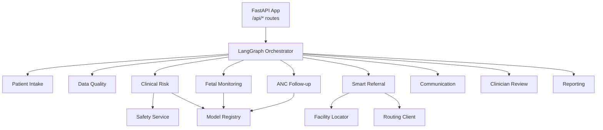
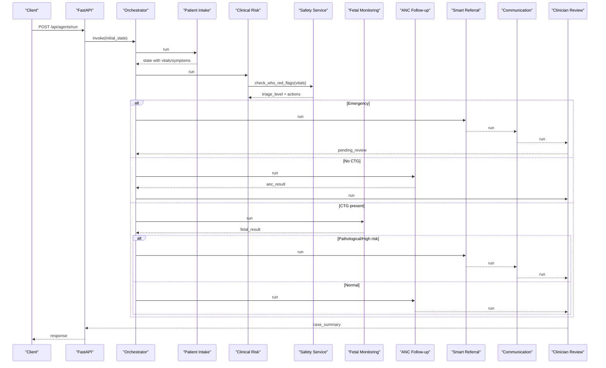
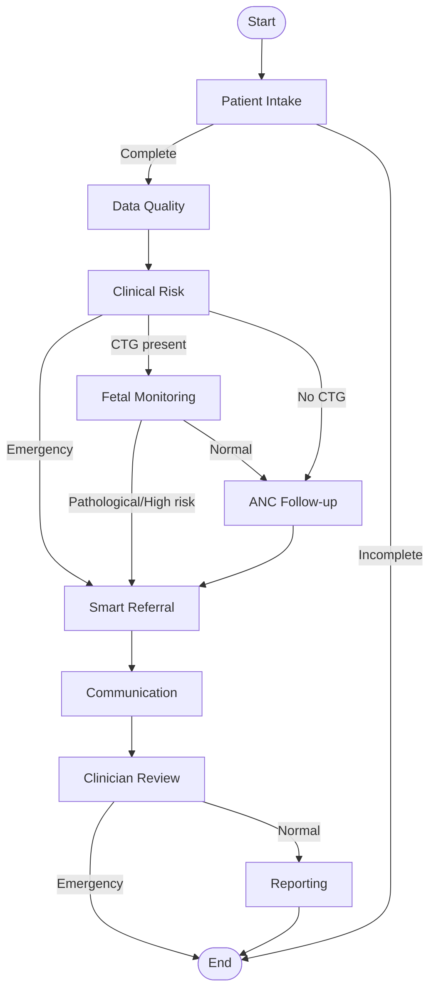
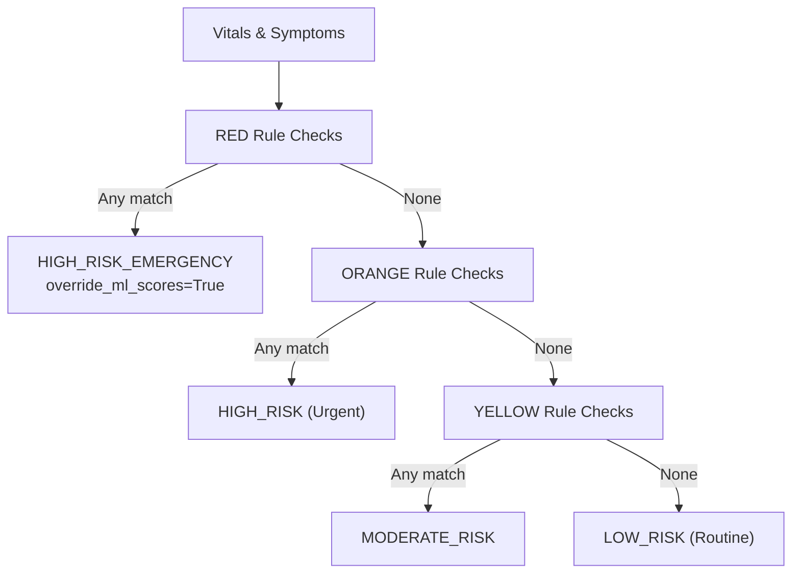
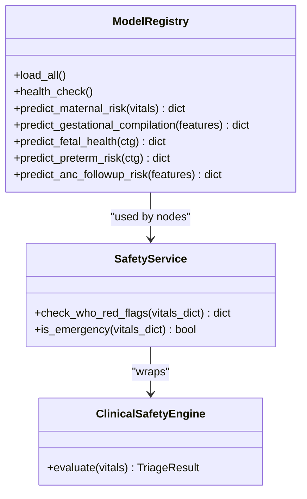
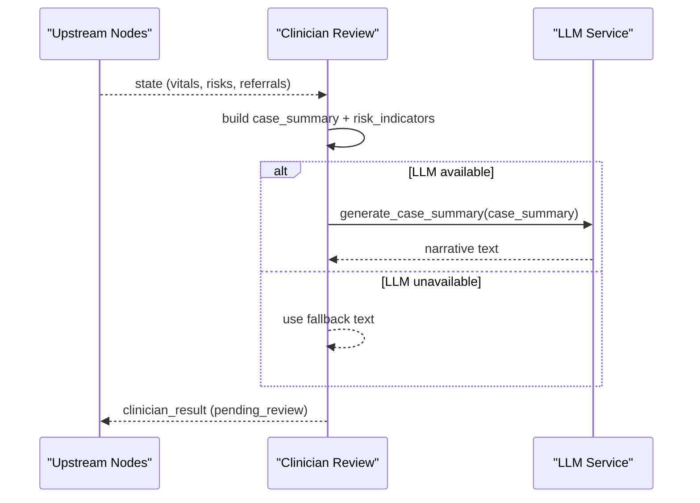
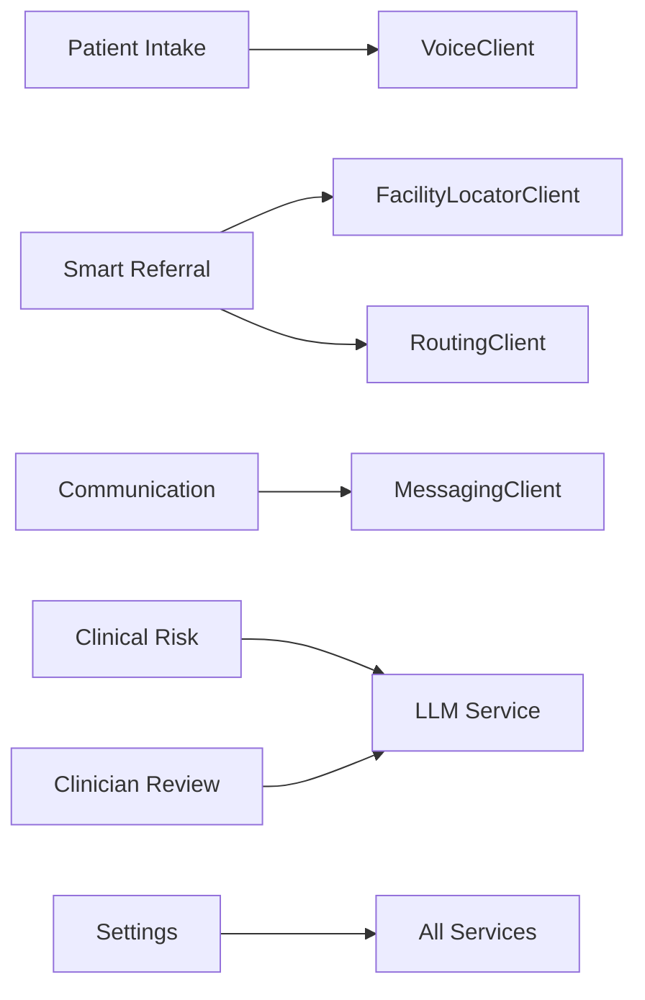
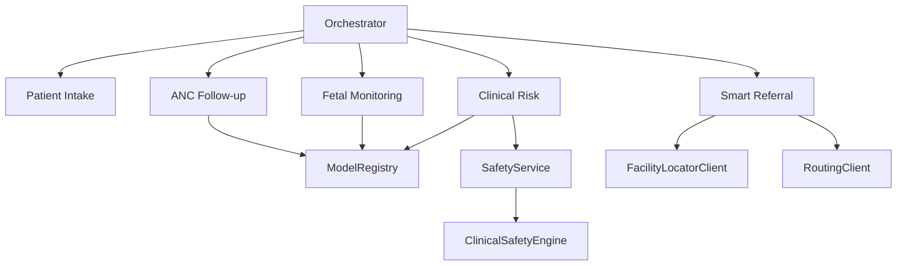

# Clinical Workflows

<cite>
**Referenced Files in This Document**
- [main.py](file://backend/api/main.py)
- [orchestrator.py](file://backend/agents/orchestrator.py)
- [patient_intake.py](file://backend/agents/nodes/patient_intake.py)
- [clinical_risk.py](file://backend/agents/nodes/clinical_risk.py)
- [fetal_monitoring.py](file://backend/agents/nodes/fetal_monitoring.py)
- [anc_followup.py](file://backend/agents/nodes/anc_followup.py)
- [smart_referral.py](file://backend/agents/nodes/smart_referral.py)
- [clinician_review.py](file://backend/agents/nodes/clinician_review.py)
- [state.py](file://backend/schemas/state.py)
- [safety_rules.py](file://safety_rules.py)
- [safety.py](file://backend/services/safety.py)
- [inference.py](file://backend/services/inference.py)
- [config.py](file://backend/config.py)
</cite>

## Table of Contents
1. Introduction
2. Project Structure
3. Core Components
4. Architecture Overview
5. Detailed Component Analysis
6. Dependency Analysis
7. Performance Considerations
8. Troubleshooting Guide
9. Conclusion

## Introduction
This document describes the clinical workflows implemented in MaaHifazat AI, covering the end-to-end patient journey from registration to risk assessment, clinical evaluation, referral generation, and human-in-the-loop review. It explains evidence-based protocols for maternal and fetal health assessment, criteria for identifying high-risk pregnancies, emergency procedures, escalation pathways, safety rules, and integration points with external systems. Guidance is provided for healthcare workers on interpreting AI recommendations and making final clinical decisions.

## Project Structure
The system is a FastAPI backend that exposes clinical APIs and orchestrates a LangGraph state machine composed of specialized agent nodes. Each node performs a focused task (intake, risk assessment, fetal monitoring, ANC follow-up, referral, communication, clinician review, reporting). A shared state object carries data across nodes. External integrations include voice transcription, facility location, routing, messaging, and an LLM service. ML models are loaded via a registry and used by specific nodes.

**Diagram sources**
- [main.py:52-134](file://backend/api/main.py#L52-L134)
- [orchestrator.py:62-138](file://backend/agents/orchestrator.py#L62-L138)
- [clinical_risk.py:15-109](file://backend/agents/nodes/clinical_risk.py#L15-L109)
- [fetal_monitoring.py:10-93](file://backend/agents/nodes/fetal_monitoring.py#L10-L93)
- [anc_followup.py:10-85](file://backend/agents/nodes/anc_followup.py#L10-L85)
- [smart_referral.py:11-118](file://backend/agents/nodes/smart_referral.py#L11-L118)
- [safety.py:18-67](file://backend/services/safety.py#L18-L67)
- [inference.py:51-141](file://backend/services/inference.py#L51-L141)

**Section sources**
- [main.py:1-135](file://backend/api/main.py#L1-L135)
- [orchestrator.py:1-167](file://backend/agents/orchestrator.py#L1-L167)

## Core Components
- Patient intake: collects demographics, vitals, symptoms; optional voice transcription; validates required fields and generates follow-up questions if missing.
- Data quality: ensures completeness before proceeding.
- Clinical risk: runs maternal risk prediction, gestational complication prediction, and mandatory WHO red-flag triage; sets emergency flag when needed.
- Fetal monitoring: analyzes CTG features using FetalWatch and PretermGuard; escalates if pathological or high preterm risk.
- ANC follow-up: predicts missed-visit risk and recommends action (home visit, call, SMS).
- Smart referral: ranks nearby facilities by capability and distance, plans route, creates referral record with urgency level.
- Communication: sends alerts/messages based on workflow outcomes.
- Clinician review: aggregates results into a case summary for human approval; marks pending review and highlights risk indicators.
- Reporting: produces summaries and logs for audit and analytics.

Key data structures:
- AgentState: shared state carrying patient identifiers, language/channel, vitals, symptoms, demographics, CTG data, flow control flags, and per-agent outputs.

**Section sources**
- [patient_intake.py:58-149](file://backend/agents/nodes/patient_intake.py#L58-L149)
- [clinical_risk.py:15-109](file://backend/agents/nodes/clinical_risk.py#L15-L109)
- [fetal_monitoring.py:10-93](file://backend/agents/nodes/fetal_monitoring.py#L10-L93)
- [anc_followup.py:10-85](file://backend/agents/nodes/anc_followup.py#L10-L85)
- [smart_referral.py:11-118](file://backend/agents/nodes/smart_referral.py#L11-L118)
- [clinician_review.py:13-147](file://backend/agents/nodes/clinician_review.py#L13-L147)
- [state.py:7-43](file://backend/schemas/state.py#L7-L43)

## Architecture Overview
The FastAPI application initializes database and model registry at startup, then exposes endpoints under /api. The LangGraph orchestrator defines a directed graph of agent nodes with conditional edges that route based on state (e.g., emergency, presence of CTG data). Safety rules are mandatory and override ML scores when RED triage is detected.

**Diagram sources**
- [main.py:52-134](file://backend/api/main.py#L52-L134)
- [orchestrator.py:22-138](file://backend/agents/orchestrator.py#L22-L138)
- [clinical_risk.py:15-109](file://backend/agents/nodes/clinical_risk.py#L15-L109)
- [safety.py:18-67](file://backend/services/safety.py#L18-L67)
- [fetal_monitoring.py:10-93](file://backend/agents/nodes/fetal_monitoring.py#L10-L93)
- [anc_followup.py:10-85](file://backend/agents/nodes/anc_followup.py#L10-L85)
- [smart_referral.py:11-118](file://backend/agents/nodes/smart_referral.py#L11-L118)
- [clinician_review.py:13-147](file://backend/agents/nodes/clinician_review.py#L13-L147)

## Detailed Component Analysis

### Patient Journey and Workflow Routing
- Entry point: FastAPI app starts DB and model registry, registers routers for patients, risks, referrals, agents, alerts, audit, analytics.
- Orchestration: StateGraph wires nine nodes with conditional routing:
  - After intake: proceed to data quality if complete; otherwise END.
  - After data quality: proceed to clinical risk.
  - After clinical risk: emergency → smart referral; CTG present → fetal monitoring; else ANC follow-up.
  - After fetal monitoring: emergency/pathological → smart referral; else ANC follow-up.
  - ANC follow-up: always proceeds to smart referral in this graph.
  - Smart referral: proceeds to communication, then clinician review.
  - Clinician review: normal → reporting; emergency → END to speed up.

**Diagram sources**
- [orchestrator.py:22-138](file://backend/agents/orchestrator.py#L22-L138)

**Section sources**
- [main.py:52-134](file://backend/api/main.py#L52-L134)
- [orchestrator.py:22-138](file://backend/agents/orchestrator.py#L22-L138)

### Evidence-Based Protocols and Safety Rules
- WHO-based deterministic rule engine evaluates vital signs and symptoms against danger-sign criteria.
- Triage levels: GREEN (routine), YELLOW (attention within 1 hour), ORANGE (urgent within 15 minutes), RED (immediate life-threatening).
- RED rules include severe hypertension, hemorrhage, imminent eclampsia, eclampsia, sepsis, reduced fetal movement after 28 weeks, unconsciousness.
- If any RED rule triggers, override_ml_scores is set to True and triage_level becomes HIGH_RISK_EMERGENCY, forcing emergency pathway.

**Diagram sources**
- [safety_rules.py:19-167](file://safety_rules.py#L19-L167)

**Section sources**
- [safety_rules.py:19-167](file://safety_rules.py#L19-L167)
- [safety.py:18-67](file://backend/services/safety.py#L18-L67)

### Clinical Decision Support Algorithms
- Maternal risk: ModelRegistry.predict_maternal_risk uses MaternalGuard model with feature mapping and label decoding.
- Gestational complications: ModelRegistry.predict_gestational_complication uses GestationInsight model with preprocessing and label mapping.
- Fetal health: ModelRegistry.predict_fetal_health uses FetalWatch on CTG features.
- Preterm risk: ModelRegistry.predict_preterm_risk uses PretermGuard on CTG features.
- ANC missed-visit risk: ModelRegistry.predict_anc_followup_risk uses CareReach model with preprocessor and threshold-based priority.

**Diagram sources**
- [inference.py:51-435](file://backend/services/inference.py#L51-L435)
- [safety.py:18-67](file://backend/services/safety.py#L18-L67)
- [safety_rules.py:72-167](file://safety_rules.py#L72-L167)

**Section sources**
- [inference.py:153-426](file://backend/services/inference.py#L153-L426)
- [clinical_risk.py:15-109](file://backend/agents/nodes/clinical_risk.py#L15-L109)

### Human-in-the-Loop Review Process
- Clinician review aggregates upstream results into a structured case summary with risk indicators and optional LLM-generated narrative.
- Status is set to pending_review; requires_immediate_attention is true for emergencies or multiple risk indicators.
- The node does not make clinical decisions; it presents data for clinician approval.

**Diagram sources**
- [clinician_review.py:13-147](file://backend/agents/nodes/clinician_review.py#L13-L147)

**Section sources**
- [clinician_review.py:13-147](file://backend/agents/nodes/clinician_review.py#L13-L147)

### Integration Points and Interoperability
- Voice transcription and symptom extraction via VoiceClient during intake.
- Facility locator and routing clients for smart referral ranking and route planning.
- Messaging client for alert delivery.
- LLM service for follow-up questions, risk summaries, and case narratives (with graceful fallbacks).
- Configuration via Pydantic settings for model paths, database URL, JWT auth, and external API URLs.

**Diagram sources**
- [patient_intake.py:58-149](file://backend/agents/nodes/patient_intake.py#L58-L149)
- [smart_referral.py:11-118](file://backend/agents/nodes/smart_referral.py#L11-L118)
- [config.py:7-55](file://backend/config.py#L7-L55)

**Section sources**
- [patient_intake.py:58-149](file://backend/agents/nodes/patient_intake.py#L58-L149)
- [smart_referral.py:11-118](file://backend/agents/nodes/smart_referral.py#L11-L118)
- [config.py:7-55](file://backend/config.py#L7-L55)

### Workflow Scenarios

#### Routine ANC Follow-Up
- Intake collects vitals and symptoms; data quality passes; clinical risk assessed; no CTG; ANC follow-up predicts missed-visit risk and recommends action (SMS/call/home visit); proceeds to smart referral for routine or urgent cases; communication sends reminders; clinician review prepares case summary.

#### Complication Detection (Non-Emergency)
- Intake and risk assessment detect moderate or mild issues; ANC follow-up may escalate to home visit or call; smart referral ranks facilities with maternity capabilities; communication notifies care team; clinician review highlights risk indicators.

#### Emergency Referrals
- WHO RED triage or pathological CTG triggers emergency flag; smart referral prioritizes facilities with emergency/NICU capabilities and shortest travel time; communication sends urgent alerts; clinician review marks immediate attention required; reporting may be skipped for speed.

#### Post-Delivery Monitoring
- If CTG data is absent post-delivery, fetal monitoring is skipped; ANC follow-up continues to monitor missed visits; referrals adjusted based on updated risk; communication maintains follow-up cadence; clinician review consolidates outcomes.

**Section sources**
- [fetal_monitoring.py:10-93](file://backend/agents/nodes/fetal_monitoring.py#L10-L93)
- [anc_followup.py:10-85](file://backend/agents/nodes/anc_followup.py#L10-L85)
- [smart_referral.py:11-118](file://backend/agents/nodes/smart_referral.py#L11-L118)
- [clinician_review.py:13-147](file://backend/agents/nodes/clinician_review.py#L13-L147)

## Dependency Analysis
- Orchestrator depends on all agent nodes and conditional routing functions.
- Clinical risk node depends on ModelRegistry and SafetyService.
- Fetal monitoring depends on ModelRegistry.
- ANC follow-up depends on ModelRegistry.
- Smart referral depends on FacilityLocatorClient and RoutingClient.
- SafetyService wraps ClinicalSafetyEngine.
- ModelRegistry loads models configured in Settings and provides predictions with fallbacks.

**Diagram sources**
- [orchestrator.py:62-138](file://backend/agents/orchestrator.py#L62-L138)
- [clinical_risk.py:15-109](file://backend/agents/nodes/clinical_risk.py#L15-L109)
- [fetal_monitoring.py:10-93](file://backend/agents/nodes/fetal_monitoring.py#L10-L93)
- [anc_followup.py:10-85](file://backend/agents/nodes/anc_followup.py#L10-L85)
- [smart_referral.py:11-118](file://backend/agents/nodes/smart_referral.py#L11-L118)
- [safety.py:18-67](file://backend/services/safety.py#L18-L67)
- [inference.py:51-141](file://backend/services/inference.py#L51-L141)

**Section sources**
- [orchestrator.py:62-138](file://backend/agents/orchestrator.py#L62-L138)
- [inference.py:51-141](file://backend/services/inference.py#L51-L141)
- [safety.py:18-67](file://backend/services/safety.py#L18-L67)

## Performance Considerations
- Model loading is performed once at startup via ModelRegistry.load_all; subsequent predictions reuse loaded models.
- LLM calls are executed in worker threads to avoid blocking the event loop; failures fall back to template summaries.
- Conditional routing minimizes unnecessary processing (e.g., skipping reporting in emergencies).
- Facility ranking includes distance and capability scoring to reduce travel time and improve outcomes.
- Graceful degradation: missing models or extras return safe fallbacks without crashing workflows.

[No sources needed since this section provides general guidance]

## Troubleshooting Guide
- Missing required vitals: intake marks incomplete and generates follow-up questions; ensure all required fields are collected before proceeding.
- LLM unavailability: intake and risk nodes fall back to templates; verify LLM configuration and network connectivity.
- Model files not found: registry logs warnings; confirm artifact paths in Settings and that models exist in artifacts directory.
- Database initialization failure: non-fatal in development; check DATABASE_URL and permissions.
- Global exception handler: returns structured JSON errors with path and detail for debugging.

**Section sources**
- [patient_intake.py:58-149](file://backend/agents/nodes/patient_intake.py#L58-L149)
- [clinical_risk.py:15-109](file://backend/agents/nodes/clinical_risk.py#L15-L109)
- [inference.py:68-141](file://backend/services/inference.py#L68-L141)
- [main.py:22-44](file://backend/api/main.py#L22-L44)
- [main.py:83-100](file://backend/api/main.py#L83-L100)

## Conclusion
MaaHifazat AI implements a robust, evidence-based clinical workflow that integrates deterministic safety rules with machine learning predictions and human-in-the-loop review. The system supports routine ANC follow-ups, complication detection, emergency referrals, and post-delivery monitoring while ensuring safety overrides and clear escalation pathways. Integrations with voice, facility location, routing, messaging, and LLM services enhance usability and responsiveness. Healthcare workers should interpret AI recommendations as decision support, relying on final clinical judgment and established protocols.

[No sources needed since this section summarizes without analyzing specific files]