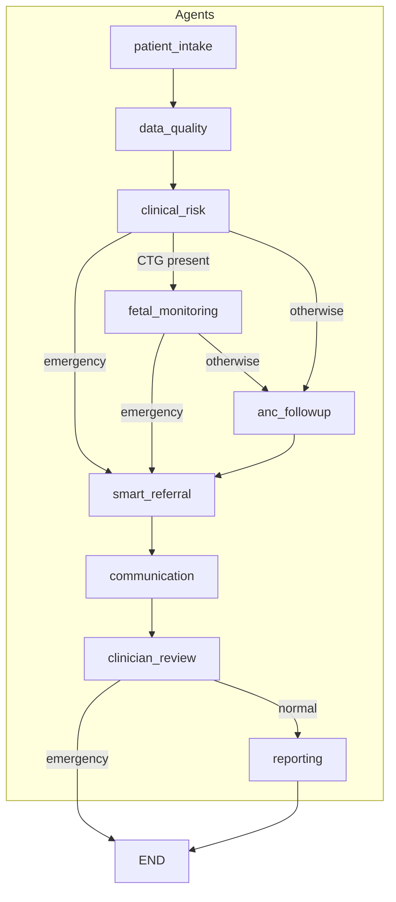
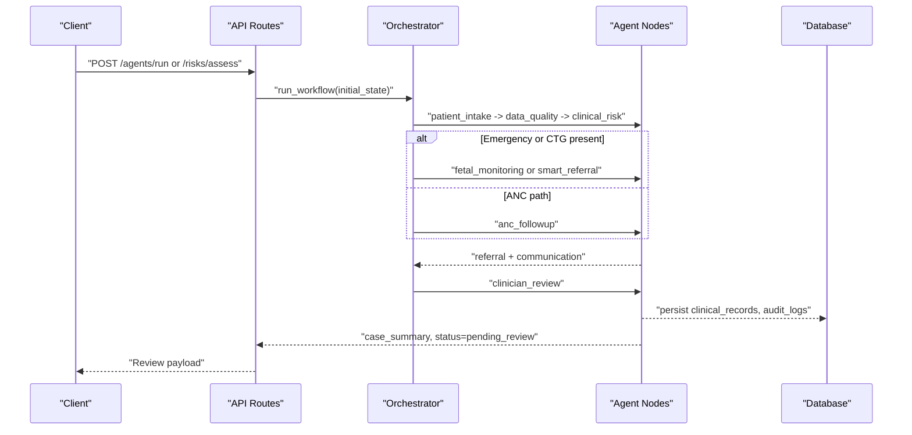
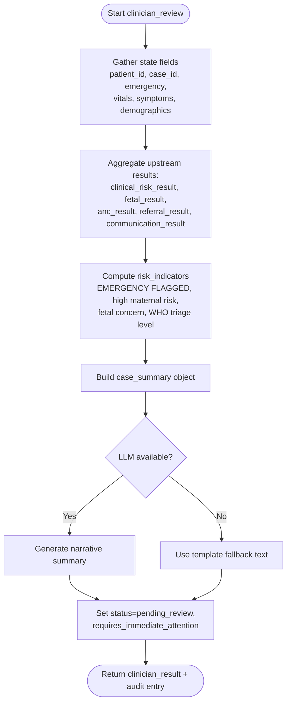
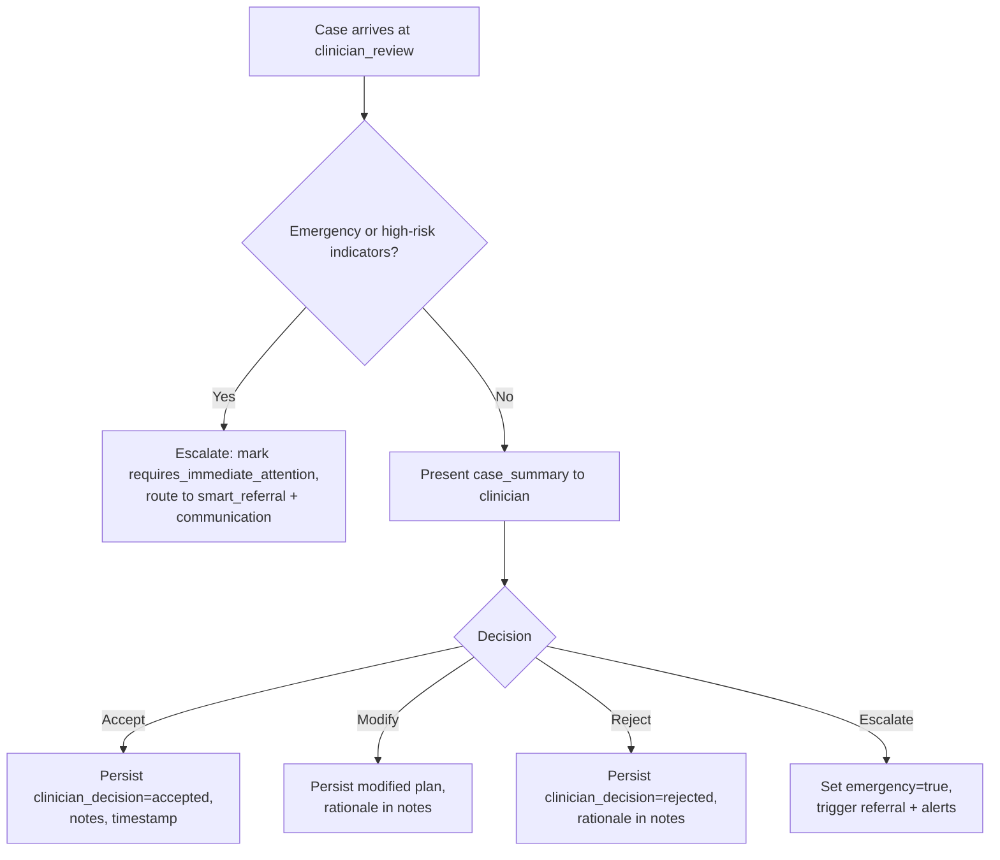
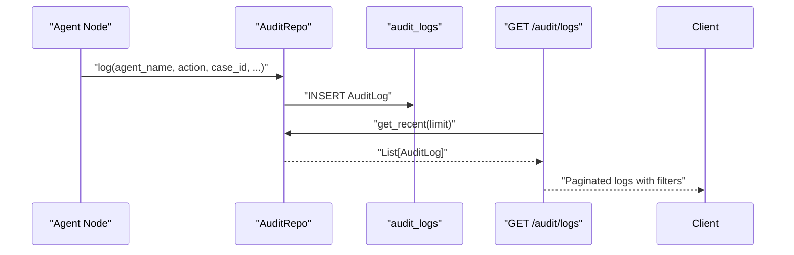
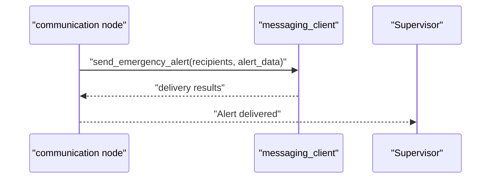
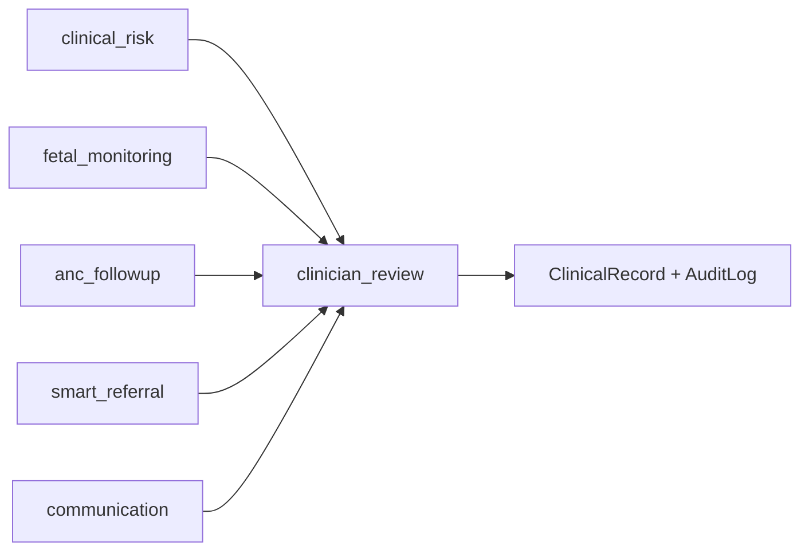

# Clinician Review Workflow

<cite>
**Referenced Files in This Document**
- [clinician_review.py](file://backend/agents/nodes/clinician_review.py)
- [orchestrator.py](file://backend/agents/orchestrator.py)
- [state.py](file://backend/schemas/state.py)
- [models.py](file://backend/db/models.py)
- [repositories.py](file://backend/db/repositories.py)
- [audit.py](file://backend/api/routes/audit.py)
- [risks.py](file://backend/api/routes/risks.py)
- [patients.py](file://backend/api/routes/patients.py)
- [communication.py](file://backend/agents/nodes/communication.py)
- [smart_referral.py](file://backend/agents/nodes/smart_referral.py)
- [clinical_risk.py](file://backend/agents/nodes/clinical_risk.py)
</cite>

## Table of Contents
1. Introduction
2. Project Structure
3. Core Components
4. Architecture Overview
5. Detailed Component Analysis
6. Dependency Analysis
7. Performance Considerations
8. Troubleshooting Guide
9. Conclusion
10. Appendices

## Introduction
This document describes the clinician review workflow that provides human-in-the-loop oversight for AI-generated clinical recommendations. It explains how patient data and AI outputs are aggregated into a case presentation, how decisions are captured with audit trails, and how emergency pathways and escalation logic operate. It also outlines notification triggers, workload considerations, and performance metrics derived from the system’s state and audit logs.

## Project Structure
The workflow is orchestrated by a LangGraph StateGraph that runs multiple agent nodes (intake, data quality, risk assessment, fetal monitoring, ANC follow-up, referral, communication, clinician review, reporting). The clinician review node aggregates upstream results into a structured case summary and marks the case as pending review. Audit logs and persistent models capture decisions and timestamps for compliance and analytics.

**Diagram sources**
- [orchestrator.py:62-133](file://backend/agents/orchestrator.py#L62-L133)

**Section sources**
- [orchestrator.py:1-167](file://backend/agents/orchestrator.py#L1-L167)

## Core Components
- Case presentation interface: Built by the clinician review node to show patient info, AI assessments, suggested actions, and supporting evidence.
- Decision tree: Captures acceptance, modification, rejection, and escalation options with required justifications via persisted records and audit entries.
- Audit trail: Append-only log capturing all steps, timestamps, and rationale for deviations.
- Notifications: Emergency alerts and referral notifications triggered during communication; pending reviews surfaced via status fields.
- Workload balancing: Facility scoring considers current load; clinician assignment can be extended using similar signals.
- Performance metrics: Derived from model confidence checks, duration tracking, and audit logs.

**Section sources**
- [clinician_review.py:13-147](file://backend/agents/nodes/clinician_review.py#L13-L147)
- [models.py:30-49](file://backend/db/models.py#L30-L49)
- [models.py:81-93](file://backend/db/models.py#L81-L93)
- [repositories.py:66-82](file://backend/db/repositories.py#L66-L82)
- [audit.py:21-87](file://backend/api/routes/audit.py#L21-L87)
- [communication.py:66-95](file://backend/agents/nodes/communication.py#L66-L95)
- [smart_referral.py:29-62](file://backend/agents/nodes/smart_referral.py#L29-L62)
- [clinical_risk.py:87-126](file://backend/agents/nodes/clinical_risk.py#L87-L126)

## Architecture Overview
The workflow compiles a graph of agents and routes conditionally based on emergency flags and available data. The clinician review node is reached after communication and produces a “pending_review” state with a comprehensive case summary. In emergencies, reporting is skipped to reduce latency.

**Diagram sources**
- [orchestrator.py:62-133](file://backend/agents/orchestrator.py#L62-L133)
- [risks.py:61-123](file://backend/api/routes/risks.py#L61-L123)
- [clinician_review.py:13-147](file://backend/agents/nodes/clinician_review.py#L13-L147)

## Detailed Component Analysis

### Case Presentation Interface
The clinician review node aggregates upstream results into a structured case summary including:
- Patient demographics, vitals, symptoms
- Maternal and gestational risk levels, WHO triage flags
- Fetal status, preterm risk, escalation flag
- ANC missed-visit risk, priority, recommended action
- Referral urgency, selected facility, estimated travel time
- Communication delivery status
- Risk indicators list and whether immediate attention is required
- Optional LLM-generated narrative summary with fallback

**Diagram sources**
- [clinician_review.py:13-147](file://backend/agents/nodes/clinician_review.py#L13-L147)

**Section sources**
- [clinician_review.py:13-147](file://backend/agents/nodes/clinician_review.py#L13-L147)

### Review Decision Tree
While the codebase does not implement an explicit decision endpoint here, the workflow defines the decision surface through state and persistence:
- Acceptance: Update clinician_decision and notes in ClinicalRecord to accept AI recommendation.
- Modification: Adjust recommended_action or referral selection and persist changes with notes.
- Rejection: Record rejection with rationale in clinician_notes and update status accordingly.
- Escalation: If emergency or conflicting judgment, set emergency flag and route to smart_referral and communication for urgent outreach.

Required justifications should be stored in clinician_notes and reflected in audit logs.

[No diagram sources needed since this section conceptualizes decision flow beyond existing endpoints]

**Section sources**
- [models.py:30-49](file://backend/db/models.py#L30-L49)
- [audit.py:21-87](file://backend/api/routes/audit.py#L21-L87)

### Audit Trail Generation
Audit entries are appended throughout the workflow:
- Each agent node writes an audit entry with agent name, timestamp, action, and result summary.
- The audit API exposes recent logs with filtering by agent, patient/case, and date range.
- Clinician decisions and deviations are recorded in ClinicalRecord fields and can be correlated with audit logs.

**Diagram sources**
- [repositories.py:66-82](file://backend/db/repositories.py#L66-L82)
- [audit.py:21-87](file://backend/api/routes/audit.py#L21-L87)

**Section sources**
- [repositories.py:66-82](file://backend/db/repositories.py#L66-L82)
- [audit.py:21-87](file://backend/api/routes/audit.py#L21-L87)

### Notification System
- Emergency alerts: When emergency conditions are detected, the communication node sends emergency alerts to health workers and supervisors.
- Referral notifications: After referral selection, notifications are sent to relevant parties.
- Pending reviews: Cases marked pending_review with requires_immediate_attention can trigger prioritized notifications.

**Diagram sources**
- [communication.py:66-95](file://backend/agents/nodes/communication.py#L66-L95)

**Section sources**
- [communication.py:66-95](file://backend/agents/nodes/communication.py#L66-L95)

### Workload Balancing Among Clinicians
- Facility-level load is considered when ranking referrals; similar principles can be applied to assign cases to clinicians based on current workload and specialty.
- The smart_referral node penalizes facilities with high current_load; extending this to clinician queues would involve analogous scoring.

**Section sources**
- [smart_referral.py:29-62](file://backend/agents/nodes/smart_referral.py#L29-L62)

### Performance Metrics for Review Accuracy and Response Times
- Model confidence checks: Data quality node tracks per-model confidence and flags low-confidence outputs.
- Duration tracking: Audit logs include duration_ms to measure processing times.
- Response times: Time between case creation and clinician decision can be computed from timestamps in ClinicalRecord and audit logs.
- Accuracy: Compare clinician_decision against outcomes or gold standards where available.

**Section sources**
- [clinical_risk.py:87-126](file://backend/agents/nodes/clinical_risk.py#L87-L126)
- [models.py:81-93](file://backend/db/models.py#L81-L93)

## Dependency Analysis
The clinician review depends on upstream agents and persists to shared data stores.

**Diagram sources**
- [orchestrator.py:62-133](file://backend/agents/orchestrator.py#L62-L133)
- [models.py:30-49](file://backend/db/models.py#L30-L49)
- [models.py:81-93](file://backend/db/models.py#L81-L93)

**Section sources**
- [orchestrator.py:62-133](file://backend/agents/orchestrator.py#L62-L133)
- [models.py:30-49](file://backend/db/models.py#L30-L49)
- [models.py:81-93](file://backend/db/models.py#L81-L93)

## Performance Considerations
- Emergency paths skip reporting to reduce latency.
- LLM generation for summaries is optional and falls back to templates if unavailable.
- Low model confidence triggers warnings to prompt careful review.
- Audit logs enable post-hoc analysis of durations and bottlenecks.

[No sources needed since this section provides general guidance]

## Troubleshooting Guide
- Missing or incomplete intake: Workflow may terminate early; ensure intake_complete is true before proceeding.
- LLM failures: Narrative summaries fall back to templates; verify service availability.
- Emergency detection: Confirm safety rules and triage logic; check who_red_flags and is_emergency flags.
- Audit visibility: Use admin-only audit logs endpoint to inspect recent activity and filter by agent, patient, or date range.

**Section sources**
- [orchestrator.py:22-27](file://backend/agents/orchestrator.py#L22-L27)
- [clinician_review.py:103-118](file://backend/agents/nodes/clinician_review.py#L103-L118)
- [audit.py:21-87](file://backend/api/routes/audit.py#L21-L87)

## Conclusion
The clinician review workflow centralizes AI outputs into a clear case presentation, enforces human oversight through pending_review states, and captures every step in an append-only audit trail. Emergency handling ensures rapid escalation, while data quality and confidence checks guide safe decision-making. Extending the system with explicit decision endpoints and workload-aware routing will further strengthen operational control and performance.

[No sources needed since this section summarizes without analyzing specific files]

## Appendices

### Example Review Scenarios
- High-risk case confirmation:
  - Inputs: High maternal risk, pathological fetal status, elevated WHO triage.
  - Action: Clinician accepts AI recommendation; record decision and notes.
  - Outcome: Proceed to referral and communication; audit logged.
- Conflicting AI vs clinical judgment:
  - Inputs: AI suggests routine follow-up; clinician identifies red flags.
  - Action: Clinician modifies plan and escalates; set emergency flag if warranted.
  - Outcome: Immediate referral and alerts; detailed rationale in notes and audit.
- Emergency override procedures:
  - Inputs: Emergency flagged by safety rules or CTG.
  - Action: Skip reporting, trigger smart_referral and emergency alerts.
  - Outcome: Rapid dispatch; audit captures timeline and actions.

[No sources needed since this section provides scenario examples]