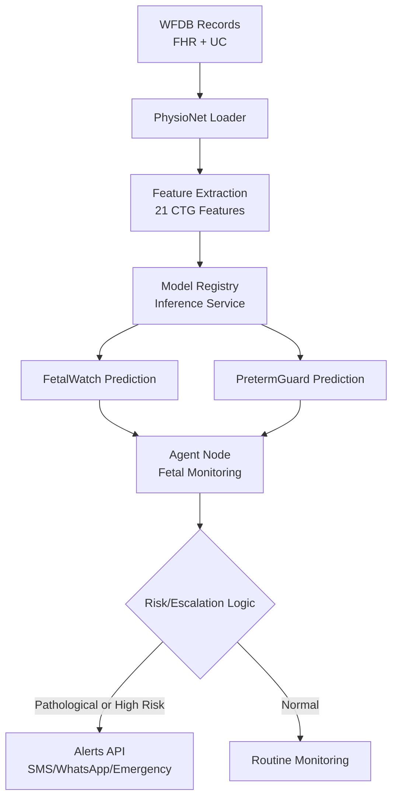
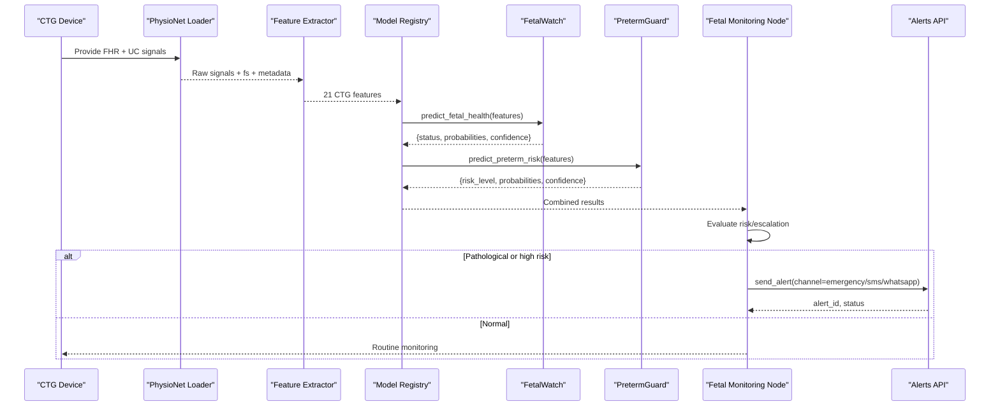
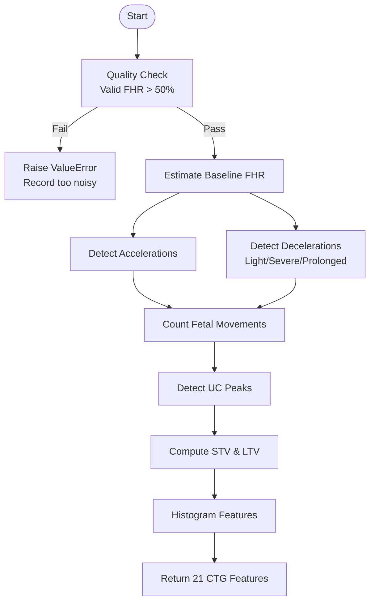
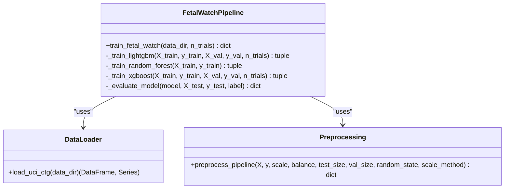
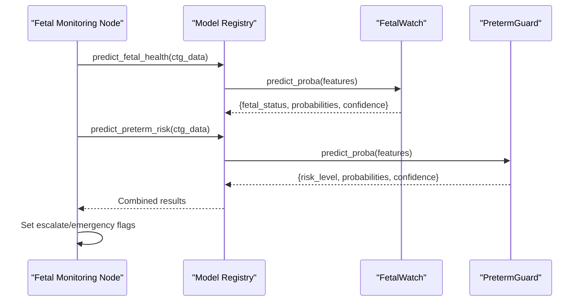
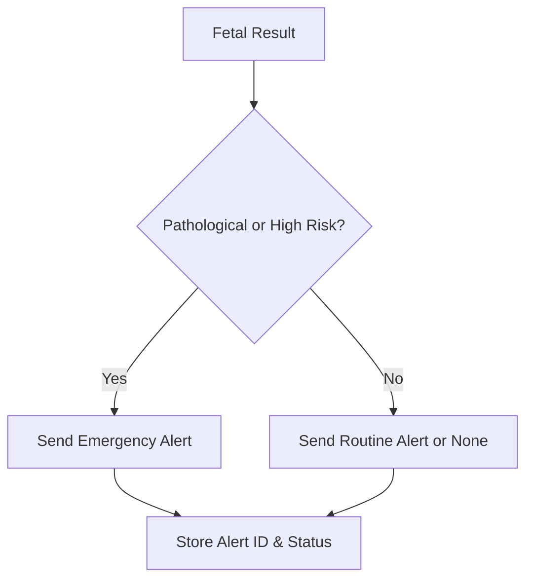
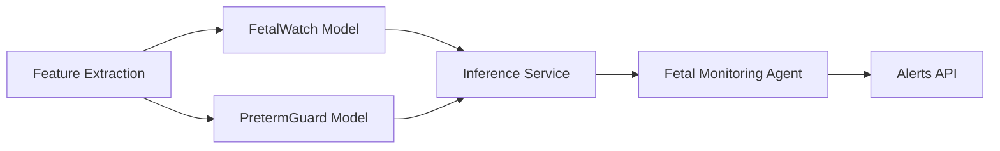

# Fetal Monitoring Workflow

<cite>
**Referenced Files in This Document**
- [fetal_watch.py](file://src/models/fetal_watch.py)
- [ctg_features.py](file://src/features/ctg_features.py)
- [physionet_ctg.py](file://src/data/loaders/physionet_ctg.py)
- [uci_ctg.py](file://src/data/loaders/uci_ctg.py)
- [preprocessing.py](file://src/data/preprocessing.py)
- [inference.py](file://backend/services/inference.py)
- [fetal_monitoring.py](file://backend/agents/nodes/fetal_monitoring.py)
- [alerts.py](file://backend/api/routes/alerts.py)
- [results.json](file://artifacts/fetalwatch/results.json)
- [02_pipeline_demo.ipynb](file://notebooks/02_pipeline_demo.ipynb)
</cite>

## Table of Contents
1. [Introduction](#introduction)
2. [Project Structure](#project-structure)
3. [Core Components](#core-components)
4. [Architecture Overview](#architecture-overview)
5. [Detailed Component Analysis](#detailed-component-analysis)
6. [Dependency Analysis](#dependency-analysis)
7. [Performance Considerations](#performance-considerations)
8. [Troubleshooting Guide](#troubleshooting-guide)
9. [Conclusion](#conclusion)
10. [Appendices](#appendices)

## Introduction
This document explains the end-to-end fetal monitoring workflow that ingests cardiotocography (CTG) recordings, extracts clinically meaningful features from fetal heart rate (FHR) and uterine contraction (UC) signals, and classifies fetal health into three categories: Normal, Suspect, and Pathological. It covers signal processing, feature engineering, model inference via FetalWatch, alerting for abnormal findings, and quality assurance practices to ensure reliable operation in real-time or near-real-time settings.

## Project Structure
The system is organized into modular layers:
- Data ingestion and loaders for PhysioNet CTU-UHB WFDB records and UCI CTG dataset
- Signal processing and feature extraction producing a standardized 21-feature vector
- Model training and evaluation pipeline (LightGBM, Random Forest, XGBoost)
- Inference service that loads models and serves predictions
- Agent node orchestrating fetal monitoring within a broader clinical workflow
- Alerting API for SMS, WhatsApp, and emergency notifications

**Diagram sources**
- [physionet_ctg.py:13-103](file://src/data/loaders/physionet_ctg.py#L13-L103)
- [ctg_features.py:506-593](file://src/features/ctg_features.py#L506-L593)
- [inference.py:206-293](file://backend/services/inference.py#L206-L293)
- [fetal_monitoring.py:10-93](file://backend/agents/nodes/fetal_monitoring.py#L10-L93)
- [alerts.py:49-109](file://backend/api/routes/alerts.py#L49-L109)

**Section sources**
- [physionet_ctg.py:13-103](file://src/data/loaders/physionet_ctg.py#L13-L103)
- [ctg_features.py:506-593](file://src/features/ctg_features.py#L506-L593)
- [inference.py:206-293](file://backend/services/inference.py#L206-L293)
- [fetal_monitoring.py:10-93](file://backend/agents/nodes/fetal_monitoring.py#L10-L93)
- [alerts.py:49-109](file://backend/api/routes/alerts.py#L49-L109)

## Core Components
- CTG data loader: Reads WFDB .dat/.hea pairs, validates channels, returns FHR and UC signals with metadata.
- Feature extractor: Computes 21 UCI-compatible features including baseline FHR, accelerations, decelerations, variability, histogram descriptors, fetal movement proxy, and uterine contractions.
- Training pipeline: Splits data, scales features, balances classes, trains LightGBM (Optuna), Random Forest, and XGBoost (Optuna), evaluates metrics, saves best model and results.
- Inference service: Singleton registry loading models at startup; exposes prediction methods returning probabilities, confidence, and availability flags.
- Agent node: Orchestrates fetal monitoring by invoking both FetalWatch and PretermGuard, sets escalation flags based on outputs.
- Alerts API: Sends SMS, WhatsApp, or emergency alerts with status tracking.

**Section sources**
- [physionet_ctg.py:13-103](file://src/data/loaders/physionet_ctg.py#L13-L103)
- [ctg_features.py:506-593](file://src/features/ctg_features.py#L506-L593)
- [fetal_watch.py:282-432](file://src/models/fetal_watch.py#L282-L432)
- [inference.py:51-141](file://backend/services/inference.py#L51-L141)
- [fetal_monitoring.py:10-93](file://backend/agents/nodes/fetal_monitoring.py#L10-L93)
- [alerts.py:49-109](file://backend/api/routes/alerts.py#L49-L109)

## Architecture Overview
The architecture integrates signal acquisition, feature engineering, machine learning inference, and alerting:

**Diagram sources**
- [physionet_ctg.py:13-103](file://src/data/loaders/physionet_ctg.py#L13-L103)
- [ctg_features.py:506-593](file://src/features/ctg_features.py#L506-L593)
- [inference.py:206-293](file://backend/services/inference.py#L206-L293)
- [fetal_monitoring.py:10-93](file://backend/agents/nodes/fetal_monitoring.py#L10-L93)
- [alerts.py:49-109](file://backend/api/routes/alerts.py#L49-L109)

## Detailed Component Analysis

### CTG Signal Processing Pipeline
- Baseline detection: Iterative median-based estimation excluding extreme values to robustly estimate baseline FHR.
- Acceleration detection: Identifies sustained rises ≥15 bpm above baseline lasting ≥15 seconds.
- Deceleration detection: Classifies light (15–30 bpm drop), severe (>30 bpm drop), and prolonged (>60 seconds) events.
- Variability: Short-term variability (mean absolute difference per minute window) and long-term variability (amplitude per minute window).
- Histogram features: Width, Min, Max, Nmax (histogram peaks), Nzeros, Mode, Mean, Median, Variance, Tendency (skewness indicator).
- Fetal movement proxy: Counts rapid short-duration FHR changes (≥10 bpm within 2-second windows).
- Uterine contractions: Peak detection with minimum distance and prominence thresholds.

**Diagram sources**
- [ctg_features.py:39-77](file://src/features/ctg_features.py#L39-L77)
- [ctg_features.py:84-131](file://src/features/ctg_features.py#L84-L131)
- [ctg_features.py:139-224](file://src/features/ctg_features.py#L139-L224)
- [ctg_features.py:232-329](file://src/features/ctg_features.py#L232-L329)
- [ctg_features.py:337-409](file://src/features/ctg_features.py#L337-L409)
- [ctg_features.py:417-459](file://src/features/ctg_features.py#L417-L459)
- [ctg_features.py:467-498](file://src/features/ctg_features.py#L467-L498)
- [ctg_features.py:506-593](file://src/features/ctg_features.py#L506-L593)

**Section sources**
- [ctg_features.py:39-77](file://src/features/ctg_features.py#L39-L77)
- [ctg_features.py:84-131](file://src/features/ctg_features.py#L84-L131)
- [ctg_features.py:139-224](file://src/features/ctg_features.py#L139-L224)
- [ctg_features.py:232-329](file://src/features/ctg_features.py#L232-L329)
- [ctg_features.py:337-409](file://src/features/ctg_features.py#L337-L409)
- [ctg_features.py:417-459](file://src/features/ctg_features.py#L417-L459)
- [ctg_features.py:467-498](file://src/features/ctg_features.py#L467-L498)
- [ctg_features.py:506-593](file://src/features/ctg_features.py#L506-L593)

### FetalWatch Model Training and Evaluation
- Data loading: Loads UCI CTG dataset, maps NSP labels to human-readable classes (Normal, Suspect, Pathological).
- Preprocessing: Stratified split (70/15/15), RobustScaler, SMOTE oversampling on training set.
- Models:
  - LightGBM with Optuna hyperparameter optimization and early stopping on validation set.
  - Random Forest baseline with balanced class weights.
  - XGBoost with Optuna optimization and multi-class softprob objective.
- Evaluation: Macro-F1, AUROC (one-vs-rest macro), per-class precision/recall/F1, confusion matrix.
- Best model selection: Saves best model artifact and serialized results JSON.

**Diagram sources**
- [fetal_watch.py:282-432](file://src/models/fetal_watch.py#L282-L432)
- [uci_ctg.py:14-52](file://src/data/loaders/uci_ctg.py#L14-L52)
- [preprocessing.py:196-261](file://src/data/preprocessing.py#L196-L261)

**Section sources**
- [fetal_watch.py:282-432](file://src/models/fetal_watch.py#L282-L432)
- [uci_ctg.py:14-52](file://src/data/loaders/uci_ctg.py#L14-L52)
- [preprocessing.py:196-261](file://src/data/preprocessing.py#L196-L261)
- [results.json:1-249](file://artifacts/fetalwatch/results.json#L1-L249)

### Inference Service and Agent Orchestration
- ModelRegistry singleton loads all models once at startup and provides safe fallbacks when models are unavailable.
- Predictions return probabilities, confidence, and availability flags; missing features are filled with zeros to ensure robustness.
- Fetal monitoring agent invokes both FetalWatch and PretermGuard, computes escalation flags based on fetal status and preterm risk levels, and logs audit trails.

**Diagram sources**
- [inference.py:206-293](file://backend/services/inference.py#L206-L293)
- [fetal_monitoring.py:10-93](file://backend/agents/nodes/fetal_monitoring.py#L10-L93)

**Section sources**
- [inference.py:51-141](file://backend/services/inference.py#L51-L141)
- [inference.py:206-293](file://backend/services/inference.py#L206-L293)
- [fetal_monitoring.py:10-93](file://backend/agents/nodes/fetal_monitoring.py#L10-L93)

### Alert Generation and Escalation
- Alerts API supports sending SMS, WhatsApp, and emergency alerts with priority and patient context.
- Status endpoint allows tracking delivery outcomes.
- Escalation logic in the fetal monitoring node triggers emergency alerts when fetal status is pathological or preterm risk is high.

**Diagram sources**
- [fetal_monitoring.py:47-93](file://backend/agents/nodes/fetal_monitoring.py#L47-L93)
- [alerts.py:49-109](file://backend/api/routes/alerts.py#L49-L109)

**Section sources**
- [fetal_monitoring.py:47-93](file://backend/agents/nodes/fetal_monitoring.py#L47-L93)
- [alerts.py:49-109](file://backend/api/routes/alerts.py#L49-L109)

## Dependency Analysis
Key dependencies and relationships:
- Feature extraction depends on WFDB reading and signal processing utilities.
- Training pipeline depends on data loaders, preprocessing utilities, and ML libraries (LightGBM, XGBoost, scikit-learn).
- Inference service depends on saved model artifacts and configuration paths.
- Agent node depends on inference service and state management.
- Alerts API depends on messaging integrations and authentication.

**Diagram sources**
- [ctg_features.py:506-593](file://src/features/ctg_features.py#L506-L593)
- [fetal_watch.py:282-432](file://src/models/fetal_watch.py#L282-L432)
- [inference.py:206-293](file://backend/services/inference.py#L206-L293)
- [fetal_monitoring.py:10-93](file://backend/agents/nodes/fetal_monitoring.py#L10-L93)
- [alerts.py:49-109](file://backend/api/routes/alerts.py#L49-L109)

**Section sources**
- [ctg_features.py:506-593](file://src/features/ctg_features.py#L506-L593)
- [fetal_watch.py:282-432](file://src/models/fetal_watch.py#L282-L432)
- [inference.py:206-293](file://backend/services/inference.py#L206-L293)
- [fetal_monitoring.py:10-93](file://backend/agents/nodes/fetal_monitoring.py#L10-L93)
- [alerts.py:49-109](file://backend/api/routes/alerts.py#L49-L109)

## Performance Considerations
- Early stopping during LightGBM training reduces overfitting and improves generalization.
- Balanced class weights and SMOTE address class imbalance, improving recall for minority classes.
- RobustScaler mitigates outlier influence in feature scaling.
- Batch feature extraction handles multiple WFDB records efficiently, skipping invalid records gracefully.
- Singleton model registry avoids repeated model loading overhead in production.

[No sources needed since this section provides general guidance]

## Troubleshooting Guide
Common issues and resolutions:
- Low-quality CTG recordings: Feature extraction raises an error if valid FHR samples are below 50%; re-acquire data or apply artifact correction.
- Missing channels: Loader skips records without required FHR/UC channels; verify device output format.
- Model unavailability: Inference service returns fallback responses; ensure model artifacts exist and configuration paths are correct.
- Alert delivery failures: Alerts API returns HTTP errors; check messaging client integration and recipient details.

**Section sources**
- [ctg_features.py:535-545](file://src/features/ctg_features.py#L535-L545)
- [physionet_ctg.py:71-78](file://src/data/loaders/physionet_ctg.py#L71-L78)
- [inference.py:147-149](file://backend/services/inference.py#L147-L149)
- [alerts.py:88-94](file://backend/api/routes/alerts.py#L88-L94)

## Conclusion
The fetal monitoring workflow integrates robust signal processing, comprehensive feature engineering, and advanced machine learning to classify fetal health into Normal, Suspect, and Pathological categories. The system supports real-time or near-real-time operation through efficient batch processing, resilient inference, and automated alerting for abnormal findings. Quality assurance measures ensure reliability, while the modular architecture facilitates scalability and maintenance.

[No sources needed since this section summarizes without analyzing specific files]

## Appendices

### Three-Class Classification System and Clinical Criteria
- Normal: Healthy CTG pattern indicating low risk; routine monitoring recommended.
- Suspect: Ambiguous CTG pattern indicating moderate risk; increased surveillance and biophysical profile recommended.
- Pathological: Abnormal CTG pattern indicating high risk; immediate clinical evaluation and potential intervention recommended.

These criteria align with standard CTG interpretation guidelines and are used to drive escalation decisions in the fetal monitoring agent.

**Section sources**
- [fetal_monitoring.py:47-93](file://backend/agents/nodes/fetal_monitoring.py#L47-L93)
- [preterm_guard.py:395-417](file://src/models/preterm_guard.py#L395-L417)

### Examples of CTG Patterns and Interpretation Guidelines
- Normal patterns: Stable baseline, appropriate accelerations, normal variability, minimal decelerations.
- Suspect patterns: Reduced variability, occasional decelerations, ambiguous accelerations.
- Pathological patterns: Markedly reduced or absent variability, recurrent severe decelerations, tachycardia or bradycardia.

Interpretation guidelines inform feature thresholds and classification rules embedded in the feature extraction and model training processes.

[No sources needed since this section provides general guidance]

### Integration with Medical Devices and Real-Time Monitoring
- Device integration: WFDB format ensures compatibility with standard CTG devices; loader validates channel presence and sampling frequency.
- Real-time capabilities: Batch processing enables streaming-like ingestion; inference service provides fast predictions with cached models.
- Alert generation: Automated escalation triggers based on model outputs and predefined risk thresholds.

**Section sources**
- [physionet_ctg.py:13-103](file://src/data/loaders/physionet_ctg.py#L13-L103)
- [inference.py:51-141](file://backend/services/inference.py#L51-L141)
- [fetal_monitoring.py:10-93](file://backend/agents/nodes/fetal_monitoring.py#L10-L93)

### Quality Assurance Processes
- Signal quality assessment: Validity checks ensure sufficient valid FHR samples; zero-duration recordings are rejected.
- Artifact detection: Invalid or non-finite values are handled; peak detection parameters mitigate noise.
- Re-analysis workflows: Skipped records are logged with warnings; batch processing continues with remaining valid records.

**Section sources**
- [ctg_features.py:535-545](file://src/features/ctg_features.py#L535-L545)
- [ctg_features.py:628-683](file://src/features/ctg_features.py#L628-L683)
- [physionet_ctg.py:54-78](file://src/data/loaders/physionet_ctg.py#L54-L78)