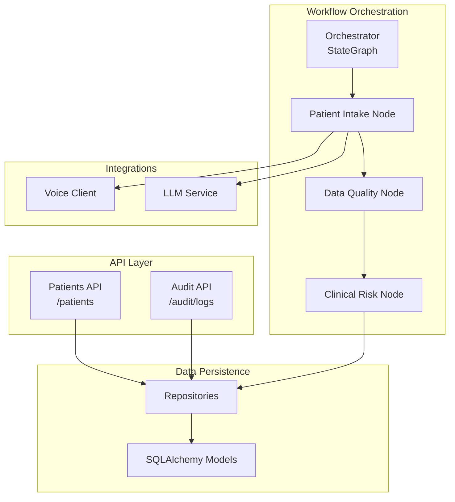
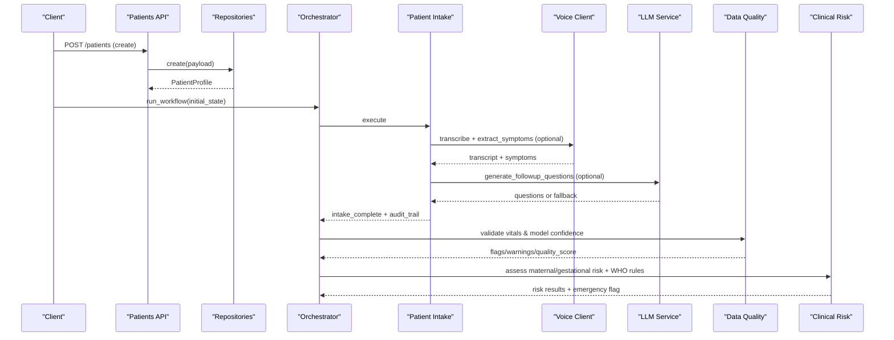
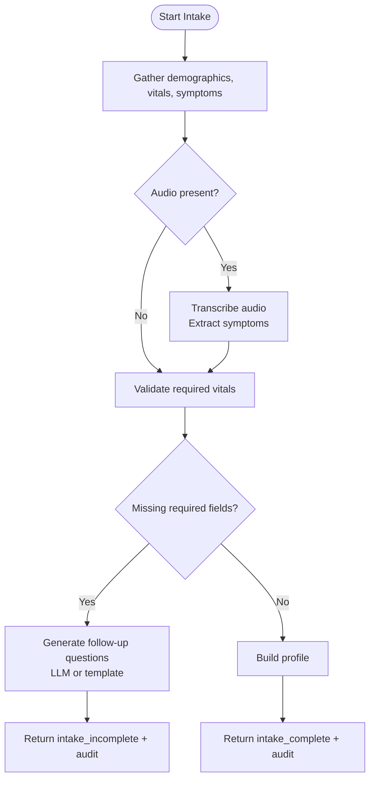
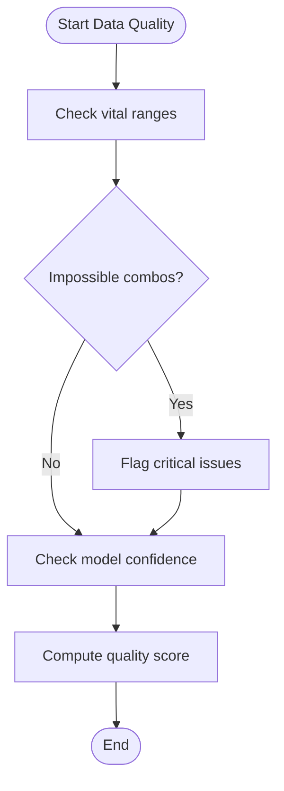
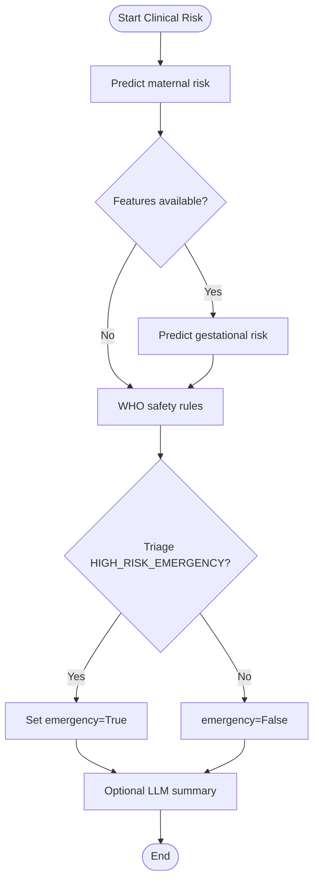
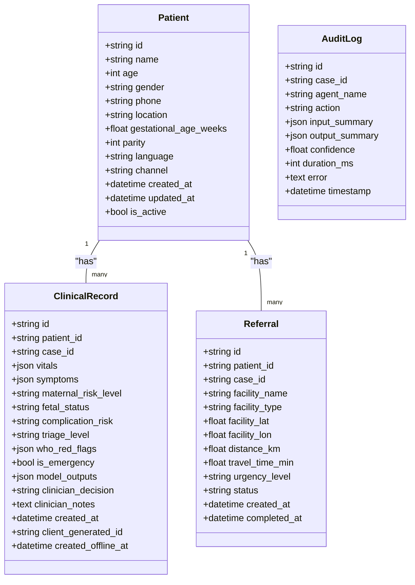
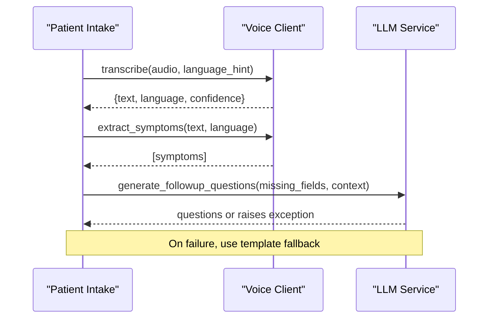
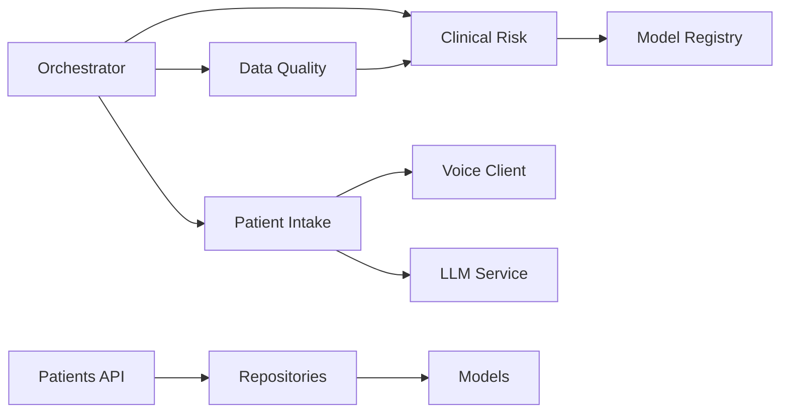

# Patient Intake Workflow

<cite>
**Referenced Files in This Document**
- [patient_intake.py](file://backend/agents/nodes/patient_intake.py)
- [state.py](file://backend/schemas/state.py)
- [patient.py](file://backend/schemas/patient.py)
- [patients.py](file://backend/api/routes/patients.py)
- [models.py](file://backend/db/models.py)
- [repositories.py](file://backend/db/repositories.py)
- [orchestrator.py](file://backend/agents/orchestrator.py)
- [data_quality.py](file://backend/agents/nodes/data_quality.py)
- [clinical_risk.py](file://backend/agents/nodes/clinical_risk.py)
- [voice_client.py](file://backend/integrations/voice_client.py)
- [llm.py](file://backend/services/llm.py)
- [audit.py](file://backend/api/routes/audit.py)
- [config.py](file://backend/config.py)
</cite>

## Table of Contents
1. [Introduction](#introduction)
2. [Project Structure](#project-structure)
3. [Core Components](#core-components)
4. [Architecture Overview](#architecture-overview)
5. [Detailed Component Analysis](#detailed-component-analysis)
6. [Dependency Analysis](#dependency-analysis)
7. [Performance Considerations](#performance-considerations)
8. [Troubleshooting Guide](#troubleshooting-guide)
9. [Conclusion](#conclusion)
10. [Appendices](#appendices)

## Introduction
This document describes the patient intake workflow in MaaHifazat AI, focusing on how new and returning patients are registered, how demographic and clinical data are collected and validated, and how the system integrates with external services for voice transcription, language detection, symptom extraction, and LLM-assisted follow-up questions. It also covers data validation rules, required fields, error handling, audit trail generation, privacy considerations, and compliance-related practices implemented in the codebase. Guidance is provided for handling incomplete or inconsistent data and for escalating quality issues.

## Project Structure
The intake workflow is orchestrated by a LangGraph state machine that starts at the patient intake node and proceeds through data quality checks, clinical risk assessment, and optional fetal monitoring or ANC follow-up based on inputs. The API layer exposes endpoints to create and manage patient records, while repositories persist data using SQLAlchemy models. External integrations include voice transcription and LLM-based question generation.

**Diagram sources**
- [orchestrator.py:62-138](file://backend/agents/orchestrator.py#L62-L138)
- [patient_intake.py:58-168](file://backend/agents/nodes/patient_intake.py#L58-L168)
- [data_quality.py:25-201](file://backend/agents/nodes/data_quality.py#L25-L201)
- [clinical_risk.py:15-127](file://backend/agents/nodes/clinical_risk.py#L15-L127)
- [patients.py:44-97](file://backend/api/routes/patients.py#L44-L97)
- [audit.py:21-88](file://backend/api/routes/audit.py#L21-L88)
- [repositories.py:9-125](file://backend/db/repositories.py#L9-L125)
- [models.py:11-115](file://backend/db/models.py#L11-L115)
- [voice_client.py:7-48](file://backend/integrations/voice_client.py#L7-L48)
- [llm.py:31-144](file://backend/services/llm.py#L31-L144)

**Section sources**
- [orchestrator.py:62-138](file://backend/agents/orchestrator.py#L62-L138)
- [patients.py:44-97](file://backend/api/routes/patients.py#L44-L97)
- [repositories.py:9-125](file://backend/db/repositories.py#L9-L125)
- [models.py:11-115](file://backend/db/models.py#L11-L115)

## Core Components
- Patient intake node: Collects demographics, vitals, symptoms; supports voice input; validates required fields; generates follow-up questions via LLM or templates; produces an audit entry.
- Data quality node: Validates vital ranges, flags impossible values (e.g., diastolic ≥ systolic), checks model confidence thresholds, and computes an overall quality score.
- Clinical risk node: Runs maternal risk prediction, optional gestational complication prediction, and mandatory WHO red-flag safety check to determine emergency status.
- API routes: Create/list/get/update patients; list audit logs with admin-only access.
- Repositories and models: Persist patients, clinical records, referrals, agent states, audit logs, model versions, and files.
- Integrations: Voice client for transcription and symptom extraction; LLM service for generating follow-up questions and summaries.

**Section sources**
- [patient_intake.py:58-168](file://backend/agents/nodes/patient_intake.py#L58-L168)
- [data_quality.py:25-201](file://backend/agents/nodes/data_quality.py#L25-L201)
- [clinical_risk.py:15-127](file://backend/agents/nodes/clinical_risk.py#L15-L127)
- [patients.py:44-97](file://backend/api/routes/patients.py#L44-L97)
- [audit.py:21-88](file://backend/api/routes/audit.py#L21-L88)
- [repositories.py:9-125](file://backend/db/repositories.py#L9-L125)
- [models.py:11-115](file://backend/db/models.py#L11-L115)
- [voice_client.py:7-48](file://backend/integrations/voice_client.py#L7-L48)
- [llm.py:31-144](file://backend/services/llm.py#L31-L144)

## Architecture Overview
The intake workflow begins at the patient intake node, which gathers structured data and optional voice input. If required vitals are missing, it requests follow-up questions (LLM-generated when available). After intake completes, the orchestrator routes to data quality validation, then to clinical risk assessment. Based on results, the flow may proceed to fetal monitoring, ANC follow-up, smart referral, communication, clinician review, and reporting.

**Diagram sources**
- [orchestrator.py:62-138](file://backend/agents/orchestrator.py#L62-L138)
- [patient_intake.py:58-168](file://backend/agents/nodes/patient_intake.py#L58-L168)
- [voice_client.py:7-48](file://backend/integrations/voice_client.py#L7-L48)
- [llm.py:78-89](file://backend/services/llm.py#L78-L89)
- [data_quality.py:25-201](file://backend/agents/nodes/data_quality.py#L25-L201)
- [clinical_risk.py:15-127](file://backend/agents/nodes/clinical_risk.py#L15-L127)
- [patients.py:44-97](file://backend/api/routes/patients.py#L44-L97)
- [repositories.py:9-125](file://backend/db/repositories.py#L9-L125)

## Detailed Component Analysis

### Patient Intake Node
- Responsibilities:
  - Gather demographics, vitals, symptoms from state.
  - Process optional audio: transcribe and extract symptoms.
  - Validate required vital fields: systolic_bp, diastolic_bp, heart_rate, temperature_celsius, gestational_age_weeks.
  - Generate follow-up questions via LLM if unavailable, use template fallback.
  - Build a profile dict and produce audit entries.
- Validation rules:
  - Required vitals must be present and non-null to mark intake complete.
  - Voice integration is optional and must not block intake if unavailable.
- Error handling:
  - Catches exceptions, returns errors list and audit entry indicating failure.
- Audit trail:
  - Appends an audit entry per execution with timestamp, action, and result summary.

**Diagram sources**
- [patient_intake.py:58-168](file://backend/agents/nodes/patient_intake.py#L58-L168)
- [voice_client.py:7-48](file://backend/integrations/voice_client.py#L7-L48)
- [llm.py:78-89](file://backend/services/llm.py#L78-L89)

**Section sources**
- [patient_intake.py:58-168](file://backend/agents/nodes/patient_intake.py#L58-L168)
- [voice_client.py:7-48](file://backend/integrations/voice_client.py#L7-L48)
- [llm.py:78-89](file://backend/services/llm.py#L78-L89)

### Data Quality Node
- Responsibilities:
  - Validate vital ranges against predefined bounds.
  - Flag impossible combinations (e.g., diastolic ≥ systolic).
  - Check model confidence scores against a threshold.
  - Compute an overall quality score.
- Validation rules:
  - Numeric conversion enforced; non-numeric values flagged.
  - Out-of-range values flagged as critical.
  - Borderline values generate warnings.
- Error handling:
  - Exceptions captured and recorded with audit entries.

**Diagram sources**
- [data_quality.py:25-201](file://backend/agents/nodes/data_quality.py#L25-L201)

**Section sources**
- [data_quality.py:25-201](file://backend/agents/nodes/data_quality.py#L25-L201)

### Clinical Risk Node
- Responsibilities:
  - Run maternal risk prediction using the model registry.
  - Optionally run gestational complication prediction if features exist.
  - Always call WHO safety rules to determine triage level and emergency status.
  - Optionally generate a human-readable risk summary via LLM; falls back to template text.
- Validation and safety:
  - WHO red-flag check is mandatory and cannot be skipped.
  - Emergency flag set when triage indicates high-risk emergency.
- Error handling:
  - Exceptions captured and recorded with audit entries.

**Diagram sources**
- [clinical_risk.py:15-127](file://backend/agents/nodes/clinical_risk.py#L15-L127)
- [llm.py:67-89](file://backend/services/llm.py#L67-L89)

**Section sources**
- [clinical_risk.py:15-127](file://backend/agents/nodes/clinical_risk.py#L15-L127)
- [llm.py:67-89](file://backend/services/llm.py#L67-L89)

### API Routes and Data Models
- Patients API:
  - Create patient: validates payload using Pydantic schema and persists via repository.
  - List/get/update: standard CRUD operations with pagination and error handling.
- Schemas:
  - VitalsInput defines valid ranges for vital fields.
  - SymptomEntry defines name, severity, duration.
  - PatientCreate/PatientProfile define registration fields and identifiers.
- Models:
  - Patient table stores core demographic and contact fields.
  - ClinicalRecord stores JSON vitals/symptoms and model outputs.
  - Referral stores facility info and urgency/status.
  - AgentStateRecord persists workflow state snapshots.
  - AuditLog captures agent actions and outcomes.

**Diagram sources**
- [models.py:11-115](file://backend/db/models.py#L11-L115)

**Section sources**
- [patients.py:44-97](file://backend/api/routes/patients.py#L44-L97)
- [patient.py:14-57](file://backend/schemas/patient.py#L14-L57)
- [models.py:11-115](file://backend/db/models.py#L11-L115)
- [repositories.py:9-125](file://backend/db/repositories.py#L9-L125)

### Integrations: Voice and LLM
- Voice Client:
  - Provides transcription and language detection stubs.
  - Extracts symptoms from free-text using keyword matching.
- LLM Service:
  - Generates follow-up questions for missing fields and risk summaries.
  - Gracefully handles unavailability by returning None and allowing callers to fall back to templates.

**Diagram sources**
- [patient_intake.py:58-168](file://backend/agents/nodes/patient_intake.py#L58-L168)
- [voice_client.py:7-48](file://backend/integrations/voice_client.py#L7-L48)
- [llm.py:78-89](file://backend/services/llm.py#L78-L89)

**Section sources**
- [voice_client.py:7-48](file://backend/integrations/voice_client.py#L7-L48)
- [llm.py:78-89](file://backend/services/llm.py#L78-L89)

## Dependency Analysis
- Orchestrator depends on all agent nodes and compiles a StateGraph to control flow.
- Patient intake depends on voice client and LLM service for enhanced data collection.
- Data quality depends on prior model outputs to assess confidence.
- Clinical risk depends on model registry and safety service.
- API routes depend on repositories and schemas for validation and persistence.
- Repositories depend on SQLAlchemy models for schema enforcement.

**Diagram sources**
- [orchestrator.py:62-138](file://backend/agents/orchestrator.py#L62-L138)
- [patient_intake.py:58-168](file://backend/agents/nodes/patient_intake.py#L58-L168)
- [data_quality.py:25-201](file://backend/agents/nodes/data_quality.py#L25-L201)
- [clinical_risk.py:15-127](file://backend/agents/nodes/clinical_risk.py#L15-L127)
- [patients.py:44-97](file://backend/api/routes/patients.py#L44-L97)
- [repositories.py:9-125](file://backend/db/repositories.py#L9-L125)
- [models.py:11-115](file://backend/db/models.py#L11-L115)

**Section sources**
- [orchestrator.py:62-138](file://backend/agents/orchestrator.py#L62-L138)
- [patient_intake.py:58-168](file://backend/agents/nodes/patient_intake.py#L58-L168)
- [data_quality.py:25-201](file://backend/agents/nodes/data_quality.py#L25-L201)
- [clinical_risk.py:15-127](file://backend/agents/nodes/clinical_risk.py#L15-L127)
- [patients.py:44-97](file://backend/api/routes/patients.py#L44-L97)
- [repositories.py:9-125](file://backend/db/repositories.py#L9-L125)
- [models.py:11-115](file://backend/db/models.py#L11-L115)

## Performance Considerations
- LLM calls are executed in worker threads to avoid blocking the event loop during follow-up question generation and risk summaries.
- Model loading uses a singleton registry to minimize startup overhead and reuse loaded models across predictions.
- Data quality checks compute a simple quality score without heavy computation, keeping latency low.
- API endpoints support pagination to limit dataset size for listing operations.

[No sources needed since this section provides general guidance]

## Troubleshooting Guide
- Intake incomplete:
  - Check missing required vital fields and ensure they are populated before marking intake complete.
  - Use generated or template follow-up questions to collect missing information.
- Voice transcription failures:
  - Ensure the voice client endpoint is reachable; otherwise, rely on manual data entry.
  - Symptoms extracted via keyword matching can be supplemented manually.
- LLM unavailability:
  - If the LLM service is unavailable, the system falls back to template questions and summaries; verify configuration and network connectivity.
- Data quality flags:
  - Review out-of-range or impossible vital values and correct them before proceeding.
  - Low model confidence triggers warnings; consider re-collecting data or seeking clinician review.
- Audit log access:
  - Admin role required to list audit logs; ensure proper authentication and authorization.

**Section sources**
- [patient_intake.py:58-168](file://backend/agents/nodes/patient_intake.py#L58-L168)
- [voice_client.py:7-48](file://backend/integrations/voice_client.py#L7-L48)
- [llm.py:129-144](file://backend/services/llm.py#L129-L144)
- [data_quality.py:25-201](file://backend/agents/nodes/data_quality.py#L25-L201)
- [audit.py:21-88](file://backend/api/routes/audit.py#L21-L88)

## Conclusion
The MaaHifazat AI patient intake workflow robustly collects and validates demographic and clinical data, integrates voice and LLM capabilities for enhanced data capture, and enforces safety rules to identify emergencies. Data quality checks and comprehensive audit trails support transparency and accountability. While duplicate detection and external patient lookup are not explicitly implemented in the analyzed code, the architecture supports future integration points through repositories and APIs. Handling incomplete or inconsistent data is managed via validation, follow-up prompts, and escalation pathways to clinicians when necessary.

[No sources needed since this section summarizes without analyzing specific files]

## Appendices

### Data Validation Rules and Required Fields
- Required vital fields for intake completion:
  - systolic_bp, diastolic_bp, heart_rate, temperature_celsius, gestational_age_weeks
- Valid ranges enforced by schemas and data quality checks:
  - Systolic BP: 60–250 mmHg
  - Diastolic BP: 30–150 mmHg
  - Heart Rate: 30–200 bpm
  - Temperature: 34–42 °C
  - Respiratory Rate: 8–60 breaths/min
  - Blood Sugar: 20–600
  - Gestational Age: 0–45 weeks
  - Fetal Movement: boolean
- Impossible value checks:
  - Diastolic must be less than systolic; violations flagged as critical.

**Section sources**
- [patient_intake.py:100-108](file://backend/agents/nodes/patient_intake.py#L100-L108)
- [patient.py:14-23](file://backend/schemas/patient.py#L14-L23)
- [data_quality.py:9-19](file://backend/agents/nodes/data_quality.py#L9-L19)
- [data_quality.py:84-98](file://backend/agents/nodes/data_quality.py#L84-L98)

### Examples by Patient Type
- New patient:
  - Create via API with required demographic fields; intake collects vitals and symptoms; follow-up questions guide missing data; data quality and clinical risk assessments proceed.
- Returning patient:
  - Retrieve existing record by ID; update demographics or vitals as needed; repeat intake and assessments to reflect current status.
- Emergency case:
  - If WHO rules indicate high-risk emergency, routing proceeds directly to smart referral and communication; reporting may be skipped for speed.

**Section sources**
- [patients.py:44-97](file://backend/api/routes/patients.py#L44-L97)
- [clinical_risk.py:39-57](file://backend/agents/nodes/clinical_risk.py#L39-L57)
- [orchestrator.py:34-55](file://backend/agents/orchestrator.py#L34-L55)

### Audit Trail Generation and Access
- Each node appends audit entries with agent name, action, timestamps, and summaries.
- Audit logs can be retrieved via admin-only API with filtering by agent, patient/case ID, and date range.

**Section sources**
- [patient_intake.py:131-148](file://backend/agents/nodes/patient_intake.py#L131-L148)
- [data_quality.py:172-183](file://backend/agents/nodes/data_quality.py#L172-L183)
- [clinical_risk.py:97-108](file://backend/agents/nodes/clinical_risk.py#L97-L108)
- [audit.py:21-88](file://backend/api/routes/audit.py#L21-L88)

### Data Privacy and Compliance Notes
- Configuration includes JWT settings for authentication; ensure production secrets are rotated and secured.
- Database URL and external API URLs are configurable; sensitive keys should be stored securely and not hardcoded.
- Audit logging supports traceability; restrict access to administrative roles.

**Section sources**
- [config.py:23-42](file://backend/config.py#L23-L42)
- [audit.py:21-88](file://backend/api/routes/audit.py#L21-L88)