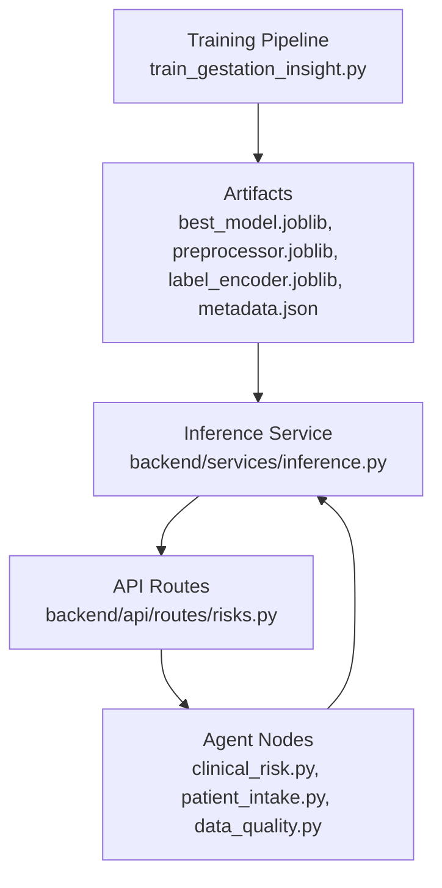
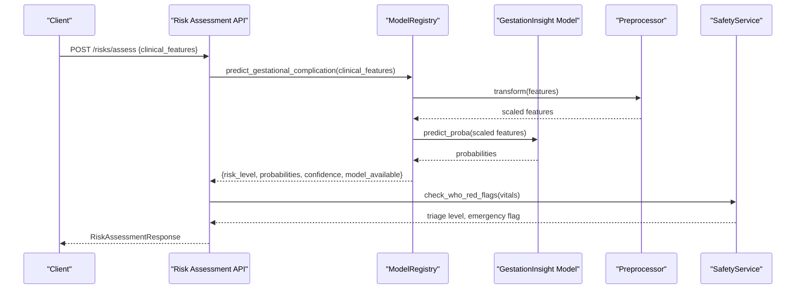
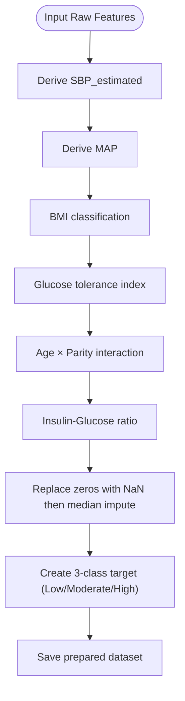
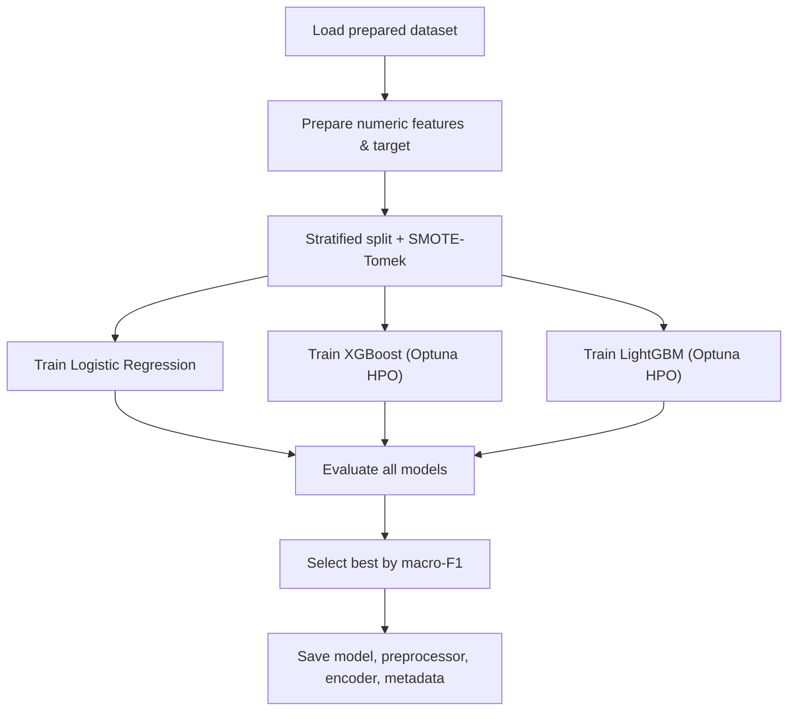
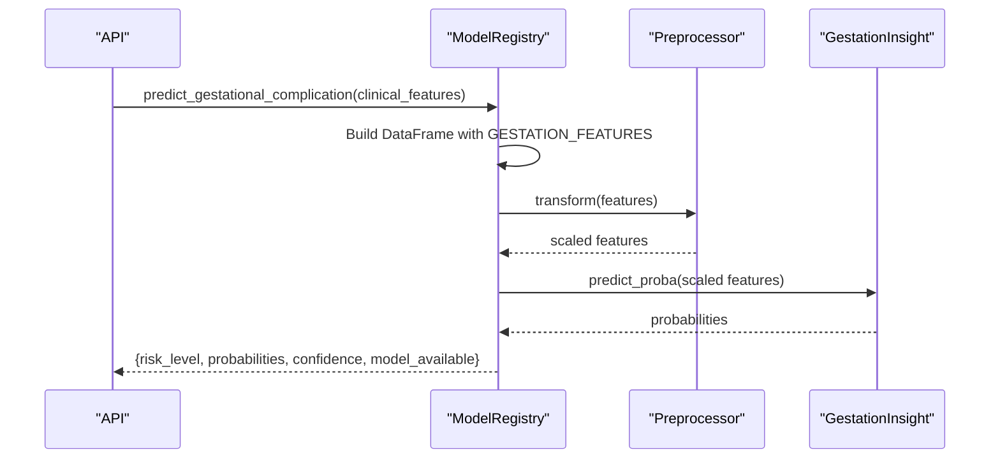
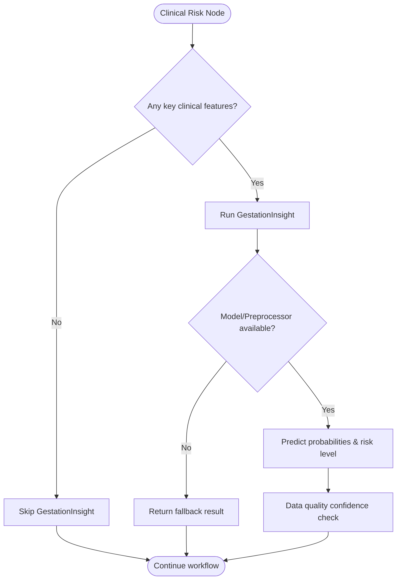
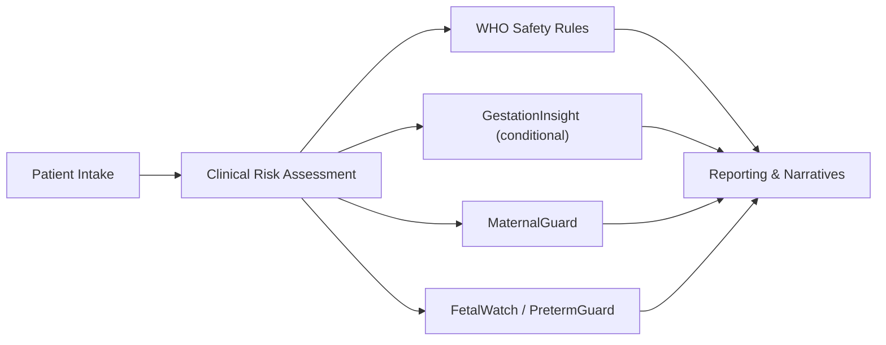
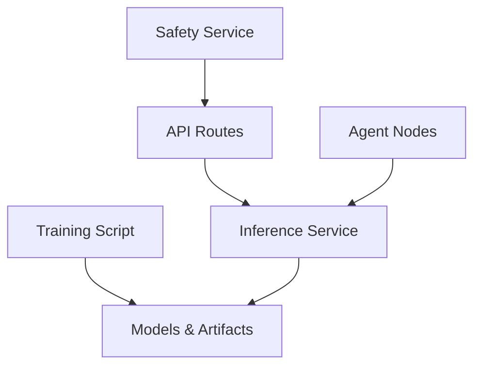

# Gestational Complication Analysis

<cite>
**Referenced Files in This Document**
- [train_gestation_insight.py](file://train_gestation_insight.py)
- [inference.py](file://backend/services/inference.py)
- [risks.py](file://backend/api/routes/risks.py)
- [clinical_risk.py](file://backend/agents/nodes/clinical_risk.py)
- [patient_intake.py](file://backend/agents/nodes/patient_intake.py)
- [data_quality.py](file://backend/agents/nodes/data_quality.py)
- [download_and_prep.py](file://download_and_prep.py)
- [metadata.json](file://artifacts/gestationinsight/metadata.json)
</cite>

## Table of Contents
1. [Introduction](#introduction)
2. [Project Structure](#project-structure)
3. [Core Components](#core-components)
4. [Architecture Overview](#architecture-overview)
5. [Detailed Component Analysis](#detailed-component-analysis)
6. [Dependency Analysis](#dependency-analysis)
7. [Performance Considerations](#performance-considerations)
8. [Troubleshooting Guide](#troubleshooting-guide)
9. [Conclusion](#conclusion)
10. [Appendices](#appendices)

## Introduction
This document explains the GestationInsight system that predicts pregnancy-related complications using a trained multi-class risk model. It covers required clinical features, how the model identifies elevated risk for gestational diabetes and related complications, the end-to-end prediction pipeline from raw inputs to risk outputs, conditional execution when sufficient features are available, fallback behavior, and integration with the broader risk assessment workflow.

## Project Structure
The system spans training, inference, API exposure, and agent-based workflows:
- Training pipeline builds and evaluates multiple models and saves artifacts (model, preprocessor, label encoder, metadata).
- Inference service loads artifacts and provides prediction methods for each model, including GestationInsight.
- API routes expose quick risk assessments and persist results.
- Agent nodes orchestrate intake, clinical risk assessment, data quality checks, and reporting.

**Diagram sources**
- [train_gestation_insight.py:511-673](file://train_gestation_insight.py#L511-L673)
- [inference.py:68-100](file://backend/services/inference.py#L68-L100)
- [risks.py:61-123](file://backend/api/routes/risks.py#L61-L123)
- [clinical_risk.py:15-62](file://backend/agents/nodes/clinical_risk.py#L15-L62)
- [patient_intake.py:58-149](file://backend/agents/nodes/patient_intake.py#L58-L149)
- [data_quality.py:29-121](file://backend/agents/nodes/data_quality.py#L29-L121)

**Section sources**
- [train_gestation_insight.py:511-673](file://train_gestation_insight.py#L511-L673)
- [inference.py:68-100](file://backend/services/inference.py#L68-L100)
- [risks.py:61-123](file://backend/api/routes/risks.py#L61-L123)
- [clinical_risk.py:15-62](file://backend/agents/nodes/clinical_risk.py#L15-L62)
- [patient_intake.py:58-149](file://backend/agents/nodes/patient_intake.py#L58-L149)
- [data_quality.py:29-121](file://backend/agents/nodes/data_quality.py#L29-L121)

## Core Components
- GestationInsight training pipeline:
  - Loads prepared dataset, prepares numeric features, balances classes, trains Logistic Regression, XGBoost, LightGBM, selects best by macro-F1, generates feature importance plots, and saves artifacts plus metadata.
- Inference service:
  - Singleton registry loads models and extras (preprocessor, label encoder), exposes predict_gestational_complication with robust handling of missing features and fallbacks.
- API route:
  - POST /risks/assess accepts optional clinical_features; if present, calls GestationInsight and persists results.
- Agent nodes:
  - Patient intake validates required vitals and demographics.
  - Clinical risk node conditionally runs GestationInsight only when key clinical features are present.
  - Data quality node flags low-confidence predictions and out-of-range values.

**Section sources**
- [train_gestation_insight.py:94-151](file://train_gestation_insight.py#L94-L151)
- [train_gestation_insight.py:158-200](file://train_gestation_insight.py#L158-L200)
- [train_gestation_insight.py:258-394](file://train_gestation_insight.py#L258-L394)
- [train_gestation_insight.py:511-673](file://train_gestation_insight.py#L511-L673)
- [inference.py:41-48](file://backend/services/inference.py#L41-L48)
- [inference.py:365-426](file://backend/services/inference.py#L365-L426)
- [risks.py:24-53](file://backend/api/routes/risks.py#L24-L53)
- [risks.py:61-123](file://backend/api/routes/risks.py#L61-L123)
- [clinical_risk.py:15-62](file://backend/agents/nodes/clinical_risk.py#L15-L62)
- [patient_intake.py:58-149](file://backend/agents/nodes/patient_intake.py#L58-L149)
- [data_quality.py:29-121](file://backend/agents/nodes/data_quality.py#L29-L121)

## Architecture Overview
The GestationInsight pipeline integrates into both quick API assessments and the full agent workflow. The training phase produces a best model and preprocessing artifacts. At runtime, the inference service loads these artifacts and applies consistent preprocessing before predicting risk levels.

**Diagram sources**
- [risks.py:61-123](file://backend/api/routes/risks.py#L61-L123)
- [inference.py:365-426](file://backend/services/inference.py#L365-L426)

**Section sources**
- [risks.py:61-123](file://backend/api/routes/risks.py#L61-L123)
- [inference.py:365-426](file://backend/services/inference.py#L365-L426)

## Detailed Component Analysis

### Required Clinical Features
GestationInsight expects a fixed set of numeric features. Missing keys are filled with zeros at inference time to ensure stable prediction.

- Core features include:
  - Pregnancies
  - Glucose
  - BloodPressure
  - SkinThickness
  - Insulin
  - BMI
  - DiabetesPedigreeFunction
  - Age
  - MAP (derived)
  - glucose_tolerance_idx (derived)
  - age_parity_interaction (derived)
  - insulin_glucose_ratio (derived)
  - SBP_estimated (derived)

These features are defined in the inference service and used consistently during training and prediction.

**Section sources**
- [inference.py:41-48](file://backend/services/inference.py#L41-L48)
- [train_gestation_insight.py:55-60](file://train_gestation_insight.py#L55-L60)
- [download_and_prep.py:209-242](file://download_and_prep.py#L209-L242)

### Feature Engineering and Target Creation
During data preparation:
- Derived features such as estimated systolic blood pressure, mean arterial pressure, glucose tolerance index, age-parity interaction, and insulin-glucose ratio are computed.
- Known zero-value placeholders in certain columns are treated as missing and imputed with medians.
- A three-class target is created to represent Low, Moderate, and High risk based on outcome and clinical thresholds.

**Diagram sources**
- [download_and_prep.py:209-242](file://download_and_prep.py#L209-L242)
- [download_and_prep.py:245-254](file://download_and_prep.py#L245-L254)

**Section sources**
- [download_and_prep.py:209-242](file://download_and_prep.py#L209-L242)
- [download_and_prep.py:245-254](file://download_and_prep.py#L245-L254)

### Training and Model Selection
The training pipeline:
- Loads prepared data and separates numeric features and target.
- Splits data stratified (70/15/15), balances training via SMOTE-Tomek.
- Trains Logistic Regression baseline, XGBoost, and LightGBM with Optuna hyperparameter search.
- Evaluates models using macro-F1 and AUROC (one-vs-rest), selects best model, computes per-class metrics, and generates feature importance visualization.
- Saves best model, preprocessor, label encoder, and metadata.

**Diagram sources**
- [train_gestation_insight.py:158-200](file://train_gestation_insight.py#L158-L200)
- [train_gestation_insight.py:258-394](file://train_gestation_insight.py#L258-L394)
- [train_gestation_insight.py:511-673](file://train_gestation_insight.py#L511-L673)

**Section sources**
- [train_gestation_insight.py:158-200](file://train_gestation_insight.py#L158-L200)
- [train_gestation_insight.py:258-394](file://train_gestation_insight.py#L258-L394)
- [train_gestation_insight.py:511-673](file://train_gestation_insight.py#L511-L673)

### Prediction Pipeline: From Raw Inputs to Risk Outputs
At runtime:
- The API receives optional clinical_features. If provided, GestationInsight is invoked.
- The inference service constructs a DataFrame with expected features, fills missing keys with zeros, optionally applies RobustScaler, and obtains class probabilities.
- Label encoding maps integer classes to human-readable risk levels (Low, Moderate, High).
- Results include risk_level, probabilities, confidence, and model availability.

**Diagram sources**
- [inference.py:365-426](file://backend/services/inference.py#L365-L426)
- [risks.py:90-94](file://backend/api/routes/risks.py#L90-L94)

**Section sources**
- [inference.py:365-426](file://backend/services/inference.py#L365-L426)
- [risks.py:90-94](file://backend/api/routes/risks.py#L90-L94)

### Conditional Execution Logic and Fallback Mechanisms
- Conditional execution:
  - The clinical risk node only runs GestationInsight if any of key clinical features (e.g., Glucose, BloodPressure, BMI, Insulin, SkinThickness, Pregnancies) are present in the combined demographics/vitals context.
- Fallback mechanisms:
  - If the model or preprocessor is unavailable, the inference service returns a safe fallback with unknown risk and zero confidence.
  - Missing features are filled with zeros to prevent errors.
  - Data quality node monitors model confidence and flags low-confidence predictions.

**Diagram sources**
- [clinical_risk.py:32-38](file://backend/agents/nodes/clinical_risk.py#L32-L38)
- [inference.py:381-426](file://backend/services/inference.py#L381-L426)
- [data_quality.py:100-121](file://backend/agents/nodes/data_quality.py#L100-L121)

**Section sources**
- [clinical_risk.py:32-38](file://backend/agents/nodes/clinical_risk.py#L32-L38)
- [inference.py:381-426](file://backend/services/inference.py#L381-L426)
- [data_quality.py:100-121](file://backend/agents/nodes/data_quality.py#L100-L121)

### Integration with Broader Risk Assessment Workflow
- Quick API:
  - POST /risks/assess can call GestationInsight alongside MaternalGuard, FetalWatch, PretermGuard, and CareReach, and persists outcomes.
- Agent workflow:
  - Patient intake validates required fields and may generate follow-up questions.
  - Clinical risk node combines maternal risk, gestational complication risk, and WHO safety rules to determine triage and emergency status.
  - Reporting node aggregates results into narratives and dashboards.

**Diagram sources**
- [patient_intake.py:58-149](file://backend/agents/nodes/patient_intake.py#L58-L149)
- [clinical_risk.py:15-62](file://backend/agents/nodes/clinical_risk.py#L15-L62)
- [risks.py:61-123](file://backend/api/routes/risks.py#L61-L123)

**Section sources**
- [patient_intake.py:58-149](file://backend/agents/nodes/patient_intake.py#L58-L149)
- [clinical_risk.py:15-62](file://backend/agents/nodes/clinical_risk.py#L15-L62)
- [risks.py:61-123](file://backend/api/routes/risks.py#L61-L123)

### Typical Patient Profiles and Predictions
- Example profile inputs:
  - Pregnancies: 2
  - Glucose: 140 mg/dL
  - BloodPressure: 80 mmHg
  - SkinThickness: 25 mm
  - Insulin: 120 µU/mL
  - BMI: 31 kg/m²
  - DiabetesPedigreeFunction: 0.5
  - Age: 30 years
  - Derived features (MAP, glucose_tolerance_idx, age_parity_interaction, insulin_glucose_ratio, SBP_estimated) are computed automatically during training and inferred via preprocessor.
- Expected output:
  - risk_level: one of Low, Moderate, High
  - probabilities: mapping of risk levels to probabilities
  - confidence: highest probability value
  - model_available: boolean indicating successful prediction

Note: Actual numerical outputs depend on the trained model and current artifact state.

**Section sources**
- [inference.py:365-426](file://backend/services/inference.py#L365-L426)
- [metadata.json:1-206](file://artifacts/gestationinsight/metadata.json#L1-L206)

## Dependency Analysis
- Training depends on sklearn, xgboost, lightgbm, optuna, imbalanced-learn, shap, and pandas/numpy.
- Inference depends on joblib, pandas, numpy, and the saved artifacts.
- API depends on FastAPI, SQLAlchemy, and the inference service.
- Agent nodes depend on the inference service and safety service.

**Diagram sources**
- [train_gestation_insight.py:19-38](file://train_gestation_insight.py#L19-L38)
- [inference.py:6-18](file://backend/services/inference.py#L6-L18)
- [risks.py:1-15](file://backend/api/routes/risks.py#L1-L15)
- [clinical_risk.py:1-12](file://backend/agents/nodes/clinical_risk.py#L1-L12)

**Section sources**
- [train_gestation_insight.py:19-38](file://train_gestation_insight.py#L19-L38)
- [inference.py:6-18](file://backend/services/inference.py#L6-L18)
- [risks.py:1-15](file://backend/api/routes/risks.py#L1-L15)
- [clinical_risk.py:1-12](file://backend/agents/nodes/clinical_risk.py#L1-L12)

## Performance Considerations
- Class imbalance is addressed via SMOTE-Tomek during training to improve minority class detection.
- Scaling uses RobustScaler fitted on training data only to avoid leakage.
- Hyperparameter optimization employs Optuna with cross-validation and pruning to reduce search time.
- Early stopping is used for LightGBM to prevent overfitting.
- Feature selection is limited to numeric features present in the prepared dataset; constant features are logged for awareness.

[No sources needed since this section provides general guidance]

## Troubleshooting Guide
- Missing model artifacts:
  - If the model file is not found, the registry logs a warning and skips loading; predictions return fallback results.
- Missing features:
  - Inference fills missing keys with zeros; ensure input dictionaries include expected keys to avoid unintended zero-filling.
- Low confidence:
  - Data quality node flags low-confidence predictions; consider collecting additional clinical features or re-evaluating intake completeness.
- Out-of-range vitals:
  - Data quality node validates ranges and flags critical issues; correct inputs before proceeding.

**Section sources**
- [inference.py:103-130](file://backend/services/inference.py#L103-L130)
- [inference.py:381-426](file://backend/services/inference.py#L381-L426)
- [data_quality.py:29-121](file://backend/agents/nodes/data_quality.py#L29-L121)

## Conclusion
GestationInsight provides a robust, production-ready approach to predicting gestational complication risk using clinically relevant features and a well-validated training pipeline. Its integration points support both quick API assessments and comprehensive agent-driven workflows, with conditional execution ensuring predictions only run when sufficient clinical data is available. Fallback mechanisms and data quality checks enhance reliability and safety across varying data conditions.

[No sources needed since this section summarizes without analyzing specific files]

## Appendices

### Metadata Snapshot
- Best model: LightGBM
- Dataset size: 768 samples
- Number of features: 13
- Classes: Low, Moderate, High
- Macro-F1: approximately 0.746
- AUROC (OVR): approximately 0.888

**Section sources**
- [metadata.json:1-206](file://artifacts/gestationinsight/metadata.json#L1-L206)