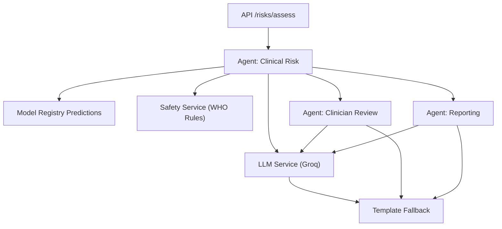
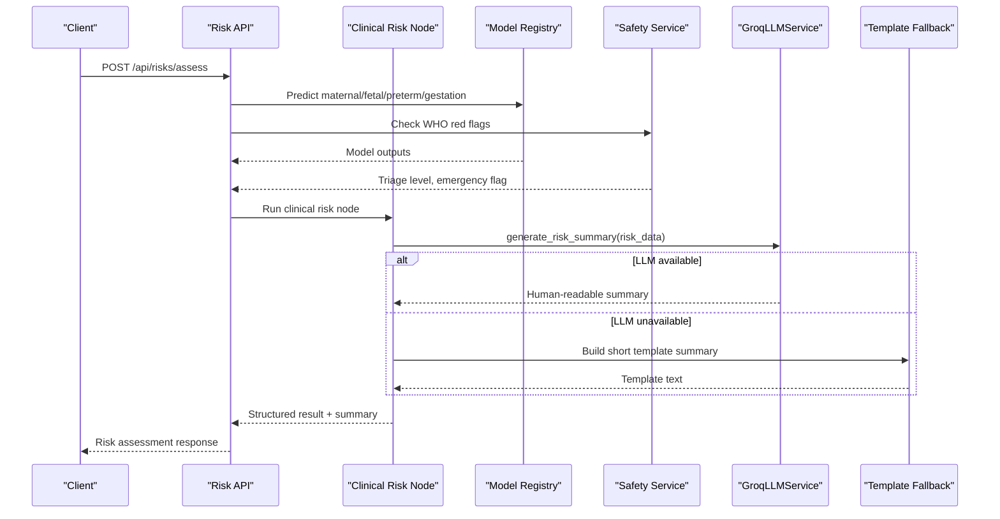
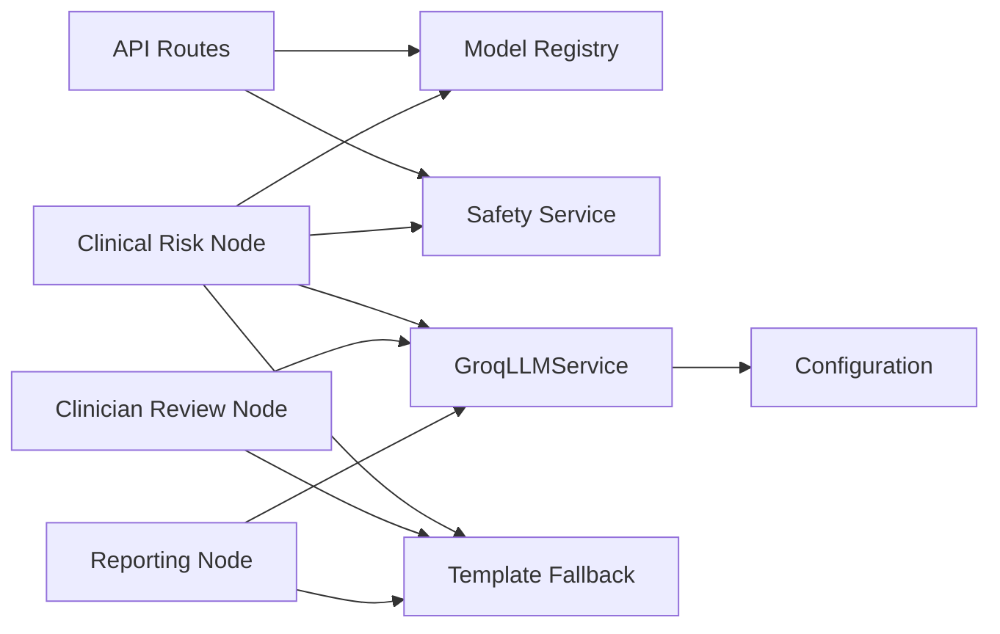

# LLM-Generated Risk Summaries

<cite>
**Referenced Files in This Document**
- [llm.py](file://backend/services/llm.py)
- [clinical_risk.py](file://backend/agents/nodes/clinical_risk.py)
- [clinician_review.py](file://backend/agents/nodes/clinician_review.py)
- [reporting.py](file://backend/agents/nodes/reporting.py)
- [risk.py](file://backend/schemas/risk.py)
- [patient.py](file://backend/schemas/patient.py)
- [risks.py](file://backend/api/routes/risks.py)
- [safety.py](file://backend/services/safety.py)
- [config.py](file://backend/config.py)
</cite>

## Table of Contents
1. [Introduction](#introduction)
2. [Project Structure](#project-structure)
3. [Core Components](#core-components)
4. [Architecture Overview](#architecture-overview)
5. [Detailed Component Analysis](#detailed-component-analysis)
6. [Dependency Analysis](#dependency-analysis)
7. [Performance Considerations](#performance-considerations)
8. [Troubleshooting Guide](#troubleshooting-guide)
9. [Conclusion](#conclusion)
10. [Appendices](#appendices)

## Introduction
This document explains the LLM-powered risk summary generation system that produces human-readable clinical narratives from model outputs and patient data. The system integrates with the Groq API to generate concise, professional summaries for maternal risk assessments, clinician case reviews, and analytics reports. It also provides robust fallback mechanisms so that the risk assessment workflow remains fully functional even when LLM services are unavailable.

Key capabilities:
- Generate plain-language risk summaries using structured inputs (vitals, demographics, model predictions).
- Provide bilingual output guidance (English and Roman Urdu) via prompt engineering.
- Ensure continuity through template-based fallbacks when LLM calls fail or are disabled.
- Enforce safety rules and triage as mandatory steps independent of LLM availability.

## Project Structure
The LLM integration is embedded within the agent pipeline and exposed via APIs:
- LLM service wrapper for Groq API calls and configuration.
- Agent nodes that orchestrate risk assessment and produce both structured results and optional LLM-generated narratives.
- Schemas defining input/output contracts for risk and patient data.
- Safety service enforcing WHO red-flag checks.
- Configuration for Groq credentials and model selection.

**Diagram sources**
- [risks.py:61-123](file://backend/api/routes/risks.py#L61-L123)
- [clinical_risk.py:15-109](file://backend/agents/nodes/clinical_risk.py#L15-L109)
- [clinician_review.py:13-147](file://backend/agents/nodes/clinician_review.py#L13-L147)
- [reporting.py:104-173](file://backend/agents/nodes/reporting.py#L104-L173)
- [llm.py:31-143](file://backend/services/llm.py#L31-L143)
- [safety.py:18-67](file://backend/services/safety.py#L18-L67)

**Section sources**
- [risks.py:61-123](file://backend/api/routes/risks.py#L61-L123)
- [clinical_risk.py:15-109](file://backend/agents/nodes/clinical_risk.py#L15-L109)
- [clinician_review.py:13-147](file://backend/agents/nodes/clinician_review.py#L13-L147)
- [reporting.py:104-173](file://backend/agents/nodes/reporting.py#L104-L173)
- [llm.py:31-143](file://backend/services/llm.py#L31-L143)
- [safety.py:18-67](file://backend/services/safety.py#L18-L67)

## Core Components
- GroqLLMService: Thin wrapper around Groq chat completions with guarded imports, timeouts, and temperature control. Provides methods for risk summaries, follow-up questions, communication messages, case summaries, and reports.
- Agent nodes:
  - Clinical Risk: Runs maternal and gestational risk models, applies WHO safety rules, and generates a human-readable risk summary with LLM fallback.
  - Clinician Review: Aggregates upstream results into a structured case summary and optionally generates an LLM narrative.
  - Reporting: Produces dashboard data and optional LLM narrative report.
- Safety Service: Wraps WHO Clinical Safety Engine to evaluate red flags and determine emergency status.
- Schemas: Define risk result structures and patient/vitals inputs.
- Configuration: Holds Groq API key, model name, and other app settings.

**Section sources**
- [llm.py:31-143](file://backend/services/llm.py#L31-L143)
- [clinical_risk.py:15-109](file://backend/agents/nodes/clinical_risk.py#L15-L109)
- [clinician_review.py:13-147](file://backend/agents/nodes/clinician_review.py#L13-L147)
- [reporting.py:104-173](file://backend/agents/nodes/reporting.py#L104-L173)
- [safety.py:18-67](file://backend/services/safety.py#L18-L67)
- [risk.py:7-43](file://backend/schemas/risk.py#L7-L43)
- [patient.py:14-56](file://backend/schemas/patient.py#L14-L56)
- [config.py:37-42](file://backend/config.py#L37-L42)

## Architecture Overview
The system follows a layered architecture:
- API layer exposes endpoints for quick risk assessment and retrieval.
- Agent pipeline executes deterministic logic (model predictions, safety rules) and optionally augments outputs with LLM-generated narratives.
- LLM service abstracts external dependencies and ensures non-blocking execution via worker threads.
- Fallback templates guarantee continuity if LLM is unavailable.

**Diagram sources**
- [risks.py:61-123](file://backend/api/routes/risks.py#L61-L123)
- [clinical_risk.py:15-109](file://backend/agents/nodes/clinical_risk.py#L15-L109)
- [llm.py:48-76](file://backend/services/llm.py#L48-L76)
- [safety.py:24-67](file://backend/services/safety.py#L24-L67)

## Detailed Component Analysis

### GroqLLMService
Responsibilities:
- Initialize Groq client with timeout and model from configuration.
- Provide specialized generation methods for risk summaries, follow-up questions, communication messages, case summaries, and reports.
- Guard against missing packages and network failures; return None via accessor when unavailable.

Prompt engineering approach:
- System prompts define role and tone (maternal health AI assistant, healthcare communication assistant, clinical decision support).
- User prompts inject structured context (risk data, missing fields, case data).
- Temperature set low for consistency; max_tokens tuned per use case.
- Reasoning effort parameter applied for specific model families to optimize speed and token budgets.

Fallback behavior:
- Accessor returns None on initialization failure; callers must treat this as LLM unavailable and use templates.

**Section sources**
- [llm.py:31-143](file://backend/services/llm.py#L31-L143)
- [config.py:37-42](file://backend/config.py#L37-L42)

### Clinical Risk Node
Workflow:
- Collect vitals and demographics from state.
- Run maternal risk prediction via ModelRegistry.
- Optionally run gestational complication prediction if relevant features exist.
- Always run WHO safety rules; determine emergency status based on triage level.
- Build a short template summary combining risk levels and triage.
- Attempt LLM-generated risk summary; fall back to template if LLM fails.
- Return structured result including risk_summary and llm_generated flag.

Error handling:
- Exceptions during LLM calls are caught; warnings logged; template used instead.
- Overall node errors captured and returned with audit trail entries.

**Section sources**
- [clinical_risk.py:15-109](file://backend/agents/nodes/clinical_risk.py#L15-L109)

### Clinician Review Node
Workflow:
- Aggregate upstream results (clinical risk, fetal assessment, ANC follow-up, referral, communication).
- Build structured case summary with patient info, assessments, and indicators.
- Derive risk indicators (emergency flag, high maternal risk, fetal concerns, WHO triage).
- Attempt LLM-generated narrative case summary; fall back to template if LLM fails.
- Mark review status and attention requirements.

Error handling:
- LLM exceptions handled gracefully; template ensures payload completeness.
- Errors recorded in audit trail.

**Section sources**
- [clinician_review.py:13-147](file://backend/agents/nodes/clinician_review.py#L13-L147)

### Reporting Node
Workflow:
- Produce dashboard data summarizing risk scores and pipeline health.
- Attempt LLM-generated narrative report; fall back to template if LLM fails.
- Include llm_generated flag and generated timestamp.

Error handling:
- LLM failures do not block structured reporting; template maintains usability.

**Section sources**
- [reporting.py:104-173](file://backend/agents/nodes/reporting.py#L104-L173)

### Safety Service
Responsibilities:
- Wrap WHO Clinical Safety Engine to evaluate red flags from vitals.
- Provide triage level, triggered rules, rationale, recommended actions.
- Quick emergency check helper.

Integration:
- Mandatory step in clinical risk assessment; cannot be skipped.
- Emergency status influences downstream decisions and indicators.

**Section sources**
- [safety.py:18-67](file://backend/services/safety.py#L18-L67)

### Input Data Structures
- RiskAssessmentRequest: Accepts patient_id, case_id, vitals, CTG features, clinical features, and ANC features.
- VitalsInput: Defines validated ranges for systolic/diastolic BP, heart rate, temperature, respiratory rate, blood sugar, gestational age, and fetal movement presence.
- Risk schemas: Define maternal risk levels, probabilities, red flags, triage levels, and recommended actions.

Usage:
- API endpoint maps request fields to model registry predictions and safety checks.
- Results persisted to clinical records with model outputs and triage information.

**Section sources**
- [risks.py:24-54](file://backend/api/routes/risks.py#L24-L54)
- [patient.py:14-56](file://backend/schemas/patient.py#L14-L56)
- [risk.py:7-43](file://backend/schemas/risk.py#L7-L43)

## Dependency Analysis
Components and their relationships:
- API routes depend on ModelRegistry and SafetyService for deterministic assessments.
- Agent nodes depend on LLM service for optional narrative augmentation.
- LLM service depends on configuration for credentials and model selection.
- Safety service depends on WHO rule engine for mandatory triage.

**Diagram sources**
- [risks.py:61-123](file://backend/api/routes/risks.py#L61-L123)
- [clinical_risk.py:15-109](file://backend/agents/nodes/clinical_risk.py#L15-L109)
- [clinician_review.py:13-147](file://backend/agents/nodes/clinician_review.py#L13-L147)
- [reporting.py:104-173](file://backend/agents/nodes/reporting.py#L104-L173)
- [llm.py:31-143](file://backend/services/llm.py#L31-L143)
- [config.py:37-42](file://backend/config.py#L37-L42)

**Section sources**
- [risks.py:61-123](file://backend/api/routes/risks.py#L61-L123)
- [clinical_risk.py:15-109](file://backend/agents/nodes/clinical_risk.py#L15-L109)
- [clinician_review.py:13-147](file://backend/agents/nodes/clinician_review.py#L13-L147)
- [reporting.py:104-173](file://backend/agents/nodes/reporting.py#L104-L173)
- [llm.py:31-143](file://backend/services/llm.py#L31-L143)
- [config.py:37-42](file://backend/config.py#L37-L42)

## Performance Considerations
- Non-blocking LLM calls: LLM requests are executed in worker threads to avoid blocking the async event loop.
- Timeout management: Groq client initialized with a fixed timeout to prevent hanging requests.
- Token budgeting: max_tokens tuned per method to balance detail and cost; reasoning_effort set to low for supported models to improve speed.
- Temperature control: Low temperature reduces variability for consistent clinical language.
- Fallback efficiency: Template summaries are lightweight and always available, ensuring minimal latency impact when LLM is down.

[No sources needed since this section provides general guidance]

## Troubleshooting Guide
Common issues and resolutions:
- LLM package missing: Guarded import prevents runtime crashes; get_llm_service returns None; ensure groq package installed if LLM is required.
- Network or authentication failures: LLM calls raise exceptions; logs warn and fallback templates are used; verify API key and connectivity.
- Empty responses: LLM service raises ValueError for empty content; handle by falling back to templates and investigating model output quality.
- Emergency escalation: WHO red flags are mandatory; if HIGH_RISK_EMERGENCY is detected, downstream processes should prioritize immediate action regardless of LLM status.

Operational tips:
- Monitor llm_generated flags in results to track LLM usage and reliability.
- Use audit trails to trace errors and actions across agent nodes.
- Validate input schemas to reduce downstream errors and improve model confidence.

**Section sources**
- [llm.py:20-28](file://backend/services/llm.py#L20-L28)
- [llm.py:48-65](file://backend/services/llm.py#L48-L65)
- [clinical_risk.py:67-95](file://backend/agents/nodes/clinical_risk.py#L67-L95)
- [clinician_review.py:89-118](file://backend/agents/nodes/clinician_review.py#L89-L118)
- [reporting.py:132-152](file://backend/agents/nodes/reporting.py#L132-L152)
- [safety.py:24-67](file://backend/services/safety.py#L24-L67)

## Conclusion
The LLM-powered risk summary system enhances clinical workflows by providing human-readable narratives while maintaining robustness through template-based fallbacks. Deterministic components (model predictions and WHO safety rules) remain independent of LLM availability, ensuring reliable risk assessment at all times. Prompt engineering standardizes tone and structure, and performance optimizations keep the system responsive under load.

[No sources needed since this section summarizes without analyzing specific files]

## Appendices

### Input Data Structure Examples
- Vitals: Include systolic/diastolic blood pressure, heart rate, temperature, respiratory rate, blood sugar, gestational age, and fetal movement presence.
- Demographics: Age, gender, parity, language, location, channel.
- Model predictions: Maternal risk level and probabilities, fetal status and probabilities, preterm risk and probabilities, gestational complication risk and probabilities, ANC follow-up risk and priority.

These inputs are consumed by the API and agent nodes to produce structured outputs and optional LLM-generated summaries.

**Section sources**
- [patient.py:14-56](file://backend/schemas/patient.py#L14-L56)
- [risk.py:7-43](file://backend/schemas/risk.py#L7-L43)
- [risks.py:24-54](file://backend/api/routes/risks.py#L24-L54)

### Summary Formatting and Clinical Language Standards
- Role-based system prompts enforce professional, empathetic, and clear language suitable for maternal health contexts.
- Bilingual guidance encourages English and Roman Urdu outputs where appropriate.
- Temperature and max_tokens parameters ensure concise, consistent, and clinically useful narratives.

**Section sources**
- [llm.py:67-119](file://backend/services/llm.py#L67-L119)

### Fallback Mechanism Details
- Each agent node builds a short template summary before attempting LLM generation.
- On LLM failure or unavailability, the template is used and llm_generated is set to False.
- This guarantees that risk assessment workflows never depend on external LLM availability.

**Section sources**
- [clinical_risk.py:60-95](file://backend/agents/nodes/clinical_risk.py#L60-L95)
- [clinician_review.py:89-118](file://backend/agents/nodes/clinician_review.py#L89-L118)
- [reporting.py:132-152](file://backend/agents/nodes/reporting.py#L132-L152)

### Error Handling and Timeout Management
- LLM client timeout configured to prevent long-running requests.
- Exceptions caught in agent nodes; warnings logged; fallback templates used.
- Audit trails capture errors and actions for traceability.

**Section sources**
- [llm.py:44-46](file://backend/services/llm.py#L44-L46)
- [clinical_risk.py:89-95](file://backend/agents/nodes/clinical_risk.py#L89-L95)
- [clinician_review.py:115-118](file://backend/agents/nodes/clinician_review.py#L115-L118)
- [reporting.py:149-152](file://backend/agents/nodes/reporting.py#L149-L152)

### Quality Assurance Measures
- Data quality node validates vital ranges and flags anomalies.
- Model confidence thresholds monitored; low confidence triggers warnings.
- WHO safety rules enforced as mandatory; emergency detection overrides other considerations.

**Section sources**
- [data_quality.py:9-23](file://backend/agents/nodes/data_quality.py#L9-L23)
- [data_quality.py:46-151](file://backend/agents/nodes/data_quality.py#L46-L151)
- [safety.py:24-67](file://backend/services/safety.py#L24-L67)