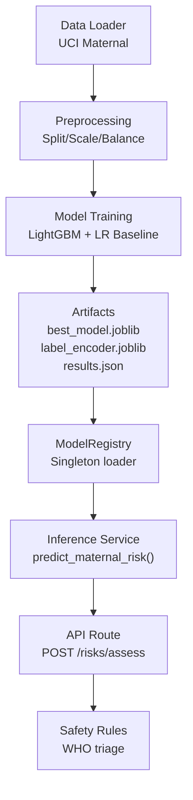
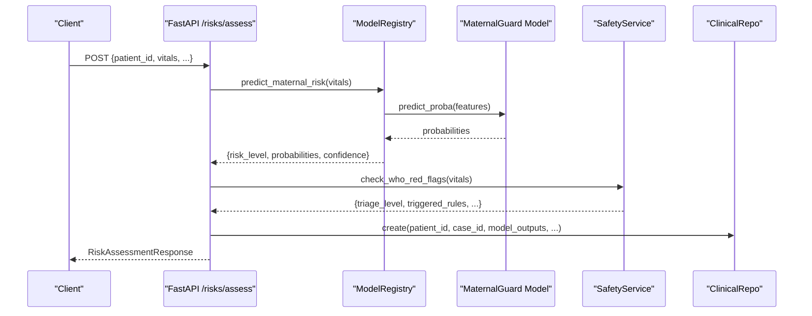
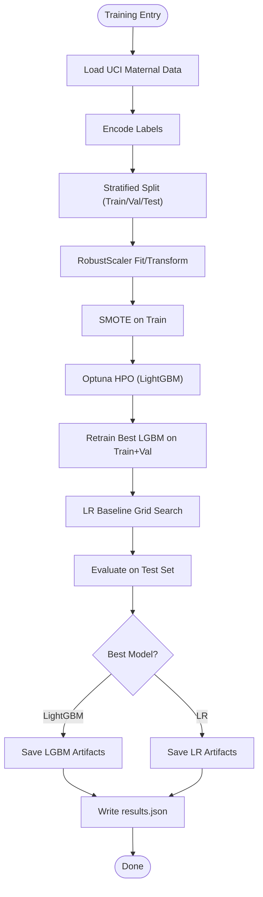

# Maternal Risk Prediction

<cite>
**Referenced Files in This Document**
- [maternal_guard.py](file://src/models/maternal_guard.py)
- [uci_maternal.py](file://src/data/loaders/uci_maternal.py)
- [preprocessing.py](file://src/data/preprocessing.py)
- [inference.py](file://backend/services/inference.py)
- [risks.py](file://backend/api/routes/risks.py)
- [risk.py](file://backend/schemas/risk.py)
- [config.py](file://backend/config.py)
- [safety_rules.py](file://safety_rules.py)
- [results.json](file://artifacts/maternalguard/results.json)
- [data_quality.py](file://backend/agents/nodes/data_quality.py)
</cite>

## Table of Contents
1. [Introduction](#introduction)
2. [Project Structure](#project-structure)
3. [Core Components](#core-components)
4. [Architecture Overview](#architecture-overview)
5. [Detailed Component Analysis](#detailed-component-analysis)
6. [Dependency Analysis](#dependency-analysis)
7. [Performance Considerations](#performance-considerations)
8. [Troubleshooting Guide](#troubleshooting-guide)
9. [Conclusion](#conclusion)
10. [Appendices](#appendices)

## Introduction
This document explains the maternal risk prediction component powered by the MaternalGuard model. It covers input data requirements, feature engineering, model architecture and training, prediction outputs, risk classification, thresholds, integration with the ModelRegistry, error handling, performance characteristics, validation metrics, confidence scores, and clinical interpretation guidelines. The goal is to enable both technical and clinical users to understand how maternal health risks are assessed using vital signs and related features, and how results are integrated into the broader system.

## Project Structure
The maternal risk prediction pipeline spans data loading, preprocessing, model training, artifact storage, and runtime inference via a service layer that integrates with API routes and safety rules.

**Diagram sources**
- [uci_maternal.py:11-47](file://src/data/loaders/uci_maternal.py#L11-L47)
- [preprocessing.py:22-130](file://src/data/preprocessing.py#L22-L130)
- [maternal_guard.py:71-260](file://src/models/maternal_guard.py#L71-L260)
- [inference.py:51-202](file://backend/services/inference.py#L51-L202)
- [risks.py:61-123](file://backend/api/routes/risks.py#L61-L123)
- [safety_rules.py:72-167](file://safety_rules.py#L72-L167)

**Section sources**
- [maternal_guard.py:71-260](file://src/models/maternal_guard.py#L71-L260)
- [inference.py:51-202](file://backend/services/inference.py#L51-L202)
- [risks.py:61-123](file://backend/api/routes/risks.py#L61-L123)

## Core Components
- Data loader for UCI Maternal dataset (features and labels).
- Preprocessing utilities for splitting, scaling, and class balancing.
- MaternalGuard training script that optimizes LightGBM via Optuna and compares against Logistic Regression baseline.
- Inference service that loads models from artifacts and provides prediction methods.
- API route exposing risk assessment endpoints and persisting results.
- Safety rules engine implementing WHO triage logic.
- Configuration for model paths and environment settings.

**Section sources**
- [uci_maternal.py:11-47](file://src/data/loaders/uci_maternal.py#L11-L47)
- [preprocessing.py:22-188](file://src/data/preprocessing.py#L22-L188)
- [maternal_guard.py:71-260](file://src/models/maternal_guard.py#L71-L260)
- [inference.py:51-202](file://backend/services/inference.py#L51-L202)
- [risks.py:61-123](file://backend/api/routes/risks.py#L61-L123)
- [safety_rules.py:72-167](file://safety_rules.py#L72-L167)
- [config.py:7-21](file://backend/config.py#L7-L21)

## Architecture Overview
MaternalGuard uses vital signs and demographic features to predict maternal risk levels. During training, the dataset is split, scaled, balanced, and optimized via cross-validation. At runtime, the ModelRegistry loads the best model and label encoder; predictions return risk level, probabilities, and confidence. API endpoints accept vitals and optionally other features, run inference, apply WHO safety rules, and persist outcomes.

**Diagram sources**
- [risks.py:61-123](file://backend/api/routes/risks.py#L61-L123)
- [inference.py:153-202](file://backend/services/inference.py#L153-L202)
- [safety_rules.py:72-167](file://safety_rules.py#L72-L167)

## Detailed Component Analysis

### Input Data Requirements
- MaternalGuard expects a dictionary of vital signs and demographics:
  - Age
  - SystolicBP
  - DiastolicBP
  - BS (blood sugar)
  - BodyTemp
  - HeartRate
- Missing keys are filled with zeros during inference to ensure consistent feature vectors.

These fields align with the MATERNAL_FEATURES list used at runtime and the UCI dataset columns excluding the target RiskLevel.

**Section sources**
- [inference.py:31-33](file://backend/services/inference.py#L31-L33)
- [inference.py:153-179](file://backend/services/inference.py#L153-L179)
- [uci_maternal.py:41-47](file://src/data/loaders/uci_maternal.py#L41-L47)

### Feature Engineering Process
- Splitting: Stratified train/validation/test splits (70/15/15 default).
- Scaling: RobustScaler applied on training set and transformed across splits.
- Balancing: SMOTE applied to training set to address class imbalance.
- Label encoding: LabelEncoder maps classes to integers for training; inverse transform used at inference.

These steps are orchestrated in the training function and shared preprocessing utilities.

**Section sources**
- [preprocessing.py:22-70](file://src/data/preprocessing.py#L22-L70)
- [preprocessing.py:80-130](file://src/data/preprocessing.py#L80-L130)
- [preprocessing.py:138-188](file://src/data/preprocessing.py#L138-L188)
- [maternal_guard.py:96-118](file://src/models/maternal_guard.py#L96-L118)

### Model Architecture and Training
- Primary model: LightGBM classifier with hyperparameter optimization via Optuna (objective maximizes macro-F1 over 5-fold stratified CV).
- Baseline: Logistic Regression with grid search over regularization parameter C.
- Evaluation: Macro-F1, AUROC (one-vs-rest), per-class precision/recall/f1, confusion matrix.
- Best model selection based on macro-F1; artifacts saved include best model, label encoder, and results JSON.

**Diagram sources**
- [maternal_guard.py:41-64](file://src/models/maternal_guard.py#L41-L64)
- [maternal_guard.py:71-260](file://src/models/maternal_guard.py#L71-L260)
- [preprocessing.py:22-188](file://src/data/preprocessing.py#L22-L188)

**Section sources**
- [maternal_guard.py:41-64](file://src/models/maternal_guard.py#L41-L64)
- [maternal_guard.py:71-260](file://src/models/maternal_guard.py#L71-L260)

### Prediction Output Format
- Returns a dictionary containing:
  - risk_level: string label (e.g., "low risk", "mid risk", "high risk")
  - probabilities: mapping from class labels to predicted probabilities
  - confidence: probability of the predicted class (rounded)
  - model_available: boolean indicating successful inference

If the model is unavailable or an exception occurs, a fallback response indicates unknown risk and zero confidence.

**Section sources**
- [inference.py:153-202](file://backend/services/inference.py#L153-L202)

### Risk Classification System and Thresholds
- Classes: low risk, mid risk, high risk (as stored in artifacts and inferred via label encoder).
- Thresholds:
  - No explicit numeric thresholds are applied to convert probabilities into risk categories within MaternalGuard; the model directly predicts categorical classes.
  - Confidence thresholding exists elsewhere in the system for quality checks (MIN_CONFIDENCE_THRESHOLD = 0.5), used to flag low-confidence predictions but not to change risk categories.
- WHO triage levels (GREEN/YELLOW/ORANGE/RED) are separate from ML risk categories and can override ML-based decisions when red flags are present.

**Section sources**
- [results.json:1-96](file://artifacts/maternalguard/results.json#L1-L96)
- [data_quality.py:21-23](file://backend/agents/nodes/data_quality.py#L21-L23)
- [safety_rules.py:19-26](file://safety_rules.py#L19-L26)

### Examples of Patient Scenarios and Assessments
- Scenario A (Low risk): Normal vitals and age within typical ranges → expected low risk prediction with high confidence if model is confident.
- Scenario B (Moderate risk): Elevated blood pressure or heart rate without critical thresholds → may result in mid risk prediction depending on feature values.
- Scenario C (High risk): Severe hypertension or abnormal combinations → likely high risk prediction; WHO safety rules may escalate to emergency triage.

Note: These scenarios describe expected behavior based on feature importance and model outputs; exact classifications depend on the trained model’s decision boundaries.

[No sources needed since this section describes conceptual scenarios]

### Integration with ModelRegistry
- Singleton registry loads all models once at startup, including MaternalGuard and its label encoder.
- Health check reports which models are available.
- Fallback responses are returned if models are missing or exceptions occur.

**Section sources**
- [inference.py:51-141](file://backend/services/inference.py#L51-L141)
- [inference.py:147-149](file://backend/services/inference.py#L147-L149)

### Error Handling Mechanisms
- Inference catches exceptions and returns safe fallback dictionaries with model_available=False and zero confidence.
- Logging records failures for debugging.
- API persists model outputs even when some models fail, enabling partial assessments.

**Section sources**
- [inference.py:194-202](file://backend/services/inference.py#L194-L202)
- [risks.py:100-123](file://backend/api/routes/risks.py#L100-L123)

### Performance Considerations
- LightGBM with early stopping and balanced class weights improves robustness on imbalanced data.
- Optuna pruning reduces wasted trials during hyperparameter search.
- RobustScaler mitigates outlier influence on scaling.
- SMOTE balances training distribution to improve recall for minority classes.
- Singleton ModelRegistry avoids repeated model loading overhead.

**Section sources**
- [maternal_guard.py:123-154](file://src/models/maternal_guard.py#L123-L154)
- [preprocessing.py:80-130](file://src/data/preprocessing.py#L80-L130)
- [preprocessing.py:138-188](file://src/data/preprocessing.py#L138-L188)
- [inference.py:51-101](file://backend/services/inference.py#L51-L101)

### Model Validation and Metrics
- Cross-validation macro-F1 used for Optuna objective.
- Test set evaluation includes macro-F1, AUROC (OVR), per-class metrics, and confusion matrices.
- Best model selected by macro-F1; results persisted to artifacts.

**Section sources**
- [maternal_guard.py:123-154](file://src/models/maternal_guard.py#L123-L154)
- [maternal_guard.py:180-231](file://src/models/maternal_guard.py#L180-L231)
- [results.json:1-96](file://artifacts/maternalguard/results.json#L1-L96)

### Confidence Scores and Clinical Interpretation Guidelines
- Confidence equals the predicted probability of the chosen class; higher values indicate stronger model certainty.
- System-wide MIN_CONFIDENCE_THRESHOLD (0.5) flags low-confidence predictions for review.
- WHO safety rules can override ML outputs when red flags are detected, ensuring patient safety takes precedence.
- Clinicians should interpret risk levels alongside confidence and WHO triage outcomes, considering clinical context and additional diagnostics.

**Section sources**
- [inference.py:191-198](file://backend/services/inference.py#L191-L198)
- [data_quality.py:21-23](file://backend/agents/nodes/data_quality.py#L21-L23)
- [safety_rules.py:72-167](file://safety_rules.py#L72-L167)

## Dependency Analysis
MaternalGuard depends on data loaders, preprocessing utilities, and external libraries (LightGBM, Optuna, scikit-learn). Runtime inference depends on ModelRegistry and configuration for artifact paths. API routes integrate inference and safety services, persisting results via repositories.

**Diagram sources**
- [uci_maternal.py:11-47](file://src/data/loaders/uci_maternal.py#L11-L47)
- [preprocessing.py:22-188](file://src/data/preprocessing.py#L22-L188)
- [maternal_guard.py:71-260](file://src/models/maternal_guard.py#L71-L260)
- [inference.py:51-202](file://backend/services/inference.py#L51-L202)
- [risks.py:61-123](file://backend/api/routes/risks.py#L61-L123)
- [safety_rules.py:72-167](file://safety_rules.py#L72-L167)

**Section sources**
- [config.py:7-21](file://backend/config.py#L7-L21)
- [inference.py:51-101](file://backend/services/inference.py#L51-L101)

## Performance Considerations
- Use robust scaling to handle outliers in vital signs.
- Apply SMOTE only on training data to avoid data leakage.
- Early stopping prevents overfitting during LightGBM training.
- Singleton registry minimizes memory usage and startup latency.
- Monitor model confidence and trigger human review when below threshold.

[No sources needed since this section provides general guidance]

## Troubleshooting Guide
- Model file not found: Check configured artifact paths in settings; ensure best_model.joblib and label_encoder.joblib exist.
- Prediction failures: Inspect logs for exceptions; verify input keys match expected features; missing keys are filled with zeros.
- Low confidence warnings: Review data quality node outputs; consider retraining or augmenting data if consistently low.
- Emergency overrides: If WHO red flags are triggered, triage level becomes HIGH_RISK_EMERGENCY regardless of ML risk.

**Section sources**
- [inference.py:103-130](file://backend/services/inference.py#L103-L130)
- [inference.py:194-202](file://backend/services/inference.py#L194-L202)
- [data_quality.py:25-183](file://backend/agents/nodes/data_quality.py#L25-L183)
- [safety_rules.py:72-167](file://safety_rules.py#L72-L167)

## Conclusion
MaternalGuard provides a robust, validated approach to maternal risk prediction using vital signs and demographic features. The system integrates model inference with WHO-based safety rules, ensuring clinical safety while leveraging machine learning insights. Proper input formatting, understanding of confidence scores, and awareness of triage overrides are essential for accurate and safe clinical interpretation.

[No sources needed since this section summarizes without analyzing specific files]

## Appendices

### API Request and Response Schema
- Request fields:
  - patient_id: identifier
  - case_id: optional identifier
  - vitals: dictionary with Age, SystolicBP, DiastolicBP, BS, BodyTemp, HeartRate
  - Optional CTG, clinical, and ANC features for other models
- Response fields:
  - case_id
  - maternal_risk: {risk_level, probabilities, confidence, model_available}
  - fetal_health, preterm_risk, gestational_complication, anc_followup (if provided)
  - safety_triage: WHO triage output
  - is_emergency: boolean

**Section sources**
- [risks.py:24-54](file://backend/api/routes/risks.py#L24-L54)
- [risks.py:61-123](file://backend/api/routes/risks.py#L61-L123)

### Feature Importance (LightGBM)
Top features influencing maternal risk predictions include blood sugar, age, heart rate, diastolic blood pressure, systolic blood pressure, and body temperature.

**Section sources**
- [results.json:88-95](file://artifacts/maternalguard/results.json#L88-L95)