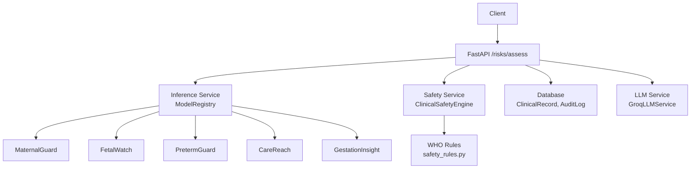
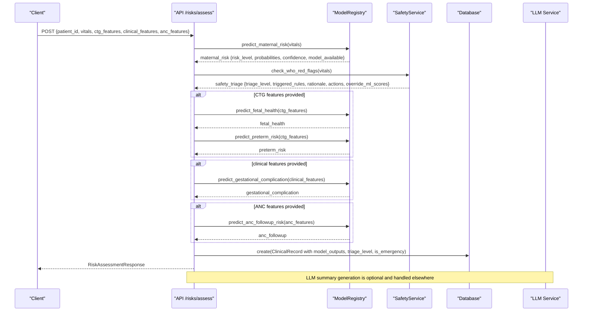
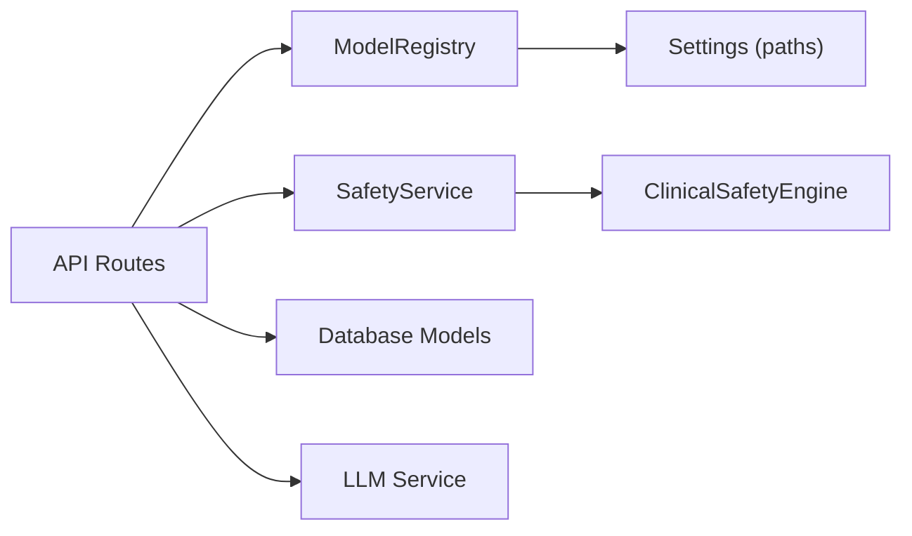

# Risk Assessment Workflow

<cite>
**Referenced Files in This Document**
- [inference.py](file://backend/services/inference.py)
- [safety.py](file://backend/services/safety.py)
- [llm.py](file://backend/services/llm.py)
- [risks.py](file://backend/api/routes/risks.py)
- [audit.py](file://backend/api/routes/audit.py)
- [models.py](file://backend/db/models.py)
- [config.py](file://backend/config.py)
- [safety_rules.py](file://safety_rules.py)
- [maternal_guard.py](file://src/models/maternal_guard.py)
- [preterm_guard.py](file://src/models/preterm_guard.py)
- [train_gestation_insight.py](file://train_gestation_insight.py)
- [results.json](file://artifacts/maternalguard/results.json)
</cite>

## Table of Contents
1. [Introduction](#introduction)
2. [Project Structure](#project-structure)
3. [Core Components](#core-components)
4. [Architecture Overview](#architecture-overview)
5. [Detailed Component Analysis](#detailed-component-analysis)
6. [Dependency Analysis](#dependency-analysis)
7. [Performance Considerations](#performance-considerations)
8. [Troubleshooting Guide](#troubleshooting-guide)
9. [Conclusion](#conclusion)
10. [Appendices](#appendices)

## Introduction
This document explains the end-to-end risk assessment workflow that combines:
- Maternal risk prediction using MaternalGuard
- Gestational complication analysis using GestationInsight
- WHO safety rule evaluation via a deterministic Clinical Safety Engine
- Optional LLM-generated clinical summaries with robust fallbacks
- Triage determination (GREEN, YELLOW, ORANGE, RED) and emergency escalation criteria
- Audit logging for compliance and traceability

The system exposes a concise API to run multi-model inference and safety checks, persist results, and retrieve them later. It is designed to be resilient when models or external services are unavailable by returning safe defaults and clearly marking model availability.

## Project Structure
At a high level:
- Inference service loads and runs ML models (MaternalGuard, FetalWatch, PretermGuard, CareReach, GestationInsight).
- Safety service wraps WHO rules to evaluate red flags and determine triage levels.
- API routes orchestrate requests, call inference and safety services, and persist outcomes.
- LLM service generates natural language summaries with graceful degradation if unavailable.
- Database models store patient records, audit logs, and model metadata.

**Diagram sources**
- [risks.py:61-123](file://backend/api/routes/risks.py#L61-L123)
- [inference.py:51-141](file://backend/services/inference.py#L51-L141)
- [safety.py:18-67](file://backend/services/safety.py#L18-L67)
- [safety_rules.py:72-167](file://safety_rules.py#L72-L167)
- [llm.py:31-143](file://backend/services/llm.py#L31-L143)
- [models.py:30-92](file://backend/db/models.py#L30-L92)

**Section sources**
- [risks.py:1-149](file://backend/api/routes/risks.py#L1-L149)
- [inference.py:1-435](file://backend/services/inference.py#L1-L435)
- [safety.py:1-83](file://backend/services/safety.py#L1-L83)
- [safety_rules.py:1-555](file://safety_rules.py#L1-L555)
- [llm.py:1-144](file://backend/services/llm.py#L1-L144)
- [models.py:1-115](file://backend/db/models.py#L1-L115)

## Core Components
- ModelRegistry: Singleton that loads all models once at startup and provides prediction methods for each model with consistent output schemas and fallbacks when models are missing.
- SafetyService: Thin adapter over ClinicalSafetyEngine to evaluate WHO danger signs and return triage level, triggered rules, rationale, actions, and whether ML scores should be overridden.
- LLM Service: Optional text generation for risk summaries, follow-up questions, communications, case summaries, and analytics reports; returns None gracefully when unavailable.
- API Routes: Expose /risks/assess to run inference and safety checks, persist results, and return structured outputs including an emergency flag.
- Data Models: Persist clinical records, audit logs, referrals, and model versions for traceability and governance.

Key responsibilities and interactions:
- Input validation and feature mapping occur in the inference service before calling models.
- Safety rules can override ML-based risk scores when red flags are present.
- LLM summaries are optional and do not block core workflows.
- All predictions and safety evaluations are persisted for auditability.

**Section sources**
- [inference.py:51-141](file://backend/services/inference.py#L51-L141)
- [safety.py:18-67](file://backend/services/safety.py#L18-L67)
- [llm.py:31-143](file://backend/services/llm.py#L31-L143)
- [risks.py:61-123](file://backend/api/routes/risks.py#L61-L123)
- [models.py:30-92](file://backend/db/models.py#L30-L92)

## Architecture Overview
The risk assessment pipeline integrates multiple models and deterministic safety rules into a unified decision support flow.

**Diagram sources**
- [risks.py:61-123](file://backend/api/routes/risks.py#L61-L123)
- [inference.py:153-426](file://backend/services/inference.py#L153-L426)
- [safety.py:24-67](file://backend/services/safety.py#L24-L67)
- [models.py:30-43](file://backend/db/models.py#L30-L43)

## Detailed Component Analysis

### Multi-Model Inference Pipeline
- MaternalGuard: Predicts maternal risk from vital signs (Age, SystolicBP, DiastolicBP, BS, BodyTemp, HeartRate). Returns risk level, class probabilities, confidence, and model availability. Missing features are filled with zeros to ensure robustness.
- FetalWatch: Predicts fetal health status from 21 CTG features. Returns fetal status, probabilities, confidence, and model availability.
- PretermGuard: Predicts preterm birth risk from the same 21 CTG features. Returns risk level, probabilities, confidence, and model availability.
- CareReach: Predicts ANC missed-visit risk from raw patient features. Applies preprocessing (if available), then maps probability thresholds to priority levels (high/medium/low).
- GestationInsight: Predicts gestational complication risk (Low/Moderate/High) from clinical features. Uses a RobustScaler preprocessor and label encoder when available; otherwise falls back to numeric indices mapped to human-readable labels.

Input data requirements:
- Vitals dict keys must match MATERNAL_FEATURES for MaternalGuard.
- CTG features dict must include the 21 CTG feature names used by FetalWatch and PretermGuard.
- Clinical features dict must include GESTATION_FEATURES for GestationInsight.
- ANC features dict must include CAREREACH_RAW_FEATURES for CareReach.

Output interpretation:
- Each prediction includes a primary label (e.g., risk_level or fetal_status), a probabilities map across classes, a confidence score equal to the predicted class probability, and a boolean indicating model availability.
- For CareReach, priority is derived from probability thresholds.
- For GestationInsight, labels are mapped to Low/Moderate/High via a label encoder or index mapping.

Fallback behavior:
- If a model is not loaded or fails during prediction, the service returns a safe default with unknown label, empty probabilities, zero confidence, and model_available set to False.

**Section sources**
- [inference.py:24-48](file://backend/services/inference.py#L24-L48)
- [inference.py:153-203](file://backend/services/inference.py#L153-L203)
- [inference.py:206-248](file://backend/services/inference.py#L206-L248)
- [inference.py:252-293](file://backend/services/inference.py#L252-L293)
- [inference.py:297-361](file://backend/services/inference.py#L297-L361)
- [inference.py:365-426](file://backend/services/inference.py#L365-L426)

### WHO Red Flag Checking and Triage Determination
The ClinicalSafetyEngine evaluates patient vitals against WHO danger-sign criteria in strict priority order:
- RED rules: Immediate life-threatening conditions (e.g., severe hypertension, hemorrhage, imminent eclampsia, eclampsia, sepsis, reduced fetal movement after 28 weeks, unconsciousness). Any trigger sets triage level to RED and marks override_ml_scores = True.
- ORANGE rules: Urgent conditions requiring attention within 15 minutes (e.g., moderate hypertension, moderate bleeding, tachycardia, high fever without sepsis indicators).
- YELLOW rules: Requires attention within 1 hour (e.g., mild hypertension, mild symptoms like headache or spotting).
- GREEN: Default routine care when no danger signs are detected.

Triage levels:
- GREEN: LOW_RISK
- YELLOW: MODERATE_RISK
- ORANGE: HIGH_RISK
- RED: HIGH_RISK_EMERGENCY

Emergency escalation:
- The SafetyService provides a quick helper to detect emergencies based on RED triage. When true, downstream systems should escalate immediately.

Conflict resolution:
- WHO rules take precedence over ML-based risk scores when any red flag is triggered. The engine explicitly sets override_ml_scores to True in such cases, ensuring safety-critical decisions are not overridden by probabilistic models.

**Section sources**
- [safety_rules.py:19-66](file://safety_rules.py#L19-L66)
- [safety_rules.py:89-167](file://safety_rules.py#L89-L167)
- [safety_rules.py:173-316](file://safety_rules.py#L173-L316)
- [safety_rules.py:322-462](file://safety_rules.py#L322-L462)
- [safety_rules.py:468-477](file://safety_rules.py#L468-L477)
- [safety.py:24-67](file://backend/services/safety.py#L24-L67)

### LLM-Generated Risk Summaries and Fallbacks
- GroqLLMService provides functions to generate:
  - Clinical risk summaries
  - Follow-up questions for missing fields
  - Patient/staff communication messages
  - Clinician review case summaries
  - Analytics/reporting text
- The service is optional: if the groq package is missing or initialization fails, get_llm_service returns None. Callers should treat LLM generation as optional and fall back to template text with llm_generated=False.
- Configuration for API key and model is centralized in Settings.

Fallback mechanisms:
- If LLM is unavailable, callers continue workflows without generated text and mark outputs accordingly.
- Errors during generation (e.g., empty completion) raise exceptions; callers should catch and handle these gracefully.

**Section sources**
- [llm.py:1-144](file://backend/services/llm.py#L1-L144)
- [config.py:37-42](file://backend/config.py#L37-L42)

### API Integration and Persistence
- Endpoint POST /risks/assess accepts patient_id, optional case_id, and feature dicts for each model. It calls inference and safety services, persists results to ClinicalRecord, and returns a structured response including maternal_risk, fetal_health, preterm_risk, gestational_complication, anc_followup, safety_triage, and is_emergency.
- GET /risks/{case_id} retrieves previously stored assessments by case_id.
- Audit logs endpoint GET /audit/logs lists recent logs with filtering and pagination, requiring admin role.

Persistence schema highlights:
- ClinicalRecord stores vitals, symptoms, maternal risk level, fetal status, complication risk, triage level, WHO red flags, emergency flag, and full model outputs.
- AuditLog captures agent_name, action, inputs/outputs summaries, confidence, duration, errors, and timestamps.

**Section sources**
- [risks.py:24-54](file://backend/api/routes/risks.py#L24-L54)
- [risks.py:61-123](file://backend/api/routes/risks.py#L61-L123)
- [risks.py:126-149](file://backend/api/routes/risks.py#L126-L149)
- [audit.py:21-88](file://backend/api/routes/audit.py#L21-L88)
- [models.py:30-92](file://backend/db/models.py#L30-L92)

### Model Training and Artifacts
- MaternalGuard training uses LightGBM with Optuna HPO and Logistic Regression baseline; best model and label encoder are saved under artifacts/maternalguard.
- PretermGuard training uses LightGBM with Optuna HPO and Random Forest baseline; best model saved under artifacts/pretermguard.
- GestationInsight training compares Logistic Regression, XGBoost, and LightGBM; best model, preprocessor, and label encoder saved under artifacts/gestationinsight.

Artifacts and metadata:
- MaternalGuard results include macro-F1, AUROC, per-class metrics, confusion matrix, and feature importance.
- GestationInsight metadata includes dataset info, splits, balancing method, feature names, and performance metrics.

**Section sources**
- [maternal_guard.py:71-260](file://src/models/maternal_guard.py#L71-L260)
- [preterm_guard.py:208-363](file://src/models/preterm_guard.py#L208-L363)
- [train_gestation_insight.py:511-669](file://train_gestation_insight.py#L511-L669)
- [results.json:1-96](file://artifacts/maternalguard/results.json#L1-L96)

## Dependency Analysis
Component coupling and cohesion:
- API routes depend on ModelRegistry and SafetyService; they do not implement inference logic themselves, promoting separation of concerns.
- ModelRegistry encapsulates model loading and prediction, isolating dependencies on joblib, pandas, numpy, and configuration paths.
- SafetyService depends on safety_rules.py’s ClinicalSafetyEngine; it does not duplicate rule logic.
- LLM service is decoupled; callers decide whether to use it and handle unavailability.

External dependencies:
- Groq LLM integration is optional and guarded by import checks.
- Database persistence uses SQLAlchemy models defined in db/models.py.
- Configuration centralizes artifact paths and API settings.

Potential circular dependencies:
- None observed; services are layered and accessed via dependency injection in FastAPI routes.

Integration points:
- Feature lists and label mappings are defined in inference.py and align with training scripts.
- Safety rules define triage levels and override semantics consumed by API responses.

**Diagram sources**
- [risks.py:61-123](file://backend/api/routes/risks.py#L61-L123)
- [inference.py:51-141](file://backend/services/inference.py#L51-L141)
- [safety.py:18-67](file://backend/services/safety.py#L18-L67)
- [config.py:7-22](file://backend/config.py#L7-L22)
- [models.py:30-92](file://backend/db/models.py#L30-L92)
- [llm.py:31-143](file://backend/services/llm.py#L31-L143)

**Section sources**
- [risks.py:61-123](file://backend/api/routes/risks.py#L61-L123)
- [inference.py:51-141](file://backend/services/inference.py#L51-L141)
- [safety.py:18-67](file://backend/services/safety.py#L18-L67)
- [config.py:7-22](file://backend/config.py#L7-L22)
- [models.py:30-92](file://backend/db/models.py#L30-L92)
- [llm.py:31-143](file://backend/services/llm.py#L31-L143)

## Performance Considerations
- ModelRegistry uses a singleton pattern and caches models at startup to avoid repeated file I/O.
- Predictions construct minimal DataFrames and fill missing columns with zeros to prevent failures due to incomplete inputs.
- CareReach applies preprocessing only when available; otherwise, it proceeds with raw features and logs a warning.
- Safety rules are deterministic and fast; evaluation order ensures worst-case scenarios are caught first.
- LLM calls are optional and bounded by max_tokens and temperature to keep latency reasonable.

Optimization opportunities:
- Batch inference could be considered if multiple patients are assessed together.
- Caching frequent feature transformations (e.g., preprocessor outputs) may reduce CPU usage.
- Monitoring model load times and health checks can help detect missing artifacts early.

[No sources needed since this section provides general guidance]

## Troubleshooting Guide
Common issues and resolutions:
- Model files not found: ModelRegistry logs warnings and returns fallback predictions with model_available=False. Ensure artifacts exist at configured paths.
- Missing features: Inference fills missing columns with zeros; verify input dictionaries contain expected keys.
- LLM unavailable: get_llm_service returns None; callers should fall back to templates and set llm_generated=False.
- Safety rule conflicts: If any RED flag triggers, override_ml_scores=True; downstream logic must respect this to avoid unsafe decisions.
- Audit logs retrieval: Admin role required; ensure proper authentication and authorization.

Diagnostic tips:
- Use health_check on ModelRegistry to confirm which models loaded successfully.
- Inspect returned probabilities and confidence to assess prediction reliability.
- Review safety_triage.triggered_rules and clinical_rationale for actionable insights.
- Check database ClinicalRecord entries for persisted model_outputs and triage_level.

**Section sources**
- [inference.py:103-130](file://backend/services/inference.py#L103-L130)
- [inference.py:147-149](file://backend/services/inference.py#L147-L149)
- [llm.py:129-143](file://backend/services/llm.py#L129-L143)
- [safety_rules.py:119-122](file://safety_rules.py#L119-L122)
- [audit.py:21-88](file://backend/api/routes/audit.py#L21-L88)

## Conclusion
The risk assessment workflow integrates machine learning predictions with deterministic WHO safety rules to provide robust clinical decision support. MaternalGuard and GestationInsight deliver risk stratification, while the ClinicalSafetyEngine enforces safety-critical overrides when red flags are present. The API orchestrates inference, safety evaluation, and persistence, with optional LLM-generated summaries for enhanced communication. Fallback mechanisms ensure continuity when models or external services are unavailable, and audit logging supports compliance and traceability.

[No sources needed since this section summarizes without analyzing specific files]

## Appendices

### Example Scenarios and Thresholds
- Scenario A: Normal vitals, no CTG features, no clinical features
  - Expected outcome: GREEN triage, low maternal risk, no complications flagged.
- Scenario B: Severe hypertension (SBP >= 160 or DBP >= 110)
  - Expected outcome: RED triage, override_ml_scores=True, immediate escalation recommended.
- Scenario C: Reduced fetal movement after 28 weeks
  - Expected outcome: RED triage, urgent obstetric evaluation.
- Scenario D: Moderate hypertension (SBP 140–159 or DBP 90–109)
  - Expected outcome: ORANGE triage, close monitoring and lab work.
- Scenario E: Mild symptoms (headache or spotting)
  - Expected outcome: YELLOW triage, documentation and follow-up.

Threshold configurations:
- CareReach ANC missed-visit priority thresholds:
  - High: probability >= 0.7
  - Medium: probability >= 0.4
  - Low: below 0.4

Clinical decision support outputs:
- RiskAssessmentResponse includes maternal_risk, fetal_health, preterm_risk, gestational_complication, anc_followup, safety_triage, and is_emergency.
- Safety triage includes triage_level, triggered_rules, clinical_rationale, recommended_actions, and override_ml_scores.

**Section sources**
- [risks.py:24-54](file://backend/api/routes/risks.py#L24-L54)
- [risks.py:61-123](file://backend/api/routes/risks.py#L61-L123)
- [inference.py:297-361](file://backend/services/inference.py#L297-L361)
- [safety_rules.py:173-462](file://safety_rules.py#L173-L462)