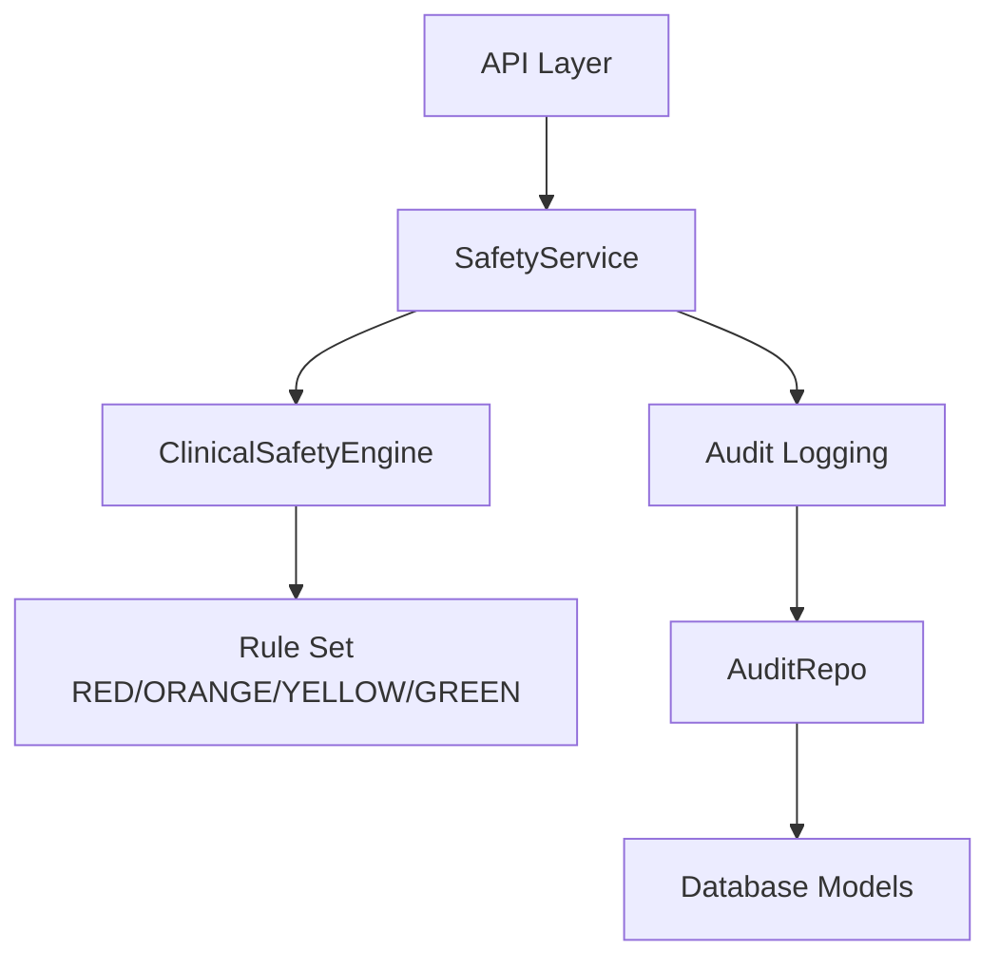
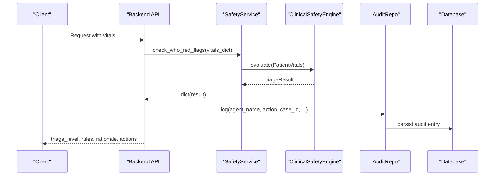
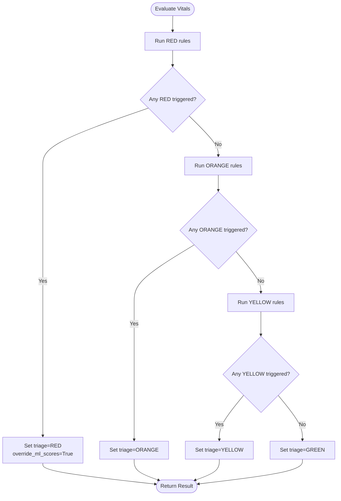
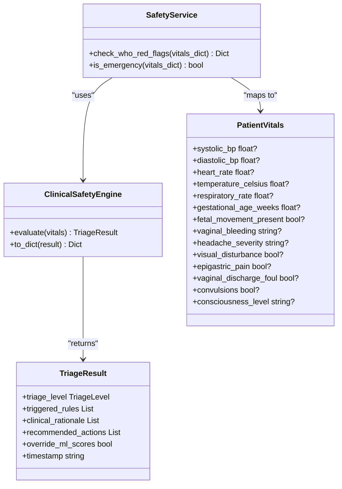
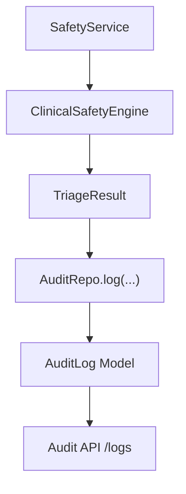
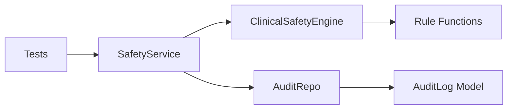

# WHO Safety Rules Engine

<cite>
**Referenced Files in This Document**
- [safety_rules.py](file://safety_rules.py)
- [backend/services/safety.py](file://backend/services/safety.py)
- [backend/api/routes/audit.py](file://backend/api/routes/audit.py)
- [backend/db/models.py](file://backend/db/models.py)
- [backend/db/repositories.py](file://backend/db/repositories.py)
- [backend/tests/test_inference.py](file://backend/tests/test_inference.py)
</cite>

## Table of Contents
1. [Introduction](#introduction)
2. [Project Structure](#project-structure)
3. [Core Components](#core-components)
4. [Architecture Overview](#architecture-overview)
5. [Detailed Component Analysis](#detailed-component-analysis)
6. [Dependency Analysis](#dependency-analysis)
7. [Performance Considerations](#performance-considerations)
8. [Troubleshooting Guide](#troubleshooting-guide)
9. [Conclusion](#conclusion)
10. [Appendices](#appendices)

## Introduction
This document explains the WHO safety rules engine that implements mandatory red flag checking and triage level determination for maternal care. It covers:
- The complete set of WHO red flag criteria used by the engine
- Triage levels (GREEN, YELLOW, ORANGE, RED) and escalation protocols
- How the SafetyService evaluates vital signs against established medical guidelines
- Rule evaluation logic, triggered rule identification, and clinical rationale generation
- Examples of clinical scenarios and their triage outcomes
- Mandatory nature of this check, integration with ML predictions, and conflict resolution
- Audit logging requirements and compliance considerations

The engine is deterministic and prioritizes patient safety by overriding any ML-based risk scores when a life-threatening condition is detected.

## Project Structure
The safety rules engine is implemented as a standalone module and integrated into the backend via a service layer. Key files:
- Core rules and triage logic: safety_rules.py
- Backend adapter/service: backend/services/safety.py
- Audit logging API: backend/api/routes/audit.py
- Database models for audit logs and clinical records: backend/db/models.py
- Repository for audit operations: backend/db/repositories.py
- Tests validating behavior: backend/tests/test_inference.py

**Diagram sources**
- [backend/services/safety.py:18-62](file://backend/services/safety.py#L18-L62)
- [safety_rules.py:72-167](file://safety_rules.py#L72-L167)
- [backend/db/repositories.py:66-82](file://backend/db/repositories.py#L66-L82)
- [backend/db/models.py:81-92](file://backend/db/models.py#L81-L92)

**Section sources**
- [safety_rules.py:1-167](file://safety_rules.py#L1-L167)
- [backend/services/safety.py:1-82](file://backend/services/safety.py#L1-L82)
- [backend/api/routes/audit.py:21-87](file://backend/api/routes/audit.py#L21-L87)
- [backend/db/models.py:81-92](file://backend/db/models.py#L81-L92)
- [backend/db/repositories.py:66-82](file://backend/db/repositories.py#L66-L82)

## Core Components
- ClinicalSafetyEngine: Implements WHO-based triage rules and returns a structured result including triage level, triggered rules, clinical rationale, recommended actions, and whether to override ML scores.
- PatientVitals: Input container for vital signs and symptoms.
- TriageResult: Output structure capturing triage decision and supporting details.
- SafetyService: Thin adapter that maps dictionary inputs to PatientVitals, runs the engine, and serializes results. Also provides a quick emergency check method.

Key behaviors:
- Evaluation order: RED → ORANGE → YELLOW → GREEN
- Any RED flag triggers immediate escalation and sets override_ml_scores=True
- All levels produce actionable recommendations and clinical rationale

**Section sources**
- [safety_rules.py:19-66](file://safety_rules.py#L19-L66)
- [safety_rules.py:72-167](file://safety_rules.py#L72-L167)
- [backend/services/safety.py:18-67](file://backend/services/safety.py#L18-L67)

## Architecture Overview
The system follows a layered architecture:
- API layer exposes endpoints for alerts and audit logs
- SafetyService adapts raw input dictionaries to the engine’s data model
- ClinicalSafetyEngine executes deterministic rule checks in priority order
- Audit subsystem persists decisions and actions for compliance and traceability

**Diagram sources**
- [backend/services/safety.py:24-62](file://backend/services/safety.py#L24-L62)
- [safety_rules.py:89-167](file://safety_rules.py#L89-L167)
- [backend/db/repositories.py:70-82](file://backend/db/repositories.py#L70-L82)
- [backend/db/models.py:81-92](file://backend/db/models.py#L81-L92)

## Detailed Component Analysis

### WHO Red Flag Criteria and Triage Levels
- Triage levels:
  - GREEN: LOW_RISK — routine care
  - YELLOW: MODERATE_RISK — requires attention within 1 hour
  - ORANGE: HIGH_RISK — urgent, requires attention within 15 minutes
  - RED: HIGH_RISK_EMERGENCY — immediate life-threatening, instant intervention required

- RED flags (immediate escalation):
  - Severe hypertension (SBP ≥ 160 or DBP ≥ 110)
  - Heavy vaginal bleeding (potential abruption/previa)
  - Imminent eclampsia (severe headache with visual disturbance or epigastric pain)
  - Active eclampsia (convulsions)
  - Sepsis indicators (temperature ≥ 38.5 °C with foul-smelling discharge)
  - Reduced fetal movement after 28 weeks gestation
  - Unconsciousness (AVPU “pain” or “unresponsive”)

- ORANGE flags (urgent):
  - Moderate hypertension (SBP 140–159 or DBP 90–109)
  - Moderate vaginal bleeding
  - Maternal tachycardia (heart rate > 120 bpm)
  - High fever without sepsis indicators (temperature ≥ 38.0 °C)

- YELLOW flags (attention within 1 hour):
  - Mild hypertension (SBP 130–139 or DBP 81–89)
  - Mild symptoms (mild headache or spotting)

- GREEN outcome:
  - No danger signs; continue routine antenatal care and monitoring

These criteria are enforced deterministically and take precedence over any predictive model outputs.

**Section sources**
- [safety_rules.py:19-26](file://safety_rules.py#L19-L26)
- [safety_rules.py:101-167](file://safety_rules.py#L101-L167)
- [safety_rules.py:173-462](file://safety_rules.py#L173-L462)

### Rule Evaluation Logic and Escalation Protocols
- Evaluation order ensures highest severity wins:
  - RED rules evaluated first; if any trigger, triage level set to RED and override_ml_scores=True
  - If no RED, evaluate ORANGE; if any trigger, triage level set to ORANGE
  - If no ORANGE, evaluate YELLOW; if any trigger, triage level set to YELLOW
  - Otherwise default to GREEN with routine care instructions

- Each triggered rule appends:
  - Rule name to triggered_rules
  - Clinical rationale explaining why the rule fired
  - Recommended actions aligned with WHO guidance

- Emergency escalation:
  - RED triage indicates immediate life-threatening conditions requiring instant intervention
  - System supports emergency alert channels through the messaging client (e.g., emergency broadcast)

**Diagram sources**
- [safety_rules.py:89-167](file://safety_rules.py#L89-L167)

**Section sources**
- [safety_rules.py:89-167](file://safety_rules.py#L89-L167)

### SafetyService Integration and Data Flow
- SafetyService.check_who_red_flags:
  - Accepts a dictionary of vital signs and symptoms
  - Maps fields to PatientVitals
  - Calls ClinicalSafetyEngine.evaluate
  - Serializes TriageResult to a JSON-compatible dictionary

- SafetyService.is_emergency:
  - Quick boolean check returning True if triage level equals HIGH_RISK_EMERGENCY

- Singleton accessor:
  - get_safety_service provides process-wide reuse of the service instance

**Diagram sources**
- [backend/services/safety.py:18-67](file://backend/services/safety.py#L18-L67)
- [safety_rules.py:32-66](file://safety_rules.py#L32-L66)
- [safety_rules.py:72-167](file://safety_rules.py#L72-L167)

**Section sources**
- [backend/services/safety.py:18-82](file://backend/services/safety.py#L18-L82)
- [safety_rules.py:32-66](file://safety_rules.py#L32-L66)

### Conflict Resolution Between Rule-Based and ML-Based Assessments
- Mandatory override:
  - When any RED flag is detected, override_ml_scores is set to True
  - This enforces that rule-based safety takes precedence over ML predictions
  - Ensures life-threatening conditions cannot be downgraded by probabilistic models

- Rationale:
  - Deterministic expert rules encode WHO emergency triage standards
  - Overrides protect patients from potential false negatives in ML models

- Implementation:
  - TriageResult includes override_ml_scores flag
  - Consumers should honor this flag and escalate accordingly

**Section sources**
- [safety_rules.py:72-80](file://safety_rules.py#L72-L80)
- [safety_rules.py:119-122](file://safety_rules.py#L119-L122)

### Audit Logging and Compliance
- Audit repository:
  - Provides methods to log actions, retrieve by case, and fetch recent entries
  - Stores agent_name, action, case_id, input/output summaries, confidence, duration, errors, and timestamp

- Audit API:
  - Admin-only endpoint to list audit logs with filtering and pagination
  - Supports queries by agent_name, patient_id, date range

- Clinical record persistence:
  - ClinicalRecord stores who_red_flags, triage_level, is_emergency, and model_outputs
  - Enables correlation between rule-based decisions and ML predictions

- Compliance considerations:
  - Immutable audit trail for regulatory oversight
  - Role-based access control for audit logs
  - Structured metadata for reproducibility and accountability

**Diagram sources**
- [backend/db/repositories.py:70-82](file://backend/db/repositories.py#L70-L82)
- [backend/db/models.py:81-92](file://backend/db/models.py#L81-L92)
- [backend/api/routes/audit.py:21-87](file://backend/api/routes/audit.py#L21-L87)

**Section sources**
- [backend/db/repositories.py:66-82](file://backend/db/repositories.py#L66-L82)
- [backend/db/models.py:81-92](file://backend/db/models.py#L81-L92)
- [backend/api/routes/audit.py:21-87](file://backend/api/routes/audit.py#L21-L87)

### Example Clinical Scenarios and Outcomes
- Scenario 1: Severe hypertension
  - Inputs: SBP ≥ 160 or DBP ≥ 110
  - Outcome: RED triage, severe_hypertension triggered, override_ml_scores=True
  - Actions: Immediate antihypertensive therapy, seizure prophylaxis, prepare for possible emergency delivery

- Scenario 2: Normal vitals
  - Inputs: BP normal, temperature normal, no bleeding, fetal movement present
  - Outcome: GREEN triage, routine care continued

- Scenario 3: Imminent eclampsia
  - Inputs: Severe headache with visual disturbance or epigastric pain
  - Outcome: RED triage, imminent_eclampsia triggered, override_ml_scores=True
  - Actions: Magnesium sulfate loading dose, blood pressure control, prepare for urgent delivery

- Scenario 4: Sepsis indicators
  - Inputs: Temperature ≥ 38.5 °C with foul-smelling discharge
  - Outcome: RED triage, sepsis triggered, override_ml_scores=True
  - Actions: Blood cultures, broad-spectrum antibiotics, monitor for septic shock

- Scenario 5: Reduced fetal movement after 28 weeks
  - Inputs: Gestational age ≥ 28 weeks and absent fetal movement
  - Outcome: RED triage, reduced_fetal_movement triggered, override_ml_scores=True
  - Actions: Immediate CTG monitoring, urgent ultrasound, consider emergency delivery

- Scenario 6: Moderate hypertension
  - Inputs: SBP 140–159 or DBP 90–109
  - Outcome: ORANGE triage, moderate_hypertension triggered
  - Actions: Frequent BP monitoring, urine protein and labs, consider oral antihypertensives

- Scenario 7: Heavy bleeding
  - Inputs: Vaginal bleeding “heavy”
  - Outcome: RED triage, hemorrhage triggered, override_ml_scores=True
  - Actions: IV access, fluid resuscitation, cross-match blood, prepare for emergency cesarean

- Scenario 8: Convulsions (eclampsia)
  - Inputs: convulsions=True
  - Outcome: RED triage, eclampsia triggered, override_ml_scores=True
  - Actions: Airway protection, magnesium sulfate, oxygen, prepare for emergency cesarean once controlled

- Scenario 9: Multiple flags
  - Inputs: Multiple RED conditions present
  - Outcome: RED triage, multiple rules triggered, override_ml_scores=True
  - Actions: Aggregate recommended actions per triggered rules

- Scenario 10: Partial/missing data
  - Inputs: All fields None
  - Outcome: GREEN triage, no flags triggered
  - Actions: Continue routine care; ensure data completeness for future assessments

These scenarios are validated by unit tests ensuring correct triage levels and rule triggering.

**Section sources**
- [safety_rules.py:484-550](file://safety_rules.py#L484-L550)
- [backend/tests/test_inference.py:78-103](file://backend/tests/test_inference.py#L78-L103)

## Dependency Analysis
- SafetyService depends on ClinicalSafetyEngine and its data structures
- ClinicalSafetyEngine encapsulates all rule logic and produces TriageResult
- Audit subsystem depends on repositories and database models
- Tests validate end-to-end behavior of safety checks

**Diagram sources**
- [backend/services/safety.py:18-82](file://backend/services/safety.py#L18-L82)
- [safety_rules.py:72-167](file://safety_rules.py#L72-L167)
- [backend/db/repositories.py:66-82](file://backend/db/repositories.py#L66-L82)
- [backend/db/models.py:81-92](file://backend/db/models.py#L81-L92)
- [backend/tests/test_inference.py:78-103](file://backend/tests/test_inference.py#L78-L103)

**Section sources**
- [backend/services/safety.py:18-82](file://backend/services/safety.py#L18-L82)
- [safety_rules.py:72-167](file://safety_rules.py#L72-L167)
- [backend/db/repositories.py:66-82](file://backend/db/repositories.py#L66-L82)
- [backend/db/models.py:81-92](file://backend/db/models.py#L81-L92)
- [backend/tests/test_inference.py:78-103](file://backend/tests/test_inference.py#L78-L103)

## Performance Considerations
- Deterministic rule evaluation is lightweight and fast, suitable for real-time triage
- Priority-based short-circuiting minimizes unnecessary checks once higher-severity flags are found
- Serialization overhead is minimal; results are simple dictionaries
- Audit logging introduces I/O latency; batch or async logging may be considered for high-throughput scenarios

[No sources needed since this section provides general guidance]

## Troubleshooting Guide
- Missing vital signs:
  - Engine safely handles None values; missing data typically results in no flags triggered
  - Ensure critical fields (BP, temperature, bleeding, consciousness) are populated for accurate triage

- Unexpected GREEN outcome:
  - Verify input field names and types match PatientVitals schema
  - Confirm thresholds align with expected ranges

- Override not applied:
  - Ensure at least one RED flag is present; override_ml_scores is only set for RED triage
  - Validate test assertions for expected behavior

- Audit logs not appearing:
  - Confirm admin role and proper authentication for audit endpoints
  - Check database connectivity and repository methods

**Section sources**
- [safety_rules.py:173-462](file://safety_rules.py#L173-L462)
- [backend/api/routes/audit.py:21-87](file://backend/api/routes/audit.py#L21-L87)
- [backend/db/repositories.py:70-82](file://backend/db/repositories.py#L70-L82)

## Conclusion
The WHO safety rules engine provides a robust, deterministic foundation for maternal emergency triage. It enforces mandatory red flag checks, escalates appropriately, and overrides ML-based risk scores when life-threatening conditions are detected. Integrated audit logging ensures compliance and traceability. The system’s design prioritizes patient safety while remaining efficient and maintainable.

[No sources needed since this section summarizes without analyzing specific files]

## Appendices

### API and Integration Notes
- Alerts API supports SMS, WhatsApp, and emergency channels for escalation workflows
- Audit API provides admin-only access to review system decisions and actions
- Clinical records store both rule-based and ML-based outputs for post-hoc analysis

**Section sources**
- [backend/api/routes/alerts.py:49-125](file://backend/api/routes/alerts.py#L49-L125)
- [backend/api/routes/audit.py:21-87](file://backend/api/routes/audit.py#L21-L87)
- [backend/db/models.py:30-50](file://backend/db/models.py#L30-L50)