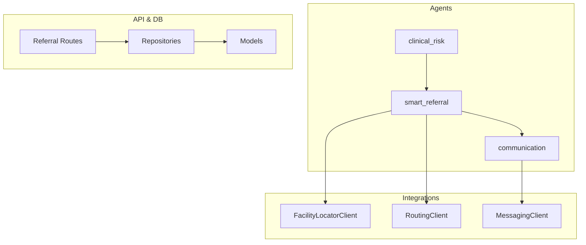
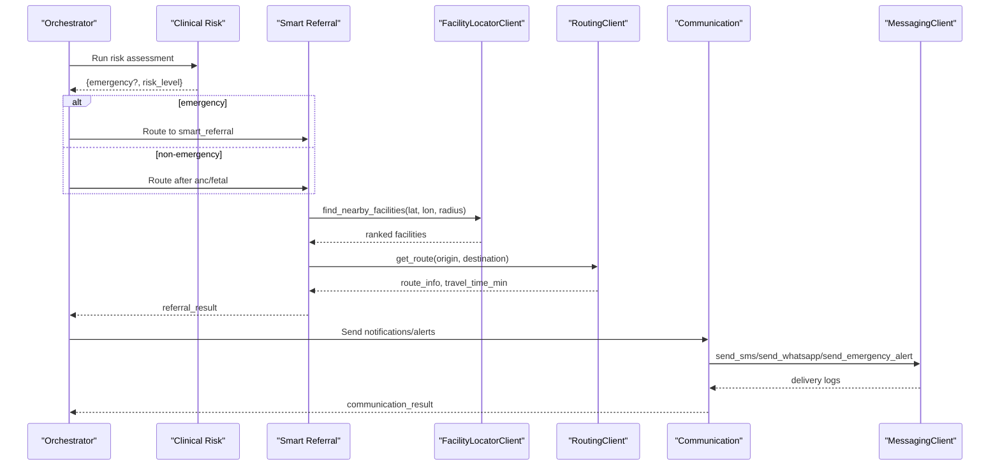
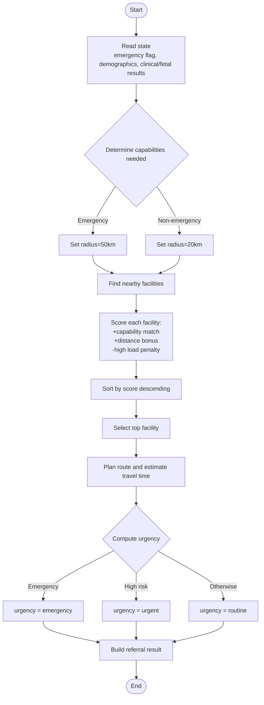
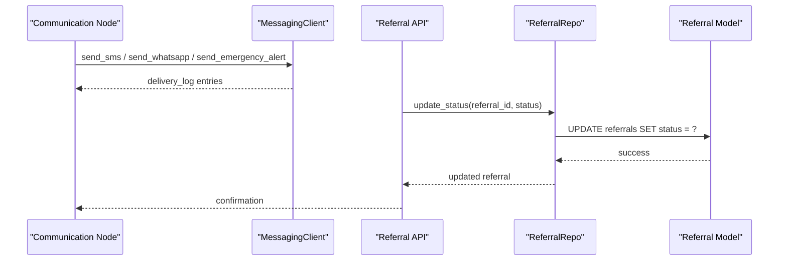
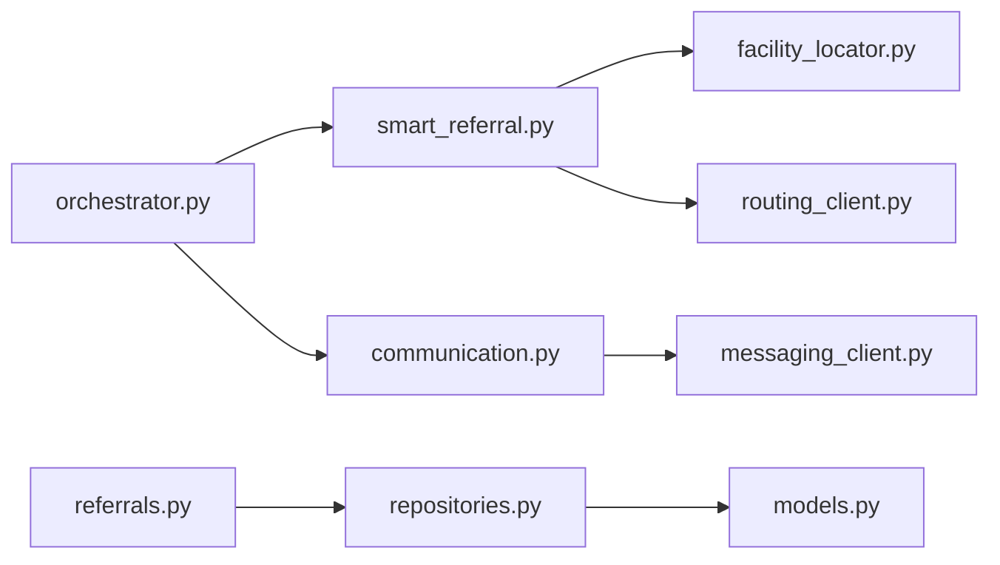

# Smart Referral Workflow

<cite>
**Referenced Files in This Document**
- [smart_referral.py](file://backend/agents/nodes/smart_referral.py)
- [facility_locator.py](file://backend/integrations/facility_locator.py)
- [routing_client.py](file://backend/integrations/routing_client.py)
- [communication.py](file://backend/agents/nodes/communication.py)
- [messaging_client.py](file://backend/integrations/messaging_client.py)
- [orchestrator.py](file://backend/agents/orchestrator.py)
- [referrals.py](file://backend/api/routes/referrals.py)
- [models.py](file://backend/db/models.py)
- [repositories.py](file://backend/db/repositories.py)
- [state.py](file://backend/schemas/state.py)
- [clinical_risk.py](file://backend/agents/nodes/clinical_risk.py)
</cite>

## Table of Contents
1. [Introduction](#introduction)
2. [Project Structure](#project-structure)
3. [Core Components](#core-components)
4. [Architecture Overview](#architecture-overview)
5. [Detailed Component Analysis](#detailed-component-analysis)
6. [Dependency Analysis](#dependency-analysis)
7. [Performance Considerations](#performance-considerations)
8. [Troubleshooting Guide](#troubleshooting-guide)
9. [Conclusion](#conclusion)
10. [Appendices](#appendices)

## Introduction
This document explains the smart referral workflow that automatically determines appropriate healthcare facilities based on patient needs, urgency level, and geographic location. It covers the facility matching algorithm (service availability, capacity, distance, travel time, specialty requirements), integration with facility locator and routing services, real-time capacity considerations, referral prioritization, emergency routing protocols, alternative facility selection, and communication workflows for care coordination.

## Project Structure
The smart referral workflow is implemented as part of an agent-based orchestration pipeline. The key modules involved are:
- Agent nodes for clinical risk assessment, smart referral, and communication
- Integration clients for facility lookup and routing estimation
- API routes for creating and managing referrals
- Data models and repositories for persistence and status tracking
- Shared state schema used across agents

**Diagram sources**
- [orchestrator.py:62-132](file://backend/agents/orchestrator.py#L62-L132)
- [smart_referral.py:11-118](file://backend/agents/nodes/smart_referral.py#L11-L118)
- [facility_locator.py:7-68](file://backend/integrations/facility_locator.py#L7-L68)
- [routing_client.py:8-59](file://backend/integrations/routing_client.py#L8-L59)
- [communication.py:38-213](file://backend/agents/nodes/communication.py#L38-L213)
- [messaging_client.py:9-78](file://backend/integrations/messaging_client.py#L9-L78)
- [referrals.py:60-126](file://backend/api/routes/referrals.py#L60-L126)
- [models.py:52-68](file://backend/db/models.py#L52-L68)
- [repositories.py:49-65](file://backend/db/repositories.py#L49-L65)

**Section sources**
- [orchestrator.py:62-132](file://backend/agents/orchestrator.py#L62-L132)
- [smart_referral.py:11-118](file://backend/agents/nodes/smart_referral.py#L11-L118)
- [facility_locator.py:7-68](file://backend/integrations/facility_locator.py#L7-L68)
- [routing_client.py:8-59](file://backend/integrations/routing_client.py#L8-L59)
- [communication.py:38-213](file://backend/agents/nodes/communication.py#L38-L213)
- [messaging_client.py:9-78](file://backend/integrations/messaging_client.py#L9-L78)
- [referrals.py:60-126](file://backend/api/routes/referrals.py#L60-L126)
- [models.py:52-68](file://backend/db/models.py#L52-L68)
- [repositories.py:49-65](file://backend/db/repositories.py#L49-L65)

## Core Components
- Smart referral node: Determines required capabilities from clinical and fetal results, locates nearby facilities, ranks them by capability match, distance, and load, plans a route, and computes urgency.
- Facility locator client: Provides nearby facilities with attributes like emergency, maternity, NICU availability, and current load.
- Routing client: Estimates travel time and provides route waypoints between patient and facility.
- Communication node: Sends alerts or referral notifications via SMS/WhatsApp/emergency channels; supports LLM-generated messages with fallbacks.
- Messaging client: Stubbed messaging service for SMS, WhatsApp, and emergency alerts with delivery tracking.
- Referral API: Endpoints to create, list, retrieve, and update referral status.
- Data models and repositories: Persist referrals and support CRUD operations.

**Section sources**
- [smart_referral.py:11-118](file://backend/agents/nodes/smart_referral.py#L11-L118)
- [facility_locator.py:14-68](file://backend/integrations/facility_locator.py#L14-L68)
- [routing_client.py:16-59](file://backend/integrations/routing_client.py#L16-L59)
- [communication.py:38-213](file://backend/agents/nodes/communication.py#L38-L213)
- [messaging_client.py:17-78](file://backend/integrations/messaging_client.py#L17-L78)
- [referrals.py:60-126](file://backend/api/routes/referrals.py#L60-L126)
- [models.py:52-68](file://backend/db/models.py#L52-L68)
- [repositories.py:49-65](file://backend/db/repositories.py#L49-L65)

## Architecture Overview
The workflow is orchestrated through a state graph. After intake and data quality checks, clinical risk assessment determines if the case is an emergency. Emergency cases route directly to smart referral; otherwise, fetal monitoring or ANC follow-up may occur before referral. The smart referral node integrates with facility and routing services, then passes results to communication for notifications.

**Diagram sources**
- [orchestrator.py:34-118](file://backend/agents/orchestrator.py#L34-L118)
- [smart_referral.py:11-118](file://backend/agents/nodes/smart_referral.py#L11-L118)
- [facility_locator.py:14-68](file://backend/integrations/facility_locator.py#L14-L68)
- [routing_client.py:16-59](file://backend/integrations/routing_client.py#L16-L59)
- [communication.py:38-213](file://backend/agents/nodes/communication.py#L38-L213)
- [messaging_client.py:17-78](file://backend/integrations/messaging_client.py#L17-L78)

## Detailed Component Analysis

### Smart Referral Algorithm
The smart referral node implements a scoring-based ranking algorithm that considers:
- Capability match: Emergency services (+10 when needed), NICU (+10 when needed), maternity (+5).
- Distance: Closer facilities score higher using a linear bonus capped at 20 points.
- Capacity/load: Facilities marked high load are penalized (-3).

It also:
- Expands search radius for emergencies (50 km) vs routine (20 km).
- Computes urgency: emergency if flagged; urgent if maternal risk is high; otherwise routine.
- Plans route for the top-ranked facility and includes estimated travel time.

**Diagram sources**
- [smart_referral.py:20-98](file://backend/agents/nodes/smart_referral.py#L20-L98)

**Section sources**
- [smart_referral.py:20-98](file://backend/agents/nodes/smart_referral.py#L20-L98)

### Facility Matching and Real-Time Capacity
- Service availability: Facilities expose boolean flags for emergency, maternity, and NICU.
- Capacity: Facilities include a current_load field (low, medium, high) used to penalize highly loaded options.
- Distance and travel time: Distance_km is provided by the locator; travel_time_minutes is computed by the routing client using mode-specific speeds.

Integration points:
- FacilityLocatorClient returns a list of facilities with attributes including has_emergency, has_maternity, has_nicu, current_load, and coordinates.
- RoutingClient estimates travel time based on straight-line distance and average speeds per mode (driving, walking, ambulance).

**Section sources**
- [facility_locator.py:14-68](file://backend/integrations/facility_locator.py#L14-L68)
- [routing_client.py:16-59](file://backend/integrations/routing_client.py#L16-L59)

### Referral Prioritization and Emergency Routing
- Prioritization: Urgency levels are derived from the emergency flag and maternal risk level. Emergency cases bypass further analysis and proceed directly to referral.
- Emergency routing: Larger search radius and explicit emergency capability requirement ensure suitable facilities are prioritized.
- Alternative selection: If the top facility is unsuitable or unavailable, subsequent ranked facilities serve as alternatives due to the sorted list.

Operational flow:
- Orchestrator routes emergency cases to smart referral immediately.
- Smart referral selects the highest-scoring facility and plans the route.
- Communication sends emergency alerts to health workers and supervisors.

**Section sources**
- [orchestrator.py:34-48](file://backend/agents/orchestrator.py#L34-L48)
- [smart_referral.py:30-82](file://backend/agents/nodes/smart_referral.py#L30-L82)
- [communication.py:64-92](file://backend/agents/nodes/communication.py#L64-L92)

### Communication Workflows and Status Tracking
- Messages: Emergency alerts, referral notifications, and ANC reminders are sent via SMS or WhatsApp depending on channel preference.
- Delivery tracking: MessagingClient records message IDs, channels, recipients, and delivery status; communication node aggregates delivery logs.
- Status updates: Referral statuses (pending, accepted, in_transit, completed, cancelled) can be updated via API endpoints.

**Diagram sources**
- [communication.py:94-158](file://backend/agents/nodes/communication.py#L94-L158)
- [messaging_client.py:17-78](file://backend/integrations/messaging_client.py#L17-L78)
- [referrals.py:111-126](file://backend/api/routes/referrals.py#L111-L126)
- [repositories.py:63-65](file://backend/db/repositories.py#L63-L65)
- [models.py:52-68](file://backend/db/models.py#L52-L68)

**Section sources**
- [communication.py:94-158](file://backend/agents/nodes/communication.py#L94-L158)
- [messaging_client.py:17-78](file://backend/integrations/messaging_client.py#L17-L78)
- [referrals.py:111-126](file://backend/api/routes/referrals.py#L111-L126)
- [repositories.py:63-65](file://backend/db/repositories.py#L63-L65)
- [models.py:52-68](file://backend/db/models.py#L52-L68)

### Example Referral Scenarios and Routing Logic

- Routine ANC follow-up:
  - Non-emergency, no high-risk indicators.
  - Search radius 20 km; maternity capability preferred; distance bonus applied.
  - Urgency set to routine; communication sends reminder/notification.

- High-risk complications:
  - Maternal risk high or fetal status suspicious/pathological.
  - NICU capability may be required; urgency set to urgent.
  - Ranking emphasizes NICU and maternity; route planning included.

- Emergency transport:
  - Emergency flag true; search radius expands to 50 km; emergency capability mandatory.
  - Urgency set to emergency; communication sends emergency alerts to multiple recipients.

These scenarios are driven by inputs from clinical risk assessment and fetal monitoring outputs, which influence capability requirements and urgency.

**Section sources**
- [smart_referral.py:30-82](file://backend/agents/nodes/smart_referral.py#L30-L82)
- [communication.py:64-158](file://backend/agents/nodes/communication.py#L64-L158)
- [clinical_risk.py:39-58](file://backend/agents/nodes/clinical_risk.py#L39-L58)

## Dependency Analysis
Key dependencies and relationships:
- Smart referral depends on facility locator and routing clients.
- Communication depends on messaging client and optional LLM service for message generation.
- Orchestrator wires agent nodes and conditional edges based on state.
- API routes depend on repositories and database models for referral management.

**Diagram sources**
- [smart_referral.py:11-118](file://backend/agents/nodes/smart_referral.py#L11-L118)
- [facility_locator.py:7-68](file://backend/integrations/facility_locator.py#L7-L68)
- [routing_client.py:8-59](file://backend/integrations/routing_client.py#L8-L59)
- [communication.py:38-213](file://backend/agents/nodes/communication.py#L38-L213)
- [messaging_client.py:9-78](file://backend/integrations/messaging_client.py#L9-L78)
- [orchestrator.py:62-132](file://backend/agents/orchestrator.py#L62-L132)
- [referrals.py:60-126](file://backend/api/routes/referrals.py#L60-L126)
- [repositories.py:49-65](file://backend/db/repositories.py#L49-L65)
- [models.py:52-68](file://backend/db/models.py#L52-L68)

**Section sources**
- [smart_referral.py:11-118](file://backend/agents/nodes/smart_referral.py#L11-L118)
- [facility_locator.py:7-68](file://backend/integrations/facility_locator.py#L7-L68)
- [routing_client.py:8-59](file://backend/integrations/routing_client.py#L8-L59)
- [communication.py:38-213](file://backend/agents/nodes/communication.py#L38-L213)
- [messaging_client.py:9-78](file://backend/integrations/messaging_client.py#L9-L78)
- [orchestrator.py:62-132](file://backend/agents/orchestrator.py#L62-L132)
- [referrals.py:60-126](file://backend/api/routes/referrals.py#L60-L126)
- [repositories.py:49-65](file://backend/db/repositories.py#L49-L65)
- [models.py:52-68](file://backend/db/models.py#L52-L68)

## Performance Considerations
- Facility search radius scales with urgency to balance speed and coverage.
- Scoring uses simple arithmetic operations; sorting is O(n log n) over candidate facilities.
- Routing estimation uses haversine distance and constant-speed assumptions; consider integrating real traffic-aware APIs for production.
- Messaging stubs return immediate success; production should handle retries and backoff.

[No sources needed since this section provides general guidance]

## Troubleshooting Guide
Common issues and handling:
- Missing location data: Defaults to Peshawar region coordinates if not provided.
- No facilities found: Ranked list will be empty; ensure locator returns valid facilities and adjust radius.
- Routing failures: Fallback to default route info; verify origin/destination coordinates and routing client configuration.
- Communication failures: LLM message generation falls back to templates; check messaging client delivery logs and recipient lists.
- Status updates: Ensure referral exists before updating; API returns 404 if not found.

**Section sources**
- [smart_referral.py:26-28](file://backend/agents/nodes/smart_referral.py#L26-L28)
- [smart_referral.py:66-72](file://backend/agents/nodes/smart_referral.py#L66-L72)
- [communication.py:14-35](file://backend/agents/nodes/communication.py#L14-L35)
- [referrals.py:97-108](file://backend/api/routes/referrals.py#L97-L108)

## Conclusion
The smart referral workflow integrates clinical risk assessment, facility discovery, routing estimation, and communication to automate and prioritize patient referrals. The scoring algorithm balances capability match, distance, and capacity to select optimal facilities, while emergency protocols ensure rapid response. Status tracking and messaging provide feedback loops for care coordination.

[No sources needed since this section summarizes without analyzing specific files]

## Appendices

### Data Models and State Schema
- Referral model fields include patient linkage, facility details, distance, travel time, urgency, and status timestamps.
- AgentState carries shared context across nodes, including vitals, demographics, and outputs from each agent.

**Section sources**
- [models.py:52-68](file://backend/db/models.py#L52-L68)
- [state.py:7-43](file://backend/schemas/state.py#L7-L43)