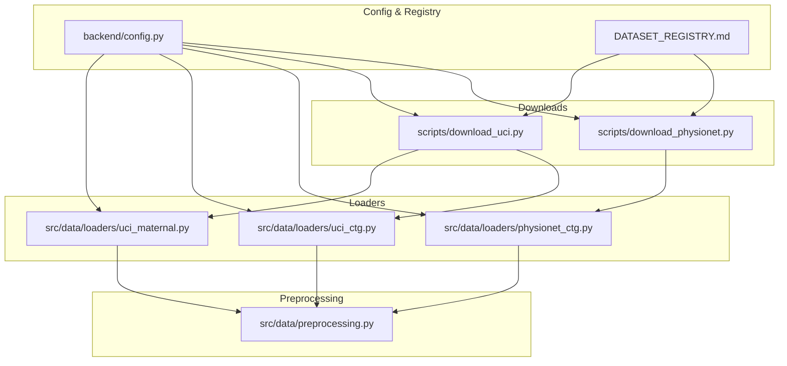
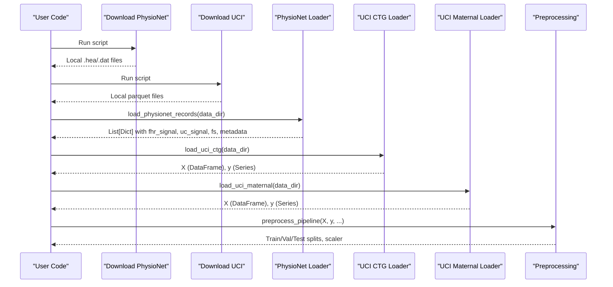
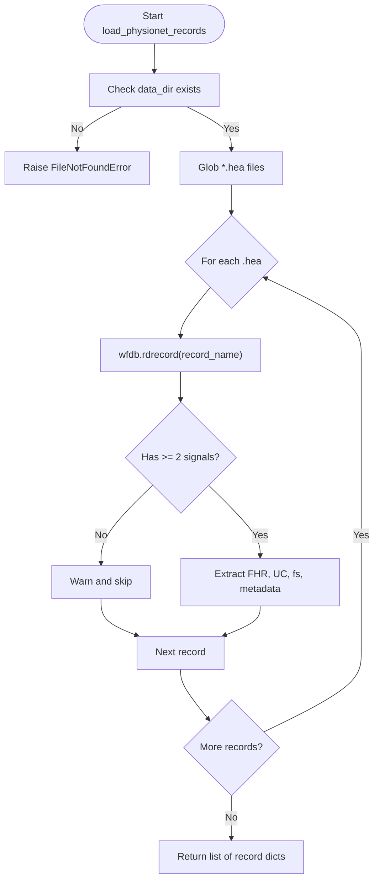
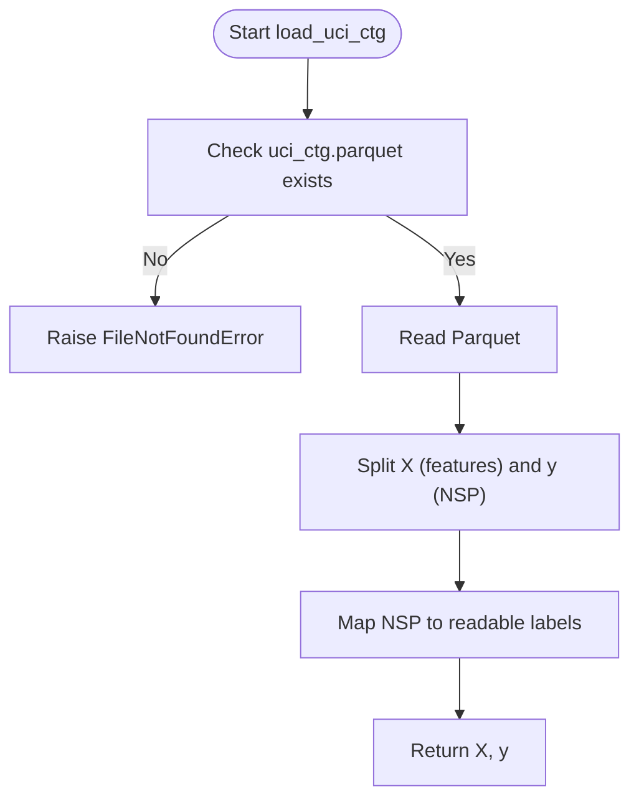
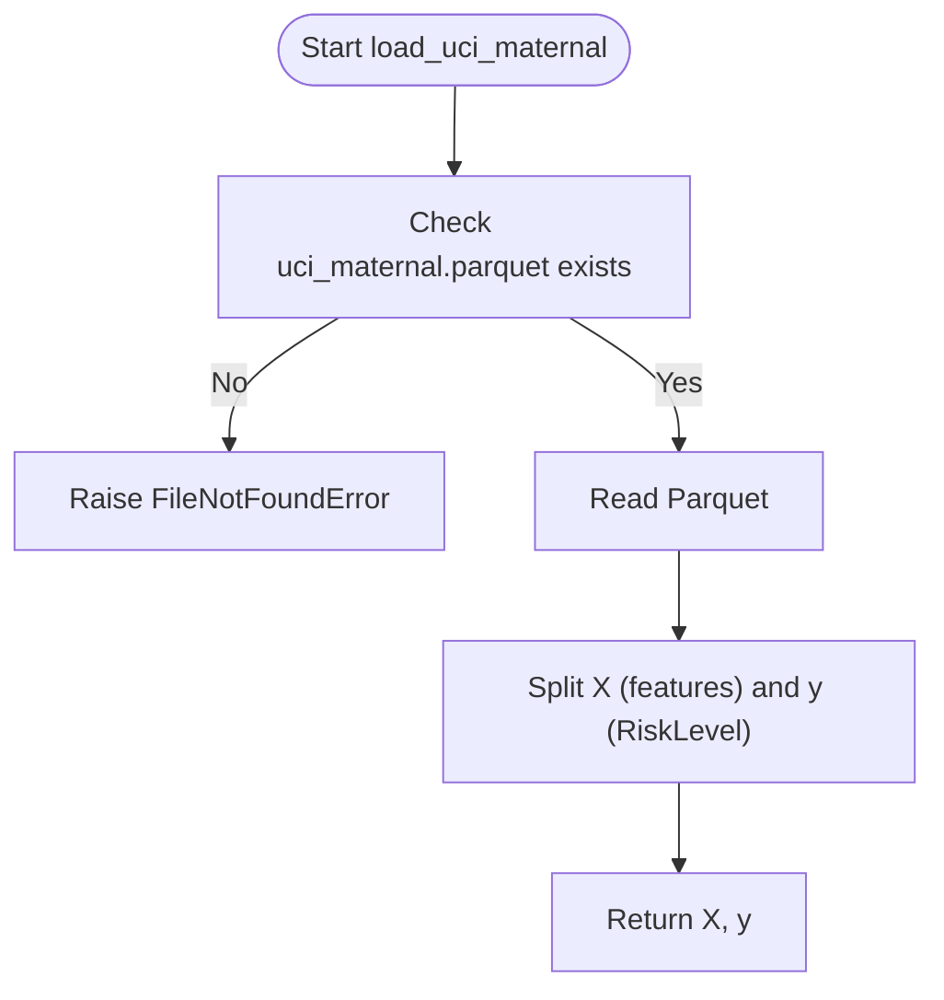
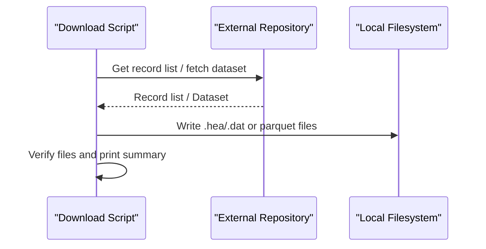
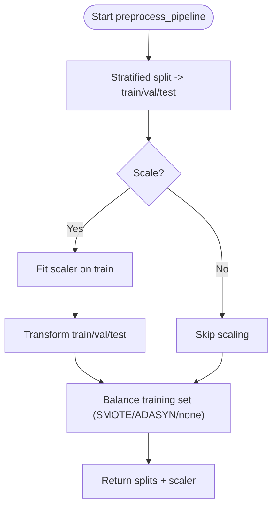
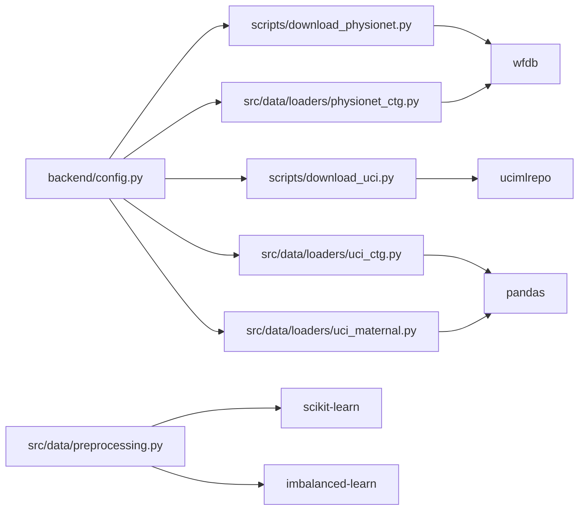

# Data Ingestion

<cite>
**Referenced Files in This Document**
- [src/data/loaders/__init__.py](file://src/data/loaders/__init__.py)
- [src/data/loaders/physionet_ctg.py](file://src/data/loaders/physionet_ctg.py)
- [src/data/loaders/uci_ctg.py](file://src/data/loaders/uci_ctg.py)
- [src/data/loaders/uci_maternal.py](file://src/data/loaders/uci_maternal.py)
- [scripts/download_physionet.py](file://scripts/download_physionet.py)
- [scripts/download_uci.py](file://scripts/download_uci.py)
- [src/data/preprocessing.py](file://src/data/preprocessing.py)
- [DATASET_REGISTRY.md](file://DATASET_REGISTRY.md)
- [download_and_prep.py](file://download_and_prep.py)
- [backend/config.py](file://backend/config.py)
- [backend/agents/nodes/data_quality.py](file://backend/agents/nodes/data_quality.py)
</cite>

## Table of Contents
1. Introduction
2. Project Structure
3. Core Components
4. Architecture Overview
5. Detailed Component Analysis
6. Dependency Analysis
7. Performance Considerations
8. Troubleshooting Guide
9. Conclusion
10. Appendices

## Introduction
This document explains how MaaHifazat AI ingests data from multiple sources, focusing on CTG recordings from PhysioNet and tabular datasets from UCI. It covers:
- How raw data is downloaded and stored
- How loaders parse different file formats (.hea/.dat for WFDB; Parquet for UCI)
- Metadata extraction and signal parsing
- Error handling, validation, and quality checks
- Patterns for adding new data sources and maintaining loader compatibility

The ingestion pipeline is designed to be robust against missing or corrupt files, to normalize outputs into consistent structures, and to integrate with downstream preprocessing and modeling stages.

## Project Structure
Data ingestion spans three layers:
- Download scripts that fetch raw datasets from external repositories
- Loaders that read local files and return normalized objects
- Preprocessing utilities that split, scale, balance, and prepare data for modeling

**Diagram sources**
- [scripts/download_physionet.py:1-68](file://scripts/download_physionet.py#L1-L68)
- [scripts/download_uci.py:1-40](file://scripts/download_uci.py#L1-L40)
- [src/data/loaders/physionet_ctg.py:1-103](file://src/data/loaders/physionet_ctg.py#L1-L103)
- [src/data/loaders/uci_ctg.py:1-53](file://src/data/loaders/uci_ctg.py#L1-L53)
- [src/data/loaders/uci_maternal.py:1-48](file://src/data/loaders/uci_maternal.py#L1-L48)
- [src/data/preprocessing.py:1-262](file://src/data/preprocessing.py#L1-L262)
- [backend/config.py:1-55](file://backend/config.py#L1-L55)
- [DATASET_REGISTRY.md:1-107](file://DATASET_REGISTRY.md#L1-L107)

**Section sources**
- [scripts/download_physionet.py:1-68](file://scripts/download_physionet.py#L1-L68)
- [scripts/download_uci.py:1-40](file://scripts/download_uci.py#L1-L40)
- [src/data/loaders/__init__.py:1-12](file://src/data/loaders/__init__.py#L1-L12)
- [src/data/preprocessing.py:1-262](file://src/data/preprocessing.py#L1-L262)
- [backend/config.py:1-55](file://backend/config.py#L1-L55)
- [DATASET_REGISTRY.md:1-107](file://DATASET_REGISTRY.md#L1-L107)

## Core Components
- PhysioNet CTG loader: reads .hea/.dat pairs via wfdb, validates signals, extracts metadata, and returns a list of record dicts with FHR and UC signals.
- UCI CTG loader: reads a Parquet file, separates features and target, maps NSP labels to human-readable strings.
- UCI Maternal loader: reads a Parquet file, separates features and RiskLevel target.
- Download scripts: fetch PhysioNet subset and UCI datasets, verify basic integrity, and save locally.
- Preprocessing: provides stratified splits, scaling, class imbalance handling, and a convenience pipeline.

Key responsibilities:
- Robust error handling (skip bad records, raise clear errors for missing files)
- Consistent output schemas per dataset
- Clear separation between download, loading, and preprocessing

**Section sources**
- [src/data/loaders/physionet_ctg.py:13-103](file://src/data/loaders/physionet_ctg.py#L13-L103)
- [src/data/loaders/uci_ctg.py:14-53](file://src/data/loaders/uci_ctg.py#L14-L53)
- [src/data/loaders/uci_maternal.py:11-48](file://src/data/loaders/uci_maternal.py#L11-L48)
- [scripts/download_physionet.py:1-68](file://scripts/download_physionet.py#L1-L68)
- [scripts/download_uci.py:1-40](file://scripts/download_uci.py#L1-L40)
- [src/data/preprocessing.py:22-262](file://src/data/preprocessing.py#L22-L262)

## Architecture Overview
The ingestion architecture follows a layered pattern:
- External sources are accessed by download scripts that write standardized artifacts to the project’s data directory.
- Loaders read these artifacts and return normalized Python objects (lists of dicts for signals; DataFrames/Series for tabular data).
- Preprocessing functions operate on these normalized outputs to produce train/validation/test splits and scaled features.

**Diagram sources**
- [scripts/download_physionet.py:1-68](file://scripts/download_physionet.py#L1-L68)
- [scripts/download_uci.py:1-40](file://scripts/download_uci.py#L1-L40)
- [src/data/loaders/physionet_ctg.py:13-103](file://src/data/loaders/physionet_ctg.py#L13-L103)
- [src/data/loaders/uci_ctg.py:14-53](file://src/data/loaders/uci_ctg.py#L14-L53)
- [src/data/loaders/uci_maternal.py:11-48](file://src/data/loaders/uci_maternal.py#L11-L48)
- [src/data/preprocessing.py:196-262](file://src/data/preprocessing.py#L196-L262)

## Detailed Component Analysis

### PhysioNet CTG Loader
- Reads all .hea files in a directory and uses wfdb to open corresponding .dat files.
- Validates that each record has at least two signals (FHR and UC).
- Extracts metadata such as sampling frequency, signal length, comments, and channel names.
- Skips corrupt or incomplete records with warnings instead of raising exceptions, ensuring downstream code receives a clean list.

**Diagram sources**
- [src/data/loaders/physionet_ctg.py:13-103](file://src/data/loaders/physionet_ctg.py#L13-L103)

**Section sources**
- [src/data/loaders/physionet_ctg.py:13-103](file://src/data/loaders/physionet_ctg.py#L13-L103)

### UCI CTG Loader
- Loads a Parquet file containing the Cardiotocography dataset.
- Separates features (excluding NSP and CLASS) and targets.
- Maps numeric NSP codes to readable labels (Normal, Suspect, Pathological).

**Diagram sources**
- [src/data/loaders/uci_ctg.py:14-53](file://src/data/loaders/uci_ctg.py#L14-L53)

**Section sources**
- [src/data/loaders/uci_ctg.py:14-53](file://src/data/loaders/uci_ctg.py#L14-L53)

### UCI Maternal Loader
- Loads a Parquet file containing the Maternal Health Risk dataset.
- Separates features (all columns except RiskLevel) and target (RiskLevel).

**Diagram sources**
- [src/data/loaders/uci_maternal.py:11-48](file://src/data/loaders/uci_maternal.py#L11-L48)

**Section sources**
- [src/data/loaders/uci_maternal.py:11-48](file://src/data/loaders/uci_maternal.py#L11-L48)

### Download Scripts
- PhysioNet: Uses wfdb to get the record list and downloads a configurable subset to a local directory. Verifies downloaded files and prints sample metadata.
- UCI: Uses ucimlrepo to fetch datasets A (CTG) and B (Maternal), inspects shapes and distributions, and saves them as Parquet files.

**Diagram sources**
- [scripts/download_physionet.py:1-68](file://scripts/download_physionet.py#L1-L68)
- [scripts/download_uci.py:1-40](file://scripts/download_uci.py#L1-L40)

**Section sources**
- [scripts/download_physionet.py:1-68](file://scripts/download_physionet.py#L1-L68)
- [scripts/download_uci.py:1-40](file://scripts/download_uci.py#L1-L40)

### Preprocessing Pipeline
- Splits data into train/validation/test using stratified sampling.
- Applies feature scaling (robust, standard, minmax) fitted on training data only.
- Handles class imbalance on the training set using SMOTE or ADASYN.
- Provides a single convenience function to chain these steps.

**Diagram sources**
- [src/data/preprocessing.py:22-262](file://src/data/preprocessing.py#L22-L262)

**Section sources**
- [src/data/preprocessing.py:22-262](file://src/data/preprocessing.py#L22-L262)

## Dependency Analysis
- Loaders depend on:
  - wfdb for PhysioNet .hea/.dat parsing
  - pandas for Parquet I/O and DataFrame operations
- Download scripts depend on:
  - wfdb for PhysioNet access
  - ucimlrepo for UCI datasets
- Preprocessing depends on:
  - scikit-learn for splitting and scaling
  - imbalanced-learn for resampling
- Configuration centralizes paths and model locations, used across scripts and loaders.

**Diagram sources**
- [scripts/download_physionet.py:1-68](file://scripts/download_physionet.py#L1-L68)
- [scripts/download_uci.py:1-40](file://scripts/download_uci.py#L1-L40)
- [src/data/loaders/physionet_ctg.py:1-103](file://src/data/loaders/physionet_ctg.py#L1-L103)
- [src/data/loaders/uci_ctg.py:1-53](file://src/data/loaders/uci_ctg.py#L1-L53)
- [src/data/loaders/uci_maternal.py:1-48](file://src/data/loaders/uci_maternal.py#L1-L48)
- [src/data/preprocessing.py:1-262](file://src/data/preprocessing.py#L1-L262)
- [backend/config.py:1-55](file://backend/config.py#L1-L55)

**Section sources**
- [src/data/loaders/__init__.py:1-12](file://src/data/loaders/__init__.py#L1-L12)
- [backend/config.py:1-55](file://backend/config.py#L1-L55)

## Performance Considerations
- Use Parquet for tabular datasets to reduce I/O time and storage footprint.
- Prefer streaming or chunked reading when dealing with large WFDB recordings; current loader reads full signals into memory per record.
- Avoid unnecessary copies; use views where possible in pandas and numpy.
- Cache metadata (e.g., sampling frequency, signal lengths) if repeatedly accessed.
- Consider parallelizing record processing for large directories (e.g., concurrent reads with thread safety considerations).

## Troubleshooting Guide
Common issues and resolutions:
- Missing data directory or files:
  - PhysioNet loader raises FileNotFoundError if the directory does not exist.
  - UCI loaders raise FileNotFoundError if expected Parquet files are absent.
- Corrupt or incomplete records:
  - PhysioNet loader skips problematic records with warnings; inspect logs to identify skipped records.
- Network failures during download:
  - Download scripts wrap network calls in try/except blocks; check printed messages for failed records or datasets.
- Authentication requirements:
  - PhysioNet access may require credentials depending on repository policies; ensure environment variables or API keys are configured if needed.
- Data quality anomalies:
  - Use the data quality node to validate vital ranges and flag outliers or impossible values.

**Section sources**
- [src/data/loaders/physionet_ctg.py:44-79](file://src/data/loaders/physionet_ctg.py#L44-L79)
- [src/data/loaders/uci_ctg.py:38-42](file://src/data/loaders/uci_ctg.py#L38-L42)
- [src/data/loaders/uci_maternal.py:33-37](file://src/data/loaders/uci_maternal.py#L33-L37)
- [scripts/download_physionet.py:14-37](file://scripts/download_physionet.py#L14-L37)
- [scripts/download_uci.py:9-22](file://scripts/download_uci.py#L9-L22)
- [backend/agents/nodes/data_quality.py:9-19](file://backend/agents/nodes/data_quality.py#L9-L19)
- [backend/agents/nodes/data_quality.py:25-200](file://backend/agents/nodes/data_quality.py#L25-L200)

## Conclusion
MaaHifazat AI’s data ingestion pipeline provides robust, modular loaders for both signal-based and tabular datasets. The design emphasizes:
- Resilience to missing or corrupt data
- Clear separation of concerns (download, load, preprocess)
- Standardized outputs for downstream modeling
- Extensibility for adding new sources while maintaining compatibility

By following the patterns documented here, you can add new data sources, implement custom loaders, and integrate additional validation and quality checks seamlessly.

## Appendices

### Adding a New Data Source
Steps:
- Create a new loader module under src/data/loaders/ with a consistent function signature (e.g., load_<source>(data_dir) returning normalized objects).
- Update src/data/loaders/__init__.py to export the new loader.
- Add a download script under scripts/ if the source requires fetching from an external repository.
- Document the dataset in DATASET_REGISTRY.md with source, license, schema, and download instructions.
- Integrate with preprocessing by ensuring outputs match expected types (DataFrame/Series for tabular; list of dicts for signals).

**Section sources**
- [src/data/loaders/__init__.py:1-12](file://src/data/loaders/__init__.py#L1-L12)
- [DATASET_REGISTRY.md:1-107](file://DATASET_REGISTRY.md#L1-L107)

### Handling Different File Formats
- WFDB (.hea/.dat): Use wfdb.rdrecord to parse signals and metadata; validate signal count and extract channels.
- Parquet: Use pandas.read_parquet; separate features and targets explicitly; map categorical codes to readable labels.
- CSV/JSON: If adding support, consider using pandas for CSV and json module for JSON; normalize to DataFrame/Series or structured dicts.

**Section sources**
- [src/data/loaders/physionet_ctg.py:54-103](file://src/data/loaders/physionet_ctg.py#L54-L103)
- [src/data/loaders/uci_ctg.py:38-53](file://src/data/loaders/uci_ctg.py#L38-L53)
- [src/data/loaders/uci_maternal.py:33-48](file://src/data/loaders/uci_maternal.py#L33-L48)

### Managing Large Dataset Downloads
- Use subset parameters to limit initial downloads (e.g., first N records) for EDA.
- Implement resumable downloads and retry logic for transient failures.
- Validate file counts and checksums post-download to ensure integrity.
- Store intermediate artifacts in compressed formats (e.g., Parquet with compression) to save space.

**Section sources**
- [scripts/download_physionet.py:5-8](file://scripts/download_physionet.py#L5-L8)
- [scripts/download_physionet.py:22-37](file://scripts/download_physionet.py#L22-L37)
- [scripts/download_uci.py:9-22](file://scripts/download_uci.py#L9-L22)

### Data Quality Checks During Ingestion
- Range validation for physiological signals and vitals.
- Flagging non-numeric or out-of-range values.
- Model confidence checks integrated into the agent workflow.

**Section sources**
- [backend/agents/nodes/data_quality.py:9-19](file://backend/agents/nodes/data_quality.py#L9-L19)
- [backend/agents/nodes/data_quality.py:25-200](file://backend/agents/nodes/data_quality.py#L25-L200)

### Duplicate Detection and Integrity Verification
- For tabular datasets, detect duplicates by comparing feature rows and target consistency; remove or flag duplicates before modeling.
- For signal datasets, verify recording lengths and sampling frequencies; flag inconsistencies.
- Maintain a manifest or metadata file summarizing dataset version, row counts, and checksums for reproducibility.

[No sources needed since this section provides general guidance]