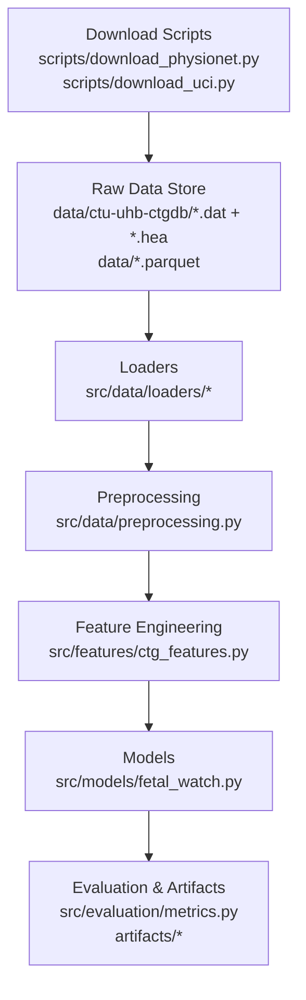
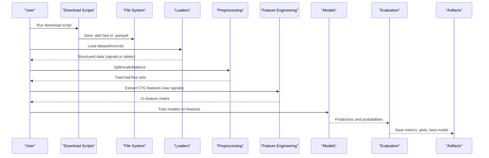

# Data Management

<cite>
**Referenced Files in This Document**
- [physionet_ctg.py](file://src/data/loaders/physionet_ctg.py)
- [uci_ctg.py](file://src/data/loaders/uci_ctg.py)
- [uci_maternal.py](file://src/data/loaders/uci_maternal.py)
- [preprocessing.py](file://src/data/preprocessing.py)
- [ctg_features.py](file://src/features/ctg_features.py)
- [download_physionet.py](file://scripts/download_physionet.py)
- [download_uci.py](file://scripts/download_uci.py)
- [DATASET_REGISTRY.md](file://DATASET_REGISTRY.md)
- [fetal_watch.py](file://src/models/fetal_watch.py)
- [metrics.py](file://src/evaluation/metrics.py)
- [results.json](file://artifacts/fetalwatch/results.json)
- [metadata.json](file://artifacts/carereach/metadata.json)
</cite>

## Table of Contents
1. Introduction
2. Project Structure
3. Core Components
4. Architecture Overview
5. Detailed Component Analysis
6. Dependency Analysis
7. Performance Considerations
8. Troubleshooting Guide
9. Conclusion
10. Appendices

## Introduction
This document explains how MaaHifazat AI ingests, preprocesses, and engineers features from cardiotocography (CTG) recordings and related maternal datasets. It covers:
- Ingestion pipelines for PhysioNet CTU-UHB CTG signals and UCI tabular datasets
- Preprocessing workflows for signal cleaning, normalization, and class balancing
- Feature engineering that maps raw 4 Hz FHR+UC signals to the UCI CTG 21-feature schema
- Data quality assurance, validation checks, and anomaly detection
- Versioning strategies, artifact management, and reproducibility practices
- Guidelines for adding new data sources, custom preprocessing steps, and maintaining data lineage
- Data privacy and security measures, storage strategies, backup procedures, and archival policies
- Practical examples for working with CTG signals, implementing custom loaders, and validating data quality for clinical use

## Project Structure
The data pipeline is organized into clear layers:
- Data ingestion scripts download or fetch external datasets and store them locally as Parquet or WFDB files
- Loaders provide consistent APIs to read datasets and records
- Preprocessing utilities split data, scale features, and balance classes
- Feature engineering converts raw CTG signals into clinically meaningful features aligned with the UCI CTG schema
- Models consume preprocessed features; evaluation metrics are computed and artifacts are saved

**Diagram sources**
- [download_physionet.py:1-68](file://scripts/download_physionet.py#L1-L68)
- [download_uci.py:1-40](file://scripts/download_uci.py#L1-L40)
- [physionet_ctg.py:13-103](file://src/data/loaders/physionet_ctg.py#L13-L103)
- [uci_ctg.py:14-53](file://src/data/loaders/uci_ctg.py#L14-L53)
- [uci_maternal.py:11-48](file://src/data/loaders/uci_maternal.py#L11-L48)
- [preprocessing.py:22-262](file://src/data/preprocessing.py#L22-L262)
- [ctg_features.py:506-683](file://src/features/ctg_features.py#L506-L683)
- [fetal_watch.py:282-432](file://src/models/fetal_watch.py#L282-L432)
- [metrics.py:49-465](file://src/evaluation/metrics.py#L49-L465)

**Section sources**
- [download_physionet.py:1-68](file://scripts/download_physionet.py#L1-L68)
- [download_uci.py:1-40](file://scripts/download_uci.py#L1-L40)
- [DATASET_REGISTRY.md:1-107](file://DATASET_REGISTRY.md#L1-L107)

## Core Components
- Data ingestion:
  - PhysioNet CTU-UHB CTG: downloads a subset of WFDB records and stores .dat/.hea pairs locally
  - UCI datasets: fetches CTG and Maternal Health Risk datasets via ucimlrepo and saves as Parquet
- Loaders:
  - PhysioNet loader reads WFDB records and returns structured dicts with FHR and UC signals plus metadata
  - UCI CTG loader reads Parquet, separates features and labels, and maps NSP to human-readable classes
  - UCI Maternal loader reads Parquet and splits features and risk-level labels
- Preprocessing:
  - Stratified train/val/test splitting
  - Feature scaling (RobustScaler, StandardScaler, MinMaxScaler)
  - Class imbalance handling (SMOTE, ADASYN)
  - Convenience pipeline combining split, scale, and balance
- Feature engineering:
  - Extracts 21 UCI-CTG-compatible features from raw FHR+UC signals
  - Includes baseline detection, accelerations/decelerations, variability (STV/LTV), histogram features, fetal movement proxy, and uterine contractions
- Models and evaluation:
  - Trains multiple models (LightGBM, Random Forest, XGBoost) with hyperparameter optimization
  - Computes classification reports, confusion matrices, ROC curves, calibration plots, and SHAP summaries
  - Saves best model and results as artifacts

**Section sources**
- [physionet_ctg.py:13-103](file://src/data/loaders/physionet_ctg.py#L13-L103)
- [uci_ctg.py:14-53](file://src/data/loaders/uci_ctg.py#L14-L53)
- [uci_maternal.py:11-48](file://src/data/loaders/uci_maternal.py#L11-L48)
- [preprocessing.py:22-262](file://src/data/preprocessing.py#L22-L262)
- [ctg_features.py:506-683](file://src/features/ctg_features.py#L506-L683)
- [fetal_watch.py:282-432](file://src/models/fetal_watch.py#L282-L432)
- [metrics.py:49-465](file://src/evaluation/metrics.py#L49-L465)

## Architecture Overview
End-to-end data flow from raw signals to model artifacts:

**Diagram sources**
- [download_physionet.py:1-68](file://scripts/download_physionet.py#L1-L68)
- [download_uci.py:1-40](file://scripts/download_uci.py#L1-L40)
- [physionet_ctg.py:13-103](file://src/data/loaders/physionet_ctg.py#L13-L103)
- [uci_ctg.py:14-53](file://src/data/loaders/uci_ctg.py#L14-L53)
- [preprocessing.py:22-262](file://src/data/preprocessing.py#L22-L262)
- [ctg_features.py:506-683](file://src/features/ctg_features.py#L506-L683)
- [fetal_watch.py:282-432](file://src/models/fetal_watch.py#L282-L432)
- [metrics.py:49-465](file://src/evaluation/metrics.py#L49-L465)

## Detailed Component Analysis

### Data Ingestion Pipelines
- PhysioNet CTU-UHB CTG:
  - Downloads a configurable subset of WFDB records to a local directory
  - Verifies downloaded files by listing .hea and .dat entries
  - Reads sample record metadata to confirm channels, sampling frequency, and duration
- UCI datasets:
  - Fetches CTG and Maternal Health Risk datasets using ucimlrepo
  - Saves features and targets as Parquet files for fast I/O
  - Prints shape, columns, dtypes, and target distributions for verification

Best practices:
- Use robust error handling for network failures and fallbacks
- Validate file existence before loading
- Keep raw data separate from processed outputs

**Section sources**
- [download_physionet.py:1-68](file://scripts/download_physionet.py#L1-L68)
- [download_uci.py:1-40](file://scripts/download_uci.py#L1-L40)

### Loaders
- PhysioNet loader:
  - Discovers unique record names from .hea files
  - Reads each record with wfdb.rdrecord, extracts FHR and UC channels
  - Validates minimum channel count and returns structured dicts with metadata
  - Skips corrupt or missing records with warnings instead of raising exceptions
- UCI CTG loader:
  - Reads Parquet file, removes label columns from features
  - Maps NSP numeric codes to human-readable labels
- UCI Maternal loader:
  - Reads Parquet file, separates RiskLevel target from features

Error handling:
- FileNotFoundError for missing Parquet files
- Warnings for skipped records due to read errors or insufficient channels

**Section sources**
- [physionet_ctg.py:13-103](file://src/data/loaders/physionet_ctg.py#L13-L103)
- [uci_ctg.py:14-53](file://src/data/loaders/uci_ctg.py#L14-L53)
- [uci_maternal.py:11-48](file://src/data/loaders/uci_maternal.py#L11-L48)

### Preprocessing Workflows
- Stratified splits:
  - Two-step stratified split to obtain train, validation, and test sets
  - Preserves class distribution across splits
- Scaling:
  - Fits scaler on training set only
  - Transforms validation and test sets consistently
  - Supports RobustScaler, StandardScaler, MinMaxScaler
- Class imbalance:
  - Applies SMOTE or ADASYN to training set only
  - Returns resampled features and labels while preserving pandas types
- Pipeline convenience:
  - Chains split → scale → balance into a single call
  - Returns all splits and fitted scaler for downstream use

Reproducibility:
- Fixed random_state seeds ensure deterministic splits and resampling

**Section sources**
- [preprocessing.py:22-262](file://src/data/preprocessing.py#L22-L262)

### Feature Engineering for CTG Signals
- Baseline detection:
  - Iterative median-based baseline estimation excluding accelerations and decelerations
- Acceleration detection:
  - Identifies sustained increases ≥15 bpm above baseline for at least 15 seconds
- Deceleration detection:
  - Classifies light, severe, and prolonged decelerations based on depth and duration thresholds
- Variability:
  - Short-term variability (STV): mean absolute difference within 1-minute windows
  - Long-term variability (LTV): amplitude per window; percentage outside normal range
- Histogram features:
  - Width, Min, Max, Nmax (peaks), Nzeros, Mode, Mean, Median, Variance, Tendency
- Fetal movement proxy:
  - Counts rapid short-duration FHR changes over sliding windows
- Uterine contractions:
  - Detects peaks in UC signal with prominence and distance constraints
- Output:
  - Produces 21 UCI-CTG-compatible features aligned with standard column names
  - Batch extraction supports processing entire directories and saving Parquet outputs

Quality checks:
- Requires >50% valid FHR samples; raises ValueError otherwise
- Warns and skips records with missing FHR/UC channels or low validity

**Section sources**
- [ctg_features.py:39-460](file://src/features/ctg_features.py#L39-L460)
- [ctg_features.py:506-683](file://src/features/ctg_features.py#L506-L683)

### Model Training and Evaluation
- Training:
  - LightGBM with Optuna HPO and early stopping
  - Random Forest baseline with balanced class weights
  - XGBoost with Optuna HPO and multi-class softprob
- Evaluation:
  - Classification reports, confusion matrices, per-class metrics
  - AUROC (one-vs-rest macro average)
  - Calibration curves and feature importance plots
  - SHAP summaries for interpretability
- Artifacts:
  - Best model saved as joblib
  - Results serialized to JSON with parameters, metrics, and confusion matrices

Reproducibility:
- Fixed random states and deterministic CV folds
- Hyperparameters logged alongside metrics

**Section sources**
- [fetal_watch.py:109-432](file://src/models/fetal_watch.py#L109-L432)
- [metrics.py:49-465](file://src/evaluation/metrics.py#L49-L465)
- [results.json:1-249](file://artifacts/fetalwatch/results.json#L1-L249)

## Dependency Analysis
Key dependencies and relationships:
- Download scripts depend on wfdb and ucimlrepo to retrieve raw data
- Loaders depend on wfdb and pandas to parse signals and tables
- Preprocessing depends on scikit-learn and imbalanced-learn for splitting, scaling, and resampling
- Feature engineering depends on scipy.signal for peak detection and numpy/pandas for computations
- Models depend on LightGBM, XGBoost, scikit-learn, and optuna for training and optimization
- Evaluation depends on matplotlib, seaborn, and sklearn.metrics for visualization and metrics

**Diagram sources**
- [download_physionet.py:1-68](file://scripts/download_physionet.py#L1-L68)
- [download_uci.py:1-40](file://scripts/download_uci.py#L1-L40)
- [physionet_ctg.py:13-103](file://src/data/loaders/physionet_ctg.py#L13-L103)
- [uci_ctg.py:14-53](file://src/data/loaders/uci_ctg.py#L14-L53)
- [preprocessing.py:22-262](file://src/data/preprocessing.py#L22-L262)
- [ctg_features.py:506-683](file://src/features/ctg_features.py#L506-L683)
- [fetal_watch.py:282-432](file://src/models/fetal_watch.py#L282-L432)
- [metrics.py:49-465](file://src/evaluation/metrics.py#L49-L465)

**Section sources**
- [DATASET_REGISTRY.md:1-107](file://DATASET_REGISTRY.md#L1-L107)

## Performance Considerations
- Use Parquet for efficient I/O of tabular datasets
- Fit scalers only on training data to avoid data leakage
- Apply class balancing only to training data to preserve evaluation integrity
- Limit SHAP computation to subsamples for large datasets
- Use early stopping in tree-based models to reduce overfitting and training time
- Batch feature extraction to process multiple recordings efficiently

[No sources needed since this section provides general guidance]

## Troubleshooting Guide
Common issues and resolutions:
- Missing data files:
  - Ensure Parquet files exist at expected paths before loading
  - Verify WFDB directory contains paired .dat and .hea files
- Corrupt or incomplete records:
  - Loaders skip problematic records with warnings; check logs for skipped record names
  - Re-download or repair affected records
- Low-quality signals:
  - Feature extraction requires >50% valid FHR samples; inspect signals for noise or gaps
  - Adjust preprocessing thresholds if necessary
- Class imbalance:
  - Use SMOTE or ADASYN on training data to improve minority class performance
  - Monitor per-class recall to ensure clinical safety
- Reproducibility:
  - Fix random_state seeds for splits, resampling, and model training
  - Log hyperparameters and metrics alongside artifacts

**Section sources**
- [physionet_ctg.py:54-103](file://src/data/loaders/physionet_ctg.py#L54-L103)
- [uci_ctg.py:38-53](file://src/data/loaders/uci_ctg.py#L38-L53)
- [uci_maternal.py:33-48](file://src/data/loaders/uci_maternal.py#L33-L48)
- [ctg_features.py:532-546](file://src/features/ctg_features.py#L532-L546)
- [preprocessing.py:22-262](file://src/data/preprocessing.py#L22-L262)

## Conclusion
MaaHifazat AI implements a robust data management pipeline that ingests CTG signals and maternal datasets, preprocesses them with validated quality checks, and engineers clinically relevant features aligned with established schemas. The system ensures reproducibility through fixed seeds, comprehensive logging, and artifact versioning. Future enhancements should include region-specific data collection, advanced de-identification, encryption, access controls, and long-term archival policies to support clinical deployment.

[No sources needed since this section summarizes without analyzing specific files]

## Appendices

### Adding New Data Sources
Steps:
- Create a loader module under src/data/loaders/ with a consistent API returning features and labels
- Implement ingestion scripts under scripts/ to fetch and save raw data
- Add dataset documentation to DATASET_REGISTRY.md including source, license, and schema
- Integrate with preprocessing and feature engineering as needed

Guidelines:
- Maintain separation between raw and processed data
- Validate inputs and handle errors gracefully
- Preserve data lineage by logging source, version, and transformations

**Section sources**
- [DATASET_REGISTRY.md:1-107](file://DATASET_REGISTRY.md#L1-L107)

### Implementing Custom Preprocessing Steps
Recommendations:
- Extend preprocessing.py with new functions for domain-specific transformations
- Ensure fit/transform semantics match scikit-learn conventions
- Apply transformations only to training data during fitting to prevent leakage
- Test edge cases such as missing values, outliers, and zero-variance features

**Section sources**
- [preprocessing.py:73-188](file://src/data/preprocessing.py#L73-L188)

### Maintaining Data Lineage
Practices:
- Record dataset versions, sources, and timestamps in metadata artifacts
- Log preprocessing parameters and random seeds
- Save intermediate outputs (e.g., feature matrices) with versioned filenames
- Track model parameters and evaluation metrics alongside trained artifacts

**Section sources**
- [metadata.json:1-45](file://artifacts/carereach/metadata.json#L1-L45)
- [results.json:1-249](file://artifacts/fetalwatch/results.json#L1-L249)

### Data Privacy and Security Measures
- De-identification:
  - Remove or hash patient identifiers before storing or sharing data
  - Avoid retaining direct personal information in feature sets
- Encryption:
  - Encrypt sensitive data at rest and in transit
  - Use secure storage backends with access controls
- Access controls:
  - Restrict data access to authorized personnel
  - Audit access logs regularly

[No sources needed since this section provides general guidance]

### Storage Strategies, Backup Procedures, and Archival Policies
- Storage:
  - Use Parquet for tabular data and WFDB for signals
  - Organize directories by dataset and version
- Backups:
  - Schedule regular backups of raw and processed data
  - Verify backup integrity periodically
- Archival:
  - Retain historical versions for reproducibility
  - Archive outdated datasets with metadata describing their scope and limitations

[No sources needed since this section provides general guidance]

### Examples: Working with CTG Signals
- Load PhysioNet records:
  - Use load_physionet_records to read FHR and UC signals with metadata
- Extract features:
  - Use extract_features_from_signal to compute 21 UCI-CTG features
  - Use extract_features_batch to process multiple recordings and save outputs
- Validate quality:
  - Check validity percentage and recording duration
  - Handle low-quality records by skipping or flagging

**Section sources**
- [physionet_ctg.py:13-103](file://src/data/loaders/physionet_ctg.py#L13-L103)
- [ctg_features.py:506-683](file://src/features/ctg_features.py#L506-L683)

### Examples: Implementing Custom Loaders
- Define a function that accepts a data path and returns structured data
- Handle file existence checks and raise informative errors
- Map raw fields to standardized names and types
- Include metadata for traceability

**Section sources**
- [uci_ctg.py:14-53](file://src/data/loaders/uci_ctg.py#L14-L53)
- [uci_maternal.py:11-48](file://src/data/loaders/uci_maternal.py#L11-L48)

### Examples: Validating Data Quality for Clinical Use
- Signal quality:
  - Ensure sufficient valid samples (>50%)
  - Inspect baseline stability and variability ranges
- Label consistency:
  - Verify class mappings and distributions
  - Monitor per-class performance for clinical safety
- Anomaly detection:
  - Flag outliers in features derived from signals
  - Review skipped records and reasons

**Section sources**
- [ctg_features.py:532-546](file://src/features/ctg_features.py#L532-L546)
- [fetal_watch.py:58-102](file://src/models/fetal_watch.py#L58-L102)
- [metrics.py:49-465](file://src/evaluation/metrics.py#L49-L465)