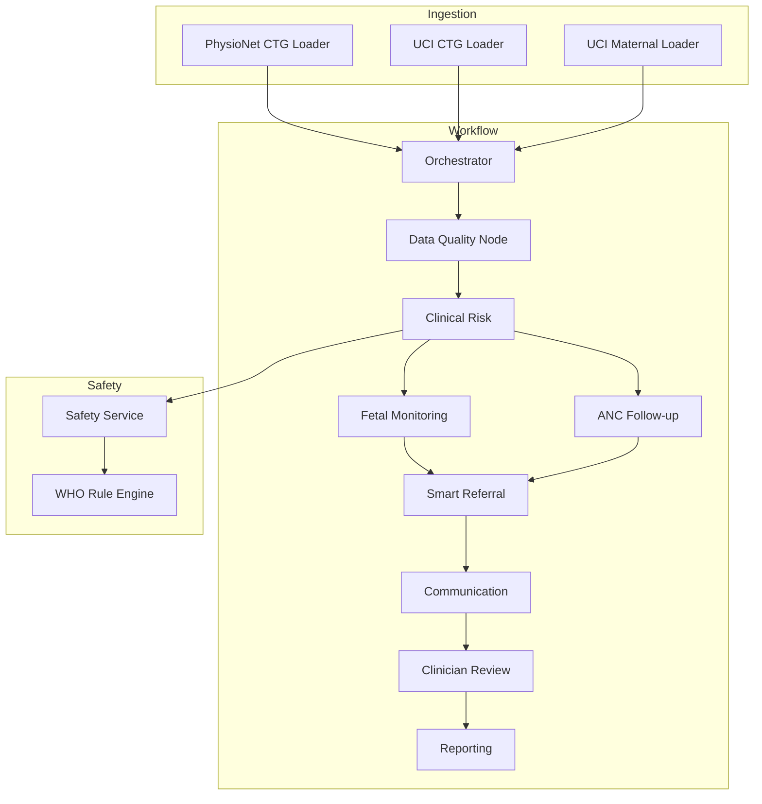
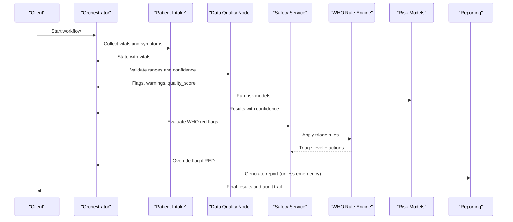
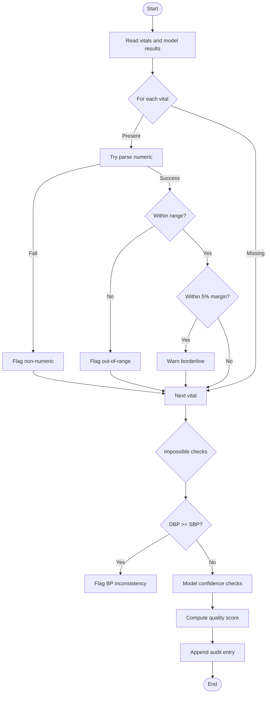
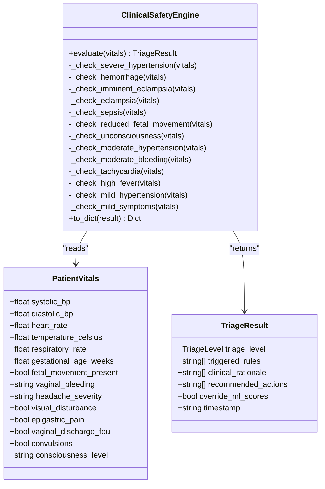
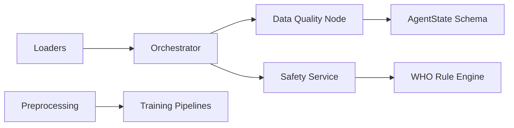

# Data Quality Assurance

<cite>
**Referenced Files in This Document**
- [data_quality.py](file://backend/agents/nodes/data_quality.py)
- [safety_rules.py](file://safety_rules.py)
- [safety.py](file://backend/services/safety.py)
- [state.py](file://backend/schemas/state.py)
- [orchestrator.py](file://backend/agents/orchestrator.py)
- [preprocessing.py](file://src/data/preprocessing.py)
- [physionet_ctg.py](file://src/data/loaders/physionet_ctg.py)
- [uci_ctg.py](file://src/data/loaders/uci_ctg.py)
- [uci_maternal.py](file://src/data/loaders/uci_maternal.py)
- [download_and_prep.py](file://download_and_prep.py)
- [train_gestation_insight.py](file://train_gestation_insight.py)
</cite>

## Table of Contents
1. Introduction
2. Project Structure
3. Core Components
4. Architecture Overview
5. Detailed Component Analysis
6. Dependency Analysis
7. Performance Considerations
8. Troubleshooting Guide
9. Conclusion
10. Appendices

## Introduction
This document explains the data quality assurance (DQA) processes implemented in MaaHifazat AI across the ingestion, validation, safety enforcement, and reporting stages. It covers:
- Validation checks: range validation, missing value detection, impossible-value checks, and model confidence thresholds
- Safety rules engine: WHO-based triage that enforces clinical constraints and can override ML outputs
- Anomaly detection: outlier flags for unrealistic or corrupted signals and values
- Guidelines for custom validation rules, monitoring metrics, and generating reports
- Data cleansing procedures, imputation strategies, and handling edge cases in clinical data
- Examples for troubleshooting issues, automating checks, and maintaining standards across healthcare settings

## Project Structure
MaaHifazat’s DQA spans several modules:
- Ingestion loaders validate raw inputs and skip corrupt records gracefully
- A data quality node validates ranges, detects anomalies, and scores overall quality
- A safety service wraps a deterministic WHO rule engine to enforce clinical constraints
- The orchestrator wires nodes into a workflow with conditional routing based on intake completeness and emergency status
- Preprocessing utilities provide scaling, splitting, and imbalance handling used during training pipelines

**Diagram sources**
- [orchestrator.py:62-138](file://backend/agents/orchestrator.py#L62-L138)
- [data_quality.py:25-183](file://backend/agents/nodes/data_quality.py#L25-L183)
- [safety.py:18-67](file://backend/services/safety.py#L18-L67)
- [safety_rules.py:72-167](file://safety_rules.py#L72-L167)

**Section sources**
- [orchestrator.py:1-167](file://backend/agents/orchestrator.py#L1-L167)
- [data_quality.py:1-201](file://backend/agents/nodes/data_quality.py#L1-L201)
- [safety.py:1-83](file://backend/services/safety.py#L1-L83)
- [safety_rules.py:1-555](file://safety_rules.py#L1-L555)

## Core Components
- Data Quality Node: Validates vital signs against physiological ranges, flags non-numeric and out-of-range values, detects impossible combinations (e.g., diastolic ≥ systolic), warns about borderline values, checks model confidence scores, and computes an overall quality score.
- Safety Service and WHO Rule Engine: Enforces WHO maternal emergency triage rules; if any red flag is triggered, it overrides ML risk scores and escalates to emergency pathways.
- Ingestion Loaders: Robustly load datasets, skipping corrupt or incomplete records and validating basic expectations before downstream processing.
- Orchestrator: Wires agent nodes into a stateful graph with conditional routing based on intake completion and emergency flags.

Key responsibilities:
- Range validation and anomaly flagging
- Missing value detection and audit logging
- Model confidence thresholding
- Clinical constraint enforcement via deterministic rules
- End-to-end audit trail accumulation

**Section sources**
- [data_quality.py:9-19](file://backend/agents/nodes/data_quality.py#L9-L19)
- [data_quality.py:25-183](file://backend/agents/nodes/data_quality.py#L25-L183)
- [safety_rules.py:19-66](file://safety_rules.py#L19-L66)
- [safety_rules.py:72-167](file://safety_rules.py#L72-L167)
- [physionet_ctg.py:13-103](file://src/data/loaders/physionet_ctg.py#L13-L103)
- [uci_ctg.py:14-53](file://src/data/loaders/uci_ctg.py#L14-L53)
- [uci_maternal.py:11-48](file://src/data/loaders/uci_maternal.py#L11-L48)
- [orchestrator.py:22-55](file://backend/agents/orchestrator.py#L22-L55)

## Architecture Overview
The DQA architecture integrates validation, safety, and workflow orchestration:

**Diagram sources**
- [orchestrator.py:62-138](file://backend/agents/orchestrator.py#L62-L138)
- [data_quality.py:25-183](file://backend/agents/nodes/data_quality.py#L25-L183)
- [safety.py:18-67](file://backend/services/safety.py#L18-L67)
- [safety_rules.py:72-167](file://safety_rules.py#L72-L167)

## Detailed Component Analysis

### Data Quality Node
Responsibilities:
- Range validation for vital signs using predefined physiological bounds
- Non-numeric value detection and critical flagging
- Impossible-value checks (e.g., diastolic ≥ systolic)
- Borderline value warnings within 5% margin of range limits
- Model confidence checks per model with a minimum threshold
- Overall quality score computation and audit logging

Validation checks implemented:
- Range validation: Each vital sign is checked against min/max bounds defined in the module
- Missing value detection: None values are skipped during checks but counted for coverage
- Outlier identification: Out-of-range and non-numeric values are flagged as critical
- Confidence thresholding: Per-model confidence below threshold triggers warnings

Quality scoring:
- Combines number of flags and low-confidence checks relative to total checks to compute a 0–1 quality score

Audit and error handling:
- Produces structured audit entries for successful runs and errors
- Errors are captured and appended to the shared state without halting the workflow

**Diagram sources**
- [data_quality.py:25-183](file://backend/agents/nodes/data_quality.py#L25-L183)

**Section sources**
- [data_quality.py:9-19](file://backend/agents/nodes/data_quality.py#L9-L19)
- [data_quality.py:25-183](file://backend/agents/nodes/data_quality.py#L25-L183)

### Safety Rules Engine (WHO Triaging)
Responsibilities:
- Deterministic evaluation of patient vitals and symptoms against WHO danger-sign criteria
- Priority-ordered rule evaluation: RED → ORANGE → YELLOW → GREEN
- Overrides ML risk scores when any RED flag is triggered
- Returns triage level, triggered rules, rationale, recommended actions, and timestamp

Rule categories:
- RED: Severe hypertension, hemorrhage, imminent eclampsia, eclampsia, sepsis, reduced fetal movement after 28 weeks, unconsciousness
- ORANGE: Moderate hypertension, moderate bleeding, tachycardia, high fever
- YELLOW: Mild hypertension, mild symptoms
- GREEN: No danger signs detected

Override behavior:
- Any RED trigger sets override flag to true and assigns highest triage level, ensuring immediate escalation

**Diagram sources**
- [safety_rules.py:19-66](file://safety_rules.py#L19-L66)
- [safety_rules.py:72-167](file://safety_rules.py#L72-L167)
- [safety_rules.py:173-462](file://safety_rules.py#L173-L462)

**Section sources**
- [safety_rules.py:19-66](file://safety_rules.py#L19-L66)
- [safety_rules.py:72-167](file://safety_rules.py#L72-L167)
- [safety_rules.py:173-462](file://safety_rules.py#L173-L462)

### Safety Service Adapter
Responsibilities:
- Wraps the WHO rule engine and exposes methods to evaluate red flags and check emergencies
- Converts input dictionaries to the engine’s expected structure and serializes results

Integration points:
- Used by higher-level services or workflows to enforce clinical constraints
- Provides quick emergency checks for routing decisions

**Section sources**
- [safety.py:18-67](file://backend/services/safety.py#L18-L67)

### Ingestion Loaders and Data Cleansing
Responsibilities:
- PhysioNet CTG loader: Reads WFDB records, skips corrupt or incomplete files with warnings, validates signal count, and returns clean lists
- UCI CTG and Maternal loaders: Load parquet datasets, separate features and targets, and raise clear errors if files are missing
- Data preparation scripts: Replace known zeros with missing values and impute using median where appropriate

Anomaly handling:
- Corrupt or missing records are skipped rather than raising exceptions, ensuring robust downstream processing
- Basic structural validations (e.g., at least two signals) prevent malformed data from entering the pipeline

Imputation strategies:
- Median imputation for numeric columns with zero placeholders
- Simple imputer usage in feature preparation for consistent handling of nulls

**Section sources**
- [physionet_ctg.py:13-103](file://src/data/loaders/physionet_ctg.py#L13-L103)
- [uci_ctg.py:14-53](file://src/data/loaders/uci_ctg.py#L14-L53)
- [uci_maternal.py:11-48](file://src/data/loaders/uci_maternal.py#L11-L48)
- [download_and_prep.py:235-241](file://download_and_prep.py#L235-L241)
- [train_gestation_insight.py:116-148](file://train_gestation_insight.py#L116-L148)

### Workflow Orchestration and Routing
Responsibilities:
- Defines a stateful graph with nine agent nodes
- Routes flow based on intake completeness and emergency status
- Ensures data quality checks run early to inform subsequent steps

Routing logic:
- After intake: proceed to data quality if complete
- After data quality: proceed to clinical risk assessment
- After clinical risk: route to smart referral if emergency; otherwise fetal monitoring or ANC follow-up depending on data availability
- After clinician review: generate reporting unless emergency

**Section sources**
- [orchestrator.py:22-55](file://backend/agents/orchestrator.py#L22-L55)
- [orchestrator.py:62-138](file://backend/agents/orchestrator.py#L62-L138)

## Dependency Analysis
Component relationships and coupling:
- Orchestrator depends on all agent nodes and uses shared state schema
- Data quality node reads vitals and model results from state and writes audit entries
- Safety service depends on the WHO rule engine and provides emergency checks
- Loaders depend on external libraries and file paths; they produce clean structures for downstream use
- Preprocessing utilities are independent but used in training pipelines

Potential circular dependencies:
- None observed; modules are layered with clear separation between ingestion, validation, safety, and workflow

External dependencies:
- wfdb for PhysioNet CTG loading
- pandas, numpy, scikit-learn, imbalanced-learn for preprocessing and modeling
- LangGraph for stateful workflow orchestration

**Diagram sources**
- [orchestrator.py:62-138](file://backend/agents/orchestrator.py#L62-L138)
- [data_quality.py:25-183](file://backend/agents/nodes/data_quality.py#L25-L183)
- [safety.py:18-67](file://backend/services/safety.py#L18-L67)
- [safety_rules.py:72-167](file://safety_rules.py#L72-L167)
- [state.py:7-43](file://backend/schemas/state.py#L7-L43)

**Section sources**
- [orchestrator.py:1-167](file://backend/agents/orchestrator.py#L1-L167)
- [state.py:1-43](file://backend/schemas/state.py#L1-L43)

## Performance Considerations
- Range checks and confidence checks are O(n) over vital fields and model results; efficient for typical batch sizes
- Skipping corrupt records avoids expensive exception handling in hot paths
- Median imputation and robust scaling reduce sensitivity to outliers during training
- Emergency routing short-circuits reporting to improve response time in critical cases

[No sources needed since this section provides general guidance]

## Troubleshooting Guide
Common issues and resolutions:
- Non-numeric vital values: Detected and flagged as critical; ensure upstream systems sanitize inputs
- Out-of-range values: Investigate sensor calibration or data entry errors; adjust ranges only with clinical justification
- Diastolic ≥ Systolic: Indicates measurement error; re-validate device output or manual entry
- Low model confidence: Triggered warnings suggest reviewing input quality or model applicability; consider retraining or domain adaptation
- Corrupt CTG records: Loaders skip problematic files; verify dataset integrity and re-download if necessary
- Emergency overrides: If RED flags are triggered, expect override of ML scores and immediate referral; validate rule inputs and thresholds

Monitoring and reporting:
- Use audit trails appended by nodes to track validation outcomes and errors
- Track quality scores and counts of flags/warnings over time to detect drift
- Log triage levels and triggered rules for safety compliance audits

Automated checks:
- Integrate data quality node into CI/CD pipelines to validate sample datasets
- Add unit tests for safety rules covering edge cases and multi-flag scenarios
- Periodically re-evaluate range definitions and confidence thresholds based on new clinical guidelines

Maintaining standards across healthcare settings:
- Centralize range definitions and rule parameters to ensure consistency
- Provide configuration hooks for site-specific adjustments while preserving core safety constraints
- Document and version-control rule changes with clinical approvals

**Section sources**
- [data_quality.py:47-100](file://backend/agents/nodes/data_quality.py#L47-L100)
- [data_quality.py:152-183](file://backend/agents/nodes/data_quality.py#L152-L183)
- [safety_rules.py:173-462](file://safety_rules.py#L173-L462)
- [physionet_ctg.py:57-78](file://src/data/loaders/physionet_ctg.py#L57-L78)

## Conclusion
MaaHifazat AI implements a comprehensive data quality assurance framework combining rigorous validation, deterministic safety rules, and robust ingestion. The system ensures clinical safety through WHO-based triage, maintains data integrity via range and anomaly checks, and supports continuous monitoring through audit trails and quality scores. By centralizing validation logic and providing clear integration points, the platform enables scalable deployment across diverse healthcare environments while preserving safety and reliability.

[No sources needed since this section summarizes without analyzing specific files]

## Appendices

### Implementing Custom Validation Rules
Guidelines:
- Extend the vital ranges dictionary to include new fields with appropriate min/max bounds and units
- Add impossible-value checks for clinically meaningful combinations
- Integrate new checks into the data quality node’s loop to maintain consistent flagging and scoring
- Update audit entries to capture new rule outcomes

Example reference paths:
- Vital ranges definition: [data_quality.py:9-19](file://backend/agents/nodes/data_quality.py#L9-L19)
- Range validation loop: [data_quality.py:47-82](file://backend/agents/nodes/data_quality.py#L47-L82)
- Impossible-value checks: [data_quality.py:84-99](file://backend/agents/nodes/data_quality.py#L84-L99)

**Section sources**
- [data_quality.py:9-19](file://backend/agents/nodes/data_quality.py#L9-L19)
- [data_quality.py:47-99](file://backend/agents/nodes/data_quality.py#L47-L99)

### Monitoring Data Quality Metrics
Recommended practices:
- Track quality_score trends over time to detect degradation
- Monitor counts of flags and warnings by field to identify systemic issues
- Log model confidence distributions to assess performance drift
- Use audit trails to correlate quality issues with workflow outcomes

Reference paths:
- Quality score computation: [data_quality.py:152-164](file://backend/agents/nodes/data_quality.py#L152-L164)
- Audit entry creation: [data_quality.py:172-183](file://backend/agents/nodes/data_quality.py#L172-L183)

**Section sources**
- [data_quality.py:152-183](file://backend/agents/nodes/data_quality.py#L152-L183)

### Generating Quality Reports
Approach:
- Aggregate audit entries across nodes to produce summary reports
- Include triage levels, triggered rules, and override flags for safety compliance
- Export quality scores and issue breakdowns for operational dashboards

Reference paths:
- Reporting node wiring: [orchestrator.py:120-132](file://backend/agents/orchestrator.py#L120-L132)
- Safety result serialization: [safety_rules.py:468-477](file://safety_rules.py#L468-L477)

**Section sources**
- [orchestrator.py:120-132](file://backend/agents/orchestrator.py#L120-L132)
- [safety_rules.py:468-477](file://safety_rules.py#L468-L477)

### Handling Edge Cases in Clinical Data
Strategies:
- Gracefully skip corrupt or incomplete records during ingestion
- Replace known invalid placeholders (e.g., zeros) with missing values and impute
- Use robust scaling and median imputation to mitigate outlier impact
- Ensure safety rules handle partial or missing data without crashing

Reference paths:
- Corrupt record handling: [physionet_ctg.py:57-78](file://src/data/loaders/physionet_ctg.py#L57-L78)
- Zero replacement and imputation: [download_and_prep.py:235-241](file://download_and_prep.py#L235-L241)
- Feature imputation: [train_gestation_insight.py:116-148](file://train_gestation_insight.py#L116-L148)

**Section sources**
- [physionet_ctg.py:57-78](file://src/data/loaders/physionet_ctg.py#L57-L78)
- [download_and_prep.py:235-241](file://download_and_prep.py#L235-L241)
- [train_gestation_insight.py:116-148](file://train_gestation_insight.py#L116-L148)