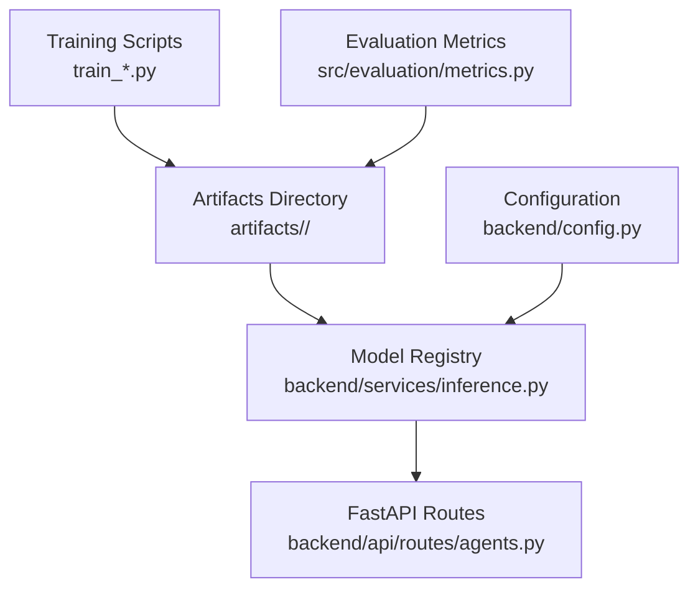
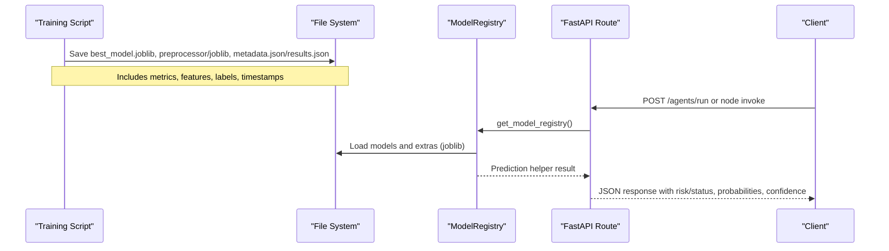
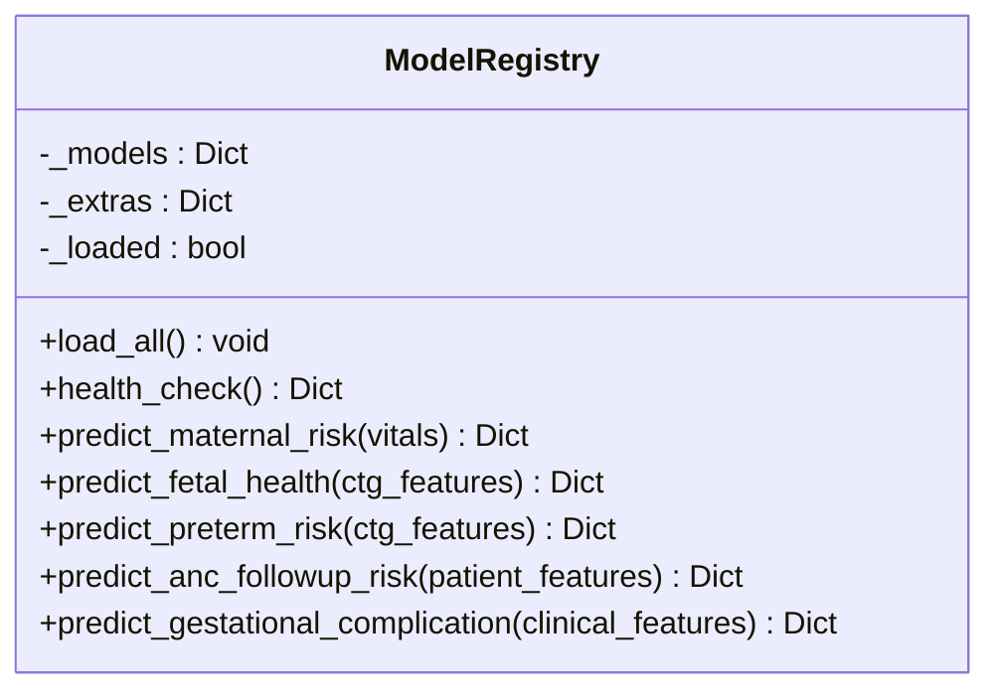
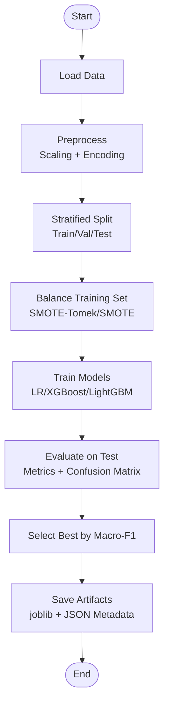
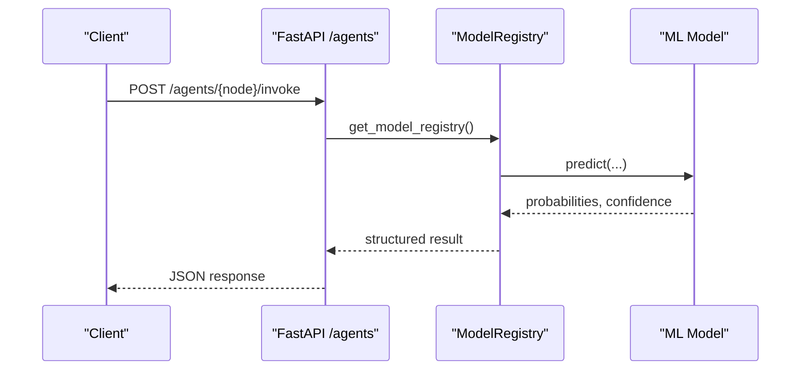
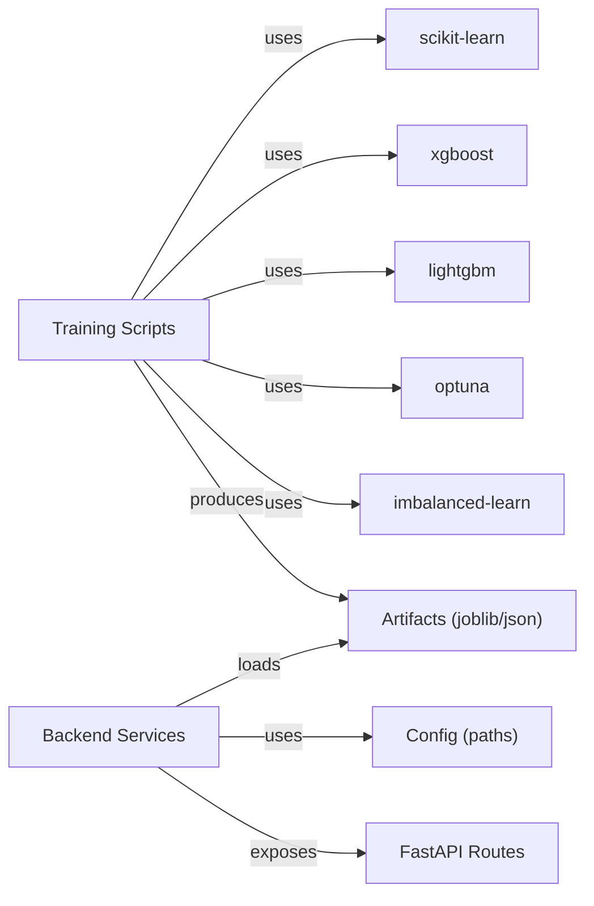

# Model Artifacts Management

<cite>
**Referenced Files in This Document**
- [inference.py](file://backend/services/inference.py)
- [config.py](file://backend/config.py)
- [agents.py](file://backend/api/routes/agents.py)
- [train_care_reach.py](file://train_care_reach.py)
- [train_gestation_insight.py](file://train_gestation_insight.py)
- [fetal_watch.py](file://src/models/fetal_watch.py)
- [maternal_guard.py](file://src/models/maternal_guard.py)
- [preterm_guard.py](file://src/models/preterm_guard.py)
- [metrics.py](file://src/evaluation/metrics.py)
- [metadata.json (carereach)](file://artifacts/carereach/metadata.json)
- [results.json (fetalwatch)](file://artifacts/fetalwatch/results.json)
- [metadata.json (gestationinsight)](file://artifacts/gestationinsight/metadata.json)
- [results.json (maternalguard)](file://artifacts/maternalguard/results.json)
- [results.json (pretermguard)](file://artifacts/pretermguard/results.json)
</cite>

## Table of Contents
1. Introduction
2. Project Structure
3. Core Components
4. Architecture Overview
5. Detailed Component Analysis
6. Dependency Analysis
7. Performance Considerations
8. Troubleshooting Guide
9. Conclusion
10. Appendices

## Introduction
This document explains how MaaHifazat AI manages model artifacts from training through deployment. It covers artifact storage structure, versioning strategies, metadata management, the model registry for loading and caching models, lifecycle practices, serialization formats, dependency tracking, environment consistency, evaluation metrics storage, performance benchmarking, A/B testing guidance, operational examples (registering new models, deploying updates, rolling back), and best practices for security, access control, and audit trails.

## Project Structure
MaaHifazat organizes ML artifacts by model under a shared artifacts directory. Each model folder contains serialized artifacts (typically joblib) and JSON metadata or results files that capture training configuration, metrics, features, and labels. The backend service loads these artifacts at startup via a singleton registry and exposes inference endpoints through FastAPI routes.

**Diagram sources**
- [train_care_reach.py:333-365](file://train_care_reach.py#L333-L365)
- [train_gestation_insight.py:619-663](file://train_gestation_insight.py#L619-L663)
- [inference.py:51-101](file://backend/services/inference.py#L51-L101)
- [config.py:7-21](file://backend/config.py#L7-L21)
- [metrics.py:1-6](file://src/evaluation/metrics.py#L1-L6)

**Section sources**
- [train_care_reach.py:333-365](file://train_care_reach.py#L333-L365)
- [train_gestation_insight.py:619-663](file://train_gestation_insight.py#L619-L663)
- [inference.py:51-101](file://backend/services/inference.py#L51-L101)
- [config.py:7-21](file://backend/config.py#L7-L21)

## Core Components
- Artifact storage per model:
  - Serialized models and preprocessors using joblib.
  - JSON metadata/results capturing metrics, parameters, feature lists, label encoders, and class distributions.
- Model registry:
  - Singleton that loads all models and extras (encoders, preprocessors) once at startup.
  - Provides prediction helpers with robust fallbacks when models are missing.
- Configuration:
  - Centralized paths to artifacts and environment variables for reproducibility.
- Evaluation utilities:
  - Standardized functions to compute and visualize confusion matrices, ROC curves, calibration plots, classification reports, SHAP summaries, and comparison tables.

**Section sources**
- [inference.py:51-141](file://backend/services/inference.py#L51-L141)
- [config.py:7-21](file://backend/config.py#L7-L21)
- [metrics.py:33-465](file://src/evaluation/metrics.py#L33-L465)

## Architecture Overview
The system follows a clear separation between training, artifact persistence, and runtime inference. Training scripts produce artifacts and metadata; the backend loads them into memory via a registry and serves predictions through API routes.

**Diagram sources**
- [train_care_reach.py:333-365](file://train_care_reach.py#L333-L365)
- [train_gestation_insight.py:619-663](file://train_gestation_insight.py#L619-L663)
- [inference.py:68-101](file://backend/services/inference.py#L68-L101)
- [agents.py:62-79](file://backend/api/routes/agents.py#L62-L79)

## Detailed Component Analysis

### Artifact Storage Structure and Versioning
- Directory layout:
  - artifacts/<model_name>/best_model.joblib
  - artifacts/<model_name>/preprocessor.joblib (when applicable)
  - artifacts/<model_name>/label_encoder.joblib (when applicable)
  - artifacts/<model_name>/metadata.json or results.json
- Versioning strategy:
  - Metadata includes a version field and timestamp for traceability.
  - Results/metadata store model name, metrics, parameters, feature lists, and class distributions.
- Serialization formats:
  - Models and preprocessors use joblib for efficient Python object serialization.
  - Human-readable metadata/results stored as JSON.

Examples of stored artifacts:
- CareReach: metadata.json includes training date, metrics across models, feature list, model name, version, and class distribution.
- GestationInsight: metadata.json includes dataset path, sample counts, feature names, split ratios, balancing method, macro-F1, AUROC, and full results.
- FetalWatch/MaternalGuard/PretermGuard: results.json include per-model parameters, metrics, confusion matrices, and best model selection.

**Section sources**
- [metadata.json (carereach):1-45](file://artifacts/carereach/metadata.json#L1-L45)
- [metadata.json (gestationinsight):1-206](file://artifacts/gestationinsight/metadata.json#L1-L206)
- [results.json (fetalwatch):1-249](file://artifacts/fetalwatch/results.json#L1-L249)
- [results.json (maternalguard):1-96](file://artifacts/maternalguard/results.json#L1-L96)
- [results.json (pretermguard):1-164](file://artifacts/pretermguard/results.json#L1-L164)
- [train_care_reach.py:333-365](file://train_care_reach.py#L333-L365)
- [train_gestation_insight.py:619-663](file://train_gestation_insight.py#L619-L663)

### Model Registry: Loading, Caching, and Deployment
- Singleton pattern ensures one instance of ModelRegistry per process.
- load_all reads configuration paths and loads each model plus extras (encoders, preprocessors).
- Health check returns availability status per model.
- Prediction helpers:
  - MaternalGuard: uses label encoder to map indices to human-readable risk levels.
  - FetalWatch/PretermGuard: uses model classes directly.
  - CareReach: applies ColumnTransformer preprocessor then predicts missed-visit risk and assigns priority thresholds.
  - GestationInsight: applies RobustScaler preprocessor and maps integer labels to Low/Moderate/High.

**Diagram sources**
- [inference.py:51-141](file://backend/services/inference.py#L51-L141)
- [inference.py:153-426](file://backend/services/inference.py#L153-L426)

**Section sources**
- [inference.py:51-141](file://backend/services/inference.py#L51-L141)
- [inference.py:153-426](file://backend/services/inference.py#L153-L426)
- [config.py:7-21](file://backend/config.py#L7-L21)

### Training Pipelines and Artifact Generation
- CareReach:
  - Preprocessing pipeline with RobustScaler and OneHotEncoder.
  - SMOTE-Tomek applied on training data only.
  - Trains LogisticRegression, XGBoost, LightGBM; selects best by Macro-F1.
  - Saves best_model.joblib, preprocessor.joblib, metadata.json, and SHAP plot.
- GestationInsight:
  - Numeric features with median imputation and RobustScaler.
  - Stratified split and SMOTE-Tomek.
  - Trains LogisticRegression, XGBoost, LightGBM with Optuna HPO; saves best_model.joblib, label_encoder.joblib, preprocessor.joblib, and metadata.json.
- FetalWatch/MaternalGuard/PretermGuard:
  - Consistent pipelines with stratified splits, scaling, imbalance handling, and Optuna HPO where applicable.
  - Outputs results.json with parameters, metrics, confusion matrices, and best model selection.

**Diagram sources**
- [train_care_reach.py:75-171](file://train_care_reach.py#L75-L171)
- [train_care_reach.py:176-305](file://train_care_reach.py#L176-L305)
- [train_care_reach.py:310-365](file://train_care_reach.py#L310-L365)
- [train_gestation_insight.py:116-200](file://train_gestation_insight.py#L116-L200)
- [train_gestation_insight.py:258-394](file://train_gestation_insight.py#L258-L394)
- [train_gestation_insight.py:619-663](file://train_gestation_insight.py#L619-L663)

**Section sources**
- [train_care_reach.py:75-171](file://train_care_reach.py#L75-L171)
- [train_care_reach.py:176-305](file://train_care_reach.py#L176-L305)
- [train_care_reach.py:310-365](file://train_care_reach.py#L310-L365)
- [train_gestation_insight.py:116-200](file://train_gestation_insight.py#L116-L200)
- [train_gestation_insight.py:258-394](file://train_gestation_insight.py#L258-L394)
- [train_gestation_insight.py:619-663](file://train_gestation_insight.py#L619-L663)

### Inference Service and API Integration
- ModelRegistry provides typed prediction methods returning consistent structures:
  - Risk/status labels, probabilities, confidence, and model availability flags.
- FastAPI route orchestrates workflows and single-node invocations, integrating agent nodes that may call model predictions.

**Diagram sources**
- [agents.py:62-79](file://backend/api/routes/agents.py#L62-L79)
- [inference.py:153-426](file://backend/services/inference.py#L153-L426)

**Section sources**
- [agents.py:62-79](file://backend/api/routes/agents.py#L62-L79)
- [inference.py:153-426](file://backend/services/inference.py#L153-L426)

### Evaluation Metrics Storage and Benchmarking
- Evaluation utilities provide standardized outputs:
  - Confusion matrix plots and normalized heatmaps.
  - One-vs-rest ROC curves and macro-AUC.
  - Calibration curves for probability reliability.
  - Classification reports with per-class precision/recall/F1/support.
  - SHAP summary plots for interpretability.
  - Comparison tables across models saved as CSV when requested.
- Training scripts persist metrics and confusion matrices in JSON artifacts for historical benchmarking.

**Section sources**
- [metrics.py:33-465](file://src/evaluation/metrics.py#L33-L465)
- [results.json (fetalwatch):1-249](file://artifacts/fetalwatch/results.json#L1-L249)
- [results.json (maternalguard):1-96](file://artifacts/maternalguard/results.json#L1-L96)
- [results.json (pretermguard):1-164](file://artifacts/pretermguard/results.json#L1-L164)

## Dependency Analysis
- Training dependencies:
  - scikit-learn for preprocessing, splitting, metrics.
  - xgboost/lightgbm for tree-based models.
  - optuna for hyperparameter optimization.
  - imbalanced-learn for SMOTE-Tomek.
  - joblib for serialization.
  - shap/matplotlib/seaborn for visualization and interpretability.
- Runtime dependencies:
  - fastapi for API routing.
  - pydantic-settings for configuration.
  - numpy/pandas for data manipulation.
  - joblib for model loading.

**Diagram sources**
- [train_care_reach.py:14-35](file://train_care_reach.py#L14-L35)
- [train_gestation_insight.py:19-38](file://train_gestation_insight.py#L19-L38)
- [inference.py:6-17](file://backend/services/inference.py#L6-L17)
- [config.py:7-21](file://backend/config.py#L7-L21)

**Section sources**
- [train_care_reach.py:14-35](file://train_care_reach.py#L14-L35)
- [train_gestation_insight.py:19-38](file://train_gestation_insight.py#L19-L38)
- [inference.py:6-17](file://backend/services/inference.py#L6-L17)
- [config.py:7-21](file://backend/config.py#L7-L21)

## Performance Considerations
- Use stratified splits and balanced sampling (SMOTE-Tomek) to mitigate class imbalance and improve generalization.
- Optuna HPO with cross-validation reduces overfitting and improves robustness.
- Early stopping in LightGBM prevents unnecessary training iterations.
- Caching via lru_cache for the registry avoids repeated instantiation overhead.
- Headless plotting and figure closing reduce memory usage during evaluation.

[No sources needed since this section provides general guidance]

## Troubleshooting Guide
- Missing model files:
  - Registry logs warnings if model or extra files are not found; predictions return safe fallbacks with model_available=false.
- Feature mismatch:
  - Ensure input dicts contain required features; missing columns are filled with zeros or handled by preprocessors.
- Label encoding issues:
  - For models requiring label encoders (MaternalGuard, GestationInsight), ensure label_encoder.joblib is present and matches training label sets.
- Preprocessor compatibility:
  - CareReach requires ColumnTransformer; ensure categorical types match training (strings for Gender, age_group).
- Evaluation discrepancies:
  - Verify metrics computation aligns with model outputs (e.g., multi-class vs binary).

**Section sources**
- [inference.py:103-141](file://backend/services/inference.py#L103-L141)
- [inference.py:153-426](file://backend/services/inference.py#L153-L426)

## Conclusion
MaaHifazat AI implements a robust artifact lifecycle: training scripts serialize models and metadata consistently; the backend registry loads and caches artifacts efficiently; APIs expose reliable predictions with graceful fallbacks. Evaluation utilities standardize metric collection and visualization. Following the guidelines below will help maintain reproducibility, performance, and safety as models evolve.

[No sources needed since this section summarizes without analyzing specific files]

## Appendices

### Guidelines for Organizing Model Artifacts
- Per-model directories under artifacts/<model>:
  - best_model.joblib
  - preprocessor.joblib (if applicable)
  - label_encoder.joblib (if applicable)
  - metadata.json or results.json
- Include timestamps, versions, metrics, features, and class distributions in metadata.

**Section sources**
- [train_care_reach.py:333-365](file://train_care_reach.py#L333-L365)
- [train_gestation_insight.py:619-663](file://train_gestation_insight.py#L619-L663)
- [metadata.json (carereach):1-45](file://artifacts/carereach/metadata.json#L1-L45)
- [metadata.json (gestationinsight):1-206](file://artifacts/gestationinsight/metadata.json#L1-L206)

### Implementing Model Version Control
- Maintain semantic versions in metadata.version.
- Keep historical artifacts alongside current ones; reference previous versions in rollback procedures.
- Record training timestamps and dataset paths for lineage.

**Section sources**
- [metadata.json (carereach):1-45](file://artifacts/carereach/metadata.json#L1-L45)
- [metadata.json (gestationinsight):1-206](file://artifacts/gestationinsight/metadata.json#L1-L206)

### Managing Model Dependencies
- Pin library versions in requirements files to ensure environment consistency.
- Store preprocessing steps (scalers, encoders) with models to avoid drift.
- Validate feature schemas at inference time.

**Section sources**
- [config.py:7-21](file://backend/config.py#L7-L21)
- [inference.py:24-48](file://backend/services/inference.py#L24-L48)

### Model Evaluation Metrics Storage and Benchmarking
- Persist per-model metrics, confusion matrices, and classification reports in JSON.
- Use standardized evaluation utilities for consistent reporting and visualization.
- Compare models via comparison tables and save CSVs for trend analysis.

**Section sources**
- [metrics.py:33-465](file://src/evaluation/metrics.py#L33-L465)
- [results.json (fetalwatch):1-249](file://artifacts/fetalwatch/results.json#L1-L249)
- [results.json (maternalguard):1-96](file://artifacts/maternalguard/results.json#L1-L96)
- [results.json (pretermguard):1-164](file://artifacts/pretermguard/results.json#L1-L164)

### A/B Testing Framework Guidance
- Register multiple model versions under the same model name with distinct artifact paths.
- Route traffic to different versions via configuration or feature flags.
- Track performance metrics per version in metadata/results for statistical comparison.

[No sources needed since this section provides general guidance]

### Examples: Registering New Models, Deploying Updates, Rolling Back
- Registering a new model:
  - Train and save best_model.joblib, preprocessors, encoders, and metadata.json/results.json under artifacts/<new_model>.
  - Update config.py paths to point to the new artifacts.
  - Restart backend to load the new model via ModelRegistry.
- Deploying an update:
  - Replace best_model.joblib and related extras with updated versions.
  - Update metadata.version and timestamp.
  - Restart backend to reload.
- Rolling back:
  - Revert config.py paths to previous artifact versions.
  - Restart backend to load prior models.

**Section sources**
- [config.py:7-21](file://backend/config.py#L7-L21)
- [inference.py:68-101](file://backend/services/inference.py#L68-L101)

### Best Practices: Security, Access Controls, Audit Trails
- Restrict write access to artifacts directory to CI/CD or authorized users.
- Use role-based access in API routes (e.g., clinician/admin roles) to limit who can trigger model runs or deployments.
- Log model load events and prediction failures for auditability.
- Avoid embedding secrets in code; use environment variables and settings.

**Section sources**
- [agents.py:62-79](file://backend/api/routes/agents.py#L62-L79)
- [config.py:23-47](file://backend/config.py#L23-L47)
- [inference.py:103-141](file://backend/services/inference.py#L103-L141)