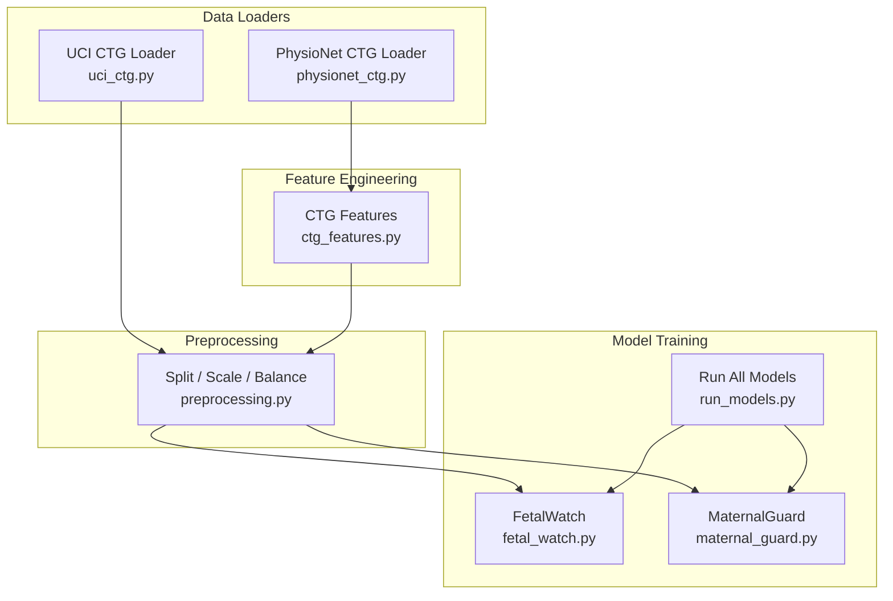
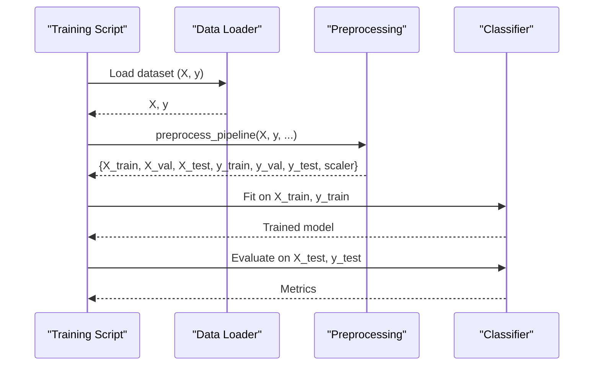
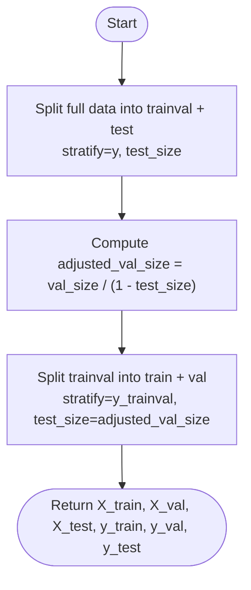
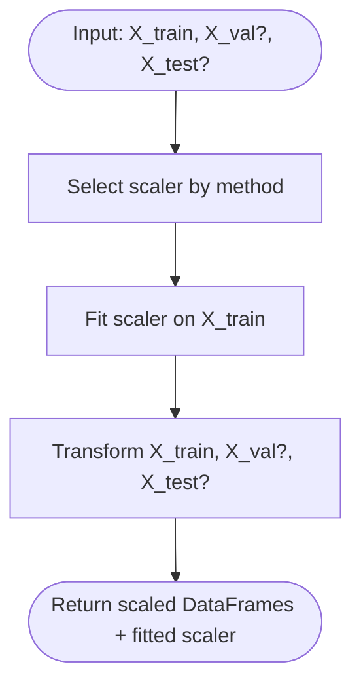
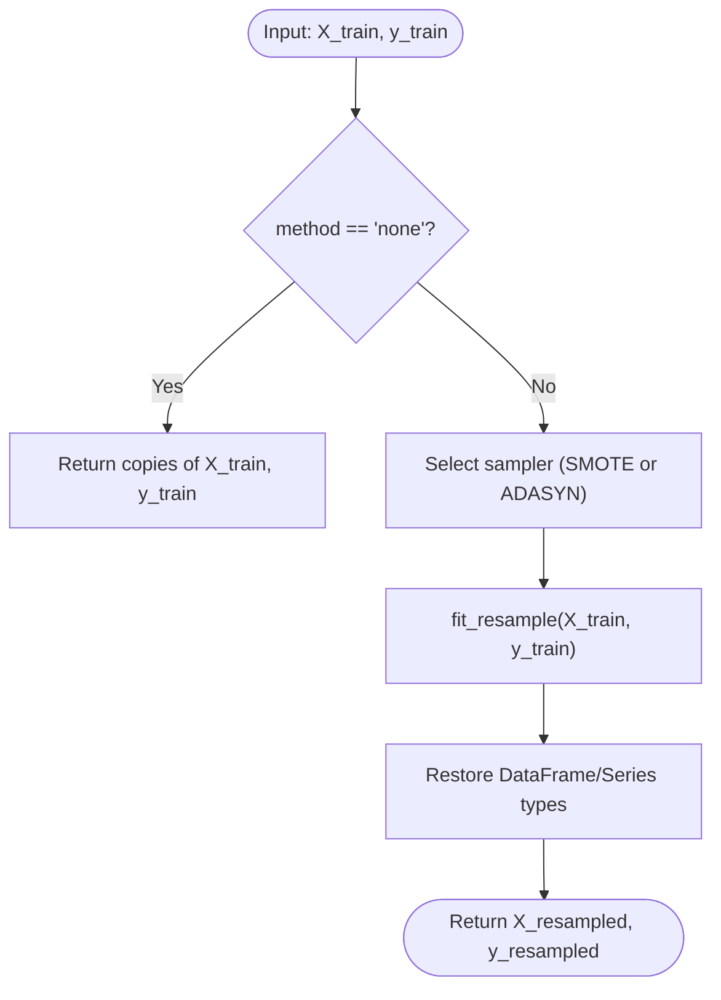
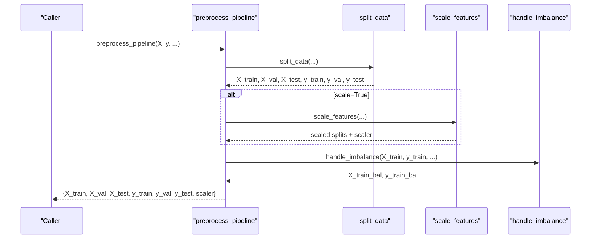
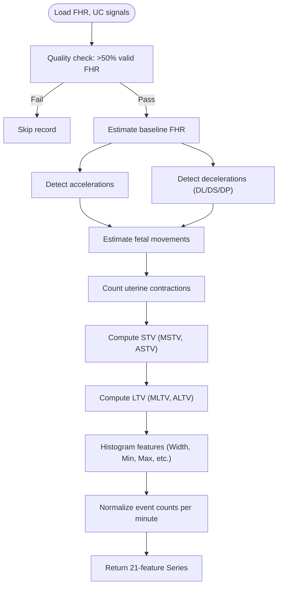
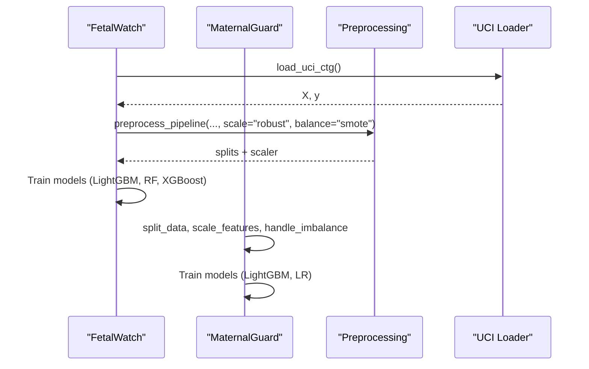
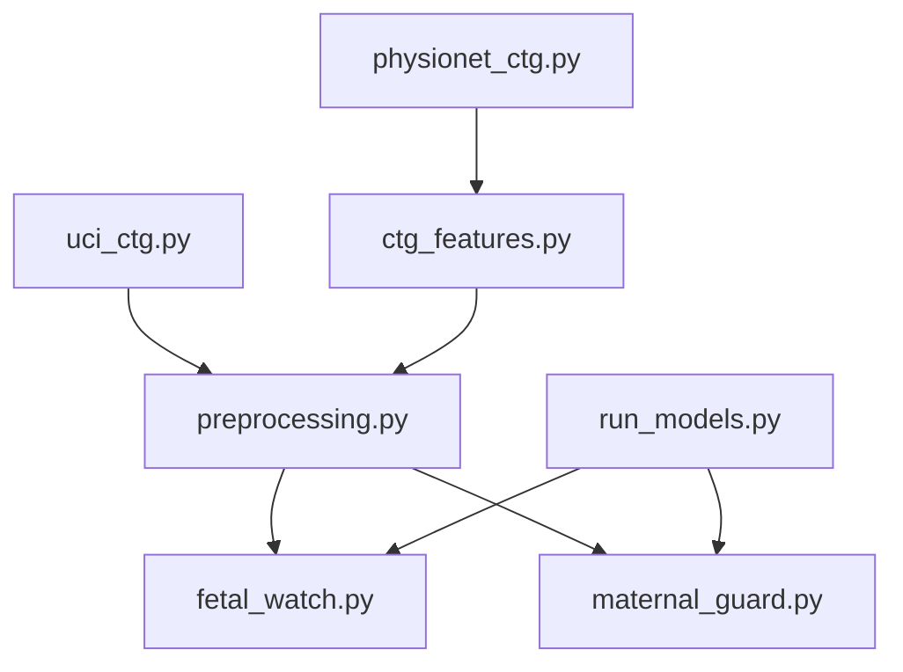

# Preprocessing Pipeline

<cite>
**Referenced Files in This Document**
- [preprocessing.py](file://src/data/preprocessing.py)
- [ctg_features.py](file://src/features/ctg_features.py)
- [physionet_ctg.py](file://src/data/loaders/physionet_ctg.py)
- [uci_ctg.py](file://src/data/loaders/uci_ctg.py)
- [fetal_watch.py](file://src/models/fetal_watch.py)
- [maternal_guard.py](file://src/models/maternal_guard.py)
- [run_models.py](file://scripts/run_models.py)
</cite>

## Table of Contents
1. [Introduction](#introduction)
2. [Project Structure](#project-structure)
3. [Core Components](#core-components)
4. [Architecture Overview](#architecture-overview)
5. [Detailed Component Analysis](#detailed-component-analysis)
6. [Dependency Analysis](#dependency-analysis)
7. [Performance Considerations](#performance-considerations)
8. [Troubleshooting Guide](#troubleshooting-guide)
9. [Conclusion](#conclusion)
10. [Appendices](#appendices)

## Introduction
This document explains the preprocessing pipeline used across MaaHifazat AI models, with a focus on:
- Stratified train/validation/test splitting
- Feature scaling (robust, standard, minmax)
- Class imbalance handling via SMOTE and ADASYN
- Orchestration that chains these steps into a single workflow
- CTG-specific feature engineering to extract clinically relevant signals from cardiotocography recordings
- Configuration options, parameter tuning guidance, performance optimization techniques
- Examples for custom steps, debugging, and data quality validation
- Reproducibility practices, random state management, and version control considerations

The goal is to make the pipeline transparent, configurable, and reproducible for both clinical and technical stakeholders.

## Project Structure
The preprocessing logic is centralized under src/data, while CTG signal processing lives under src/features. Model training scripts consume the preprocessing utilities to ensure consistent data transformations before model fitting.

**Diagram sources**
- [uci_ctg.py:14-53](file://src/data/loaders/uci_ctg.py#L14-L53)
- [physionet_ctg.py:13-103](file://src/data/loaders/physionet_ctg.py#L13-L103)
- [ctg_features.py:506-594](file://src/features/ctg_features.py#L506-L594)
- [preprocessing.py:22-261](file://src/data/preprocessing.py#L22-L261)
- [fetal_watch.py:282-337](file://src/models/fetal_watch.py#L282-L337)
- [maternal_guard.py:71-118](file://src/models/maternal_guard.py#L71-L118)
- [run_models.py:37-170](file://scripts/run_models.py#L37-L170)

**Section sources**
- [preprocessing.py:22-261](file://src/data/preprocessing.py#L22-L261)
- [ctg_features.py:27-32](file://src/features/ctg_features.py#L27-L32)
- [uci_ctg.py:14-53](file://src/data/loaders/uci_ctg.py#L14-L53)
- [physionet_ctg.py:13-103](file://src/data/loaders/physionet_ctg.py#L13-L103)
- [fetal_watch.py:282-337](file://src/models/fetal_watch.py#L282-L337)
- [maternal_guard.py:71-118](file://src/models/maternal_guard.py#L71-L118)
- [run_models.py:37-170](file://scripts/run_models.py#L37-L170)

## Core Components
- Stratified split: Two-step stratified split producing train, validation, and test sets with controlled proportions and reproducibility via random_state.
- Scaling: RobustScaler, StandardScaler, MinMaxScaler fit only on training data and applied consistently to val/test.
- Imbalance handling: SMOTE or ADASYN resampling applied exclusively to the training set after scaling.
- Orchestration: A convenience function chains split → scale → balance and returns all splits plus the fitted scaler.

Key configuration options:
- Split sizes: test_size, val_size
- Random seed: random_state
- Scaling method: robust, standard, minmax
- Imbalance method: smote, adasyn, none

**Section sources**
- [preprocessing.py:22-70](file://src/data/preprocessing.py#L22-L70)
- [preprocessing.py:80-130](file://src/data/preprocessing.py#L80-L130)
- [preprocessing.py:138-188](file://src/data/preprocessing.py#L138-L188)
- [preprocessing.py:196-261](file://src/data/preprocessing.py#L196-L261)

## Architecture Overview
The preprocessing pipeline is consumed by model training scripts. For example, FetalWatch loads UCI CTG features, applies the shared preprocessing pipeline, then trains multiple classifiers. MaternalGuard composes the same building blocks directly.

**Diagram sources**
- [fetal_watch.py:301-337](file://src/models/fetal_watch.py#L301-L337)
- [preprocessing.py:196-261](file://src/data/preprocessing.py#L196-L261)
- [uci_ctg.py:14-53](file://src/data/loaders/uci_ctg.py#L14-L53)

**Section sources**
- [fetal_watch.py:301-337](file://src/models/fetal_watch.py#L301-L337)
- [maternal_guard.py:90-118](file://src/models/maternal_guard.py#L90-L118)
- [preprocessing.py:196-261](file://src/data/preprocessing.py#L196-L261)

## Detailed Component Analysis

### Stratified Train/Validation/Test Split
- Performs two sequential stratified splits:
  - First split separates test set from combined train+val
  - Second split separates validation from train using an adjusted proportion relative to the remaining data
- Ensures class distribution preservation across splits
- Returns six objects: X_train, X_val, X_test, y_train, y_val, y_test

Configuration:
- test_size: fraction reserved for testing
- val_size: fraction reserved for validation (relative to full dataset)
- random_state: seed for reproducibility

**Diagram sources**
- [preprocessing.py:22-70](file://src/data/preprocessing.py#L22-L70)

**Section sources**
- [preprocessing.py:22-70](file://src/data/preprocessing.py#L22-L70)

### Feature Scaling
- Supports three strategies:
  - RobustScaler: median/IQR-based; robust to outliers
  - StandardScaler: zero mean, unit variance
  - MinMaxScaler: scales to a fixed range
- Scaler is fit only on training data and applied to validation/test to prevent data leakage
- Preserves DataFrame structure (columns and index)

Configuration:
- method: robust, standard, minmax
- Optional application to val/test

**Diagram sources**
- [preprocessing.py:80-130](file://src/data/preprocessing.py#L80-L130)

**Section sources**
- [preprocessing.py:80-130](file://src/data/preprocessing.py#L80-L130)

### Class Imbalance Handling
- Applies oversampling to the training set only:
  - SMOTE: synthetic minority oversampling
  - ADASYN: adaptive synthetic sampling based on neighborhood density
  - None: no resampling
- Restores pandas types after resampling

Configuration:
- method: smote, adasyn, none
- random_state: seed for reproducibility

**Diagram sources**
- [preprocessing.py:138-188](file://src/data/preprocessing.py#L138-L188)

**Section sources**
- [preprocessing.py:138-188](file://src/data/preprocessing.py#L138-L188)

### Orchestration: preprocess_pipeline
- Chains split → scale → balance into one call
- Returns all splits and the fitted scaler
- Encapsulates configuration for reproducibility and consistency

Usage examples in codebase:
- FetalWatch uses the convenience function with RobustScaler and SMOTE
- MaternalGuard composes the individual functions explicitly

**Diagram sources**
- [preprocessing.py:196-261](file://src/data/preprocessing.py#L196-L261)
- [fetal_watch.py:312-328](file://src/models/fetal_watch.py#L312-L328)
- [maternal_guard.py:103-118](file://src/models/maternal_guard.py#L103-L118)

**Section sources**
- [preprocessing.py:196-261](file://src/data/preprocessing.py#L196-L261)
- [fetal_watch.py:312-328](file://src/models/fetal_watch.py#L312-L328)
- [maternal_guard.py:103-118](file://src/models/maternal_guard.py#L103-L118)

### CTG-Specific Feature Engineering
- Extracts 21 UCI CTG-compatible features from raw fetal heart rate (FHR) and uterine contraction (UC) signals sampled at 4 Hz
- Includes baseline detection, accelerations, decelerations (light, severe, prolonged), fetal movement proxy, uterine contractions, short-term variability (STV), long-term variability (LTV), and histogram-based descriptors
- Batch extraction supports loading WFDB records, skipping invalid records gracefully, and saving results to Parquet

Key outputs:
- LB, AC, FM, UC, DL, DS, DP, ASTV, MSTV, ALTV, MLTV, Width, Min, Max, Nmax, Nzeros, Mode, Mean, Median, Variance, Tendency

Quality checks:
- Requires >50% valid FHR samples
- Validates recording duration

**Diagram sources**
- [ctg_features.py:506-594](file://src/features/ctg_features.py#L506-L594)
- [ctg_features.py:39-77](file://src/features/ctg_features.py#L39-L77)
- [ctg_features.py:84-131](file://src/features/ctg_features.py#L84-L131)
- [ctg_features.py:139-224](file://src/features/ctg_features.py#L139-L224)
- [ctg_features.py:232-329](file://src/features/ctg_features.py#L232-L329)
- [ctg_features.py:337-409](file://src/features/ctg_features.py#L337-L409)
- [ctg_features.py:417-499](file://src/features/ctg_features.py#L417-L499)

**Section sources**
- [ctg_features.py:27-32](file://src/features/ctg_features.py#L27-L32)
- [ctg_features.py:506-594](file://src/features/ctg_features.py#L506-L594)
- [physionet_ctg.py:13-103](file://src/data/loaders/physionet_ctg.py#L13-L103)

### Integration with Model Training
- FetalWatch:
  - Loads UCI CTG features
  - Applies preprocess_pipeline with RobustScaler and SMOTE
  - Trains LightGBM (Optuna HPO), Random Forest baseline, and XGBoost (Optuna HPO)
  - Evaluates on held-out test set and saves best model and results
- MaternalGuard:
  - Loads maternal risk dataset
  - Composes split → scale → SMOTE explicitly
  - Trains LightGBM (Optuna HPO) and Logistic Regression baseline
  - Evaluates and saves artifacts

**Diagram sources**
- [fetal_watch.py:301-337](file://src/models/fetal_watch.py#L301-L337)
- [maternal_guard.py:90-118](file://src/models/maternal_guard.py#L90-L118)
- [uci_ctg.py:14-53](file://src/data/loaders/uci_ctg.py#L14-L53)
- [preprocessing.py:196-261](file://src/data/preprocessing.py#L196-L261)

**Section sources**
- [fetal_watch.py:301-337](file://src/models/fetal_watch.py#L301-L337)
- [maternal_guard.py:90-118](file://src/models/maternal_guard.py#L90-L118)

## Dependency Analysis
- Data loaders provide clean inputs to preprocessing:
  - UCI CTG loader returns features and labels
  - PhysioNet loader provides raw signals for CTG feature extraction
- CTG feature extractor depends on signal processing utilities and produces standardized features compatible with UCI schema
- Preprocessing module depends on scikit-learn and imbalanced-learn
- Model training scripts depend on preprocessing and optionally on Optuna for hyperparameter search

**Diagram sources**
- [uci_ctg.py:14-53](file://src/data/loaders/uci_ctg.py#L14-L53)
- [physionet_ctg.py:13-103](file://src/data/loaders/physionet_ctg.py#L13-L103)
- [ctg_features.py:506-594](file://src/features/ctg_features.py#L506-L594)
- [preprocessing.py:196-261](file://src/data/preprocessing.py#L196-L261)
- [fetal_watch.py:301-337](file://src/models/fetal_watch.py#L301-L337)
- [maternal_guard.py:90-118](file://src/models/maternal_guard.py#L90-L118)
- [run_models.py:37-170](file://scripts/run_models.py#L37-L170)

**Section sources**
- [preprocessing.py:196-261](file://src/data/preprocessing.py#L196-L261)
- [ctg_features.py:506-594](file://src/features/ctg_features.py#L506-L594)
- [fetal_watch.py:301-337](file://src/models/fetal_watch.py#L301-L337)
- [maternal_guard.py:90-118](file://src/models/maternal_guard.py#L90-L118)
- [run_models.py:37-170](file://scripts/run_models.py#L37-L170)

## Performance Considerations
- Scaling choice:
  - RobustScaler is preferred when outliers are present (default in pipeline)
  - StandardScaler suits Gaussian-like distributions
  - MinMaxScaler useful for bounded algorithms or neural networks
- Imbalance handling:
  - Prefer SMOTE for moderate imbalance; ADASYN may be more aggressive near decision boundaries
  - Apply only to training set to avoid leakage
- Stratified splits:
  - Ensure sufficient samples per class to maintain stable estimates
- CTG feature extraction:
  - Quality gate (>50% valid FHR) prevents noisy records from degrading downstream models
  - Normalization of event counts per minute aligns with UCI CTG conventions
- Training pipelines:
  - Use early stopping and cross-validation to reduce overfitting
  - Optuna pruners accelerate HPO by discarding unpromising trials

[No sources needed since this section provides general guidance]

## Troubleshooting Guide
Common issues and resolutions:
- Missing data files:
  - UCI CTG parquet not found: ensure file exists at expected path
  - PhysioNet directory missing: verify data directory and permissions
- Invalid CTG records:
  - Low-quality FHR (<50% valid): record skipped; inspect raw signals
  - Missing FHR/UC channels: skip and continue processing other records
- Scaling errors:
  - Unknown method: choose from robust, standard, minmax
- Imbalance errors:
  - Unknown method: choose from smote, adasyn, none
- Reproducibility:
  - Set random_state consistently across split, scaling (if applicable), and imbalance steps

Relevant error paths:
- FileNotFoundError for missing parquet files
- ValueError for low-quality CTG records
- ValueError for unknown scaling or imbalance methods

**Section sources**
- [uci_ctg.py:38-42](file://src/data/loaders/uci_ctg.py#L38-L42)
- [physionet_ctg.py:44-48](file://src/data/loaders/physionet_ctg.py#L44-L48)
- [ctg_features.py:535-545](file://src/features/ctg_features.py#L535-L545)
- [preprocessing.py:113-117](file://src/data/preprocessing.py#L113-L117)
- [preprocessing.py:175-179](file://src/data/preprocessing.py#L175-L179)

## Conclusion
The MaaHifazat AI preprocessing pipeline provides a robust, configurable foundation for transforming raw data into model-ready formats. It ensures:
- Consistent stratified splits preserving class distributions
- Safe scaling with no data leakage
- Effective handling of class imbalance via SMOTE/ADASYN
- Clinically meaningful CTG feature extraction aligned with established standards
- Clear integration points for model training and evaluation

Adopting the recommended configurations and practices will improve reproducibility, interpretability, and performance across datasets and models.

[No sources needed since this section summarizes without analyzing specific files]

## Appendices

### Configuration Options Summary
- Split:
  - test_size: fraction for test set
  - val_size: fraction for validation set
  - random_state: seed for reproducibility
- Scaling:
  - method: robust, standard, minmax
- Imbalance:
  - method: smote, adasyn, none
  - random_state: seed for reproducibility

**Section sources**
- [preprocessing.py:22-70](file://src/data/preprocessing.py#L22-L70)
- [preprocessing.py:80-130](file://src/data/preprocessing.py#L80-L130)
- [preprocessing.py:138-188](file://src/data/preprocessing.py#L138-L188)
- [preprocessing.py:196-261](file://src/data/preprocessing.py#L196-L261)

### Parameter Tuning Guidelines
- Scaling:
  - Start with robust scaling; switch to standard if distributions are well-behaved
- Imbalance:
  - Try SMOTE first; use ADASYN if boundary-focused synthesis improves performance
  - Validate impact on calibration and per-class metrics
- CTG features:
  - Inspect baseline, acceleration, and deceleration detection thresholds for domain alignment
  - Monitor STV/LTV ranges against clinical norms

**Section sources**
- [ctg_features.py:39-77](file://src/features/ctg_features.py#L39-L77)
- [ctg_features.py:84-131](file://src/features/ctg_features.py#L84-L131)
- [ctg_features.py:139-224](file://src/features/ctg_features.py#L139-L224)
- [ctg_features.py:232-329](file://src/features/ctg_features.py#L232-L329)

### Custom Preprocessing Steps
- Add new scalers by extending the scaler map and updating type hints
- Introduce new imbalance strategies by adding entries to the sampler map
- Extend CTG feature extraction by implementing additional signal-derived metrics and appending to the output Series

**Section sources**
- [preprocessing.py:108-117](file://src/data/preprocessing.py#L108-L117)
- [preprocessing.py:170-182](file://src/data/preprocessing.py#L170-L182)
- [ctg_features.py:578-594](file://src/features/ctg_features.py#L578-L594)

### Debugging and Validation
- Validate splits:
  - Check class distributions across train/val/test
- Validate scaling:
  - Confirm scaler parameters learned from training set
  - Verify val/test transformed ranges
- Validate imbalance:
  - Compare pre/post resampling class counts
- Validate CTG features:
  - Ensure >50% valid FHR
  - Inspect per-record warnings for skipped records

**Section sources**
- [fetal_watch.py:312-328](file://src/models/fetal_watch.py#L312-L328)
- [ctg_features.py:631-683](file://src/features/ctg_features.py#L631-L683)

### Reproducibility and Version Control
- Fix random_state across split, scaling (where applicable), and imbalance steps
- Log configuration parameters alongside model artifacts
- Pin dependency versions (scikit-learn, imbalanced-learn, wfdb)
- Store preprocessing configurations in version-controlled files (e.g., JSON/YAML) and reference them in training scripts

**Section sources**
- [fetal_watch.py:312-328](file://src/models/fetal_watch.py#L312-L328)
- [maternal_guard.py:103-118](file://src/models/maternal_guard.py#L103-L118)