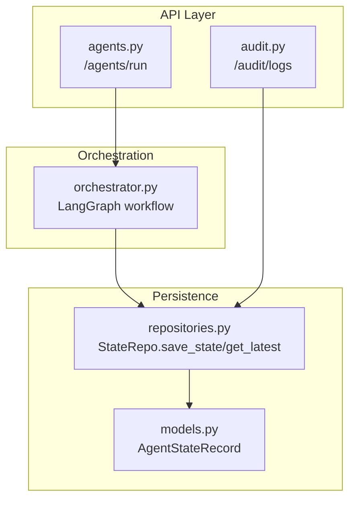
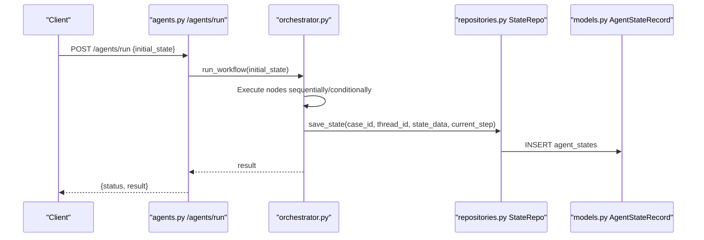
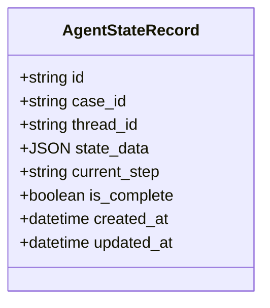
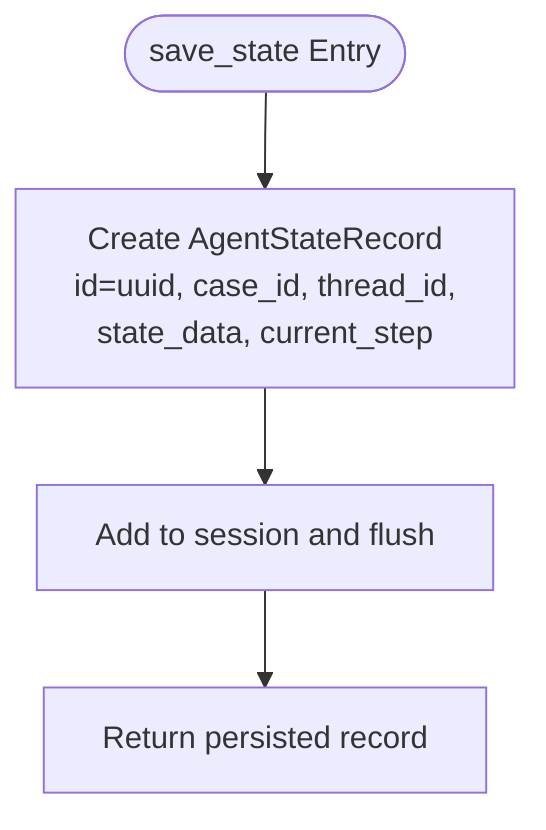
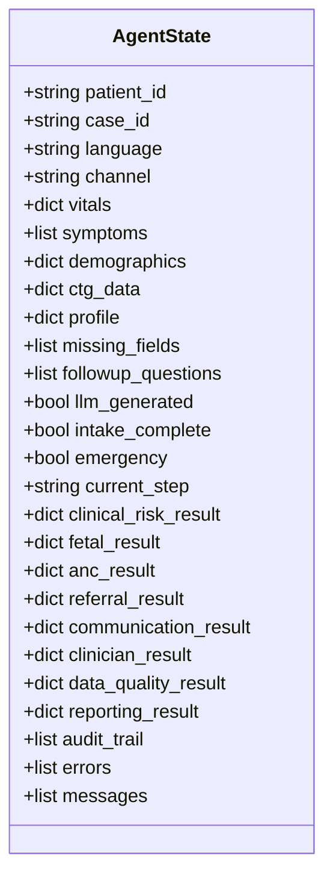
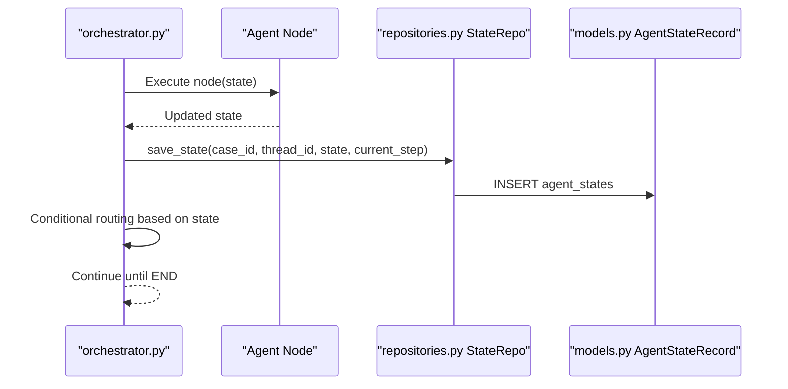
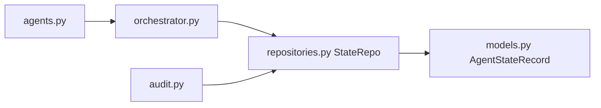

# Agent State Entity

<cite>
**Referenced Files in This Document**
- [models.py](file://backend/db/models.py)
- [repositories.py](file://backend/db/repositories.py)
- [state.py](file://backend/schemas/state.py)
- [orchestrator.py](file://backend/agents/orchestrator.py)
- [agents.py](file://backend/api/routes/agents.py)
- [audit.py](file://backend/api/routes/audit.py)
- [reporting.py](file://backend/agents/nodes/reporting.py)
- [test_orchestrator.py](file://backend/tests/test_orchestrator.py)
</cite>

## Table of Contents
1. [Introduction](#introduction)
2. [Project Structure](#project-structure)
3. [Core Components](#core-components)
4. [Architecture Overview](#architecture-overview)
5. [Detailed Component Analysis](#detailed-component-analysis)
6. [Dependency Analysis](#dependency-analysis)
7. [Performance Considerations](#performance-considerations)
8. [Troubleshooting Guide](#troubleshooting-guide)
9. [Conclusion](#conclusion)
10. [Appendices](#appendices)

## Introduction
This document provides comprehensive documentation for the AgentStateRecord entity that persists LangGraph workflow execution states in the agent orchestration system. It explains how serialized AgentState objects are stored to support fault-tolerant, multi-step clinical decision processes, including interruption and resumption of workflows. It also clarifies the roles of case_id and thread_id for tracking workflow instances, documents the state serialization format, and outlines examples for persistence during complex clinical workflows, audit querying, and cleanup of completed workflows.

## Project Structure
The persistence layer is implemented with SQLAlchemy models and repositories. The AgentStateRecord model defines the database schema for storing workflow state snapshots. Repositories provide methods to save and retrieve state records. The orchestrator wires the LangGraph workflow nodes, while API routes expose endpoints to run workflows and query audit logs.

**Diagram sources**
- [agents.py:62-79](file://backend/api/routes/agents.py#L62-L79)
- [orchestrator.py:62-147](file://backend/agents/orchestrator.py#L62-L147)
- [repositories.py:84-96](file://backend/db/repositories.py#L84-L96)
- [models.py:70-79](file://backend/db/models.py#L70-L79)
- [audit.py:21-87](file://backend/api/routes/audit.py#L21-L87)

**Section sources**
- [models.py:70-79](file://backend/db/models.py#L70-L79)
- [repositories.py:84-96](file://backend/db/repositories.py#L84-L96)
- [agents.py:62-79](file://backend/api/routes/agents.py#L62-L79)
- [audit.py:21-87](file://backend/api/routes/audit.py#L21-L87)

## Core Components
- AgentStateRecord (database model): Persists a snapshot of the LangGraph AgentState for a workflow instance.
- StateRepo (repository): Provides save_state and get_latest operations to persist and retrieve state snapshots.
- AgentState (schema): Defines the structure of the workflow state object that gets serialized into state_data.
- Orchestrator: Wires the LangGraph workflow; integration points can call StateRepo to persist state at key steps.
- API Routes: Expose endpoints to run workflows and query audit logs; they rely on the orchestrator and repositories.

Key fields in AgentStateRecord:
- id: Unique primary key for the record.
- case_id: Business-level identifier for the patient encounter or case.
- thread_id: Execution context identifier for a specific workflow run (thread).
- state_data: JSON column containing the full serialized AgentState.
- current_step: Current node or step in the workflow where the state was captured.
- is_complete: Boolean flag indicating whether the workflow has completed successfully.
- created_at: Timestamp when the record was created.
- updated_at: Timestamp when the record was last updated.

Relationship between case_id and thread_id:
- case_id groups all runs related to a single patient encounter.
- thread_id distinguishes concurrent or sequential executions within the same case (e.g., retries, parallel threads).

State serialization format:
- state_data stores the complete AgentState as JSON, including patient identifiers, vitals, symptoms, demographics, flow control flags, per-agent outputs, and cross-cutting concerns like audit_trail, errors, and messages.

**Section sources**
- [models.py:70-79](file://backend/db/models.py#L70-L79)
- [repositories.py:84-96](file://backend/db/repositories.py#L84-L96)
- [state.py:7-42](file://backend/schemas/state.py#L7-L42)

## Architecture Overview
The orchestration system uses LangGraph to execute a sequence of agent nodes. At critical points, the system can persist the current AgentState into AgentStateRecord via StateRepo. This enables recovery from interruptions by reloading the latest state for a given case/thread and resuming from the recorded step.

**Diagram sources**
- [agents.py:62-79](file://backend/api/routes/agents.py#L62-L79)
- [orchestrator.py:144-147](file://backend/agents/orchestrator.py#L144-L147)
- [repositories.py:88-92](file://backend/db/repositories.py#L88-L92)
- [models.py:70-79](file://backend/db/models.py#L70-L79)

## Detailed Component Analysis

### AgentStateRecord Model
- Purpose: Stores persistent snapshots of workflow state to enable fault tolerance and auditability.
- Fields:
  - id: Primary key generated as UUID string.
  - case_id: Indexed foreign business key linking to the patient encounter.
  - thread_id: Indexed execution context for a specific workflow run.
  - state_data: JSON payload of the full AgentState.
  - current_step: String identifying the current workflow node or step.
  - is_complete: Boolean marking completion status.
  - created_at: Creation timestamp.
  - updated_at: Last update timestamp.

**Diagram sources**
- [models.py:70-79](file://backend/db/models.py#L70-L79)

**Section sources**
- [models.py:70-79](file://backend/db/models.py#L70-L79)

### State Repository Operations
- save_state(case_id, thread_id, state_data, current_step): Creates a new AgentStateRecord with a unique id and persists it.
- get_latest(case_id): Retrieves the most recent record for a case ordered by updated_at descending.

**Diagram sources**
- [repositories.py:88-92](file://backend/db/repositories.py#L88-L92)

**Section sources**
- [repositories.py:84-96](file://backend/db/repositories.py#L84-L96)

### AgentState Schema
- Purpose: Defines the shape of the workflow state used across all agent nodes.
- Key sections:
  - Identification: patient_id, case_id, language, channel.
  - Patient data: vitals, symptoms, demographics, ctg_data, profile, missing_fields, followup_questions, llm_generated.
  - Flow control: intake_complete, emergency, current_step.
  - Agent outputs: clinical_risk_result, fetal_result, anc_result, referral_result, communication_result, clinician_result, data_quality_result, reporting_result.
  - Cross-cutting: audit_trail, errors, messages.

**Diagram sources**
- [state.py:7-42](file://backend/schemas/state.py#L7-L42)

**Section sources**
- [state.py:7-42](file://backend/schemas/state.py#L7-L42)

### Workflow Orchestration and Persistence Integration
- The orchestrator compiles a LangGraph StateGraph with nine nodes covering intake, quality checks, risk assessment, fetal monitoring, ANC follow-up, referral, communication, clinician review, and reporting.
- The run_workflow function invokes the compiled graph and returns the final state.
- To enable persistence and recovery, integrations should call StateRepo.save_state at key transitions (e.g., after each node or at checkpoints), using current_step to mark progress and updating is_complete upon END.

**Diagram sources**
- [orchestrator.py:62-147](file://backend/agents/orchestrator.py#L62-L147)
- [repositories.py:88-96](file://backend/db/repositories.py#L88-L96)
- [models.py:70-79](file://backend/db/models.py#L70-L79)

**Section sources**
- [orchestrator.py:22-55](file://backend/agents/orchestrator.py#L22-L55)
- [orchestrator.py:62-147](file://backend/agents/orchestrator.py#L62-L147)

### Clinical Workflow Examples
- Normal workflow: Intake completes, data quality passes, clinical risk assessed, no emergency, proceeds through reporting. Audit trail entries accumulate across nodes.
- Emergency workflow: Dangerous vitals trigger emergency flag, smart referral selected, communication sends alerts, clinician review may be bypassed for speed.
- Incomplete intake: Missing required vitals cause early termination before risk assessment and reporting.

These behaviors demonstrate how state changes propagate through the workflow and how persistence captures intermediate states for recovery.

**Section sources**
- [test_orchestrator.py:52-80](file://backend/tests/test_orchestrator.py#L52-L80)
- [test_orchestrator.py:84-111](file://backend/tests/test_orchestrator.py#L84-L111)
- [test_orchestrator.py:115-135](file://backend/tests/test_orchestrator.py#L115-L135)

### State Querying for Audit Purposes
- Audit logs endpoint supports filtering by agent_name, patient_id, and date ranges, returning paginated results.
- While audit logs are separate from AgentStateRecord, both together provide a robust audit trail: AgentStateRecord captures full state snapshots, and AuditLog captures discrete actions with timestamps and summaries.

**Section sources**
- [audit.py:21-87](file://backend/api/routes/audit.py#L21-L87)

### Cleanup of Completed Workflows
- Use is_complete to identify finished workflows.
- Implement periodic cleanup jobs to archive or delete old completed records beyond retention policies.
- Leverage updated_at to prioritize cleanup of stale records.

[No sources needed since this section provides general guidance]

## Dependency Analysis
The following diagram shows dependencies among core components involved in state persistence and retrieval.

**Diagram sources**
- [agents.py:62-79](file://backend/api/routes/agents.py#L62-L79)
- [orchestrator.py:144-147](file://backend/agents/orchestrator.py#L144-L147)
- [repositories.py:84-96](file://backend/db/repositories.py#L84-L96)
- [models.py:70-79](file://backend/db/models.py#L70-L79)
- [audit.py:21-87](file://backend/api/routes/audit.py#L21-L87)

**Section sources**
- [agents.py:62-79](file://backend/api/routes/agents.py#L62-L79)
- [orchestrator.py:144-147](file://backend/agents/orchestrator.py#L144-L147)
- [repositories.py:84-96](file://backend/db/repositories.py#L84-L96)
- [models.py:70-79](file://backend/db/models.py#L70-L79)
- [audit.py:21-87](file://backend/api/routes/audit.py#L21-L87)

## Performance Considerations
- JSON size: state_data stores the full AgentState; ensure payloads remain bounded to avoid large writes.
- Indexes: case_id and thread_id are indexed to optimize queries for latest state and per-thread lookups.
- Write frequency: Persist at meaningful checkpoints rather than every micro-step to reduce write overhead.
- Read patterns: Use get_latest(case_id) to resume workflows efficiently.

[No sources needed since this section provides general guidance]

## Troubleshooting Guide
Common issues and mitigations:
- Missing case_id or thread_id: Ensure these identifiers are consistently provided when saving state.
- Stale state: Verify updated_at and current_step to confirm the latest snapshot.
- Large payloads: If state_data grows too large, consider compressing or splitting into multiple records.
- Recovery failures: Validate that current_step matches an existing node name in the orchestrator graph.

**Section sources**
- [repositories.py:88-96](file://backend/db/repositories.py#L88-L96)
- [models.py:70-79](file://backend/db/models.py#L70-L79)

## Conclusion
AgentStateRecord is central to enabling fault-tolerant execution of multi-step clinical decision processes. By persisting serialized AgentState snapshots with clear identifiers (case_id, thread_id) and progression markers (current_step, is_complete), the system supports reliable recovery from interruptions, robust auditing, and efficient cleanup. Integrating StateRepo calls at key workflow checkpoints ensures continuity and resilience across complex clinical workflows.

[No sources needed since this section summarizes without analyzing specific files]

## Appendices

### Example: State Persistence During Complex Clinical Workflows
- After patient_intake, save state with current_step="patient_intake".
- After data_quality and clinical_risk, update state with respective steps.
- On emergency detection, set is_complete=False and current_step="smart_referral", then continue to communication and clinician_review.
- Upon END, set is_complete=True and persist final state.

[No sources needed since this section provides general guidance]

### Example: State Querying for Audit Purposes
- Retrieve latest state for a case using get_latest(case_id).
- Combine with audit logs to reconstruct timeline of actions and decisions.

**Section sources**
- [audit.py:21-87](file://backend/api/routes/audit.py#L21-L87)
- [repositories.py:94-96](file://backend/db/repositories.py#L94-L96)

### Example: Cleanup of Completed Workflows
- Identify records where is_complete=True and updated_at older than retention period.
- Archive or delete according to policy.

[No sources needed since this section provides general guidance]