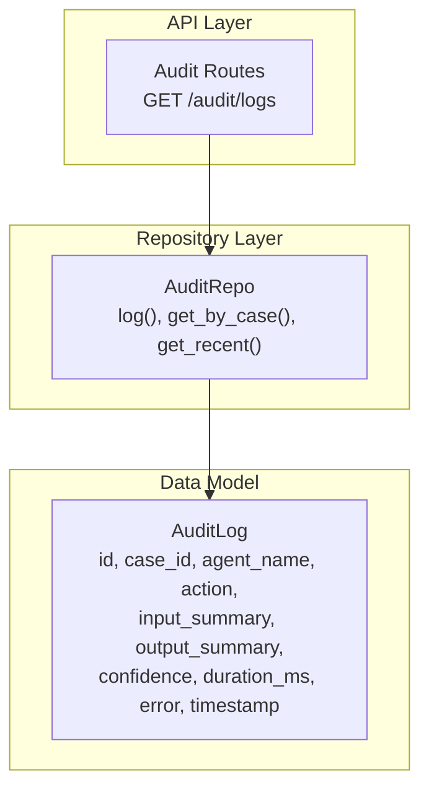
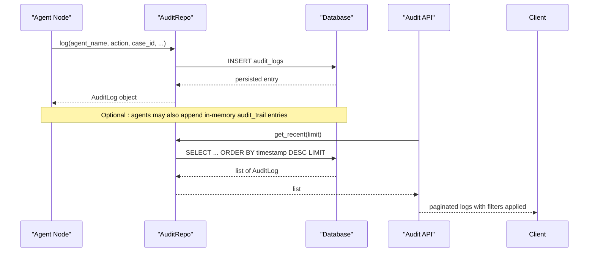
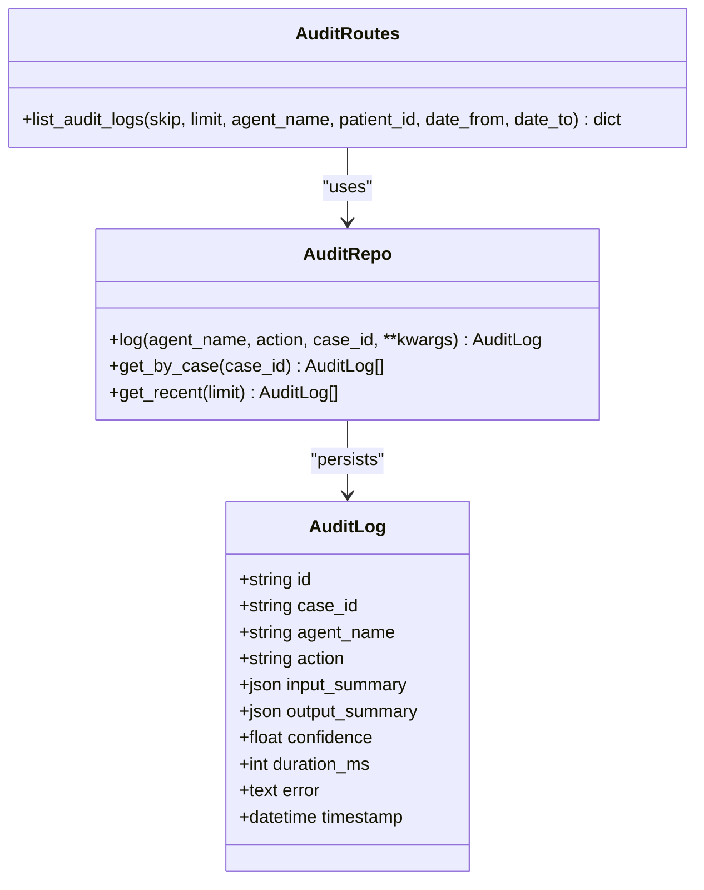
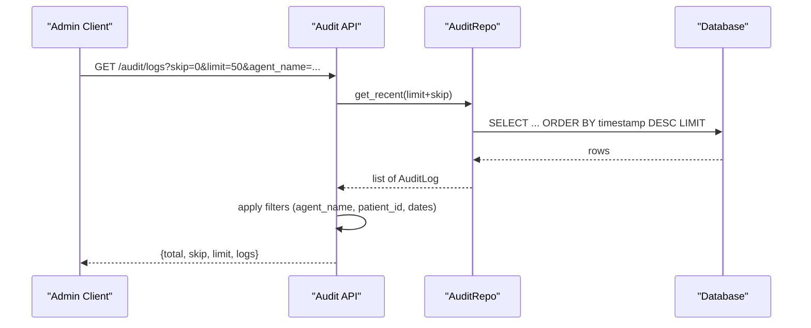
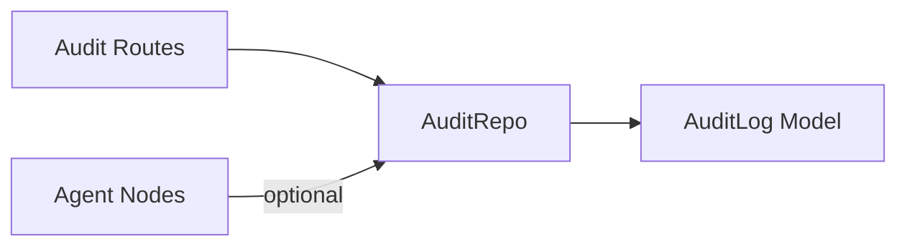

# Audit Log Entity

<cite>
**Referenced Files in This Document**
- [models.py](file://backend/db/models.py)
- [repositories.py](file://backend/db/repositories.py)
- [audit.py](file://backend/api/routes/audit.py)
- [patient_intake.py](file://backend/agents/nodes/patient_intake.py)
- [clinical_risk.py](file://backend/agents/nodes/clinical_risk.py)
- [communication.py](file://backend/agents/nodes/communication.py)
- [data_quality.py](file://backend/agents/nodes/data_quality.py)
- [clinician_review.py](file://backend/agents/nodes/clinician_review.py)
</cite>

## Table of Contents
1. [Introduction](#introduction)
2. [Project Structure](#project-structure)
3. [Core Components](#core-components)
4. [Architecture Overview](#architecture-overview)
5. [Detailed Component Analysis](#detailed-component-analysis)
6. [Dependency Analysis](#dependency-analysis)
7. [Performance Considerations](#performance-considerations)
8. [Troubleshooting Guide](#troubleshooting-guide)
9. [Conclusion](#conclusion)
10. [Appendices](#appendices)

## Introduction
This document provides comprehensive documentation for the AuditLog entity that captures system activity across agent executions. It explains how the entity records agent actions, inputs, outputs, performance metrics, and errors to support debugging, performance analysis, and regulatory compliance in healthcare settings. It also details the indexing strategy on case_id for efficient querying and provides examples of audit log entries, performance monitoring queries, and compliance reporting workflows.

## Project Structure
The audit logging capability is implemented across three primary layers:
- Data model definition (SQLAlchemy ORM)
- Repository layer for persistence and retrieval
- API routes for admin-only access to audit logs

**Diagram sources**
- [audit.py:21-87](file://backend/api/routes/audit.py#L21-L87)
- [repositories.py:66-82](file://backend/db/repositories.py#L66-L82)
- [models.py:81-92](file://backend/db/models.py#L81-L92)

**Section sources**
- [audit.py:1-87](file://backend/api/routes/audit.py#L1-L87)
- [repositories.py:1-125](file://backend/db/repositories.py#L1-L125)
- [models.py:1-115](file://backend/db/models.py#L1-L115)

## Core Components
- AuditLog entity defines the schema for capturing audit events with fields for identity, context, structured input/output summaries, confidence, duration, error messages, and timestamps.
- AuditRepo provides methods to create audit entries and retrieve them by case or recent order.
- Audit API exposes an admin-only endpoint to list logs with filtering and pagination.

Key responsibilities:
- Persist structured audit data for each agent execution
- Enable efficient retrieval by case_id and time windows
- Support administrative oversight and compliance reporting

**Section sources**
- [models.py:81-92](file://backend/db/models.py#L81-L92)
- [repositories.py:66-82](file://backend/db/repositories.py#L66-L82)
- [audit.py:21-87](file://backend/api/routes/audit.py#L21-L87)

## Architecture Overview
The audit system integrates into the agent workflow via repository calls and exposes read access through a secured API. Agents generate audit trails within their execution paths; these can be persisted using the repository and queried via the API.

**Diagram sources**
- [repositories.py:70-82](file://backend/db/repositories.py#L70-L82)
- [audit.py:21-87](file://backend/api/routes/audit.py#L21-L87)

## Detailed Component Analysis

### AuditLog Entity Schema
The AuditLog table stores one row per agent action with the following fields:
- id: Primary key, unique identifier for the audit entry
- case_id: Logical grouping key for related actions; indexed for efficient queries
- agent_name: Name of the agent node that performed the action
- action: Descriptive label for the operation executed
- input_summary: JSON field capturing structured input metadata about the agent execution
- output_summary: JSON field capturing structured output metadata about the agent execution
- confidence: Numeric confidence score associated with the agent’s decision or prediction
- duration_ms: Integer representing execution duration in milliseconds
- error: Text field for error messages when failures occur
- timestamp: DateTime indicating when the action was recorded

Indexing strategy:
- case_id is indexed to optimize queries that filter or retrieve logs by case, supporting both per-case timelines and performance analytics.

Compliance value:
- Captures who did what, when, and with what inputs/outputs and performance characteristics
- Enables reconstruction of agent behavior for audits and incident investigations
- Supports regulatory requirements for traceability and accountability in healthcare environments

**Section sources**
- [models.py:81-92](file://backend/db/models.py#L81-L92)

### Repository Layer
The AuditRepo encapsulates database operations for audit logs:
- log: Creates a new AuditLog entry with provided parameters and persists it
- get_by_case: Retrieves all audit logs for a given case_id ordered by timestamp
- get_recent: Retrieves the most recent N audit logs ordered by timestamp descending

These methods enable both operational logging and administrative retrieval.

**Section sources**
- [repositories.py:66-82](file://backend/db/repositories.py#L66-L82)

### API Layer
The audit API provides an admin-only endpoint:
- GET /audit/logs supports pagination (skip, limit) and optional filters (agent_name, patient_id, date_from, date_to)
- Returns total count, pagination metadata, and a list of log objects including core fields and any additional attributes present on the model

Security:
- Requires admin role via dependency injection

Error handling:
- Wraps repository calls in try/except and returns HTTP 500 on failure

**Section sources**
- [audit.py:21-87](file://backend/api/routes/audit.py#L21-L87)

### Agent Integration Patterns
Agents produce in-memory audit trail entries during execution. While the current nodes demonstrate appending structured audit entries to state, the repository provides a persistent mechanism to record audit logs with standardized fields.

Examples from agent nodes:
- Patient intake node constructs an audit entry with agent name, timestamp, action, and result summary
- Clinical risk node similarly builds an audit entry capturing assessment results and LLM usage flags
- Communication, data quality, and clinician review nodes include error-specific audit entries when exceptions occur

These patterns illustrate how agents can enrich audit data with contextual information such as result summaries and error details.

**Section sources**
- [patient_intake.py:131-149](file://backend/agents/nodes/patient_intake.py#L131-L149)
- [clinical_risk.py:97-109](file://backend/agents/nodes/clinical_risk.py#L97-L109)
- [communication.py:215-230](file://backend/agents/nodes/communication.py#L215-L230)
- [data_quality.py:185-200](file://backend/agents/nodes/data_quality.py#L185-L200)
- [clinician_review.py:147-164](file://backend/agents/nodes/clinician_review.py#L147-L164)

#### Class Diagram

**Diagram sources**
- [models.py:81-92](file://backend/db/models.py#L81-L92)
- [repositories.py:66-82](file://backend/db/repositories.py#L66-L82)
- [audit.py:21-87](file://backend/api/routes/audit.py#L21-L87)

#### Sequence Diagram: Admin Listing Logs

**Diagram sources**
- [audit.py:21-87](file://backend/api/routes/audit.py#L21-L87)
- [repositories.py:76-82](file://backend/db/repositories.py#L76-L82)

## Dependency Analysis
- The API route depends on the repository for data access and enforces admin authorization
- The repository depends on the SQLAlchemy models for schema mapping
- Agent nodes may append in-memory audit trails; persistent logging uses the repository

**Diagram sources**
- [audit.py:21-87](file://backend/api/routes/audit.py#L21-L87)
- [repositories.py:66-82](file://backend/db/repositories.py#L66-L82)
- [models.py:81-92](file://backend/db/models.py#L81-L92)

**Section sources**
- [audit.py:1-87](file://backend/api/routes/audit.py#L1-L87)
- [repositories.py:1-125](file://backend/db/repositories.py#L1-L125)
- [models.py:1-115](file://backend/db/models.py#L1-L115)

## Performance Considerations
- Index on case_id enables efficient per-case queries and timeline reconstruction
- Recent retrieval uses ORDER BY timestamp DESC with LIMIT to minimize I/O
- In-memory filtering in the API allows flexible query composition but could be optimized with server-side SQL filters if needed
- For high-volume scenarios, consider:
  - Adding indexes on frequently filtered fields (e.g., agent_name, timestamp ranges)
  - Partitioning by time or case categories
  - Archiving older logs to reduce query load

[No sources needed since this section provides general guidance]

## Troubleshooting Guide
Common issues and resolutions:
- Missing audit entries: Ensure agents call the repository log method with required fields; verify session flush occurs
- Slow queries: Confirm case_id index exists; evaluate adding composite indexes for common filter combinations
- API errors: Check admin role assignment and database connectivity; inspect exception handling in the route

Operational checks:
- Validate that audit_logs table schema matches expected fields
- Verify that get_recent and get_by_case return expected datasets
- Inspect error text in audit entries for root cause analysis

**Section sources**
- [audit.py:38-46](file://backend/api/routes/audit.py#L38-L46)
- [repositories.py:70-82](file://backend/db/repositories.py#L70-L82)
- [models.py:81-92](file://backend/db/models.py#L81-L92)

## Conclusion
The AuditLog entity provides a robust foundation for system activity logging across agent executions. With structured fields for inputs, outputs, confidence, duration, and errors, it supports debugging, performance analysis, and regulatory compliance in healthcare environments. The indexed case_id ensures efficient retrieval for per-case timelines and analytics. Administrative APIs enable secure access for oversight and reporting.

[No sources needed since this section summarizes without analyzing specific files]

## Appendices

### Field Reference
- id: Unique identifier for the audit entry
- case_id: Logical grouping key; indexed for performance
- agent_name: Identifies the executing agent
- action: Describes the operation performed
- input_summary: JSON capturing structured input metadata
- output_summary: JSON capturing structured output metadata
- confidence: Numeric confidence score
- duration_ms: Execution duration in milliseconds
- error: Error message text
- timestamp: Record creation time

**Section sources**
- [models.py:81-92](file://backend/db/models.py#L81-L92)

### Example Audit Log Entries by Agent Type
- Patient Intake: Records data collection actions, voice transcript presence, and completeness status
- Clinical Risk: Records risk assessments, WHO triage levels, and LLM-generated summaries
- Communication: Records communication attempts and errors
- Data Quality: Records validation outcomes and errors
- Clinician Review: Records review preparation steps and errors

These examples illustrate how agents populate action and result_summary fields, which can be extended to input_summary and output_summary for richer structured capture.

**Section sources**
- [patient_intake.py:131-149](file://backend/agents/nodes/patient_intake.py#L131-L149)
- [clinical_risk.py:97-109](file://backend/agents/nodes/clinical_risk.py#L97-L109)
- [communication.py:215-230](file://backend/agents/nodes/communication.py#L215-L230)
- [data_quality.py:185-200](file://backend/agents/nodes/data_quality.py#L185-L200)
- [clinician_review.py:147-164](file://backend/agents/nodes/clinician_review.py#L147-L164)

### Performance Monitoring Queries
- Retrieve recent logs for system health checks
- Filter by agent_name to analyze specific agent performance
- Use date ranges to assess throughput and latency trends
- Group by action to identify bottlenecks

These queries leverage the indexed case_id and timestamp ordering for efficient retrieval.

**Section sources**
- [audit.py:21-87](file://backend/api/routes/audit.py#L21-L87)
- [repositories.py:76-82](file://backend/db/repositories.py#L76-L82)

### Compliance Reporting
- Reconstruct agent decision timelines per case using case_id
- Export audit entries for regulatory audits
- Correlate confidence and duration metrics with outcomes
- Investigate errors via error field and timestamps

**Section sources**
- [repositories.py:76-82](file://backend/db/repositories.py#L76-L82)
- [models.py:81-92](file://backend/db/models.py#L81-L92)