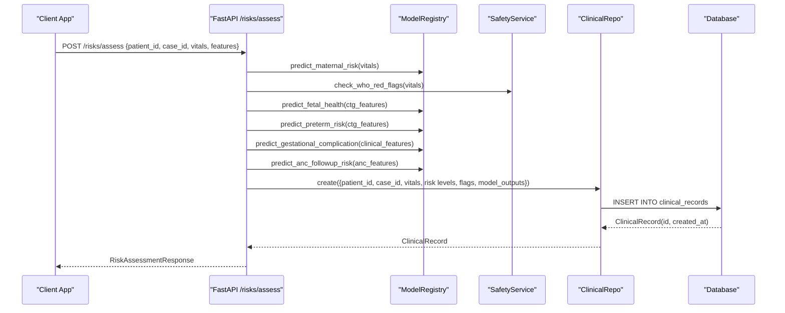
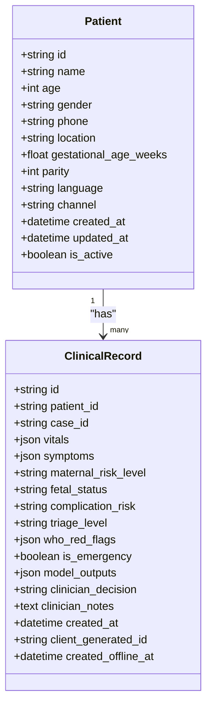
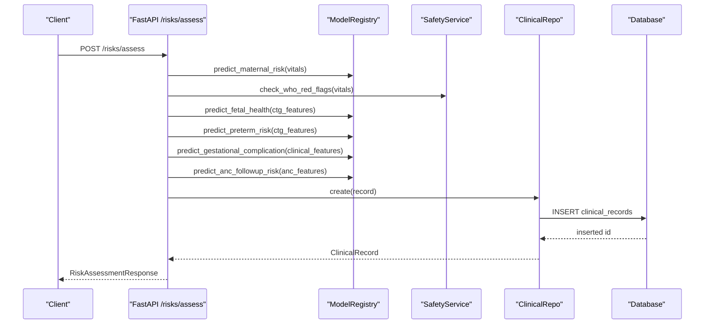
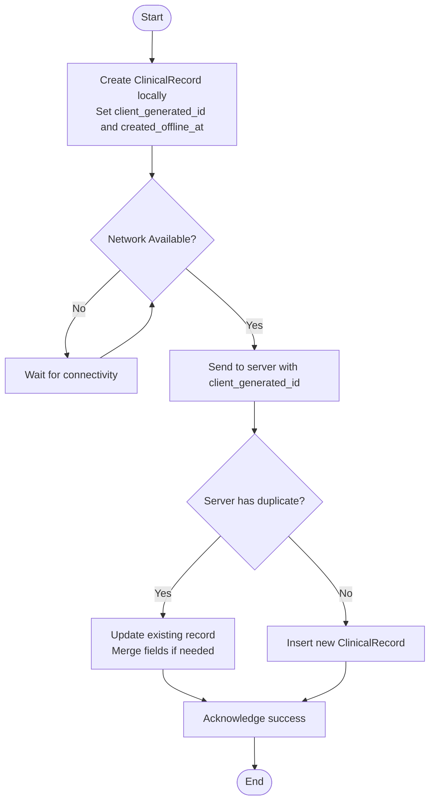
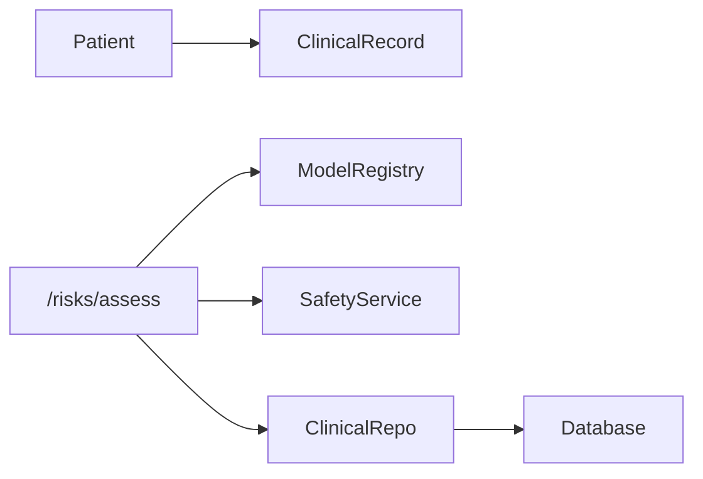

# Clinical Record Entity

<cite>
**Referenced Files in This Document**
- [models.py](file://backend/db/models.py)
- [repositories.py](file://backend/db/repositories.py)
- [patient.py](file://backend/schemas/patient.py)
- [risk.py](file://backend/schemas/risk.py)
- [risks.py](file://backend/api/routes/risks.py)
- [clinical_risk.py](file://backend/agents/nodes/clinical_risk.py)
</cite>

## Table of Contents
1. [Introduction](#introduction)
2. [Project Structure](#project-structure)
3. [Core Components](#core-components)
4. [Architecture Overview](#architecture-overview)
5. [Detailed Component Analysis](#detailed-component-analysis)
6. [Dependency Analysis](#dependency-analysis)
7. [Performance Considerations](#performance-considerations)
8. [Troubleshooting Guide](#troubleshooting-guide)
9. [Conclusion](#conclusion)
10. [Appendices](#appendices)

## Introduction
This document provides comprehensive documentation for the ClinicalRecord entity, which stores comprehensive patient clinical data and supports multi-model risk assessment workflows. It explains all fields, including JSON structures for complex clinical data (vitals, symptoms, model outputs), offline synchronization capabilities using client-generated identifiers and timestamps, relationships with the Patient entity, and how clinical records integrate with the multi-model risk assessment system. Examples are provided for creating clinical records, updating risk assessments, and synchronizing offline data.

## Project Structure
The ClinicalRecord entity is defined as a SQLAlchemy ORM model and is used by repositories and API routes to persist and retrieve clinical data. The schemas define input validation for screening data and risk results. Agent nodes compute risk assessments that feed into clinical records.

```mermaid
graph TB
subgraph "Database Models"
M_Patient["Patient"]
M_ClinicalRecord["ClinicalRecord"]
end
subgraph "Schemas"
S_Vitals["VitalsInput"]
S_Symptom["SymptomEntry"]
S_Screening["PatientScreening"]
S_Risk["RiskResult Schemas"]
end
subgraph "API"
A_Risks["/risks/assess"]
end
subgraph "Agents"
N_ClinicalRisk["clinical_risk node"]
end
M_Patient --> |"1..*" M_ClinicalRecord
S_Screening --> |"uses"| S_Vitals
S_Screening --> |"uses"| S_Symptom
A_Risks --> |"persists via"| M_ClinicalRecord
N_ClinicalRisk --> |"produces results used by"| A_Risks
```

**Diagram sources**
- [models.py:11-50](file://backend/db/models.py#L11-L50)
- [patient.py:14-56](file://backend/schemas/patient.py#L14-L56)
- [risk.py:7-43](file://backend/schemas/risk.py#L7-L43)
- [risks.py:61-123](file://backend/api/routes/risks.py#L61-L123)
- [clinical_risk.py:15-109](file://backend/agents/nodes/clinical_risk.py#L15-L109)

**Section sources**
- [models.py:11-50](file://backend/db/models.py#L11-L50)
- [repositories.py:31-47](file://backend/db/repositories.py#L31-L47)
- [patient.py:14-56](file://backend/schemas/patient.py#L14-L56)
- [risk.py:7-43](file://backend/schemas/risk.py#L7-L43)
- [risks.py:61-123](file://backend/api/routes/risks.py#L61-L123)
- [clinical_risk.py:15-109](file://backend/agents/nodes/clinical_risk.py#L15-L109)

## Core Components
- ClinicalRecord model defines the persistent schema for storing comprehensive clinical data per case or per encounter.
- Patient model defines the parent entity; ClinicalRecord references Patient via a foreign key relationship.
- Repositories provide CRUD operations for ClinicalRecord.
- Schemas define validated inputs for vitals and symptoms and structure risk result types.
- API route /risks/assess orchestrates model predictions and persists results into ClinicalRecord.
- Agent node clinical_risk computes maternal risk, gestational complication risk, and WHO safety triage, producing structured outputs that can be persisted.

Key responsibilities:
- Capture raw clinical inputs (vitals, symptoms).
- Store computed risk levels and flags from multiple models.
- Support offline creation and synchronization.
- Provide traceability through case_id and timestamps.

**Section sources**
- [models.py:11-50](file://backend/db/models.py#L11-L50)
- [repositories.py:31-47](file://backend/db/repositories.py#L31-L47)
- [patient.py:14-56](file://backend/schemas/patient.py#L14-L56)
- [risk.py:7-43](file://backend/schemas/risk.py#L7-L43)
- [risks.py:61-123](file://backend/api/routes/risks.py#L61-L123)
- [clinical_risk.py:15-109](file://backend/agents/nodes/clinical_risk.py#L15-L109)

## Architecture Overview
The multi-model risk assessment pipeline integrates several models and safety rules, then persists outcomes into ClinicalRecord.



**Diagram sources**
- [risks.py:61-123](file://backend/api/routes/risks.py#L61-L123)
- [repositories.py:31-47](file://backend/db/repositories.py#L31-L47)
- [models.py:30-50](file://backend/db/models.py#L30-L50)

## Detailed Component Analysis

### ClinicalRecord Entity Fields
- id: Primary key identifier for the record.
- patient_id: Foreign key referencing Patient.id; links the record to a specific patient.
- case_id: Optional grouping identifier for a clinical episode or assessment session.
- vitals: JSON field storing full vitals dict (e.g., systolic_bp, diastolic_bp, heart_rate, temperature_celsius, respiratory_rate, blood_sugar, gestational_age_weeks, fetal_movement_present).
- symptoms: JSON field storing a list of symptom entries (name, severity, duration_hours).
- maternal_risk_level: String representing maternal risk level derived from MaternalGuard.
- fetal_status: String representing fetal health status derived from FetalWatch.
- complication_risk: String representing gestational complication risk derived from GestationInsight.
- triage_level: String representing WHO triage level derived from SafetyService.
- who_red_flags: JSON field storing WHO red flag evaluation details (triage_level, triggered_rules, clinical_rationale, recommended_actions).
- is_emergency: Boolean indicating emergency status based on triage_level.
- model_outputs: JSON field storing all model prediction outputs for auditability and downstream processing.
- clinician_decision: String capturing final clinical decision made by a clinician.
- clinician_notes: Text field for free-form clinical notes.
- created_at: Timestamp when the record was created in the database.
- client_generated_id: String used for offline sync to identify the same record across devices.
- created_offline_at: Timestamp when the record was created offline before synchronization.

JSON Field Structures
- vitals: Dict with numeric ranges validated by VitalsInput schema. Includes blood pressure, heart rate, temperature, respiratory rate, blood sugar, gestational age, and fetal movement presence.
- symptoms: List of SymptomEntry objects with name, severity (mild/moderate/severe), and optional duration in hours.
- who_red_flags: Dict containing triage_level, triggered_rules (list), clinical_rationale (string), and recommended_actions (list).
- model_outputs: Dict aggregating outputs from multiple models:
  - maternal_risk: Output from MaternalGuard (includes risk_level and probabilities).
  - fetal_health: Output from FetalWatch (includes fetal_status and probabilities).
  - preterm_risk: Output from PretermGuard (includes risk level and probabilities).
  - gestational_complication: Output from GestationInsight (includes risk_level and probabilities).
  - anc_followup: Output from CareReach ANC follow-up model (includes missed_visit_risk, priority_score, recommended_action, next_reminder_date, risk_factors).

Relationships
- Patient to ClinicalRecord: One-to-many relationship via foreign key patient_id. Each patient can have many clinical records.

Offline Sync Capabilities
- client_generated_id: Allows clients to assign a stable identifier for a record created offline. During sync, this ID can be used to detect duplicates or update existing records.
- created_offline_at: Records the time the data was captured offline, enabling proper ordering and reconciliation during synchronization.

Multi-Model Risk Assessment Integration
- The API endpoint calls multiple models and safety rules, then persists aggregated results into ClinicalRecord.model_outputs and corresponding risk-level fields.
- The agent node clinical_risk computes maternal risk, gestational complication risk, and WHO triage, ensuring mandatory safety checks and producing structured outputs suitable for persistence.

Examples
- Creating a clinical record:
  - Use POST /risks/assess with patient_id, case_id, vitals, and optional feature sets. The endpoint persists a ClinicalRecord with populated risk fields and model_outputs.
- Updating risk assessments:
  - Re-run assessments with updated vitals or features; the endpoint creates new ClinicalRecord entries reflecting the latest state. Clinicians can later update clinician_decision and clinician_notes.
- Offline synchronization pattern:
  - Client generates client_generated_id and sets created_offline_at when capturing data offline. On reconnect, the client sends the same payload; backend can use client_generated_id to upsert or deduplicate records.

**Section sources**
- [models.py:30-50](file://backend/db/models.py#L30-L50)
- [patient.py:14-56](file://backend/schemas/patient.py#L14-L56)
- [risk.py:7-43](file://backend/schemas/risk.py#L7-L43)
- [risks.py:61-123](file://backend/api/routes/risks.py#L61-L123)
- [clinical_risk.py:15-109](file://backend/agents/nodes/clinical_risk.py#L15-L109)

### Class Diagram: Entities and Relationships


**Diagram sources**
- [models.py:11-50](file://backend/db/models.py#L11-L50)

### Sequence Diagram: Risk Assessment Flow


**Diagram sources**
- [risks.py:61-123](file://backend/api/routes/risks.py#L61-L123)
- [repositories.py:31-47](file://backend/db/repositories.py#L31-L47)
- [models.py:30-50](file://backend/db/models.py#L30-L50)

### Flowchart: Offline Sync Pattern


[No sources needed since this diagram shows conceptual workflow, not actual code structure]

## Dependency Analysis
- ClinicalRecord depends on Patient via foreign key patient_id.
- API route risks.py depends on ModelRegistry and SafetyService to compute risk levels and flags.
- Repository ClinicalRepo encapsulates persistence logic for ClinicalRecord.
- Schemas validate inputs and define output structures for risk results.



**Diagram sources**
- [models.py:11-50](file://backend/db/models.py#L11-L50)
- [risks.py:61-123](file://backend/api/routes/risks.py#L61-L123)
- [repositories.py:31-47](file://backend/db/repositories.py#L31-L47)

**Section sources**
- [models.py:11-50](file://backend/db/models.py#L11-L50)
- [risks.py:61-123](file://backend/api/routes/risks.py#L61-L123)
- [repositories.py:31-47](file://backend/db/repositories.py#L31-L47)

## Performance Considerations
- JSON fields allow flexible storage but may increase payload size; ensure efficient indexing where necessary (e.g., case_id index exists).
- Batch updates or upserts during offline sync can reduce network overhead.
- Avoid redundant model calls by caching repeated predictions within a session if appropriate.
- Validate inputs early using Pydantic schemas to minimize invalid writes.

[No sources needed since this section provides general guidance]

## Troubleshooting Guide
Common issues and resolutions:
- Missing required fields in vitals: Ensure all expected keys are present; validation will reject incomplete payloads.
- Duplicate records during offline sync: Use client_generated_id to detect and merge duplicates on the server side.
- Emergency misclassification: Verify WHO triage logic and ensure safety checks are always executed.
- Incomplete model outputs: Confirm that all requested features (ctg_features, clinical_features, anc_features) are provided to avoid null results.

**Section sources**
- [patient.py:14-56](file://backend/schemas/patient.py#L14-L56)
- [risks.py:61-123](file://backend/api/routes/risks.py#L61-L123)
- [clinical_risk.py:15-109](file://backend/agents/nodes/clinical_risk.py#L15-L109)

## Conclusion
The ClinicalRecord entity centralizes comprehensive patient clinical data and integrates multi-model risk assessments into a single persistent record. Its design supports offline synchronization via client_generated_id and created_offline_at, enabling robust workflows in low-connectivity environments. By leveraging validated schemas, safety rules, and model outputs, the system ensures accurate risk classification and actionable clinical insights.

[No sources needed since this section summarizes without analyzing specific files]

## Appendices

### Example: Creating a Clinical Record via API
- Endpoint: POST /risks/assess
- Request body includes patient_id, case_id, vitals, and optional feature sets.
- Response includes risk levels and flags; a ClinicalRecord is persisted with model_outputs.

**Section sources**
- [risks.py:61-123](file://backend/api/routes/risks.py#L61-L123)

### Example: Offline Synchronization
- Client assigns client_generated_id and sets created_offline_at when creating records offline.
- On reconnection, client sends the same payload; server uses client_generated_id to upsert or deduplicate.

**Section sources**
- [patient.py:49-56](file://backend/schemas/patient.py#L49-L56)
- [models.py:47-48](file://backend/db/models.py#L47-L48)