# Core Entities and Relationships

<cite>
**Referenced Files in This Document**
- [models.py](file://backend/db/models.py)
- [engine.py](file://backend/db/engine.py)
- [repositories.py](file://backend/db/repositories.py)
- [patients.py](file://backend/api/routes/patients.py)
- [referrals.py](file://backend/api/routes/referrals.py)
- [audit.py](file://backend/api/routes/audit.py)
- [patient.py](file://backend/schemas/patient.py)
- [referral.py](file://backend/schemas/referral.py)
- [config.py](file://backend/config.py)
</cite>

## Table of Contents
1. [Introduction](#introduction)
2. [Project Structure](#project-structure)
3. [Core Components](#core-components)
4. [Architecture Overview](#architecture-overview)
5. [Detailed Component Analysis](#detailed-component-analysis)
6. [Dependency Analysis](#dependency-analysis)
7. [Performance Considerations](#performance-considerations)
8. [Troubleshooting Guide](#troubleshooting-guide)
9. [Conclusion](#conclusion)

## Introduction
This document provides comprehensive documentation for the core database entities in MaaHifazat AI, focusing on seven primary tables: Patient, ClinicalRecord, Referral, AgentStateRecord, AuditLog, ModelVersion, and FileRecord. It explains entity relationships using SQLAlchemy ORM, foreign key constraints, data integrity rules, field definitions with types and validation rules, UUID-based primary keys, indexing patterns, and how these entities are used across API routes and repositories.

## Project Structure
The database layer is implemented with SQLAlchemy ORM models, an async engine/session setup, and repository classes that encapsulate CRUD operations. FastAPI routes expose endpoints that consume these repositories to manage patients, referrals, and audit logs. Pydantic schemas define request/response contracts and validation rules.

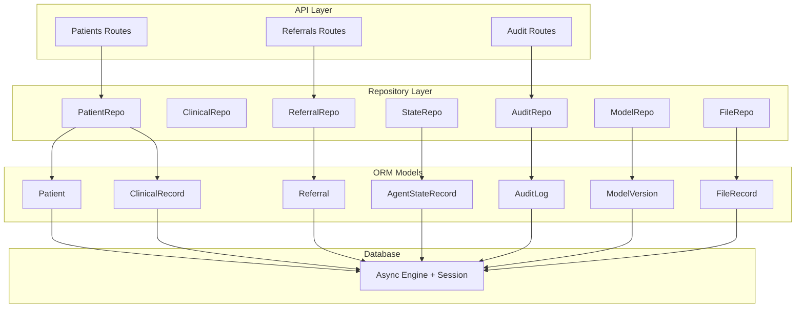

**Diagram sources**
- [patients.py:1-97](file://backend/api/routes/patients.py#L1-L97)
- [referrals.py:1-126](file://backend/api/routes/referrals.py#L1-L126)
- [audit.py:1-88](file://backend/api/routes/audit.py#L1-L88)
- [repositories.py:1-125](file://backend/db/repositories.py#L1-L125)
- [models.py:1-115](file://backend/db/models.py#L1-L115)
- [engine.py:1-37](file://backend/db/engine.py#L1-L37)

**Section sources**
- [models.py:1-115](file://backend/db/models.py#L1-L115)
- [engine.py:1-37](file://backend/db/engine.py#L1-L37)
- [repositories.py:1-125](file://backend/db/repositories.py#L1-L125)
- [patients.py:1-97](file://backend/api/routes/patients.py#L1-L97)
- [referrals.py:1-126](file://backend/api/routes/referrals.py#L1-L126)
- [audit.py:1-88](file://backend/api/routes/audit.py#L1-L88)
- [patient.py:1-57](file://backend/schemas/patient.py#L1-L57)
- [referral.py:1-28](file://backend/schemas/referral.py#L1-L28)
- [config.py:1-55](file://backend/config.py#L1-L55)

## Core Components
This section summarizes each of the seven core entities, their fields, relationships, and usage.

- Patient
  - Purpose: Demographics, contact info, pregnancy details, and lifecycle flags.
  - Key fields: id (UUID), name, age, gender, phone, location, gestational_age_weeks, parity, language, channel, created_at, updated_at, is_active.
  - Relationships: One-to-many with ClinicalRecord and Referral via back_populates.
  - Validation: Age range enforced by schema; gender defaults to female at model level; language/channel defaults provided.

- ClinicalRecord
  - Purpose: Vitals, symptoms, risk assessments, model outputs, and clinician decisions per case.
  - Key fields: id (UUID), patient_id (FK to patients.id), case_id (indexed), vitals (JSON), symptoms (JSON), maternal_risk_level, fetal_status, complication_risk, triage_level, who_red_flags (JSON), is_emergency, model_outputs (JSON), clinician_decision, clinician_notes, created_at, client_generated_id, created_offline_at.
  - Relationships: Many-to-one with Patient via FK.

- Referral
  - Purpose: Facility details, urgency level, and status tracking for patient referrals.
  - Key fields: id (UUID), patient_id (FK to patients.id), case_id (indexed), facility_name, facility_type, facility_lat, facility_lon, distance_km, travel_time_min, urgency_level (routine/urgent/emergency), status (pending/accepted/in_transit/completed/cancelled), created_at, completed_at.
  - Relationships: Many-to-one with Patient via FK.

- AgentStateRecord
  - Purpose: Workflow execution state for agent orchestration.
  - Key fields: id (UUID), case_id (indexed), thread_id (indexed), state_data (JSON), current_step, is_complete, created_at, updated_at.
  - Relationships: No direct FK to other entities; linked by case_id.

- AuditLog
  - Purpose: System activity logging for agents and actions.
  - Key fields: id (UUID), case_id (indexed), agent_name, action, input_summary (JSON), output_summary (JSON), confidence, duration_ms, error, timestamp.
  - Relationships: No FK; associated by case_id.

- ModelVersion
  - Purpose: ML model metadata including versioning and metrics.
  - Key fields: id (UUID), model_name, version, file_path, metrics (JSON), features (JSON), is_active, trained_at, registered_at.
  - Relationships: Standalone metadata table.

- FileRecord
  - Purpose: Uploaded documents and media associated with cases.
  - Key fields: id (UUID), case_id (indexed), file_type (audio/document/qr_code/report), file_path, mime_type, size_bytes, uploaded_at.
  - Relationships: No FK; associated by case_id.

**Section sources**
- [models.py:11-115](file://backend/db/models.py#L11-L115)
- [patient.py:8-57](file://backend/schemas/patient.py#L8-L57)
- [referral.py:7-28](file://backend/schemas/referral.py#L7-L28)

## Architecture Overview
The system uses an async SQLAlchemy engine with declarative base models and repository classes to abstract database operations. FastAPI routes depend on repositories to perform CRUD operations, while Pydantic schemas validate inputs and serialize outputs. The database is configured via settings, defaulting to an async SQLite file.

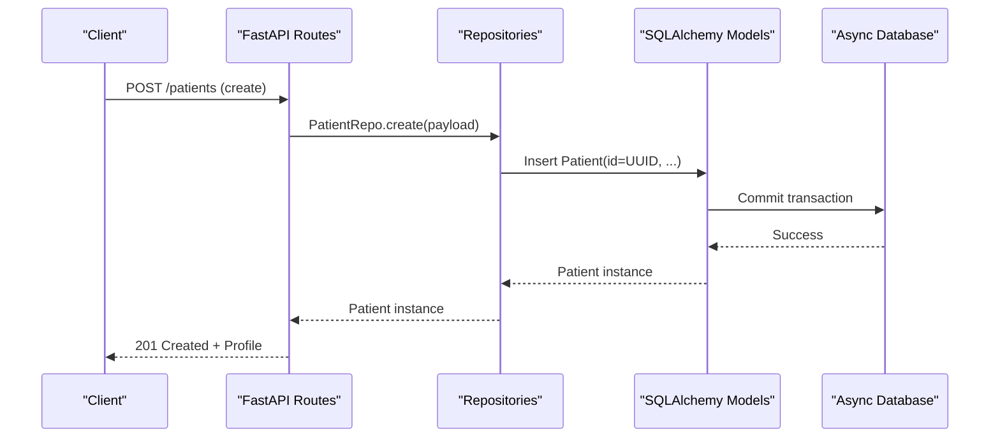

**Diagram sources**
- [patients.py:44-53](file://backend/api/routes/patients.py#L44-L53)
- [repositories.py:13-17](file://backend/db/repositories.py#L13-L17)
- [models.py:11-29](file://backend/db/models.py#L11-L29)
- [engine.py:10-18](file://backend/db/engine.py#L10-L18)

**Section sources**
- [engine.py:10-37](file://backend/db/engine.py#L10-L37)
- [config.py:23-24](file://backend/config.py#L23-L24)

## Detailed Component Analysis

### Entity Relationship Diagram (ERD)
This ERD shows how patients connect to clinical records and referrals, and how other entities relate via case_id or standalone metadata.

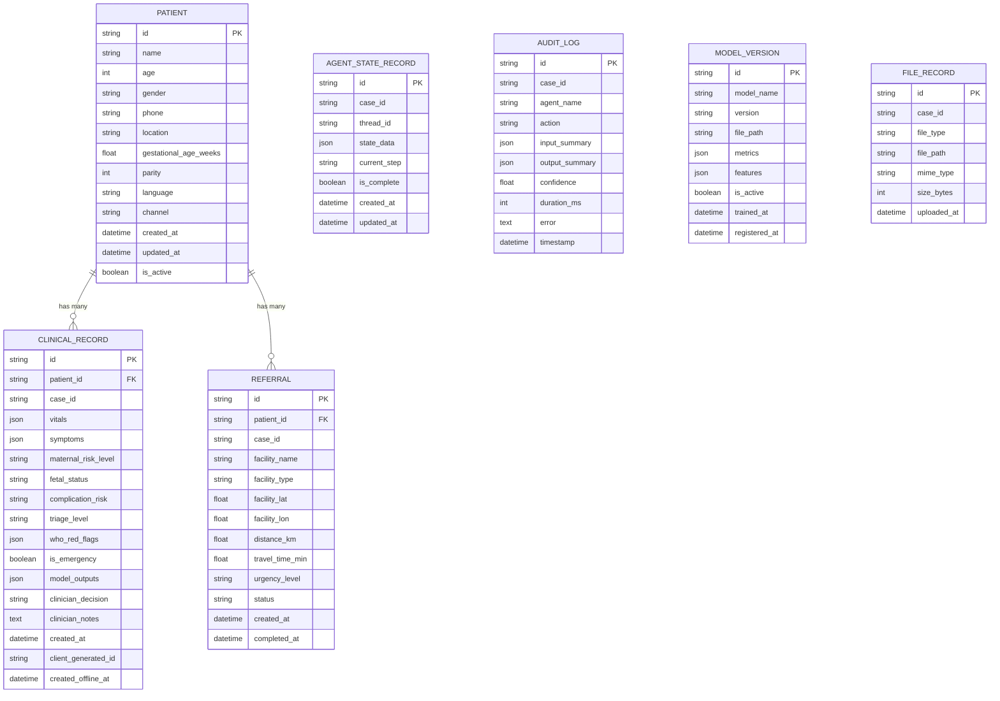

**Diagram sources**
- [models.py:11-115](file://backend/db/models.py#L11-L115)

### Patient Entity Analysis
- Primary Key Strategy: UUID generated via a function defaulting to uuid.uuid4().
- Indexing: None explicitly defined on Patient; lookup by id is O(1) due to PK.
- Validation Rules:
  - Age must be between 10 and 60 (schema).
  - Gender defaults to female at model level; schema enforces enum values.
  - Language defaults to ur; channel defaults to app.
- Business Logic:
  - is_active flag indicates active enrollment.
  - Gestational age weeks supports pregnancy context.
- Usage:
  - CRUD endpoints for create, list, get, update.
  - Repository methods support pagination and ordering by created_at.

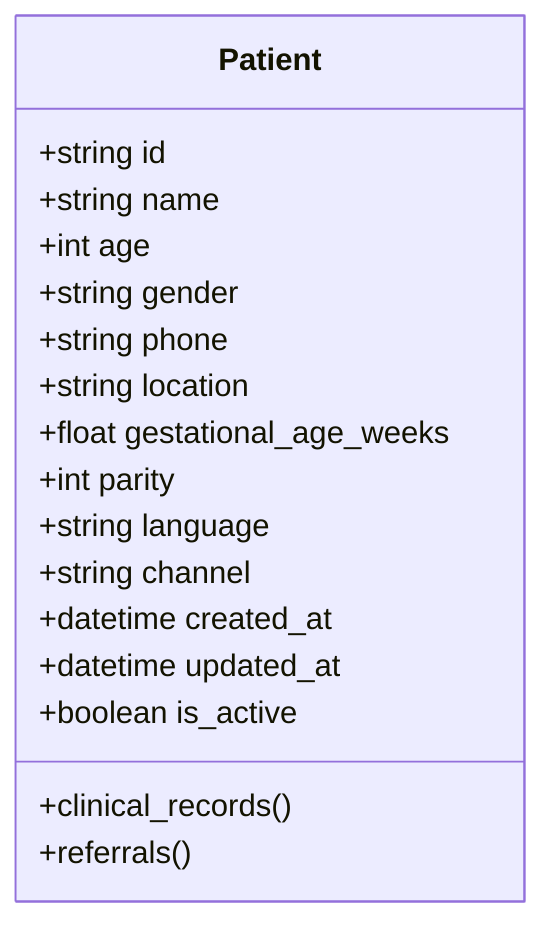

**Diagram sources**
- [models.py:11-29](file://backend/db/models.py#L11-L29)

**Section sources**
- [models.py:11-29](file://backend/db/models.py#L11-L29)
- [patient.py:8-57](file://backend/schemas/patient.py#L8-L57)
- [patients.py:44-97](file://backend/api/routes/patients.py#L44-L97)
- [repositories.py:9-29](file://backend/db/repositories.py#L9-L29)

### ClinicalRecord Entity Analysis
- Primary Key Strategy: UUID.
- Foreign Keys: patient_id references patients.id.
- Indexing: case_id indexed for fast lookups by case.
- Data Types:
  - JSON fields store complex structures: vitals, symptoms, who_red_flags, model_outputs.
  - Risk levels and triage stored as strings; emergency flag boolean.
- Validation Rules:
  - Vitals ranges enforced by schema when creating screening payloads.
  - Case_id optional but recommended for linking to workflow.
- Business Logic:
  - Supports offline sync fields: client_generated_id and created_offline_at.
  - Clinician decision and notes capture human-in-the-loop outcomes.
- Usage:
  - Repository methods retrieve by case_id or by patient with ordering.

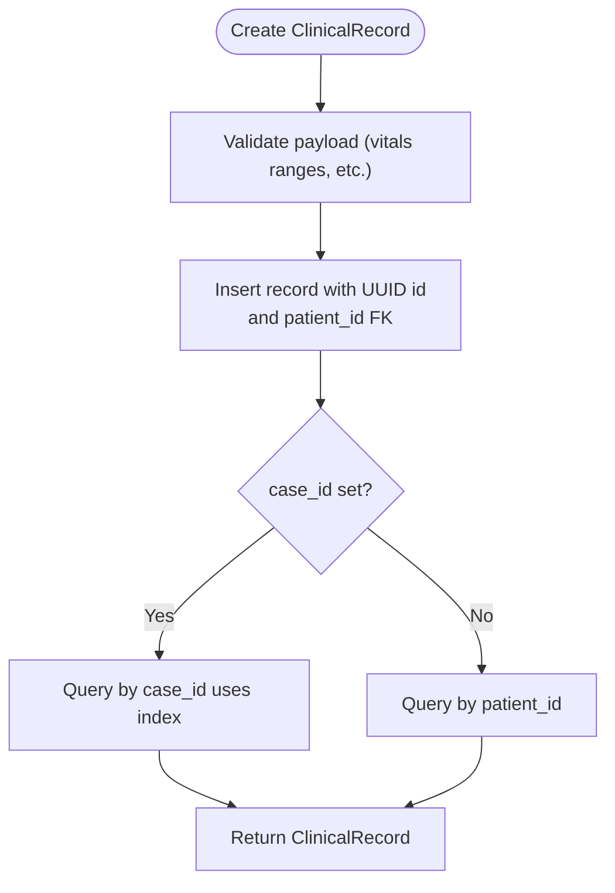

**Diagram sources**
- [models.py:30-51](file://backend/db/models.py#L30-L51)
- [repositories.py:31-47](file://backend/db/repositories.py#L31-L47)
- [patient.py:14-57](file://backend/schemas/patient.py#L14-L57)

**Section sources**
- [models.py:30-51](file://backend/db/models.py#L30-L51)
- [repositories.py:31-47](file://backend/db/repositories.py#L31-L47)
- [patient.py:14-57](file://backend/schemas/patient.py#L14-L57)

### Referral Entity Analysis
- Primary Key Strategy: UUID.
- Foreign Keys: patient_id references patients.id.
- Indexing: case_id indexed for quick retrieval.
- Data Types:
  - Location coordinates and distances stored as floats.
  - Urgency level and status are strings with constrained semantics.
- Validation Rules:
  - Urgency level defaults to routine; status defaults to pending.
  - Schema defines referral creation fields and status update contract.
- Business Logic:
  - Tracks full lifecycle from creation to completion/cancellation.
  - Supports geospatial attributes for facility selection and routing.
- Usage:
  - Endpoints for create, list with filters, get by id, update status.

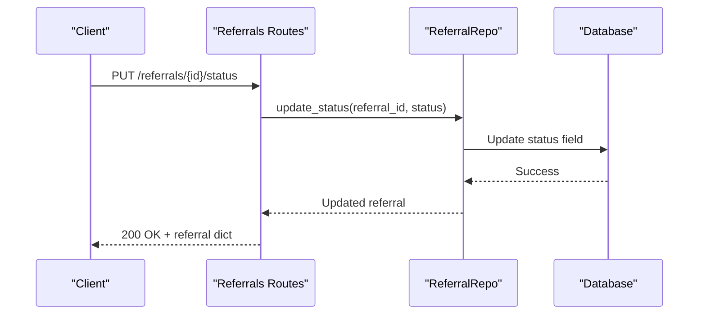

**Diagram sources**
- [referrals.py:111-126](file://backend/api/routes/referrals.py#L111-L126)
- [repositories.py:63-64](file://backend/db/repositories.py#L63-L64)
- [models.py:52-68](file://backend/db/models.py#L52-L68)

**Section sources**
- [models.py:52-68](file://backend/db/models.py#L52-L68)
- [referrals.py:21-126](file://backend/api/routes/referrals.py#L21-L126)
- [referral.py:7-28](file://backend/schemas/referral.py#L7-L28)
- [repositories.py:49-64](file://backend/db/repositories.py#L49-L64)

### AgentStateRecord Entity Analysis
- Primary Key Strategy: UUID.
- Indexing: case_id and thread_id indexed for efficient state retrieval.
- Data Types:
  - state_data stores serialized workflow state as JSON.
  - current_step tracks progress; is_complete marks completion.
- Business Logic:
  - Used to persist and resume agent workflows across steps.
  - Latest state retrieved by case_id ordered by updated_at.
- Usage:
  - Repository methods save state and fetch latest per case.

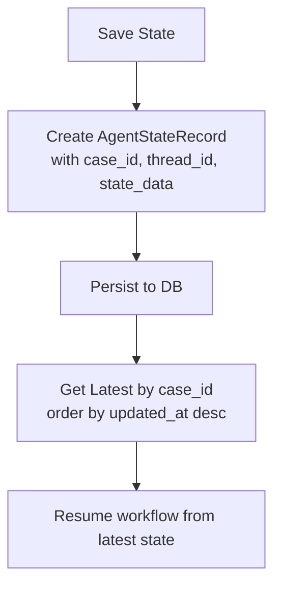

**Diagram sources**
- [models.py:70-79](file://backend/db/models.py#L70-L79)
- [repositories.py:84-96](file://backend/db/repositories.py#L84-L96)

**Section sources**
- [models.py:70-79](file://backend/db/models.py#L70-L79)
- [repositories.py:84-96](file://backend/db/repositories.py#L84-L96)

### AuditLog Entity Analysis
- Primary Key Strategy: UUID.
- Indexing: case_id indexed for filtering by case.
- Data Types:
  - input_summary/output_summary as JSON for flexible logging.
  - confidence and duration_ms for performance and quality metrics.
- Business Logic:
  - Admin-only endpoint lists recent logs with optional filters.
  - Logs capture agent actions and errors for traceability.
- Usage:
  - Repository methods log entries and retrieve recent logs.

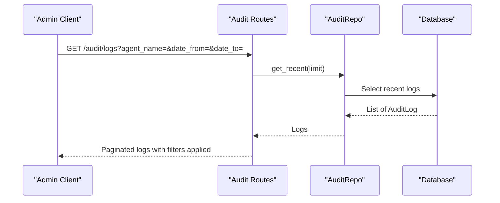

**Diagram sources**
- [audit.py:21-88](file://backend/api/routes/audit.py#L21-L88)
- [repositories.py:66-82](file://backend/db/repositories.py#L66-L82)
- [models.py:81-92](file://backend/db/models.py#L81-L92)

**Section sources**
- [models.py:81-92](file://backend/db/models.py#L81-L92)
- [audit.py:21-88](file://backend/api/routes/audit.py#L21-L88)
- [repositories.py:66-82](file://backend/db/repositories.py#L66-L82)

### ModelVersion Entity Analysis
- Primary Key Strategy: UUID.
- Data Types:
  - metrics/features as JSON for extensible model metadata.
  - is_active flag to select the active model version.
- Business Logic:
  - Repository method retrieves active model by model_name.
  - Supports registration of new versions with timestamps.
- Usage:
  - Used to track and serve the correct model artifacts.

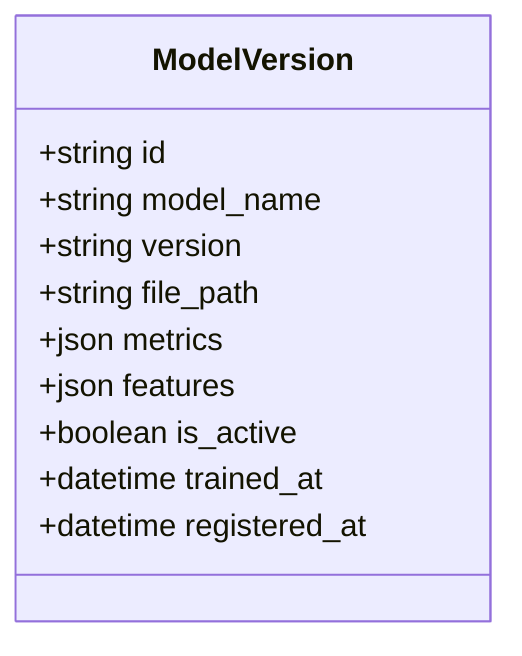

**Diagram sources**
- [models.py:94-104](file://backend/db/models.py#L94-L104)
- [repositories.py:98-110](file://backend/db/repositories.py#L98-L110)

**Section sources**
- [models.py:94-104](file://backend/db/models.py#L94-L104)
- [repositories.py:98-110](file://backend/db/repositories.py#L98-L110)

### FileRecord Entity Analysis
- Primary Key Strategy: UUID.
- Indexing: case_id indexed for retrieving files by case.
- Data Types:
  - file_type categorizes uploads (audio/document/qr_code/report).
  - mime_type and size_bytes describe file metadata.
- Business Logic:
  - Repository methods create and query files by case.
- Usage:
  - Supports storing and retrieving attachments linked to cases.

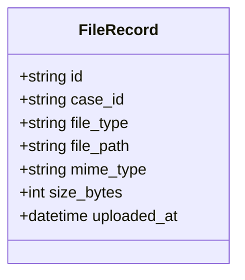

**Diagram sources**
- [models.py:106-115](file://backend/db/models.py#L106-L115)
- [repositories.py:112-124](file://backend/db/repositories.py#L112-L124)

**Section sources**
- [models.py:106-115](file://backend/db/models.py#L106-L115)
- [repositories.py:112-124](file://backend/db/repositories.py#L112-L124)

## Dependency Analysis
The dependencies flow from API routes to repositories to ORM models to the database engine. Schemas provide validation boundaries at the API layer.

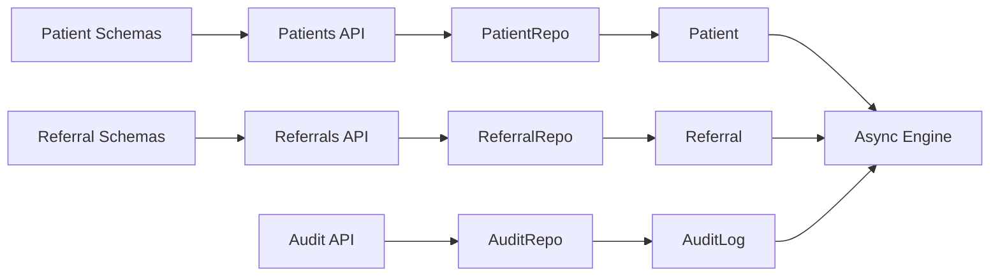

**Diagram sources**
- [patients.py:1-97](file://backend/api/routes/patients.py#L1-L97)
- [referrals.py:1-126](file://backend/api/routes/referrals.py#L1-L126)
- [audit.py:1-88](file://backend/api/routes/audit.py#L1-L88)
- [repositories.py:1-125](file://backend/db/repositories.py#L1-L125)
- [models.py:1-115](file://backend/db/models.py#L1-L115)
- [engine.py:1-37](file://backend/db/engine.py#L1-L37)
- [patient.py:1-57](file://backend/schemas/patient.py#L1-L57)
- [referral.py:1-28](file://backend/schemas/referral.py#L1-L28)

**Section sources**
- [patients.py:1-97](file://backend/api/routes/patients.py#L1-L97)
- [referrals.py:1-126](file://backend/api/routes/referrals.py#L1-L126)
- [audit.py:1-88](file://backend/api/routes/audit.py#L1-L88)
- [repositories.py:1-125](file://backend/db/repositories.py#L1-L125)
- [models.py:1-115](file://backend/db/models.py#L1-L115)
- [engine.py:1-37](file://backend/db/engine.py#L1-L37)
- [patient.py:1-57](file://backend/schemas/patient.py#L1-L57)
- [referral.py:1-28](file://backend/schemas/referral.py#L1-L28)

## Performance Considerations
- Indexing:
  - case_id is indexed on ClinicalRecord, Referral, AgentStateRecord, AuditLog, and FileRecord to optimize queries by case.
  - thread_id is indexed on AgentStateRecord for multi-threaded workflow state retrieval.
- Pagination:
  - Repositories use limit/offset for listing endpoints to control memory usage.
- JSON Fields:
  - Storing complex structures in JSON avoids schema changes but may impact query performance; consider denormalization if frequent filtering is required.
- Async I/O:
  - Async engine and sessions reduce blocking and improve throughput under concurrent loads.
- Defaults and Validation:
  - Default values reduce null checks; schema validation prevents invalid data entry early.

[No sources needed since this section provides general guidance]

## Troubleshooting Guide
- Common Issues:
  - Missing case_id: Ensure case_id is set when creating records to enable indexed lookups.
  - Invalid vitals: Validate ranges in schemas before submission to avoid rejections.
  - Not found errors: Verify IDs exist before updates; routes raise 404 when resources are missing.
- Debugging:
  - Enable debug mode to echo SQL statements via engine configuration.
  - Use audit logs to trace agent actions and identify failures.
- Recovery:
  - Transactions auto-rollback on exceptions; ensure proper session handling in custom code.

**Section sources**
- [engine.py:10-18](file://backend/db/engine.py#L10-L18)
- [audit.py:38-46](file://backend/api/routes/audit.py#L38-L46)
- [patients.py:78-80](file://backend/api/routes/patients.py#L78-L80)
- [referrals.py:106-108](file://backend/api/routes/referrals.py#L106-L108)

## Conclusion
MaaHifazat AI’s database layer centers around seven well-defined entities that support patient management, clinical documentation, referral workflows, agent state persistence, auditing, model versioning, and file storage. The design leverages UUID primary keys, strategic indexing on case_id and thread_id, and JSON fields for flexibility. Relationships are primarily one-to-many from Patient to ClinicalRecord and Referral, with other entities linked via case_id. Validation is enforced through Pydantic schemas, and async SQLAlchemy ensures scalable I/O. This architecture supports robust healthcare workflows with clear data integrity and traceability.

[No sources needed since this section summarizes without analyzing specific files]