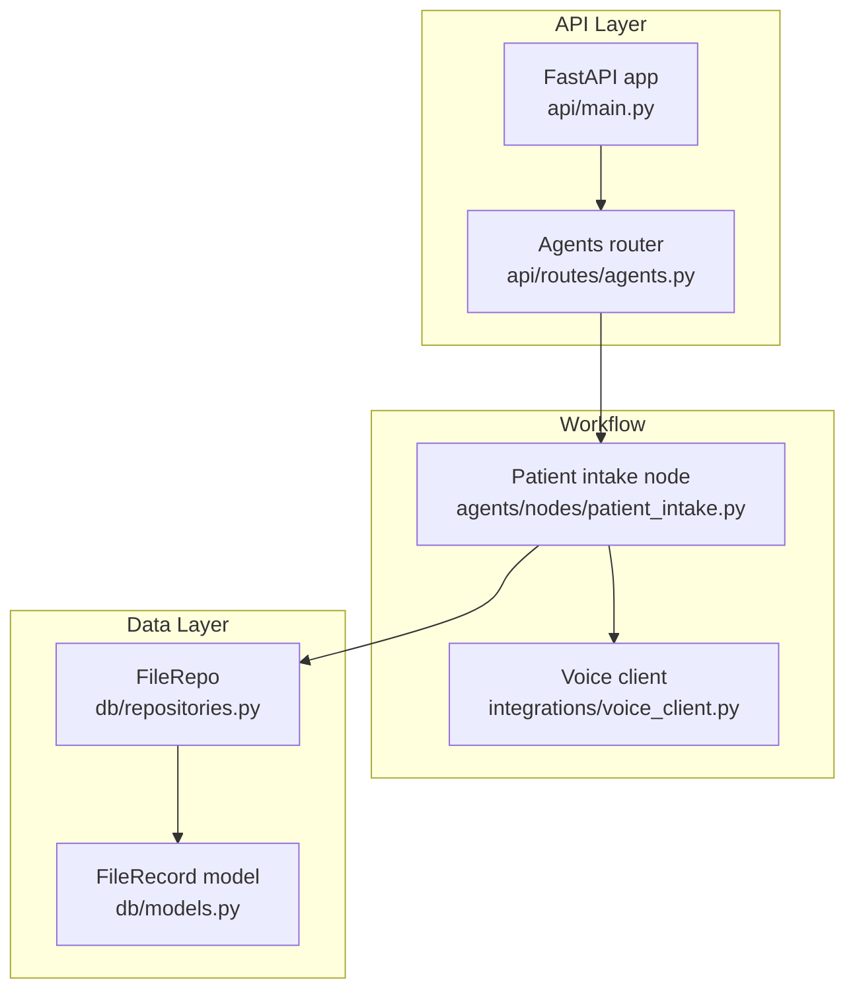
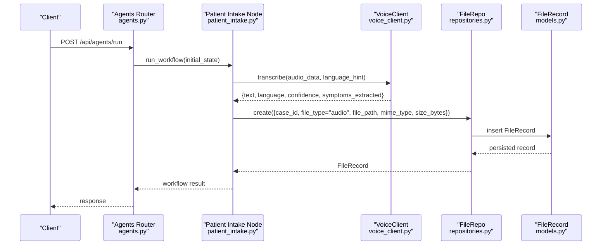
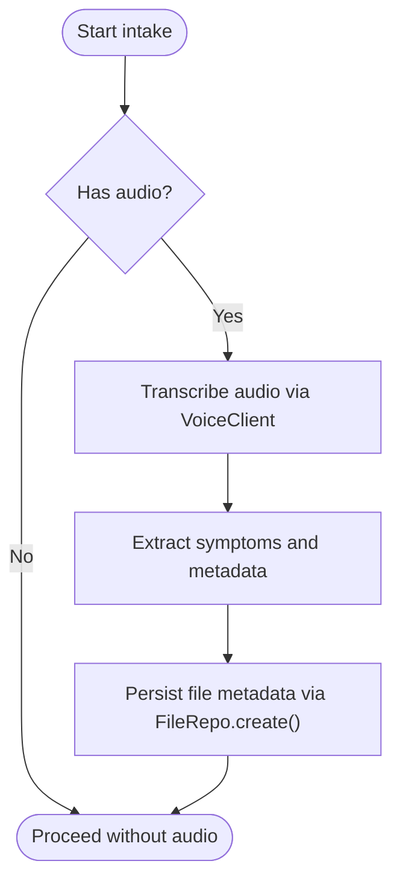
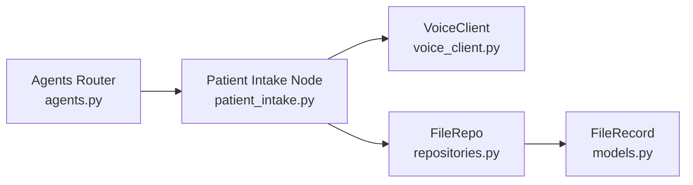

# File Record Entity

<cite>
**Referenced Files in This Document**
- [models.py](file://backend/db/models.py)
- [repositories.py](file://backend/db/repositories.py)
- [main.py](file://backend/api/main.py)
- [agents.py](file://backend/api/routes/agents.py)
- [patient_intake.py](file://backend/agents/nodes/patient_intake.py)
- [voice_client.py](file://backend/integrations/voice_client.py)
</cite>

## Table of Contents
1. [Introduction](#introduction)
2. [Project Structure](#project-structure)
3. [Core Components](#core-components)
4. [Architecture Overview](#architecture-overview)
5. [Detailed Component Analysis](#detailed-component-analysis)
6. [Dependency Analysis](#dependency-analysis)
7. [Performance Considerations](#performance-considerations)
8. [Troubleshooting Guide](#troubleshooting-guide)
9. [Conclusion](#conclusion)

## Introduction
This document explains the FileRecord entity used to manage uploaded files and documents within the healthcare workflow. It covers all fields, file type categorization, metadata storage, relationships with case_id, and how the system supports multi-channel communication (including voice messages). It also provides examples of upload handling, metadata extraction, and retrieval patterns using the repository layer.

## Project Structure
The FileRecord entity is defined as a database model and accessed via a repository. The API application wires routers for clinical workflows that may produce or consume files (e.g., audio recordings during patient intake).

**Diagram sources**
- [main.py:52-134](file://backend/api/main.py#L52-L134)
- [agents.py:62-114](file://backend/api/routes/agents.py#L62-L114)
- [patient_intake.py:61-79](file://backend/agents/nodes/patient_intake.py#L61-L79)
- [voice_client.py:14-22](file://backend/integrations/voice_client.py#L14-L22)
- [repositories.py:112-124](file://backend/db/repositories.py#L112-L124)
- [models.py:106-114](file://backend/db/models.py#L106-L114)

**Section sources**
- [main.py:52-134](file://backend/api/main.py#L52-L134)
- [agents.py:62-114](file://backend/api/routes/agents.py#L62-L114)

## Core Components
- FileRecord model defines the persistent schema for file metadata.
- FileRepo provides create and retrieval operations by case_id.
- Workflow nodes (e.g., patient_intake) can trigger processing of audio inputs and integrate with external voice services.

Key responsibilities:
- Store file metadata: id, case_id, file_type, file_path, mime_type, size_bytes, uploaded_at.
- Organize files per case for traceability and retrieval.
- Support multiple media types used in maternal health workflows.

**Section sources**
- [models.py:106-114](file://backend/db/models.py#L106-L114)
- [repositories.py:112-124](file://backend/db/repositories.py#L112-L124)

## Architecture Overview
The system uses an event-driven flow where incoming data (including audio) enters through agent workflows, which may call voice services and persist file metadata via repositories.

**Diagram sources**
- [agents.py:62-79](file://backend/api/routes/agents.py#L62-L79)
- [patient_intake.py:61-79](file://backend/agents/nodes/patient_intake.py#L61-L79)
- [voice_client.py:14-22](file://backend/integrations/voice_client.py#L14-L22)
- [repositories.py:116-120](file://backend/db/repositories.py#L116-L120)
- [models.py:106-114](file://backend/db/models.py#L106-L114)

## Detailed Component Analysis

### FileRecord Entity Schema
- id: Unique identifier for the file record.
- case_id: Associates the file with a specific patient case for organization and retrieval.
- file_type: Categorizes the file into one of: audio, document, qr_code, report.
- file_path: Storage path or URL to the actual file content.
- mime_type: Media type (e.g., audio/mp3, application/pdf, image/png, application/pdf for reports).
- size_bytes: Size of the file in bytes.
- uploaded_at: Timestamp when the file was recorded.

These fields enable consistent metadata storage across different media formats and support downstream processing such as transcription, document parsing, QR decoding, and report generation.

**Section sources**
- [models.py:106-114](file://backend/db/models.py#L106-L114)

### Repository Operations
- create(data): Inserts a new FileRecord row with provided metadata.
- get_by_case(case_id): Retrieves all file records associated with a given case_id.

These methods encapsulate persistence logic and are used by workflow nodes to persist file metadata after processing.

**Section sources**
- [repositories.py:112-124](file://backend/db/repositories.py#L112-L124)

### Workflow Integration: Audio Handling
During patient intake, if audio data is present, the workflow calls a voice service to transcribe speech and extract symptoms. After processing, the system can persist metadata about the audio file using FileRecord.

**Diagram sources**
- [patient_intake.py:61-79](file://backend/agents/nodes/patient_intake.py#L61-L79)
- [voice_client.py:14-22](file://backend/integrations/voice_client.py#L14-L22)
- [repositories.py:116-120](file://backend/db/repositories.py#L116-L120)

**Section sources**
- [patient_intake.py:61-79](file://backend/agents/nodes/patient_intake.py#L61-L79)
- [voice_client.py:14-22](file://backend/integrations/voice_client.py#L14-L22)
- [repositories.py:116-120](file://backend/db/repositories.py#L116-L120)

### File Type Categorization and Metadata Examples
- audio:
  - Use cases: Voice messages from patients, recorded consultations.
  - Typical metadata: mime_type like audio/mp3; size_bytes reflects recording length; uploaded_at captures capture time.
- document:
  - Use cases: Uploaded medical records, lab results, prescriptions.
  - Typical metadata: mime_type like application/pdf; size_bytes indicates document size; file_path points to stored PDF.
- qr_code:
  - Use cases: Scanned QR codes linking to patient records or test results.
  - Typical metadata: mime_type like image/png; file_path stores image; optional decoded payload can be referenced elsewhere.
- report:
  - Use cases: Generated clinical reports or summaries.
  - Typical metadata: mime_type like application/pdf; file_path references generated report; size_bytes tracks report size.

These categories allow the system to handle diverse media consistently while preserving essential metadata for retrieval and processing.

[No sources needed since this section provides conceptual guidance]

### Relationship with case_id
Files are organized by case_id, enabling:
- Aggregation of all artifacts (audio, documents, QR images, reports) per encounter.
- Efficient retrieval of all files related to a specific case.
- Clear audit trails linking media to clinical decisions.

Retrieval pattern:
- Use FileRepo.get_by_case(case_id) to list all files for a case.

**Section sources**
- [repositories.py:122-124](file://backend/db/repositories.py#L122-L124)

### Example Patterns

#### Upload Handling Pattern
- Validate incoming file and determine file_type based on extension or content.
- Compute size_bytes and set mime_type accordingly.
- Persist file to storage and record metadata via FileRepo.create().
- Associate with case_id to organize by patient encounter.

[No sources needed since this section describes a general pattern]

#### Metadata Extraction Pattern
- For audio: use voice service to obtain text, language, confidence, and extracted symptoms; store these insights alongside the file metadata.
- For documents: infer mime_type and size; optionally parse content to enrich metadata (e.g., title, author) in other stores.
- For QR codes: decode image to extract payload; link to relevant records.
- For reports: generate content, compute size, and store path.

[No sources needed since this section describes a general pattern]

#### Retrieval Pattern
- Query by case_id to retrieve all associated files.
- Filter by file_type to narrow results (e.g., only audio or only reports).
- Return metadata to clients for UI display or further processing.

**Section sources**
- [repositories.py:122-124](file://backend/db/repositories.py#L122-L124)

## Dependency Analysis
The FileRecord entity depends on the database engine and is consumed by the repository layer. Workflows interact with the repository to persist and retrieve file metadata.

**Diagram sources**
- [agents.py:62-114](file://backend/api/routes/agents.py#L62-L114)
- [patient_intake.py:61-79](file://backend/agents/nodes/patient_intake.py#L61-L79)
- [voice_client.py:14-22](file://backend/integrations/voice_client.py#L14-L22)
- [repositories.py:112-124](file://backend/db/repositories.py#L112-L124)
- [models.py:106-114](file://backend/db/models.py#L106-L114)

**Section sources**
- [agents.py:62-114](file://backend/api/routes/agents.py#L62-L114)
- [repositories.py:112-124](file://backend/db/repositories.py#L112-L124)
- [models.py:106-114](file://backend/db/models.py#L106-L114)

## Performance Considerations
- Indexing: Ensure case_id is indexed for efficient retrieval by case.
- Large files: Avoid storing large binaries in the database; store paths in FileRecord and keep files in object storage.
- Batch operations: When generating multiple reports or processing many files, batch repository calls to reduce DB round-trips.
- Caching: Cache frequent lookups for active cases to reduce repeated queries.

[No sources needed since this section provides general guidance]

## Troubleshooting Guide
- Missing case_id: If case_id is not set, files cannot be retrieved by case. Validate before creating FileRecord.
- Incorrect mime_type: Ensure correct MIME types to avoid client-side rendering issues.
- Duplicate entries: Prevent duplicates by checking existing records for the same file_path or case_id + file_type combinations.
- Voice transcription failures: Handle exceptions from voice services and log errors; still persist file metadata even if transcription fails.

**Section sources**
- [repositories.py:116-124](file://backend/db/repositories.py#L116-L124)
- [voice_client.py:14-22](file://backend/integrations/voice_client.py#L14-L22)

## Conclusion
The FileRecord entity provides a robust foundation for managing diverse file types in the healthcare workflow. By standardizing metadata and organizing files by case_id, it enables reliable retrieval, auditing, and integration with multi-channel communication systems. Combined with repository operations and workflow nodes, it supports audio processing, document handling, QR code management, and report generation across the platform.

[No sources needed since this section summarizes without analyzing specific files]