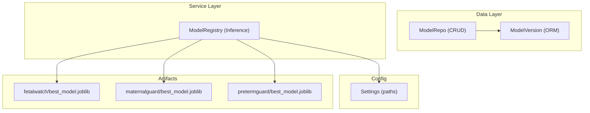
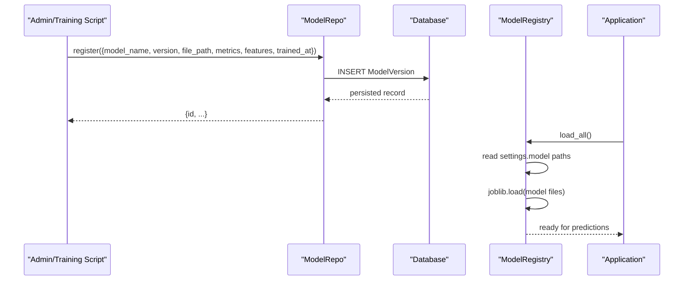
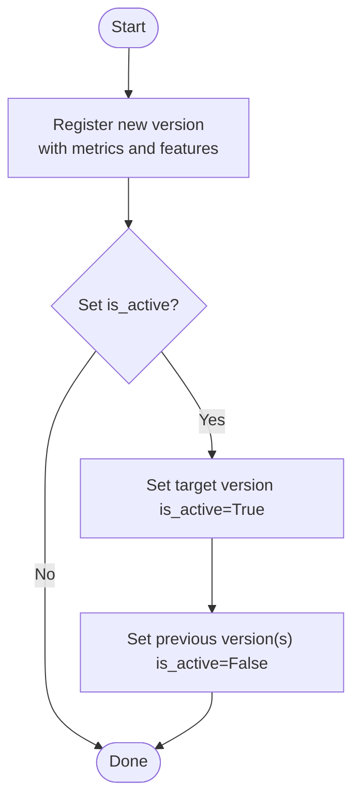
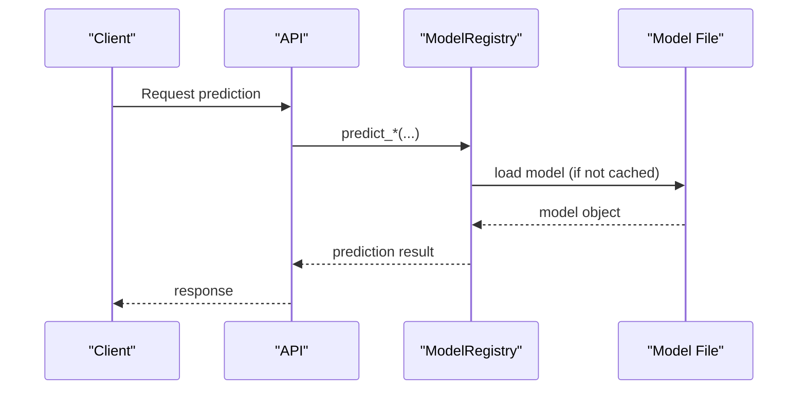
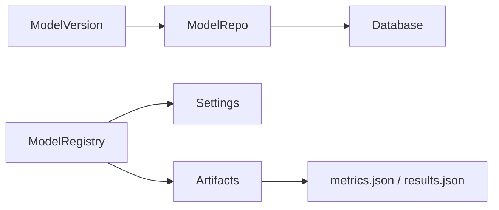

# Model Version Entity

<cite>
**Referenced Files in This Document**
- [models.py](file://backend/db/models.py)
- [repositories.py](file://backend/db/repositories.py)
- [inference.py](file://backend/services/inference.py)
- [config.py](file://backend/config.py)
- [results.json (FetalWatch)](file://artifacts/fetalwatch/results.json)
- [results.json (MaternalGuard)](file://artifacts/maternalguard/results.json)
- [results.json (PretermGuard)](file://artifacts/pretermguard/results.json)
- [metadata.json (CareReach)](file://artifacts/carereach/metadata.json)
</cite>

## Table of Contents
1. [Introduction](#introduction)
2. [Project Structure](#project-structure)
3. [Core Components](#core-components)
4. [Architecture Overview](#architecture-overview)
5. [Detailed Component Analysis](#detailed-component-analysis)
6. [Dependency Analysis](#dependency-analysis)
7. [Performance Considerations](#performance-considerations)
8. [Troubleshooting Guide](#troubleshooting-guide)
9. [Conclusion](#conclusion)
10. [Appendices](#appendices)

## Introduction
This document explains the ModelVersion entity that manages ML model metadata and versioning for the system’s model registry. It covers all fields, how versions are tracked for models such as FetalWatch, MaternalGuard, and PretermGuard, how performance metrics and feature lists are stored as JSON, and how the active model switching mechanism works via the is_active flag. It also describes integration with the inference system to ensure consistent model usage across the application and supports A/B testing by enabling multiple versions to be registered and selectively activated.

## Project Structure
The ModelVersion entity is defined in the ORM layer and used by repository methods to register and retrieve active versions. The inference service loads models from configured artifact paths at startup and provides prediction endpoints. Configuration maps logical model names to file paths under artifacts.

**Diagram sources**
- [models.py:94-104](file://backend/db/models.py#L94-L104)
- [repositories.py:98-110](file://backend/db/repositories.py#L98-L110)
- [inference.py:51-101](file://backend/services/inference.py#L51-L101)
- [config.py:13-21](file://backend/config.py#L13-L21)

**Section sources**
- [models.py:94-104](file://backend/db/models.py#L94-L104)
- [repositories.py:98-110](file://backend/db/repositories.py#L98-L110)
- [inference.py:51-101](file://backend/services/inference.py#L51-L101)
- [config.py:13-21](file://backend/config.py#L13-L21)

## Core Components
- ModelVersion (ORM): Stores metadata for each model version including identifiers, file path, metrics, features, activation status, and timestamps.
- ModelRepo: Provides methods to register a new version and fetch the currently active version per model name.
- ModelRegistry (Inference): Loads models into memory once at startup and exposes prediction functions for each model.

Key responsibilities:
- Persist model metadata and enable version control through explicit registration.
- Provide a single source of truth for the active model per model_name.
- Load and serve models consistently across the application.

**Section sources**
- [models.py:94-104](file://backend/db/models.py#L94-L104)
- [repositories.py:98-110](file://backend/db/repositories.py#L98-L110)
- [inference.py:51-101](file://backend/services/inference.py#L51-L101)

## Architecture Overview
The model registry integrates three layers:
- Persistence: ModelVersion records track versions and their metadata.
- Repository: CRUD operations to register versions and query the active one.
- Inference: Singleton registry loads models from configured artifact paths and serves predictions.

**Diagram sources**
- [repositories.py:102-110](file://backend/db/repositories.py#L102-L110)
- [inference.py:68-101](file://backend/services/inference.py#L68-L101)
- [config.py:13-21](file://backend/config.py#L13-L21)

## Detailed Component Analysis

### ModelVersion Entity
Fields and semantics:
- id: Unique identifier for the version record.
- model_name: Logical model identifier (e.g., fetalwatch, maternalguard, pretermguard).
- version: Semantic or build version string for this artifact.
- file_path: Path to the serialized model artifact on disk.
- metrics: JSON object storing performance metrics (e.g., macro_f1, auroc, per-class precision/recall/F1, confusion matrix).
- features: JSON array listing the input features expected by the model.
- is_active: Boolean flag indicating whether this version is the current production version for its model_name.
- trained_at: Timestamp when the model was trained.
- registered_at: Timestamp when this version was registered in the registry.

Active model switching:
- Only one version per model_name should be active at a time.
- To switch, set is_active=True for the desired version and False for others with the same model_name.
- Retrieval uses get_active(model_name) to return the active row.

JSON fields reference:
- Metrics examples can be found in the artifacts’ results/metadata files. For instance:
  - FetalWatch metrics include macro_f1, auroc_ovr_macro, per_class metrics, and confusion_matrix.
  - MaternalGuard metrics include macro_f1, auroc_ovr, per_class metrics, and feature_importance.
  - PretermGuard metrics include macro_f1, auroc_ovr_macro, per_class metrics, and confusion_matrix.
  - CareReach metadata includes a feature_list and training_date.

Examples of typical content:
- metrics: {"macro_f1": ..., "auroc_ovr_macro": ..., "per_class": {...}, "confusion_matrix": [...]}
- features: ["LB", "AC", "FM", "UC", "DL", "DS", "DP", "ASTV", "MSTV", "ALTV", "MLTV", "Width", "Min", "Max", "Nmax", "Nzeros", "Mode", "Mean", "Median", "Variance", "Tendency"]

**Section sources**
- [models.py:94-104](file://backend/db/models.py#L94-L104)
- [repositories.py:102-110](file://backend/db/repositories.py#L102-L110)
- [results.json (FetalWatch):1-249](file://artifacts/fetalwatch/results.json#L1-L249)
- [results.json (MaternalGuard):1-96](file://artifacts/maternalguard/results.json#L1-L96)
- [results.json (PretermGuard):1-164](file://artifacts/pretermguard/results.json#L1-L164)
- [metadata.json (CareReach):1-45](file://artifacts/carereach/metadata.json#L1-L45)

### Model Registry and Active Version Flow
The repository provides:
- register(data): Creates a new ModelVersion entry with provided metadata.
- get_active(model_name): Returns the currently active version for a given model_name.

Operational flow:
- After training, compute metrics and capture feature list; call register to persist the new version.
- Update is_active flags to promote the new version and demote the previous one.
- Inference services rely on configuration to load models; if you need runtime selection by version, extend the registry to resolve file_path from the active ModelVersion.

**Diagram sources**
- [repositories.py:102-110](file://backend/db/repositories.py#L102-L110)

**Section sources**
- [repositories.py:102-110](file://backend/db/repositories.py#L102-L110)

### Integration with Inference System
The inference service:
- Loads models at startup using configured artifact paths.
- Exposes prediction methods for each model (e.g., predict_fetal_health, predict_maternal_risk, predict_preterm_risk).
- Uses feature lists to validate inputs and handle missing columns gracefully.

Consistency and A/B testing:
- Use ModelVersion to track which artifact corresponds to which version and metrics.
- For A/B testing, maintain multiple versions in the registry and route traffic to different versions by adjusting which model file is loaded (via config or dynamic resolution based on active version).
- Ensure feature schemas match the registered features to avoid inference errors.

**Diagram sources**
- [inference.py:68-101](file://backend/services/inference.py#L68-L101)
- [inference.py:153-203](file://backend/services/inference.py#L153-L203)
- [inference.py:206-248](file://backend/services/inference.py#L206-L248)
- [inference.py:252-293](file://backend/services/inference.py#L252-L293)

**Section sources**
- [inference.py:68-101](file://backend/services/inference.py#L68-L101)
- [inference.py:153-203](file://backend/services/inference.py#L153-L203)
- [inference.py:206-248](file://backend/services/inference.py#L206-L248)
- [inference.py:252-293](file://backend/services/inference.py#L252-L293)

## Dependency Analysis
- ModelVersion depends on SQLAlchemy types and datetime utilities.
- ModelRepo depends on AsyncSession and SQLAlchemy queries to insert and select ModelVersion rows.
- Inference service depends on configuration for artifact paths and uses joblib to load models.
- Artifacts contain model binaries and evaluation outputs that inform metrics and features stored in ModelVersion.

**Diagram sources**
- [models.py:94-104](file://backend/db/models.py#L94-L104)
- [repositories.py:98-110](file://backend/db/repositories.py#L98-L110)
- [inference.py:68-101](file://backend/services/inference.py#L68-L101)
- [config.py:13-21](file://backend/config.py#L13-L21)

**Section sources**
- [models.py:94-104](file://backend/db/models.py#L94-L104)
- [repositories.py:98-110](file://backend/db/repositories.py#L98-L110)
- [inference.py:68-101](file://backend/services/inference.py#L68-L101)
- [config.py:13-21](file://backend/config.py#L13-L21)

## Performance Considerations
- Model loading is performed once at startup and cached in memory; repeated loads are avoided.
- Feature validation ensures robustness against missing columns by defaulting to zero, reducing inference failures.
- Storing large metrics JSONs in ModelVersion is acceptable for small-to-medium datasets; consider archiving heavy artifacts (e.g., confusion matrices) to object storage and keeping only summary metrics in the database for faster queries.
- When supporting many versions, index model_name and is_active to optimize active-version lookups.

[No sources needed since this section provides general guidance]

## Troubleshooting Guide
Common issues and resolutions:
- Model file not found: Ensure artifact paths in configuration point to existing files; check logs for warnings about missing model files.
- Prediction failures: Verify that input features match the registered feature list; missing keys will be filled with zeros but may degrade accuracy.
- Active version mismatch: Confirm that exactly one version per model_name has is_active=True; use get_active(model_name) to verify.
- Metrics inconsistency: Ensure metrics recorded in ModelVersion reflect the actual model artifact being served; update both after retraining.

**Section sources**
- [inference.py:103-130](file://backend/services/inference.py#L103-L130)
- [inference.py:153-203](file://backend/services/inference.py#L153-L203)
- [inference.py:206-248](file://backend/services/inference.py#L206-L248)
- [inference.py:252-293](file://backend/services/inference.py#L252-L293)

## Conclusion
The ModelVersion entity provides a robust foundation for tracking ML model versions, metadata, and performance. Combined with repository methods and the inference service, it enables reliable model registration, active version management, and consistent model serving. By maintaining accurate metrics and feature lists, teams can confidently roll out new versions, perform A/B tests, and monitor model performance over time.

[No sources needed since this section summarizes without analyzing specific files]

## Appendices

### Field Reference Summary
- id: String UUID primary key.
- model_name: String identifying the model family.
- version: String version tag.
- file_path: String path to the model artifact.
- metrics: JSON object containing performance metrics.
- features: JSON array listing expected input features.
- is_active: Boolean flag for active promotion.
- trained_at: DateTime timestamp of training completion.
- registered_at: DateTime timestamp of registry insertion.

**Section sources**
- [models.py:94-104](file://backend/db/models.py#L94-L104)

### Example Workflows

- Model Registration
  - Compute metrics and capture feature list after training.
  - Call register with data including model_name, version, file_path, metrics, features, and trained_at.
  - Set is_active=True for the new version and False for prior versions of the same model_name.

- Version Management
  - Query get_active(model_name) to identify the current production version.
  - Use repository updates to toggle is_active during promotions or rollbacks.

- Performance Tracking
  - Store summary metrics (e.g., macro_f1, auroc) and detailed per-class metrics in metrics JSON.
  - Keep feature lists aligned with model expectations to prevent inference drift.

- A/B Testing
  - Maintain multiple versions in the registry.
  - Route traffic to different versions by selecting which model file to load (via configuration or dynamic resolution based on active version).
  - Compare metrics across versions to evaluate improvements.

**Section sources**
- [repositories.py:102-110](file://backend/db/repositories.py#L102-L110)
- [inference.py:68-101](file://backend/services/inference.py#L68-L101)
- [results.json (FetalWatch):1-249](file://artifacts/fetalwatch/results.json#L1-L249)
- [results.json (MaternalGuard):1-96](file://artifacts/maternalguard/results.json#L1-L96)
- [results.json (PretermGuard):1-164](file://artifacts/pretermguard/results.json#L1-L164)
- [metadata.json (CareReach):1-45](file://artifacts/carereach/metadata.json#L1-L45)